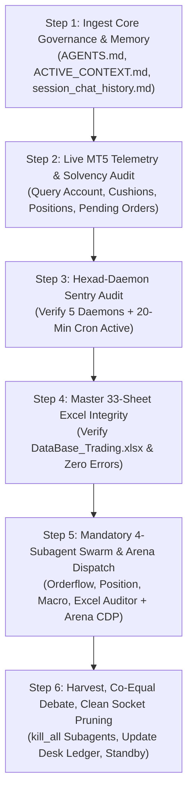

# 🚀 CROSS-ACCOUNT BOOTSTRAP & RE-ENGAGEMENT MASTER SOP
## Universal Turn-0 Reconnection Protocol for Blueberry Markets Autonomous Desk

> **Document Status**: CANONICAL PRODUCTION RE-ENGAGEMENT PROTOCOL  
> **Location**: `Data/Manditory/ACCOUNT_SWITCH_BOOTSTRAP_PROTOCOL.md`  
> **Purpose**: When the operator switches Gemini/Antigravity accounts, launches a new session, or re-engages after an interruption, the incoming agent MUST execute this exact sequence to achieve 100% operational continuity, restore all background daemons, verify account solvency, and resume autonomous 20-minute multi-agent execution with zero context amnesia.

---

## ⚡ OPERATOR QUICK-START TRIGGER (COPY & PASTE TO ANY NEW AGENT)

```markdown
Read and execute Data/Manditory/ACCOUNT_SWITCH_BOOTSTRAP_PROTOCOL.md immediately.
Verify MT5 connectivity, audit account solvency, verify all 5 persistent daemons, and launch the mandatory 4-subagent fleet and Arena.ai council for the current 20-minute cycle.
```

---

## 🏛️ PART 1: THE 6-STEP BOOTSTRAP ACTIVATION CHAIN

Whenever an agent receives the trigger or re-engages on a fresh session, execute these 6 steps sequentially without asking:



### STEP 1: INGEST CORE GOVERNANCE & MEMORY (ZERO AMNESIA)
1. **Token Preservation Mandate (Query AST Graph FIRST)**:
   - Always query the AST Knowledge Graph via `/graphify` or `python -m graphify query "<concept/symbol>"` (or MCP tool `query_graph_tool`) before reading large Python or code files. `graphify-out/graph.json` contains 7.4k parsed code nodes and relationships, providing instant structural context in <500 tokens.
2. **Physical Reading Gate (Read ALL Files Line-by-Line for Full Context)**:
   - The coordinator and all subagents MUST physically load and read ALL 12 active canonical files in `Data/Manditory/` line-by-line using `read_file` to ingest complete operational context and quantitative rigor (zero skimming, zero truncation):
     * `Data/Manditory/STANDARDIZED_TRADING_DECISION_CHAIN.md` (Canonical Quant Trading SOP & 5-Pillar Confluence Engine)
     * `Data/Manditory/AUTONOMOUS_WAKEUP_CHECKLIST.md` (Canonical Autonomous Wake-Up Checklist — read and executed in full depth, line-by-line)
     * `Data/Manditory/ACCOUNT_SWITCH_BOOTSTRAP_PROTOCOL.md` (Turn-0 Reconnection & Bootstrap Master Protocol)
     * `Data/Manditory/SUBAGENT_PROMPT_TEMPLATES.md` (Tier 2 Big Prompts for 4-Subagent Swarm on Gemini 3.8 Flash)
     * `Data/Manditory/ARENA_STANDARD_PROMPT_TEMPLATE.md` (3-Persona Affirmative Candidate Discovery Specification for Arena.ai)
     * `Data/Manditory/TOP_10_TRADE_EXECUTION_PITFALLS_AND_AUTOPSY.md` (Lethal trading traps, slippage autopsies, ratchet mechanics)
     * `Data/Manditory/32_SHEET_REAL_WORLD_PITFALL_AVOIDANCE_QUESTIONS.md` (32 forensic sheet inspection questions)
     * `Data/Manditory/OPERATOR_ISSUES_AND_RESOLUTIONS_CHECKLIST.md` (Operator-mandated resolutions & invariant tracker)
     * `Data/Manditory/CONTINUOUS_KAIZEN_SELF_IMPROVEMENT_PROTOCOL.md` (Session history learning & anti-regression protocol)
     * `Data/Manditory/GOAL.md` (Active mission anchor, target 5,500.00 USD, runway to Oct 23, 2026)
     * `Data/Manditory/PASS_BLUEBERRY_PHASE_1_BY_OCT_23_2026.md` (Challenge rules, 4,775 USD floor, 4,795 USD buffer)
     * `Data/Manditory/ANTIGRAVITY_ARENA_THINKING_CHAIN_COUNCIL_PROTOCOL.md` (Council thinking chain & dialectic synthesis)
   - Also physically load and review:
     * `.agents/rules/ACTIVE_CONTEXT.md` (Real-time live account state, open positions, floor cushions)
     * `.agents/memory/session_chat_history.md` (Full conversation trajectory, past setbacks, operator directives — zero amnesia)
3. **Compliance Header**: Emit the mandatory acknowledgment line at the top of your response:
   ```
   ✅ AGENTS.md fully loaded — All 12 Core Domains & Execution Protocols Activated.
   > 📚 Active Skills Loaded & Applied: @[quant-analyst], @[clean-code], @[systematic-debugging]
   ```

### STEP 2: LIVE MT5 TELEMETRY & SOLVENCY SENTRY
1. Initialize MetaTrader 5 and export fresh telemetry to `Data/telemetry/mt5_account_telemetry.json`:
   ```bash
   python -c "
   import json, pathlib, datetime, MetaTrader5 as mt5
   ROOT = pathlib.Path('.')
   if mt5.initialize():
       acc = mt5.account_info()
       positions = mt5.positions_get()
       orders = mt5.orders_get()
       pos_list = [{'ticket': p.ticket, 'symbol': p.symbol, 'direction': 'BUY' if p.type == 0 else 'SELL', 'volume': p.volume, 'price_open': p.price_open, 'sl': p.sl, 'tp': p.tp, 'profit_usd': p.profit} for p in (positions or [])]
       order_list = [{'ticket': o.ticket, 'symbol': o.symbol, 'direction': 'BUY_LIMIT' if o.type == 2 else 'SELL_LIMIT' if o.type == 3 else str(o.type), 'volume': o.volume_current, 'price_open': o.price_open, 'sl': o.sl, 'tp': o.tp} for o in (orders or [])]
       telemetry = {
           'timestamp': datetime.datetime.now(datetime.timezone.utc).isoformat(),
           'account': {
               'balance_usd': acc.balance, 'equity_usd': acc.equity, 'margin_usd': acc.margin,
               'margin_free_usd': acc.margin_free, 'margin_level': acc.margin_level,
               'hard_floor_cushion_usd': round(acc.equity - 4775.0, 2),
               'operating_buffer_cushion_usd': round(acc.equity - 4795.0, 2)
           },
           'open_positions_count': len(pos_list), 'open_positions': pos_list,
           'pending_orders_count': len(order_list), 'pending_orders': order_list
       }
       out_path = ROOT / 'Data' / 'telemetry' / 'mt5_account_telemetry.json'
       out_path.parent.mkdir(parents=True, exist_ok=True)
       with open(out_path, 'w', encoding='utf-8') as f: json.dump(telemetry, f, indent=2)
       print('MT5 Connected: Equity =', acc.equity, 'Floor Cushion =', telemetry['account']['hard_floor_cushion_usd'])
       mt5.shutdown()
   "
   ```
2. Verify Inviolable Solvency Cushions:
   - Hard Floor (4,775.00 USD): Equity - 4,775.00 USD must be strictly positive (Never breach under any condition).
   - Operating Buffer (4,795.00 USD): Equity - 4,795.00 USD (+20.00 USD defense cushion).
   - Worst-Case Stressed Post-Loss Equity: `Equity - sum(Risk_i * 1.25 + 2.00) >= 4,795.00 USD`.


### STEP 2.1: POSITION CAPACITY, LIMIT ORDER ACCOUNTING & AUTONOMOUS AUTHORITY (OPERATOR MANDATE)
1. **Max 4 Running Filled Positions**: The desk is authorized to maintain up to 4 concurrent running (filled) positions across orthogonal asset clusters.
2. **Limit Order Slot Rule**: A slot is considered filled ONLY when an order is filled into an active position. Resting/pending limit orders do NOT consume capacity slots! Limit orders may be pre-staged at structural whale shelves without blocking capacity.
3. **Full Autonomous Trading Rights**: Antigravity has full autonomous rights to punch, delete, cancel, or modify orders and trailing stops in MetaTrader 5 without seeking manual operator approval.
4. **Dynamic Buffer Defense**: Single filled trades risk 15.00–20.00 USD nominal. Once a filled position reaches Early-BE (+0.75R to +0.80R), its stop is ratcheted to Entry + 0.10R0, dropping risk to 0.00 USD and instantly freeing risk capacity for subsequent fills while preserving the 4,795.00 USD operating buffer.

### STEP 3: HEXAD-DAEMON SENTRY AUDIT & AUTO-RESTART (IN ANTIGRAVITY TASK MANAGER)
> 🛑 **MANDATORY DAEMON LIFECYCLE INVARIANT (STRICT OPERATOR DIRECTIVE)**:
> Upon instantiation or account re-engagement, the coordinator MUST call `manage_task(Action='list')` to audit the 5 authorized persistent background processes running inside Antigravity's task manager.
> External orphan processes not registered in `manage_task` DO NOT trigger Antigravity's reactive wake-up system!
> If ANY of the 5 authorized daemons is absent from `manage_task(Action='list')`, the coordinator MUST IMMEDIATELY launch it using the exact parameters below before proceeding:

1. **Daemon 1 (Continuous 33-Sheet Excel Pipeline Daemon)**:
   - Tool Call: `run_command(CommandLine="python Data/Excel_Modules/Run_Parallel_Pipeline.py --continuous --gap 300 --workers 1", IsDaemon=true, WaitMsBeforeAsync=500, toolSummary="Launch Continuous 33-Sheet Excel Pipeline Daemon")`
   - Setting: `IsDaemon=true`, `WaitMsBeforeAsync=500`
   - Purpose: Cycles full pipeline continuously with an exact 5-minute (300s) cooldown gap between cycles. Maintains fresh orderbook, CVD, liq maps, and technical data in `Data/DataBase_Trading.xlsx` with zero race conditions (workers=1 atomic safety).

2. **Daemon 2 (20-Minute Cron Sentry)**:
   - Tool Call: `schedule(CronExpression="0,20,40 * * * *", IsDaemon=true, Prompt="20-MINUTE AUTONOMOUS WAKE-UP AUDIT (MANDATORY CANONICAL QUANT SOP):\n1. MANDATORY GOVERNANCE & MEMORY INGESTION: Sequentially execute and audit all sections of @[Data/Manditory/AUTONOMOUS_WAKEUP_CHECKLIST.md] and @[Data/Manditory/ACCOUNT_SWITCH_BOOTSTRAP_PROTOCOL.md] line-by-line in full depth.\n2. AST KNOWLEDGE GRAPH & TOKEN PRESERVATION: Query /graphify or python -m graphify query before reading large files.\n3. MASTER 33-SHEET EXCEL INTEGRITY: Verify all 33 sheets of Data/DataBase_Trading.xlsx (Liquidation Ladders Sheets 10-17 & 22, Retail Stops Map Sheet 23, Whale Bunkers Sheets 18 & 25, CVD Delta Sheet 26, Auction Structure Sheet 33). Verify <= 15m freshness and 0 formula errors.\n4. SUBAGENT SWARM DISPATCH: Immediately invoke 4 subagents (Model='flash' - Gemini 3.8 Flash) using Tier 2 Big Prompts from Data/Manditory/SUBAGENT_PROMPT_TEMPLATES.md citing @[Data/Manditory/STANDARDIZED_TRADING_DECISION_CHAIN.md]: Orderflow Analyst, Position Manager, Macro Risk Analyst, Excel Data Quality Auditor.\n5. ARENA.AI CANDIDATE DISCOVERY DISPATCH: Ingest affirmative candidate discovery prompt to Arena.ai via Chrome CDP port 9222, tasking Arena.ai to evaluate all 156 assets across 3 quantitative personas (Orderflow Analyst, Position Manager, Macro Risk Analyst — excluding Excel checker) for high-confluence trade candidates.\n6. PRE-CONDITION TRIGGER CHECKLIST & CONFLUENCE EVALUATION: Cross-verify subagent research against Arena.ai output. Check Pre-Condition Trigger Checklist across the entire 156-asset universe (Crypto, Forex, Metals, Indices) across liquidation maps, stop sweeps, whale persistence (>= 180s), CVD absorption, and dynamic friction gates.\n7. AUTONOMOUS MT5 EXECUTION: If all checkable pre-conditions pass, immediately punch passive limit order into MT5. If conditions not met, strictly maintain 100% flat cash defense.\n8. CLEAN PRUNING: Cleanly prune subagents via manage_subagents(Action='kill_all'). Stand by for next trigger.")`
   - Purpose: Autonomous wake-up at 20th, 40th, and 60th/00th minute for systematic desk audits ensuring parent agent strictly executes all checklists and SOPs line-by-line in complete depth.

3. **Daemon 3 (Arena Completion Daemon)**:
   - Tool Call: `run_command(CommandLine="python Terminal/arena_completion_daemon.py --daemon", IsDaemon=true, WaitMsBeforeAsync=500, toolSummary="Launch Arena Completion Daemon")`
   - Setting: `IsDaemon=true`, `WaitMsBeforeAsync=500`
   - Purpose: Monitors Chrome CDP (port 9222) continuously. The instant Arena.ai completes its response, it auto-harvests the full output into `docs/trade_plans/ARENA_LATEST_RAW.md` and wakes up Antigravity for joint evaluation.

4. **Daemon 4 (Autonomous 5-Minute Git Sync Daemon)**:
   - Tool Call: `run_command(CommandLine="python Terminal/Data_Factory/autonomous_git_sync_daemon.py", IsDaemon=true, WaitMsBeforeAsync=500, toolSummary="Launch Autonomous Git Sync Daemon")`
   - Setting: `IsDaemon=true`, `WaitMsBeforeAsync=500`
   - Purpose: Runs continuously every 5 minutes (300s). Stages all modified and new workspace files (`git add -A`), validates `Data/DataBase_Trading.xlsx` zip CRC integrity before committing, commits with timestamped provenance, and pushes cleanly to `origin/main`. Guarantees zero local/remote desynchronization with zero manual intervention.

5. **Daemon 5 (AST Graphify Watcher Daemon)**:
   - Tool Call: `run_command(CommandLine="python Terminal/run_graphify_watcher.py", IsDaemon=true, WaitMsBeforeAsync=500, toolSummary="Launch AST Graphify Watcher Daemon")`
   - Setting: `IsDaemon=true`, `WaitMsBeforeAsync=500`
   - Purpose: Continuous low-RAM AST watcher monitoring `Terminal/` and `Engine/` to synchronize code graph memory without token waste.

6. **Daemon 6 (Gemini Web2API Council Daemon — Endogen Architecture - Token Preservation)**:
   - Tool Call: `run_command(CommandLine="python C:\Users\SIGMA\Documents\Trading\gemini-web2api\gemini_web2api.py --config C:\Users\SIGMA\Documents\Trading\gemini-web2api\config.json", IsDaemon=true, WaitMsBeforeAsync=1000, toolSummary="Launch Gemini Web2API Daemon on port 8081")`
   - Setting: `IsDaemon=true`, `WaitMsBeforeAsync=1000`
   - Purpose: Continuous OpenAI-compatible reverse-proxy daemon on `http://localhost:8081` (Auth: `Bearer sk-gemini`). Provides zero-token auxiliary multi-agent councils with Gemini models, drastically saving context tokens for auxiliary analyses.

*Verification Gate*: Re-run `manage_task(Action='list')` to verify all 6 tasks report `Status: RUNNING` and have valid `taskId` values assigned.

---

### STEP 4: MASTER 33-SHEET EXCEL INTEGRITY GATE
Verify that `Data/DataBase_Trading.xlsx` is fresh, uncorrupted, and has zero formula errors:
- Path: `Data/DataBase_Trading.xlsx` (Size ~12.9 to 13.7 MB).
- Check that all 33 sheets (including Sheet 30 '20_Auction_Market_Structure' and Sheet 33 'ETF_Market_Overview') load cleanly via `openpyxl`.
- Attest that formula errors (`#REF!`, `#DIV/0!`, `#N/A`, `#VALUE!`, `#NAME?`, `#NUM!`, `#NULL!`) count = 0 across all cells.

---

### STEP 5: SIMULTANEOUS DUAL-TRACK DISPATCH (MANDATORY TIER 2 BIG PROMPTS ONLY)
> 🛑 **MANDATORY BIG PROMPT INVARIANT (STRICT OPERATOR DIRECTIVE)**:
> The coordinator is **strictly FORBIDDEN** from dispatching lightweight, summarized, or truncated prompts to subagents.
> On EVERY turn, cycle, and bootstrap re-engagement, the coordinator MUST copy and inject the **FULL UNABRIDGED TIER 2 BIG PROMPTS** (~350–500 tokens each) from `Data/Manditory/SUBAGENT_PROMPT_TEMPLATES.md` (Part 2) into each subagent.
> Every subagent prompt MUST explicitly include `@[Data/Manditory/STANDARDIZED_TRADING_DECISION_CHAIN.md]` as the first non-bypassable reading requirement. Short prompts fail to audit all 33 sheets line-by-line and are considered an immediate protocol violation.

1. **Track A (Internal Subagent Fleet Invocation with Tier 2 Big Prompts — Gemini 3.8 Flash)**:
   - Immediately invoke all 4 specialized subagents simultaneously using `invoke_subagent` (`Model='flash'` - Gemini 3.8 Flash):
     * **Subagent 1: Orderflow Analyst** (`Role='Orderflow Analyst', Model='flash'` - Gemini 3.8 Flash): Injected with Full Tier 2 Big Prompt covering Sheets 00–28, 30 (`20_Auction_Market_Structure`), mandatory citation of `STANDARDIZED_TRADING_DECISION_CHAIN.md`, full 156-asset universe scan (`Terminal/multi_asset_opportunity_scanner.py`), dynamic spread gates across Forex/Commodities/Indices/Crypto, 5-pillar confluence, L2/L3 orderbook depth, resting whale bunkers, CVD divergence, and Potential Candidate Radar Checklist.
     * **Subagent 2: Position Manager** (`Role='Position Manager', Model='flash'` - Gemini 3.8 Flash): Injected with Full Tier 2 Big Prompt covering mandatory citation of `STANDARDIZED_TRADING_DECISION_CHAIN.md`, MT5 telemetry, ratchet progression, stressed capacity audit strictly enforcing 1-position slot under +$39.83 buffer, and ticket sizing.
     * **Subagent 3: Macro Risk Analyst** (`Role='Macro Risk Analyst', Model='flash'` - Gemini 3.8 Flash): Injected with Full Tier 2 Big Prompt covering mandatory citation of `STANDARDIZED_TRADING_DECISION_CHAIN.md`, Sheet 28 `19_Calendar`, `macro_calendar.json`, ETF flows, CEX netflows, session clock, and rollover embargo.
     * **Subagent 4: Excel Data Quality Auditor** (`Role='Excel Data Quality Auditor', Model='flash'` - Gemini 3.8 Flash): Injected with Full Tier 2 Big Prompt covering mandatory citation of `STANDARDIZED_TRADING_DECISION_CHAIN.md`, 33-sheet coverage, CRC checks, zero formula errors, header verification, and pipeline daemon health.
2. **Track B (Parallel Arena.ai 3-Persona Candidate Discovery Dispatch)**:
   - PARALLEL TO SUBAGENT INVOCATION, dispatch the affirmative 3-persona candidate discovery prompt citing `STANDARDIZED_TRADING_DECISION_CHAIN.md` to Arena.ai via Chrome CDP on port 9222:
     `python Terminal/dispatch_arena_redteam.py`
   - Arena.ai begins generation on Chrome CDP simultaneously, embodying all 3 quantitative personas (Orderflow Analyst, Position Manager, Macro Risk Analyst — excluding Excel auditor) to discover and formulate high-confluence candidates across all 156 assets with unconstrained deep mathematical reasoning.

---

### STEP 6: REACTIVE HARVEST, ARENA OUTPUT EVALUATION, CO-EQUAL DEBATE & PRUNING
1. **Reactive Auto-Wakeup**: Standby for incoming messages. When the subagents finish or when `arena_completion_daemon.py` detects completion, Antigravity wakes up reactively with zero token polling.
2. **Mandatory Arena.ai Evaluation**: Immediately read `docs/trade_plans/ARENA_LATEST_RAW.md` harvested by the daemon. Thoroughly evaluate Arena.ai's ruling, entry/SL/TP critiques, 17-gate audit, and mathematical proofs.
3. **Co-Equal Council Synthesis & Dialectic Debate**:
   - Synthesize Arena.ai's critique with the independent findings of all 4 subagents.
   - If mathematical confluence, resting whale defense, and Anti-Knife contracts are validated: punch live limit order into MT5.
   - If market momentum flushes toward un-swept stops or safe stops exceed the risk budget: issue unanimous **STAND ASIDE IN 100% CASH** and update the Candidate Radar Checklist.
4. **Clean Socket Pruning Mandate**: Immediately execute `manage_subagents(Action='kill_all')` to terminate all SSE connections and prevent Windows socket exhaustion.
5. **Desk Ledger Update**: Update `docs/trade_plans/LIVE_COLLABORATIVE_ORDER_DESK.md`, `ACTIVE_CONTEXT.md`, and append turn to `.agents/memory/session_chat_history.md`.
6. **5-Minute Git Sync**: Daemon 4 automatically pushes all committed state to `origin/main` within its 300s window.
7. **Dual-Repo Sync**: Synchronize dual-repo parity via `python .agents/scripts/verify_and_sync_agents.py`.

---

## 🔒 PERPETUAL GOAL INVARIANTS (NEVER COMPROMISED)
1. **Perpetual Goal Contract**: Under NO circumstances may `<!-- GOAL_COMPLETE -->` or `<!-- GOAL_CANCELLED -->` be emitted until live equity >= 5,500.00 USD is proven on MetaTrader 5.
2. **Inviolable Hard Floor**: 4,775.00 USD must NEVER be breached under any condition (0 exceptions).
3. **Operating Buffer Defense**: 4,795.00 USD (+20.00 USD cushion) strictly preserved under worst-case 1.25x slippage stress.
4. **Strict Passive Limit Execution**: Passive limit orders only, safely anchored behind resting institutional whale walls (>= $100K to $1M+, persisting >= 180s). Zero market orders crossing the spread.
5. **Zero Token Polling**: Polling timers <= 60s are permanently banned. Rely strictly on native event-driven reactive wakeups and the 20-minute cron sentry (`0,20,40 * * * *`).
6. **Plain-Text Formatting**: Zero raw LaTeX delimiters (`$` or `$$`) in chat responses; write plain-text variables and USD amounts.
