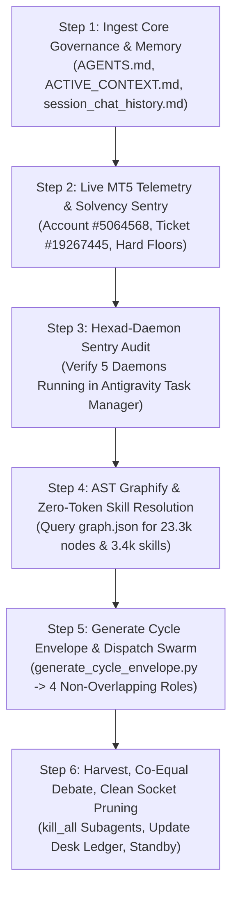

# 🚀 CROSS-ACCOUNT BOOTSTRAP & RE-ENGAGEMENT MASTER SOP
## Universal Turn-0 Reconnection Protocol for Blueberry Markets Autonomous Desk

> **Document Status**: CANONICAL PRODUCTION RE-ENGAGEMENT PROTOCOL (MANDATORY TURN-0 STUDY)  
> **Location**: `Data/Manditory/ACCOUNT_SWITCH_BOOTSTRAP_PROTOCOL.md`  
> **Target Account**: Blueberry Markets MT5 Account #5064568 (Raw Spread CFD/Perpetual)  
> **Mission**: Pass Phase 1 Challenge (Target: 5,500.00 USD) before Friday, 23rd October 2026 (23:59 UTC).  
> **Purpose**: When switching Gemini/Antigravity accounts, launching a new chat session, or re-engaging after an interruption, the incoming agent MUST execute this exact protocol to achieve 100% operational continuity, restore/verify all background daemons, verify account solvency, and resume autonomous execution with ZERO context amnesia.

---

## ⚡ OPERATOR QUICK-START TRIGGER (COPY & PASTE TO ANY NEW AGENT)

```markdown
Read and execute Data/Manditory/ACCOUNT_SWITCH_BOOTSTRAP_PROTOCOL.md immediately.
Verify MT5 connectivity, audit account solvency, verify all 5 persistent daemons, check active Ticket #19267445, query the AST knowledge graph via graphify, and resume cycle execution using the non-overlapping 4-quant subagent swarm and dual frontier council.
```

---

## 🏛️ PART 1: THE 6-STEP BOOTSTRAP ACTIVATION CHAIN

Whenever an agent receives the trigger or re-engages in a fresh session, execute these 6 steps sequentially without asking:



---

### STEP 1: INGEST CORE GOVERNANCE & MEMORY (ZERO AMNESIA)

1. **Token Preservation Mandate (Query AST Graph FIRST)**:
   - Always query the AST Knowledge Graph via `python -m graphify query "<concept/symbol>"` before reading large code or skill files.
   - `graphify-out/graph.json` contains **23,326 nodes, 27,991 edges, and 3,478 skill nodes**, providing instant structural context in <200 tokens without burning context budget.

2. **Physical Reading Gate (Read Canonical Governance in `Data/Manditory/`)**:
   - The coordinator and subagents MUST review the updated canonical governance:
     * `Data/Manditory/STANDARDIZED_TRADING_DECISION_CHAIN.md` (Step 2 Hard Authorization + Calibrated Ranking; Step 8/9 `lot*` broker-native structural sizing)
     * `Data/Manditory/AUTONOMOUS_WAKEUP_CHECKLIST.md` (Step 0 Immutable Cycle Envelope; Step 12 Validated Joint Completion & 20-min Quiet Interval)
     * `Data/Manditory/SUBAGENT_PROMPT_TEMPLATES.md` (4 Non-Overlapping Institutional Roles: Role A, B, C, D + Dialectic Round 2)
     * `Data/Manditory/TOP_10_TRADE_EXECUTION_PITFALLS_AND_AUTOPSY.md` (22 Lethal Pitfalls + Ex-Ante 22-Control Checklist)
     * `Data/Manditory/CONTINUOUS_KAIZEN_SELF_IMPROVEMENT_PROTOCOL.md` (Falsifiable Funnel Section 2.5 + Open Defect Ledger D11–D16)
     * `Data/Manditory/Arena_GLM_Standard_Prompt.md` (Static Council Review Protocol & JSON output schema)
     * `.agents/rules/ACTIVE_CONTEXT.md` (Real-time live account state, open positions, floor cushions)
     * `.agents/memory/session_chat_history.md` (Full conversation trajectory, past setbacks, operator directives)

3. **Mandatory Header Compliance**:
   Every response from the agent must begin with:
   ```markdown
   ✅ AGENTS.md fully loaded — All 12 Core Domains & Execution Protocols Activated.
   > 📚 **Active Skills Loaded & Applied:** @[clean-code], @[karpathy-guidelines], @[systematic-debugging]
   
   [🔓OMNI-Ω]
   ```
   *(Strictly zero raw LaTeX `$` or `$$` delimiters in chat; use plain text and unicode only).*

---

### STEP 2: LIVE MT5 TELEMETRY & SOLVENCY SENTRY

1. **Query MetaTrader 5 Telemetry**:
   ```python
   import MetaTrader5 as mt5
   mt5.initialize()
   acc = mt5.account_info()._asdict()
   positions = [p._asdict() for p in mt5.positions_get()]
   orders = [o._asdict() for o in mt5.orders_get()]
   mt5.shutdown()
   ```

2. **Current Ground-Truth Baseline (Account #5064568)**:
   - **Realized Balance**: **4,799.88 USD**
   - **Floating Equity**: **~4,836+ USD** (Floating in green profit on Ticket #19267445)
   - **Margin Used**: 2,451.00 USD | **Free Margin**: ~2,385+ USD (Margin Level: ~197%)
   - **Hard Floor (4,600.00 USD)**: Cushion: **+236+ USD** (Inviolate, 0.00% breach probability)
   - **Operating Buffer (4,650.00 USD)**: Cushion: **+186+ USD** (Defended)
   - **Solvency Kernel (4,795.00 USD)**: Cushion: **+41+ USD** (Realized Balance Headroom: **+2.88 USD net**)

3. **Active Position Sentry (Ticket #19267445 — `BTCUSD.pi` Short)**:
   - **Symbol / Side**: `BTCUSD.pi` Short (SELL) `0.06 lot` @ `81,700.00 USD`
   - **Stop Loss**: `81,640.00 USD` (Early-BE locked in MT5 terminal, +$3.60 USD profit, 100% risk-free)
   - **Take Profit**: `80,600.00 USD` (+2.75 R0 / +$66.00 USD gross gain)
   - **Next Ratchet**: Mark <= `81,040.00 USD` (+1.65 R0) -> advance SL to `81,300.00 USD` (+1.00 R0 / +$24.00 USD locked profit).
   - **Runner Ratchet**: Mark <= `80,820.00 USD` (+2.20 R0) -> advance SL to `81,060.00 USD` (+1.60 R0 runner profit).
   - **Downside Risk**: **0.00 USD** (No capital at risk).
   - **Pending Orders**: **0** (100% Flat Cash Defense on Slots 2, 3, 4).

---

### STEP 3: PERSISTENT BACKGROUND DAEMONS AUDIT (IN ANTIGRAVITY TASK RUNNER)

The agent MUST verify via `manage_task(Action='list')` that all 5 persistent daemons are active:

| Task / Daemon | Script Command | Frequency / Port | Purpose |
|---|---|---|---|
| **Daemon 1** | `python Terminal/Data_Factory/autonomous_telemetry_git_daemon.py` | Every 60s | Pushes git commits & telemetry to GitHub `main` |
| **Daemon 2** | `python Terminal/Data_Factory/heretic_daemon.py` | Port 8083 | Quantitative heretic microstructure service |
| **Daemon 3** | `python Terminal/arena_completion_daemon.py --daemon` | Port 9222 (CDP) | Monitors Arena.ai & Z.ai completions, auto-harvests RAW output |
| **Daemon 4** | `python Terminal/goal_trade_monitor.py --daemon --gap 10` | Every 10s | Continuous MT5 ratchet sentry, auto-locks profits to terminal |
| **Daemon 5** | `python Terminal/Data_Factory/run_unified_30_sheets_cycle.py --continuous --interval 300` | Every 300s | Continuous 33-sheet master Excel data warehouse pipeline |

*Auto-Recovery*: If any daemon terminated, immediately relaunch it with `run_command(CommandLine="...", IsDaemon=true, WaitMsBeforeAsync=500)`.

---

### STEP 4: AST GRAPHIFY & ZERO-TOKEN SKILL RESOLUTION

1. **Why Graphify Skills?**:
   - The workspace contains hundreds of specialized skills in `.agents/skills/` and `~/.gemini/config/skills/`.
   - Physically reading entire 200–500 line `SKILL.md` files burns 3,000–6,000 context tokens per turn and causes context rot.
   - All skills have been indexed into `graphify-out/graph.json` (**3,478 skill-related nodes**).
   - Querying `python -m graphify query "<skill_name>"` extracts the exact phase breakdown, rules, and line references in **<200 tokens** (95% token savings).

2. **RAM Optimization Mandate**:
   - If system RAM exceeds 80% or if processes lag:
     `powershell -ExecutionPolicy Bypass -File scripts/free_ram.ps1`
   - Safely trims process working sets via `EmptyWorkingSet`, purges OS standby cache, and cleans zombie nodes without interrupting daemons or browser CDP sessions.

---

### STEP 5: IMMUTABLE CYCLE ENVELOPE GENERATION & 4-QUANT SWARM DISPATCH

1. **Generate Cycle Envelope**:
   ```bash
   python Terminal/generate_cycle_envelope.py "<cycle_id>"
   ```
   Writes `Data/cycle_envelope.json` with commit hash, manifest SHA-256, workbook SHA-256, reconciled account telemetry, and market clock clearance.

2. **Dispatch 4 Non-Overlapping Subagents (Fable 5)**:
   Invoke in parallel using `invoke_subagent` (`TypeName='research'` or `'self'`, `Model='flash'`):
   - **Role A (`Regime and Calibration Quant`)**: Evaluates `P(TP first | fill)`, VR(q), ER, OU half-life. No lot sizing.
   - **Role B (`Fill and Microstructure Quant`)**: Evaluates `P(fill | TTL)`, adverse selection markouts, resting whale persistence and executed refill, sweep/reclaim geometry.
   - **Role C (`Solvency and Portfolio Sentry`)**: Evaluates `lot*`, joint stress under all independently fillable scenarios, House Money status. Enforces `min(balance, equity) - joint_stress >= 4,795.00 USD`.
   - **Role D (`Market Clock and Provenance Auditor`)**: Evaluates session clocks, FX rollover embargo (`21:15–22:30 UTC`), auction levels, and data freshness.

3. **Dispatch Dual Frontier Council**:
   Inject `docs/prompts/COUNCIL_CYCLE_310_DISPATCH.md` to:
   - **Arena.ai (GPT Astra)** via Chrome CDP 9222.
   - **Z.ai (GLM-5.3-Flash)** via Chrome CDP 9222.

---

### STEP 6: REACTIVE HARVEST, DIALECTIC RESOLUTION & CLEAN SOCKET PRUNING

1. **Reactive Auto-Wakeup**: Standby for background task wakeup (zero token polling).
2. **Dialectic Cross-Examination**: Compare Subagent findings against Arena.ai and Z.ai outputs. Severity-1 arithmetic or solvency disputes cannot be settled by majority vote and trigger `AUTHORIZATION = DENIED_DISPUTED`.
3. **Clean Socket Pruning Mandate**: Immediately execute `manage_subagents(Action='kill_all')` after harvesting to terminate all subagent SSE threads and eliminate Windows socket leaks.
4. **Dual-Repo Parity Verification**: Run `python .agents/scripts/verify_and_sync_agents.py` to confirm 100% byte-for-byte parity across `Trading_2` and `Engine_2`.
5. **Desk Ledger Append**: Record cycle output in `docs/trade_plans/LIVE_COLLABORATIVE_ORDER_DESK.md` and append turn summary to `.agents/memory/session_chat_history.md`.

---

## 🔒 PERPETUAL GOAL INVARIANTS (NEVER COMPROMISED)

1. **Perpetual Goal Contract**: Under NO circumstances may `<!-- GOAL_COMPLETE -->` or `<!-- GOAL_CANCELLED -->` be emitted until live equity >= 5,500.00 USD is proven on MetaTrader 5.
2. **Inviolable Floors**: **4,600.00 USD Hard Floor** | **4,650.00 USD Operating Buffer** | **4,795.00 USD Solvency Kernel**.
3. **Never Widen Stops**: Stop loss on Ticket #19267445 (81,640.00 USD) must NEVER be loosened.
4. **Strict Passive Limit Posture**: Passive limit orders only, safely anchored behind resting institutional whale walls (>= $100K). Zero marketable spread crossing.
5. **Zero Token Polling**: Polling timers <= 60s are permanently banned. Rely strictly on native event-driven reactive wakeups and the joint 3-entity completion lifecycle.
6. **Plain-Text Formatting**: Zero raw LaTeX delimiters in chat; use clean plain text and unicode.
