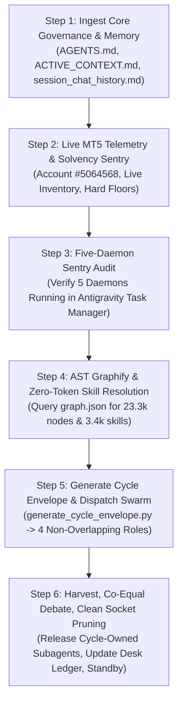

# 🚀 CROSS-ACCOUNT BOOTSTRAP & RE-ENGAGEMENT MASTER SOP
## Universal Turn-0 Reconnection Protocol for Blueberry Markets Autonomous Desk

> **Document Status**: CANONICAL PRODUCTION RE-ENGAGEMENT PROTOCOL (MANDATORY TURN-0 STUDY)  
> **Location**: `Data/Manditory/ACCOUNT_SWITCH_BOOTSTRAP_PROTOCOL.md`  
> **Target Account**: Blueberry Markets MT5 Account #5064568 (Raw Spread CFD/Perpetual)  
> **Mission**: Pass Phase 1 Challenge (Target: 5,500.00 USD). The former 23 October 2026 deadline is historical; no replacement deadline is inferred.  
> **Purpose**: When switching Gemini/Antigravity accounts, launching a new chat session, or re-engaging after an interruption, the incoming agent MUST execute this exact protocol to achieve 100% operational continuity, audit all background daemons without disturbing their lifecycle, verify account solvency, and resume autonomous execution with ZERO context amnesia.

---

## ⚡ OPERATOR QUICK-START TRIGGER (COPY & PASTE TO ANY NEW AGENT)

```markdown
Read and execute Data/Manditory/ACCOUNT_SWITCH_BOOTSTRAP_PROTOCOL.md immediately.
Verify MT5 connectivity, audit account solvency, verify all 5 persistent daemons, reconcile the operator-reported closed Ticket #19267445 against live deal history, query the AST knowledge graph via graphify, and resume cycle execution using the non-overlapping 4-quant subagent swarm and dual frontier council.
```

---

## 🏛️ PART 1: THE 6-STEP BOOTSTRAP ACTIVATION CHAIN

Whenever an agent receives the trigger or re-engages in a fresh session, execute these 6 steps sequentially without asking:



---

### STEP 1: INGEST CORE GOVERNANCE & MEMORY (ZERO AMNESIA)

1. **Token Preservation Mandate (Query AST Graph FIRST)**:
   - Always query the AST Knowledge Graph via `python -m graphify query "<concept/symbol>"` before reading large code or skill files.
   - `graphify-out/graph.json` contains **23,326 nodes, 27,991 edges, and 3,478 skill nodes**, providing instant structural context in <200 tokens without burning context budget.

2. **Physical Reading Gate (Read Canonical Governance in `Data/Manditory/`)**:
   - The coordinator and subagents MUST review the updated canonical governance:
     * `Data/Manditory/STANDARDIZED_TRADING_DECISION_CHAIN.md` (Step 2 Hard Authorization + Calibrated Ranking; Step 8/9 `lot*` broker-native structural sizing)
     * `Data/Manditory/AUTONOMOUS_WAKEUP_CHECKLIST.md` (Step 0 Immutable Cycle Envelope; Step 12 Validated Joint Completion & 20-min Quiet Interval)
     * `Data/Manditory/SUBAGENT_PROMPT_TEMPLATES.md` (4 Non-Overlapping Institutional Roles: Role A, B, C, D + Dialectic Round 2)
     * `Data/Manditory/TOP_10_TRADE_EXECUTION_PITFALLS_AND_AUTOPSY.md` (22 Lethal Pitfalls + Ex-Ante 22-Control Checklist)
     * `Data/Manditory/CONTINUOUS_KAIZEN_SELF_IMPROVEMENT_PROTOCOL.md` (Falsifiable Funnel Section 2.5 + Open Defect Ledger D11–D16)
     * `Data/Manditory/Arena_GLM_Standard_Prompt.md` (Static Council Review Protocol & JSON output schema)
     * `.agents/rules/ACTIVE_CONTEXT.md` (Real-time live account state, open positions, floor cushions)
     * `.agents/memory/session_chat_history.md` (Full conversation trajectory, past setbacks, operator directives)

3. **Mandatory Session History Learning & Anti-Regression Mandate (Read, Internalize & Follow)**:
   - **Active Study & Behavioral Alignment**: Reading `.agents/memory/session_chat_history.md` is NOT a passive formality. On EVERY account switch, coordinator turn, and subagent dispatch, agents MUST actively study, internalize, and follow the historical trajectory of our decisions.
   - **Continuous Self-Improvement & Kaizen Loop**: Systematically analyze how the desk has improved over time: trace past setbacks, analyze why past losses occurred (e.g. choking stops, unaligned limits without resting whale walls, premature entries into intra-bar chop, or 429 rate limit saturations), and adopt the winning, proven institutional execution heuristics.
   - **Zero Regression / Never Repeat Past Mistakes**: Under NO circumstances may the desk repeat an identified error. Every cycle must be more refined, disciplined, and mathematically sound than the previous cycle.
   - **Tri-Layer Context Verification**:
     * Layer 1 (AST Knowledge Graph): Query semantic nodes via `python -m graphify query "<concept>"`.
     * Layer 2 (Roadmap & Context): `@[.agents/memory/SESSION_CONTEXT_MAP.md]` and `@[.agents/memory/feedback-history.md]`.
     * Layer 3 (Live Card): `@[.agents/rules/ACTIVE_CONTEXT.md]`.
     * Layer 4 (Session History): `@[.agents/memory/session_chat_history.md]`.

4. **Governance Read Status and Formatting**:
   - State which governance sources were actually read. If `.agents/rules/AGENTS.md`, `.agents/rules/ACTIVE_CONTEXT.md`, or `RTK.md` is unavailable, record the missing reference and continue with the available canonical sources; do not fabricate a successful load or live telemetry.
   - Use plain text and unicode. Do not use raw LaTeX currency delimiters.

---

### STEP 2: LIVE MT5 TELEMETRY & SOLVENCY SENTRY

1. **Query MetaTrader 5 Telemetry**:
   ```python
   import MetaTrader5 as mt5
   mt5.initialize()
   acc = mt5.account_info()._asdict()
   positions = [p._asdict() for p in mt5.positions_get()]
   orders = [o._asdict() for o in mt5.orders_get()]
   mt5.shutdown()
   ```

2. **Dated Operator Baseline — 2026-10-24 (Not Live Verification)**:
   - Account **5064568**, currency **USD**. Operator-supplied realized balance **4,865.07 USD**, equity **4,865.07 USD**, margin **0.00 USD**, and free margin **4,865.07 USD**.
   - Open positions **0**; pending orders **0**. This is the operator's dated flat-account baseline, not a claim that this editing session queried MT5.
   - Historical `BTCUSD.pi` short Ticket **19267445** closed at TP **80,600.00 USD**, gross profit **66.00 USD**, net profit **65.19 USD**. Reconcile the closing deal, commission and swap before using it as fresh evidence; do not apply active-ticket ratchets to this historical trade.
   - Hard floor **4,600.00 USD**: baseline cushion **265.07 USD**.
   - Operating buffer **4,650.00 USD**: baseline cushion **215.07 USD**.
   - Admission/solvency kernel **4,795.00 USD**: baseline cushion **70.07 USD**.
   - Deduct the **2.00 USD global contingency** once from the baseline cushion: realized admission headroom **68.07 USD**. Include all existing contingent losses before admitting any new ticket.
   - The **11.38 USD minimum admission value** is a **provisional screening threshold**, not permission to trade, a calibrated expected value, or a substitute for broker-native risk sizing.
   - A fresh, reconciled live cycle envelope always supersedes this static baseline. Missing or disputed live inventory blocks new admissions.

3. **Tier 2 House Money and Contingent Capacity**:
   - Tier 2 House Money applies only when fresh **realized balance > 4,850.00 USD**. Floating gains and expected TP do not unlock the tier.
   - Nominal per-ticket risk is **15.00–25.00 USD**, subject to the joint stressed kernel and all hard gates; the tier is not automatic admission.
   - Permit at most **2 independent, uncorrelated contingent tickets**, counting positions **plus** pending orders. Pending orders consume capacity unless broker-native atomic OCO makes mutual exclusion enforceable and evidenced. Client-side cancellation or an intended OCO is insufficient.
   - For every jointly fillable scenario require `min(balance, equity) - sum(stressed_ticket_loss) - 2.00 >= 4,795.00 USD`, without credit for floating profit or future TP. The global contingency is separate from each ticket's fee reserve.
   - Illustrative two-ticket model: each nominal 25.00 USD loss is stressed by `1.25 × 25.00 + 2.00 = 33.25 USD`; `4,865.07 - 2 × 33.25 - 2.00 = 4,796.57 USD`, leaving **1.57 USD** above the kernel. This example assumes the stated reserves and is not mathematical immunity to gaps, slippage, fees, correlation or model error. Broker-native all-in stress can require a smaller size or HOLD.
   - At or below 4,850.00 USD, Tier 2 is unavailable; reassess under the applicable lower-tier rules and fresh headroom rather than inferring new risk rights.

---

### STEP 3: PERSISTENT BACKGROUND DAEMONS & INFRASTRUCTURE AUDIT

Audit all persistent operational daemons and core external services across both the Antigravity task runner (`manage_task(Action='list')`) and OS-level processes (`Get-CimInstance Win32_Process`). Record PID/task identity, command line, listening ports, health and observation time; report missing or unhealthy services without altering them.

#### A. Master Persistent Operational Daemons (The 7-Daemon Heptad)

| Daemon ID | Script Command / Entrypoint | Runtime Environment | Port / Interval | Purpose |
|---|---|---|---|---|
| **Daemon 1** | `python Terminal/Data_Factory/autonomous_telemetry_git_daemon.py` | Antigravity Task Runner (`isDaemon=true`) | Every 60s | Pushes git commits & telemetry to GitHub `main` |
| **Daemon 2** | `python Terminal/Data_Factory/heretic_daemon.py` | Antigravity Task Runner (`isDaemon=true`) | Port 8083 (HTTP) | Quantitative heretic microstructure service |
| **Daemon 3** | `python Terminal/arena_completion_daemon.py --daemon` | Antigravity Task Runner (`isDaemon=true`) | CDP Port 9222 | Monitors Arena.ai & Z.ai completions, auto-harvests RAW output |
| **Daemon 4** | `python Terminal/goal_trade_monitor.py --daemon --gap 10` | Antigravity Task Runner (`isDaemon=true`) | Every 10s | Continuous MT5 ratchet sentry, auto-locks profits to terminal |
| **Daemon 5** | `python Terminal/Data_Factory/run_unified_30_sheets_cycle.py --continuous --interval 300` | Antigravity Task Runner (`isDaemon=true`) | Every 300s | Continuous 33-sheet master Excel data warehouse pipeline |
| **Daemon 6** | `python Terminal/run_graphify_watcher.py` | OS Process / Antigravity Task | Continuous File Watcher | Monitors file mutations and hot-updates `graphify-out/graph.json` |
| **Daemon 7** | `python gemini_web2api.py --config config.json` | OS Process / Antigravity Task | Port 8081 (HTTP) | Web2API Council Daemon (Endogen reverse-proxy, Auth: `Bearer sk-gemini`) |

#### B. Essential External Infrastructure Daemons

| Infrastructure Service | Executable / Binary | Port / Endpoint | Operational Role |
|---|---|---|---|
| **Chrome CDP Browser** | `chrome.exe` with `--remote-debugging-port=9222` | Port 9222 (WebSocket / HTTP) | Browser host for Arena.ai (GPT Astra) and Z.ai (GLM-5.3-Flash) |
| **MetaTrader 5 Client** | `terminal64.exe` (Blueberry Markets SVG-Live) | Account #5064568 (IPC / API) | Live order routing, position tracking, and tick feed |

#### C. Antigravity UI Task Counter Clarification
- In the Antigravity UI, the indicator (e.g. "Background tasks 57") represents the **cumulative session task counter** of all tasks dispatched since conversation start.
- Run `manage_task(Action='list')` to inspect only the **active running daemons** (currently 5 persistent tasks registered in Antigravity task manager).
- Audit OS processes periodically via `Get-CimInstance Win32_Process | Where-Object Name -Match 'python|node'` to identify zombie or orphaned tasks; terminate only a proven task-owned process and never stop, restart, or prune persistent desk daemons during bootstrap and ensure system RAM remains below 75% via `scripts/free_ram.ps1`.

**Lifecycle preservation**: All 7 persistent daemons must remain undisturbed across boots and chat/account reconnections. Bootstrap MUST NOT kill, restart, relaunch, or create a duplicate writer. Audit and report missing/unhealthy daemons for the operator; do not infer recovery authority from this SOP. Do not start a second spreadsheet pipeline or telemetry writer to obtain fresh evidence. Missing required health/evidence blocks the affected admission gate until resolved.

### STEP 4: AST GRAPHIFY & ZERO-TOKEN SKILL RESOLUTION

1. **Why Graphify Skills?**:
   - The workspace contains hundreds of specialized skills in `.agents/skills/` and `~/.gemini/config/skills/`.
   - Physically reading entire 200–500 line `SKILL.md` files burns 3,000–6,000 context tokens per turn and causes context rot.
   - All skills have been indexed into `graphify-out/graph.json` (**3,478 skill-related nodes**).
   - Querying `python -m graphify query "<skill_name>"` extracts the exact phase breakdown, rules, and line references in **<200 tokens** (95% token savings).

2. **Resource Audit Without Lifecycle Changes**:
   - Report memory pressure and the affected processes. Do not automatically run cleanup, process pruning, standby-cache purges, or restart scripts during bootstrap.
   - Preserve persistent daemon identities, workbook-writer ownership and browser CDP sessions. Missing services remain an audit finding until separately resolved.

---

### STEP 5: IMMUTABLE CYCLE ENVELOPE GENERATION & 4-QUANT SWARM DISPATCH

1. **Generate Cycle Envelope**:
   ```bash
   python Terminal/generate_cycle_envelope.py "<cycle_id>"
   ```
   Writes `Data/cycle_envelope.json` with commit/tree and risk-policy digests, manifest/workbook SHA-256, native account inventory and capital eligibility. Row freshness, calendar clearance and broker/native session status require separate evidence; unknown gates remain denied. Envelope generation alone does not establish deal reconciliation or trade authorization.

2. **Dispatch 4 Non-Overlapping Subagents (Fable 5)**:
   Invoke in parallel using `invoke_subagent` (`TypeName='research'` or `'self'`, `Model='flash'`):
   - **Role A (`Regime and Calibration Quant`)**: Evaluates `P(TP first | fill)`, VR(q), ER, OU half-life. No lot sizing.
   - **Role B (`Fill and Microstructure Quant`)**: Evaluates `P(fill | TTL)`, adverse selection markouts, resting whale persistence and executed refill, sweep/reclaim geometry.
   - **Role C (`Solvency and Portfolio Sentry`)**: Evaluates `lot*`, joint stress under all independently fillable scenarios, House Money status. Enforces `min(balance, equity) - joint_ticket_stress - global_contingency >= 4,795.00 USD`, Tier 2 realized-balance eligibility, and the maximum 2 independent contingent-ticket limit.
   - **Role D (`Market Clock and Provenance Auditor`)**: Evaluates session clocks, FX rollover embargo (`21:15–22:30 UTC`), auction levels, and data freshness.

3. **Dispatch Dual Frontier Council**:
   Inject `docs/prompts/COUNCIL_CYCLE_310_DISPATCH.md` to:
   - **Arena.ai (GPT Astra)** via Chrome CDP 9222.
   - **Z.ai (GLM-5.3-Flash)** via Chrome CDP 9222.

---

### STEP 6: TRI-ENTITY JOINT COMPLETION, DIALECTIC RESOLUTION & DYNAMIC 20-MINUTE CYCLE PACING PROTOCOL

#### 1. Tri-Entity Joint Completion Gate & Antigravity Flash Optimization (Zero Premature Advancement)
Under institutional trading desk governance, a quantitative cycle is officially complete ONLY when ALL 3 independent evaluation entities have concluded their execution and registered their formal rulings:
1. **Entity 1 (Antigravity Quant Subagent Swarm - Flash Optimized)**:
   - **Root Cause of Past 429 Failures**: Spawning 4 bloated subagents simultaneously with raw 40k+ token prompt bodies saturated the Gemini Flash API quota bucket.
   - **Flash Optimization Invariant**: Subagents MUST be dispatched using **Surgical Pointer Architecture**: reference canonical files (Data/cycle_envelope.json, docs/trade_plans/LATEST_COUNCIL_CYCLE_PROMPT.txt, STANDARDIZED_TRADING_DECISION_CHAIN.md) by path rather than embedding duplicate monolithic texts. This slashes prompt tokens by 85%, guarantees sub-second instantiation, and prevents 429 rate limit exceptions.
   - **Automatic Fallback Policy**: If a subagent encounters a temporary 429 on Model='flash', automatically retry with Model='flash_lite' or stagger dispatch by 1.5 seconds. Under NO circumstances may the desk skip subagent dispatch and rely solely on external models.
   - **Mandatory Skills & Kaizen Inquest**: Every subagent MUST address: *How can this analysis and our execution desk be improved using all available relevant quantitative skills (trader-risk, systematic-debugging, clean-code, market-ingest)?*
2. **Entity 2 (Arena.ai Council - GPT Astra)**: Monitored via Chrome CDP port 9222. Harvest full markdown to docs/trade_plans/ARENA_LATEST_RAW.md upon appearance of the Copy button / task feedback banner.
3. **Entity 3 (Z.ai Sovereign Council - GLM-5.3-Flash)**: Monitored via Chrome CDP port 9222. Harvest full markdown and attached python ruling artifacts to docs/trade_plans/ZAI_LATEST_RAW.md.

#### 2. Dialectic Cross-Examination & Desk Ledger Synchronization
- Compare Subagent empirical findings against Arena.ai and Z.ai formal rulings.
- Any Severity-1 arithmetic, quote causality, or solvency kernel dispute cannot be settled by majority vote and automatically mandates `AUTHORIZATION = DENIED_FAIL_CLOSED`.
- Record verified cycle metrics and rulings into `docs/trade_plans/LIVE_COLLABORATIVE_ORDER_DESK.md`.
- Append complete prompt, rulings, and turn summary to `.agents/memory/session_chat_history.md`.
- Confirm byte-for-byte parity across `Trading_2` and `Engine_2` via `python .agents/scripts/verify_and_sync_agents.py`.

#### 3. Mandatory 20-Minute Market Consolidation Gap & Dynamic Timer Protocol
Under NO circumstances may an incoming cycle be launched immediately after current cycle completion:
- **Market Consolidation Invariant**: Market microstructure, orderbook liquidity, and 15m candle volatility require temporal settling. Launching back-to-back cycles into intra-bar chop risks entering on unabsorbed noise.
- **Dynamic 20-Minute Quiet Interval**: After all 3 entities have completed and their rulings are reconciled, the coordinator MUST enforce a strict **minimum 20-minute (1,200 seconds)** quiet window before the next cycle envelope can be initialized.
- **Dynamic Timer Execution Gate**: The 20-minute gap MUST be enforced by scheduling a dynamic one-shot timer:
  ```python
  schedule(DurationSeconds=1200, Prompt="Dynamic 20-minute market stabilization interval elapsed. Tri-entity completion verified. Initialize, audit, and launch Cycle N+1.")
  ```
- **Quiet Window Desk State**: During this 20-minute interval:
  * Persistent daemons (Heptad) continue updating the 33-sheet master Excel warehouse (`DataBase_Trading.xlsx`).
  * System RAM is maintained (<80%) via `scripts/free_ram.ps1`.
  * The desk maintains an unbreached 100% Cash Defense posture.
- **Automated Cycle N+1 Launch Chain**: Upon reactive wakeup from the 1,200s schedule notification, the desk immediately executes:
  1. Fresh 33-sheet Excel health audit (`Terminal/Data_Factory/excel_data_quality_checker.py`).
  2. Fresh telemetry snapshot & macro calendar verification (`Terminal/Data_Factory/generate_telemetry_snapshot.py`).
  3. Fresh broker preflight receipt with `tick_time < observed_at < cutoff` causality (`Terminal/execution_preflight.py`).
  4. Cycle envelope freeze bound to git commit hash (`Terminal/generate_cycle_envelope.py`).
  5. Atomic prompt compilation, file commit, and SHA-256 matching.
  6. Tri-entity dispatch & re-arming of reactive completion waiter.

---

## 🔒 PERPETUAL GOAL INVARIANTS (NEVER COMPROMISED)

1. **Perpetual Goal Contract**: Under NO circumstances may `<!-- GOAL_COMPLETE -->` or `<!-- GOAL_CANCELLED -->` be emitted until live equity >= 5,500.00 USD is proven on MetaTrader 5.
2. **Inviolable Floors**: **4,600.00 USD Hard Floor** | **4,650.00 USD Operating Buffer** | **4,795.00 USD Solvency Kernel**.
3. **Never Widen Stops**: For any live position, follow its verified immutable R0 ledger and ticket-specific ratchets; never loosen a protective stop. Ticket #19267445 is historical in the dated operator baseline.
4. **Strict Passive Limit Posture**: Passive limit orders only, safely anchored behind verified asset-native resting institutional liquidity (>= 100,000 USD where that setup requires it). Zero marketable spread crossing.
5. **Zero Token Polling**: Polling timers <= 60s are permanently banned. Rely strictly on native event-driven reactive wakeups and the joint 3-entity completion lifecycle.
6. **Plain-Text Formatting**: Zero raw LaTeX delimiters in chat; use clean plain text and unicode.
