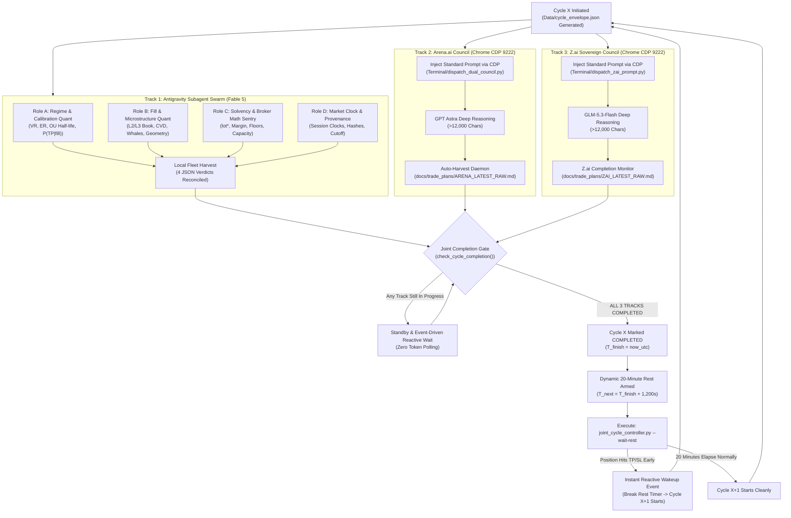

# 🔄 CANONICAL AUTONOMOUS CYCLE METHODOLOGY
## The Event-Driven Tri-Track Joint Completion & Dynamic 20-Minute Rest Protocol

> **Document Status**: CANONICAL PRODUCTION METHODOLOGY SPECIFICATION  
> **Location**: `Data/Manditory/AUTONOMOUS_CYCLE_METHODOLOGY.md`  
> **Target Account**: Blueberry Markets MT5 Account #5064568  
> **Core Architecture**: Event-Driven Asynchronous State Machine (`Terminal/joint_cycle_controller.py`)  
> **Mandatory Rule**: No cycle may ever advance via rigid wall-clock crons. Advancement is governed strictly by the 3-entity joint completion gate followed by an exact 20-minute quiet interval.

---

## 🏛️ PART 1: THE CORE PHILOSOPHY & WHY STATIC CRONS ARE ELIMINATED

### 1. The Critical Failure Mode of Rigid Static Crons
Historically, automated trading architectures relied on fixed wall-clock cron expressions (such as `14,29,44,59 * * * *` or `0,20,40 * * * *`). In multi-agent deliberation systems, this causes severe operational hazards:
- **Calculation Drift & Context Collisions**: Deep reasoning models (Arena.ai GPT Astra, Z.ai GLM-5.3-Flash, and Fable 5 subagents) produce complex quantitative markouts. If deliberation takes 18–25 minutes, a static 15-minute cron triggers a brand-new cycle while the previous cycle is still writing to disk. This causes prompt collision, duplicate API submissions, and context amnesia.
- **Premature Advancement**: Static crons advance cycles based on the wall clock rather than empirical completeness. If a model is 90% done, a static cron would discard or overwrite its output.
- **Missed Immediate Re-Engagement**: If a live MT5 position hits its Take Profit 2 minutes after a cycle begins, a static cron forces the desk to wait 13 minutes before reacting, missing the immediate post-sweep re-entry window.

### 2. The Canonical Operator Mandate
The desk operates strictly under the event-driven state machine:
```
"In cycle X, we prompt Antigravity subagents, Arena.ai, and Z.ai.
 We call this cycle FINISHED ONLY when ALL THREE have completed prompt processing.
 When all three are done, we mark the cycle complete.
 The difference between completed Cycle X and next Cycle trigger must be strictly 20 minutes.
 If an active position closes (hits TP/SL), we wake up immediately."
```

---

## ⚙️ PART 2: THE 3 PARALLEL DELIBERATION TRACKS

Every cycle initiates three concurrent, independent analytical tracks:



---

## 🔒 PART 3: THE JOINT-COMPLETION GATE & STATE MACHINE CONTRACT

### 1. The Inviolate Completion Gate
A cycle is marked `COMPLETED` in `Data/cycle_state.json` if and only if:
1. `components.antigravity_subagents.status == "COMPLETED"`
2. `components.arena_ai.status == "COMPLETED"`
3. `components.zai.status == "COMPLETED"`

If any single entity is still generating, analyzing, or harvesting, the cycle remains strictly `IN_PROGRESS`.

### 2. The Dynamic 20-Minute Post-Completion Delay
Upon achieving joint completion:
- The controller determines the exact completion timestamp:
  `T_finish = max(T_subagents, T_arena, T_zai)`
- The next cycle trigger is scheduled at:
  `T_next = T_finish + 1,200 seconds (20.0 minutes)`
- The state is persisted to `Data/cycle_state.json`:
  ```json
  {
    "current_cycle_id": "311",
    "cycle_status": "COMPLETED",
    "cycle_completed_utc": "2026-10-23 23:25:00 UTC",
    "next_cycle_scheduled_utc": "2026-10-23 23:45:00 UTC",
    "rest_interval_seconds": 1200
  }
  ```

### 3. The Two Wake-Up Paths from the 20-Minute Rest Interval

#### Path A: Standard 20-Minute Timer Expiration
If no active MT5 position closes, the desk rests peacefully for the full 1,200 seconds without burning tokens. When the timer expires, the background task notifies Antigravity, which automatically advances to Cycle X+1.

#### Path B: Early Position Closure Reactive Wake-Up (Interrupt)
If an active position reaches its Take Profit or Stop Loss during the 20-minute rest interval:
1. The background sentry daemon (`Terminal/goal_trade_monitor.py --daemon --gap 10`) detects that `positions_get()` changed from 1 to 0 or that deal history contains a new closed ticket.
2. The sentry triggers `Terminal/joint_cycle_controller.py --wake-early`, terminating the rest sleep immediately.
3. Antigravity receives an immediate high-priority task notification and starts the next cycle on the spot to capture the post-sweep re-entry or adjust risk capacity.

---

## 🛠️ PART 4: OPERATIONAL COMMANDS & SCRIPTS

| Operation | Command | Execution Behavior |
|---|---|---|
| **Dispatch Dual Council (Arena + Z.ai)** | `python Terminal/dispatch_dual_council.py --cycle <ID>` | Injects standard prompt to both Chrome CDP tabs and Web2API |
| **Check Joint Cycle Status** | `python Terminal/joint_cycle_controller.py --status` | Audits state of all 3 entities and time remaining |
| **Mark Component Complete** | `python Terminal/joint_cycle_controller.py --complete <component>` | Updates status of local fleet, Arena, or Z.ai |
| **Arm & Wait 20-Min Rest** | `python Terminal/joint_cycle_controller.py --wait-rest` | Enters event-driven wait until `T_next` or early position wake-up |
| **Trigger Immediate Cycle Start** | `python Terminal/joint_cycle_controller.py --start-cycle <ID>` | Initializes fresh cycle envelope and resets component states |

---

## 📋 PART 5: CO-EQUAL DIALECTIC SYNTHESIS PROTOCOL

Once all 3 entities complete their deliberation:
1. **Machine-Harvest Raw Outputs**:
   - Local Subagent verdicts parsed from JSON returns.
   - Arena.ai harvested to `docs/trade_plans/ARENA_LATEST_RAW.md`.
   - Z.ai harvested to `docs/trade_plans/ZAI_LATEST_RAW.md`.
2. **Co-Equal Debate (Round 2 Dialectic)**:
   - Compare setup candidates across all 3 entities.
   - If Arena or Z.ai proposes a setup that violates broker lot-grid math, resting whale wall persistence, or floor constraints, Role C and Role B exercise binding veto power.
   - If all 3 entities achieve mathematical confluence on an asset-native setup: verify 10-Point Pre-Punch Checklist, calculate `lot*`, and stage passive limit order safely behind resting whale liquidity.
   - If any entity raises an unresolved Severity-1 dispute: default strictly to `STAND_ASIDE_PRESERVE_CAPITAL`.
3. **Clean Socket Pruning**:
   - Terminate completed subagent sockets via `manage_subagents(Action='kill_all')`.
   - Record synthesis in `docs/trade_plans/LIVE_COLLABORATIVE_ORDER_DESK.md`.
   - Execute `joint_cycle_controller.py --wait-rest` to begin the 20-minute quiet interval.
