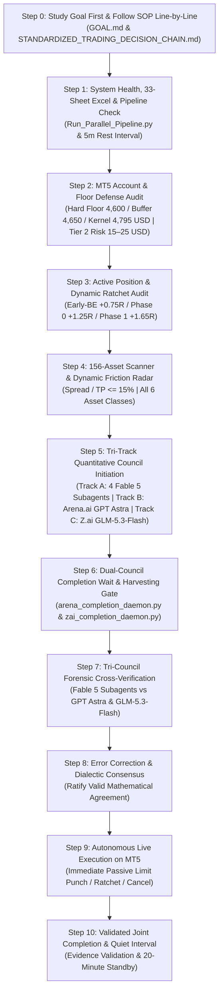

# 📋 AUTONOMOUS WAKE-UP CHECKLIST & JOINT-COMPLETION LIFECYCLE
## Antigravity Desk & Arena.ai Co-Equal Quantitative Investment Council

> **Canonical Production Checklist**: Non-bypassable Master Autonomous Desk Wake-Up Sequence (Read & Execute Fully Line-by-Line).  
> **Target Environment**: MetaTrader 5 (Blueberry Markets Account #5064568) | Antigravity Autonomous Decision Desk  
> **Active Goal Contract**: Pass Phase 1 Challenge (Target: 5,500.00 USD) by End of Friday, 23rd October 2026 (23:59 UTC).  
> **INVIOLABLE OPERATOR MANDATE**: The /goal contract is PERPETUAL and must NEVER be killed, paused, or cancelled until live equity >= 5,500.00 USD is proven on MT5.  
> **MANDATORY CANDIDATE RADAR**: The desk is STRICTLY FORBIDDEN from issuing a bare 'Stand Aside' without formulating and tracking concrete Potential Candidate Setups with checkable pre-condition trigger checklists [ ].  
> **Mandatory Foundation**: [`STANDARDIZED_TRADING_DECISION_CHAIN.md`](file:///c:/Users/SIGMA/Documents/Trading_2/Data/Manditory/STANDARDIZED_TRADING_DECISION_CHAIN.md) (Canonical Quant SOP) + Master 33-Sheet Excel Data Warehouse (`Data/DataBase_Trading.xlsx` & `Data/Manditory/`).  
> **Standard Dual-Council Prompt Template**: [`Arena_GLM_Standard_Prompt.md`](file:///c:/Users/SIGMA/Documents/Trading_2/Data/Manditory/Arena_GLM_Standard_Prompt.md) (All-in-One 4-Persona Quantitative Audit for Arena.ai [GPT Astra] & Z.ai [GLM-5.3-Flash])  
> **Operator Concerns & Perpetual Resolutions**: [`OPERATOR_ISSUES_AND_RESOLUTIONS_CHECKLIST.md`](file:///c:/Users/SIGMA/Documents/Trading_2/Data/Manditory/OPERATOR_ISSUES_AND_RESOLUTIONS_CHECKLIST.md)  
> **Cadence & Separation**: Clean 20-Minute Relative Post-Completion Separation (`T_finish + 20 min`) between completed Cycle X and Cycle X+1 trigger, supervised by autonomous 30-Minute Watchdog Sentry Cron (`0,30 * * * *` at :00 and :30 of every hour).  
> **Token Preservation Rule**: Always query the AST Knowledge Graph via `/graphify` or `python -m graphify query "<symbol/concept>"` FIRST before reading large code files.  
> **Strict Joint-Completion & Hardware Health Invariant (Operator Mandate)**: A cycle is NEVER completed upon prompt dispatch. A cycle is marked officially **FINISHED** only when:
>    1. **ALL THREE entities complete processing**: (1) Antigravity 4-Quant Subagent Swarm (Fable 5), (2) Arena.ai Frontier Council (GPT Astra), and (3) Z.ai Sovereign Council (GLM-5.3-Flash), with their markdown responses harvested and verified non-empty.
>    2. **Mandatory RAM & CPU Optimization**: Execute `powershell -ExecutionPolicy Bypass -File scripts/free_ram.ps1` to prune zombie processes, trim working sets, and reclaim physical RAM below 80%.
>    3. **20-Minute Relative Post-Completion Separation**: The difference between completed Cycle X and the trigger for Cycle X+1 must be strictly **20 minutes** (1,200 seconds), recorded in `Data/cycle_state.json` via `Terminal/joint_cycle_controller.py`.

---

## 🚨 MANDATORY INVIOLATE 4-QUANT FLEET (FABLE 5), ARENA.AI (GPT ASTRA) & Z.AI DISPATCH GUARANTEE
> **NEVER OMIT, BYPASS, OR SKIP UNDER ANY CIRCUMSTANCES**:
> 1. **Mandatory 4-Subagent Quant Fleet (Fable 5)**: On EVERY autonomous wake-up cycle and on EVERY decision turn, Antigravity MUST physically invoke the **4 specialized quantitative subagents** via `invoke_subagent` (`Model='flash'` / Fable 5 runtime):
>    - **Statistical Regime & Diffusion Quant** (`Role='Statistical Regime Quant'` — Fable 5): Calculates Lo-MacKinlay Variance Ratio `VR(q)`, Kaufman Efficiency Ratio `ER`, Hurst exponent `H`, Ornstein-Uhlenbeck half-life `tau_half in [20m, 4h]`, and Newey-West drift `t`-stat. Strict stand-aside on `UNDEFINED` regime.
>    - **Microstructure & Liquidation Quant** (`Role='Microstructure Quant'` — Fable 5): Evaluates L2/L3 orderbook depth, Binance Futures LIR, resting whale persistence (`tau >= 180s`, refill `rho >= 0.60`), Sheet 23 retail stop sweeps (< 90s reclaim vs > 240s broken), and CVD absorption divergence (`z_CVD >= 1.5`).
>    - **Convex Portfolio & Solvency Sentry** (`Role='Solvency Sentry'` — Fable 5): Evaluates live MT5 account telemetry, exact broker `mt5.order_calc_profit` lot snapping, option-adjusted EV, Quarter-Kelly sizing, joint stressed loss `= sum(1.25 * NominalLoss_i + 2.00 USD) + 2.00 USD global reserve`, Tier 2 realized-balance eligibility and the two contingent slots.
>    - **Auction Profile & Friction Arbitrageur** (`Role='Auction Profile Quant'` — Fable 5): Studies Sheet 33 Value Area (VAH, VAL, POC, Initial Balance), enforces Relative Spread Gate (`Spread Price / TP Distance <= 10.0%`), audits 33-sheet data warehouse (33/33 sheets, 0 formula errors, <= 15m fresh), and enforces the strict Event Risk Clock (PMIs 07:15–08:00 UTC, 07:10 cancel, 07:14:59 emergency flatten).
> 2. **Mandatory Canonical Governance & Line-by-Line Execution**: Every subagent prompt and council prompt MUST cite and STRICTLY FOLLOW line-by-line `STANDARDIZED_TRADING_DECISION_CHAIN.md` (read fully from start to finish) and require physical line-by-line inspection of all referenced governance documents in `Data/Manditory/`.
> 3. **Mandatory Dual Frontier Council Parallel Dispatch (Arena.ai GPT Astra & Z.ai GLM-5.3-Flash)**: On EVERY wake-up cycle, surgical 360-degree quantitative prompts citing `STANDARDIZED_TRADING_DECISION_CHAIN.md` MUST be injected SIMULTANEOUSLY into:
>    - **Arena.ai (GPT Astra)** via Chrome CDP port 9222 using `Terminal/dispatch_arena_prompt.py`.
>    - **Z.ai (GLM-5.3-Flash)** via Chrome CDP port 9222 using `Terminal/dispatch_zai_prompt.py --file <prompt_path>`.
>    Both external frontier councils must evaluate the 156-asset universe across the 4 quantitative personas, providing co-equal dialectic verification.
> 4. **Live Profit Ratchets Do Not Excuse Omission**: When live orders fill and dynamic ratchets (Early-BE, Phase 0, Phase 1) fire on MT5, the coordinator must execute the ratchet IMMEDIATELY to secure capital, but MUST SIMULTANEOUSLY dispatch the 4-subagent fleet and dual council prompt. No operational event ever excuses skipping the dual-track council.
> 5. **Mandatory Perpetual Quantitative Methodology Interrogation (Operator Invariant)**: Every subagent prompt, council prompt (Arena.ai GPT Astra & Z.ai GLM-5.3-Flash), and wake-up synthesis MUST explicitly interrogate Section 2.5 of `STANDARDIZED_TRADING_DECISION_CHAIN.md`: *Is our methodology for finding potential candidates truly sound, and how can we fundamentally improve it? Given that we monitor 156 assets with vast orderbook, CVD, and liquidation data, why has equity remained flat, and how do we think like elite quants to generate profitable executions while fiercely preserving the hard floor?* This question must always be replied to on every cycle for continuous improvement.

---

## 🧠 THE CANONICAL WAKE-UP INQUEST: 9 MANDATORY SELF-INTERROGATION GATEWAYS

Before evaluating data, touching code, or dispatching orders, the coordinator and all subagents MUST systematically self-interrogate through these 9 non-bypassable gateways:

### Gateway 0: Automated 33-Sheet Excel Data Quality & Per-Sheet Freshness (<= 15 Min) Audit
> *"Are all 33 sheets in Data/DataBase_Trading.xlsx present, error-free, and actively updating on a per-sheet level?"*
- **Automated Auditor Execution**: Run `python Terminal/Data_Factory/excel_data_quality_checker.py` at the start of every wake-up cycle.
- **Verification Criteria**:
  * Total Sheets: 33/33 sheets present and indexed.
  * Formula Errors: Exactly 0 errors (`#REF!`, `#DIV/0!`, `#N/A`, `#VALUE!`, `#NAME?`, `#NUM!`).
  * Header Integrity: 100% valid, unmerged headers in Row 1 across all sheets.
  * Per-Sheet Freshness Invariant: Inspect internal cell timestamps for EVERY dynamic trading sheet (`00_MT5_Account_Telemetry`, `11_Technical`, `14_Hyperdash_Liq_Map`, `15_Hyperdash_Stops_Map`, `17_Orderbook`, `18_CVD`, `20_Auction_Market_Structure`). Each must be `<= 15.0 minutes` (`900s`) old. Never rely solely on overall file modification time (`os.path.getmtime`).
  * Scorecard: Verified output in `Data/excel_health_audit.json`.
- **Fail-Closed Gate**: If the audit detects any formula error, missing sheet, or any dynamic operational sheet stale (> 15m), trading is frozen in 100% Cash Defense until the pipeline refreshes.

### Gateway 1: Mission, Runway & Macro Clock
> *"What is our exact target, how much runway remains, and what is our exact dollar bridge?"*
- **Primary Target**: Pass Phase 1 of Blueberry Markets evaluation (#5064568) by reaching **5,500.00 USD** equity.
- **Runway & Deadline**: End of Friday, 23rd October 2026 (23:59 UTC). Calculate exact remaining hours.
- **Dollar Bridge**: Distance = 5,500.00 USD - Current Equity.
- **Macro Blackout & Session Clock**: Is there any Tier-1 macroeconomic release (CPI, PPI, FOMC, NFP) scheduled within +-30 minutes in `Data/macro_calendar.json` or Sheet 28 (`19_Calendar`)? Are we approaching the 21:15–22:30 UTC interbank FX rollover spread expansion?

### Gateway 2: Capital Floor & Solvency Sentry
> *"What are the fresh broker-verified cushions above the 4,600.00 USD hard floor, 4,650.00 USD operating buffer and stricter 4,795.00 USD kernel admission floor?"*
- **Capital base**: `min(fresh_balance, fresh_equity)`; floating profits cannot raise admission credit above realized balance.
- **Cushions**: Recompute capital base minus each of the three levels. No lower safety layer substitutes for the kernel admission floor.
- **Joint stress**: `StressedLoss = max_over_joint_fill_scenarios(sum_i(1.25 * NominalLoss_i + 2.00 USD)) + 2.00 USD global reserve`.
- **Binary solvency authorization**: `SolvencyMet = min(balance,equity) - StressedLoss >= 4,795.00 USD`. Include all open and jointly fillable pending tickets, verified contingent slots and joint margin. Unknown inventory or loss inputs fail closed.

### Gateway 3: Tier 2 Two-Asset Contingent Capacity Audit
> *"Do all open positions and potentially fillable pending orders fit within two independent assets and the authorized cash risk?"*
- **Tier 2 eligibility**: Fresh broker-verified realized balance must be strictly above **4,850.00 USD**. Tier 2 nominal risk is **15.00–25.00 USD per ticket**, with at most **2 independent assets**; setup quality cannot increase these limits. Otherwise require a separately authorized lower tier or HOLD.
- **Slot definition**: Open positions and independently fillable pending orders consume the same two contingent slots. Count pending orders before execution; no uncapped staged-order exemption exists.
- **Joint fill assumption**: All pending orders may fill together unless verified broker-enforced atomic OCO makes branches mutually exclusive. Client-side cancellation does not qualify.
- **Independence and solvency**: Multiple tickets or correlated exposures cannot manufacture independent assets. Every jointly fillable scenario must satisfy the two-slot cap, joint margin and `min(balance,equity) - StressedLoss >= 4,795.00 USD`.

### Gateway 4: Active Running Positions Re-Evaluation & Dynamic Ratchets
> *"Are there any filled positions running right now, what is their R0 excursion, and have dynamic ratchets triggered?"*
- **Floating P&L & R0 Excursion**: `R = (Current Market Price - Entry Price) / R0`.
- **Dynamic Ratchet Execution**:
  * **Phase Early-BE (+0.75R0 to +0.80R0)**: Move Stop Loss to `Entry + 0.10 * R0` immediately. Recompute stop loss only after broker confirmation; retain stressed execution costs and the 2.00 USD per-ticket allowance. The open position continues consuming its contingent slot.
  * **Phase 0 (+1.25R0)**: Move Stop Loss to `Entry + 0.15 * R0`.
  * **Phase 1 (+1.65R0)**: Move Stop Loss to `Entry + 0.80 * R0` (subject to broker execution and stressed costs).
  * **Take Profit Target**: Verify TP front-runs opposing high-density liquidation magnet or Daily VWAP.
  * **Time Decay Rule**: If trade age > 24 bars (6 hours) and gain < +0.20R0, execute market close.

### Gateway 5: Resting Limit Orders Structural, Liquidation & Microstructure Sentry
> *"Are our resting limit orders still structurally valid, or has the underlying market thesis degraded?"*
- **Distance to Market**: Is price approaching the limit? Is a fill imminent?
- **Structural Shelf Integrity**: Is the underlying Fibonacci Prime EMA (EMA 13 / 34 / 89 / 233), Session VWAP, Volume Profile POC/VAL/VAH, Multi-Timeframe Auction Extremes (Monday High/Low/Mid IB_W, Session Extremes, Week/Month High/Low), or Symmetrical Fibonacci Retracement Golden Zone (0.618–0.650 GP, 0.702 OTE, 0.786 Invalidation Shelf) still intact?
- **Whale Wall Persistence**: Inspect Sheet 18 (`10_Whale_Orders`) and Sheet 25 (`17_Orderbook`). Do the resting whale walls (>= 100K USD) still persist (>= 180s), or were they cancelled/pulled?
- **Comprehensive Liquidation & Stop Sweep Dynamics**:
  * Inspect BOTH Hyperdash stops/liquidation maps (Sheet 23 `15_Hyperdash_Stops_Map` & Sheet 24 `16_Hyperdash_Liquidation_Map`) AND CoinGlass liquidation heatmaps, live liquidation streams, and multi-exchange surfaces (Sheets 10, 11, 12, 13, 14, 15, 16, 17, 18, 22).
  * Has an adverse retail stop sweep cluster or dense liquidation pool formed between current market price and our limit entry? If so, wait for the cascade flush before entering.
- **Sentry Decision**: Ratify one of 3 explicit actions for every resting ticket:
  1. **MAINTAIN**: Supporting walls intact, distance reasonable (<= 2.0 ATR), thesis valid.
  2. **SLIGHT ADJUSTMENT**: Supporting whale wall or shelf relocated; adjust entry/SL/TP to match.
  3. **CANCEL**: Supporting wall pulled/thinned > 50%, price drifted > 3.0 ATR away, or regime broke.

### Gateway 6: Candidate Formulation & Dynamic Friction 5-Pillar Confluence Pipeline
> *"Which candidate assets qualify right now for limit order staging under dynamic friction budgeting?"*
- **Dynamic Spread Friction Budgeting Gate**:
  * Model friction in the declared single-count cost ledger; high conviction cannot override calibrated net viability, hard authorization or the risk cap.
  * Evaluate the Friction Efficiency Ratio: `Spread Points / TP Distance Points <= 15.0%`.
  * Baseline guidelines: Crypto <= 35.0 bps, Forex <= 6.0 bps, Metals & Indices <= 10.0 bps, Exotics <= 25.0 bps.
  * **Tier 2 risk cap**: Fresh realized balance strictly above 4,850.00 USD permits nominal 15.00–25.00 USD per ticket across at most two independent assets, counting all jointly fillable pending orders in two contingent slots; confluence does not authorize a larger risk budget.
- **5-Pillar Confluence Stack (Regime & Narrative Driven)**:
  * Prioritize the dominant Market Regime & Macro Narrative (The WHY) over rigid all-or-nothing conjunctive micro-gates.
  * For Model 2 Trend Pullbacks: Retracements into the Symmetrical Fibonacci Golden Zone [0.618 GP, 0.702 OTE], Fibonacci Prime EMA 34 / 89 ribbon shelves, Session VWAP, or Volume Profile VPOC at mild Z-scores (|Z| = 0.2 to 1.7 SD) in confirmed TREND_UP/TREND_DOWN regimes qualify for pro-trend limit orders.
  * For Forex and Indices: Volume Profile VPOC, Value Area High/Low (VAH/VAL), Multi-Timeframe Auction Extremes (Monday IB_W, Session High/Low, Week/Month High/Low), and Fibonacci Prime EMA ribbons (5/13/34/89/144/233) serve as structural anchors.
  1. Dynamic spread friction gate passed (Efficiency Ratio <= 15%).
  2. Multi-horizon taker CVD delta divergence/absorption (`zc_div > 0.8`, Spot > 0, Futures < 0, or tick absorption).
  3. Auction location: Model 1 Extreme Mean Reversion (`|Z| >= 2.0 to 3.5 SD`, RSI < 35 or > 65) sweeping dense liquidation/stop pools OR Model 2 Trend Pullback into the Symmetrical Fibonacci Golden Zone [0.618 GP, 0.702 OTE], Fib-Prime EMA 34/89 shelf, or VPOC in confirmed trend with SL anchored >= 0.40 ATR beyond 0.786 Invalidation Shelf.
  4. Verified structural backing: Resting whale wall >= 100K USD (persistence >= 180s) for Crypto, or VPOC/EMA support for Forex/Indices, anchoring SL safely outside sweep zone.
  5. Macro clearance (zero Tier-1 event blackout).
- **Authorization mandate**: An empty contingent slot and setup confluence are necessary screens. Require every SOP 2.1 hard gate, calibrated positive lower-bound utility under SOP 2.2, asset-native evidence under 2.3 and broker-grid sizing under SOP Step 8 before any new-risk ticket.

### Gateway 7: 33-Sheet Excel Freshness & Integrity Audit (OPERATOR DIRECTIVE)
> *"Has Data/DataBase_Trading.xlsx loaded all 33 sheets cleanly with zero formula errors, and are all values actively updating and fresh?"*
- **File Health**: `Data/DataBase_Trading.xlsx` (Size ~13.1 to 13.9 MB) loads cleanly via openpyxl/pandas.
- **Sheet 33 Unmerged Header Verification**: Verify Row 1 of Sheet 33 (`20_Auction_Market_Structure`) has all 36 canonical column names written directly without unmerged/blank header gaps.
- **Mandatory Freshness Check**:
  * Verify timestamps on `17_Orderbook`, `18_CVD`, `00_MT5_Account_Telemetry`, and `20_Auction_Market_Structure` are <= 15 minutes old.
  * Verify value deltas between consecutive dumps are non-zero.
  * Fail closed when any decision-critical event or receipt timestamp exceeds its configured field age bound; 15 minutes is the warehouse maximum, with stricter quote/microstructure bounds as defined in SOP 2.1.
- **Error Scan**: Exactly 0 formula errors (`#REF!`, `#DIV/0!`, `#VALUE!`, `#N/A`, `#NAME?`, `#NUM!`, `#NULL!`) across all 1.6M+ cells.
- **Pipeline Daemon Health**: Continuous 33-sheet pipeline daemon (`task-107241`) is actively cycling with 5m rest intervals.

### Gateway 8: Hardware Health, Background Daemons & Workspace Hygiene
> *"Is system RAM optimized, are all 5 daemons running in Antigravity task manager, and is the workspace pristine?"*
- **RAM Check**: Is RAM usage <= 70%? If not, execute `scripts/free_ram.ps1` while strictly preserving browser sessions.
- **6 Authorized Persistent Background Daemons (in Antigravity Task Manager)**:
  1. Daemon 1: Continuous 33-Sheet Pipeline Daemon (`Run_Parallel_Pipeline.py --continuous --gap 300 --workers 1`, `IsDaemon=true`)
  2. Daemon 2: 20-Minute Cron Sentry (`schedule` cron on `0,20,40 * * * *`, `IsDaemon=true`)
  3. Daemon 3: Arena Completion Daemon (`arena_completion_daemon.py --daemon` on port 9222, `IsDaemon=true`)
  4. Daemon 4: Autonomous 5-Minute Git Sync Daemon (`autonomous_git_sync_daemon.py`, commits & pushes every 300s, `IsDaemon=true`)
  5. Daemon 5: AST Graphify Watcher Daemon (`run_graphify_watcher.py`, `IsDaemon=true`)
  6. Daemon 6: Gemini Web2API Council Daemon on port 8081 (`python gemini_web2api.py --config config.json`, `IsDaemon=true`, Endogen architecture)
- **Zero Scratch Litter**: Prune all temporary scripts immediately after verification.
- **Turn Ledger Append**: Append turn record to `.agents/memory/session_chat_history.md`.

---

## 🔄 THE 11-STEP JOINT-COMPLETION WAKE-UP SPRINT (STEPS 0–10)

Every full autonomous wake-up cycle must sequentially execute Steps 0–10 without skipping, after the validated 20-minute post-completion interval. A watchdog or reactive wakeup does not shorten that interval.



---

## 🔴 STEP 0 — OPEN IMMUTABLE CYCLE ENVELOPE

Do not dispatch analysis until every box passes:

- [ ] cycle_id and UUID are new and unique.
- [ ] cutoff_utc is explicit.
- [ ] evidence commit and tree are cutoff-causal.
- [ ] evidence manifest has a SHA-256 digest.
- [ ] physical workbook/blob digest is recorded.
- [ ] every decision-critical row has event and receipt timestamps, both <= cutoff_utc, and both ages within its declared field bound (warehouse maximum 900 seconds; stricter configured bounds for quotes/microstructure). Future/missing timestamps fail closed; workbook mtime is not freshness.
- [ ] account, positions, orders, deals, symbol metadata, and broker clock reconcile.
- [ ] balance/equity residuals are explained or fail closed.
- [ ] calendar is authenticated and available.
- [ ] broker and native market clocks are open with verified venue holiday/early-close calendars and date-specific DST; blackout clearance is explicit (SOP 2.3).
- [ ] outside the conservative 21:15–22:30 UTC FX rollover embargo.
- [ ] strict admission uses min(fresh_balance,fresh_equity) and 4,795.00 USD after joint stress and reserves.
- [ ] all jointly fillable pending orders are included in the two contingent slots, joint stress and margin; any OCO exclusion is broker-atomic and verified.
- [ ] prompt renderer reports zero unresolved placeholders.
- [ ] prompt digest and dispatch nonce are persisted before transmission.

If any identity, inventory, calendar, or solvency field fails:
AUTHORIZATION = DENIED_FAIL_CLOSED.
Existing-position risk management remains active.

### Step 0 capital reference and fresh-broker reconciliation

The **2026-10-24 governance update** records an **operator-supplied** reference of **4,865.07 USD realized balance/equity**, **0 positions / 0 pending orders**, and closed BTC ticket **19267445** at TP **80,600** with **66.00 USD gross / 65.19 USD net** profit. Exact broker as-of time is unspecified. This dated reference does not attest the live account: reconcile fresh broker balance, equity, positions, pending orders and closing deals before authorization. Do not turn a failed inventory query into a zero count.

At the supplied flat reference, cushions are **265.07 USD above the 4,600.00 USD hard floor**, **215.07 USD above the 4,650.00 USD operating buffer**, and **70.07 USD above the 4,795.00 USD kernel admission floor**. Deduct a separate **2.00 USD global reserve** to obtain **68.07 USD realized headroom**.

Two 25.00 USD nominal tickets require **66.50 USD** joint ticket stress: `2 * (1.25 * 25.00 + 2.00)`. This leaves **4,798.57 USD**, or **4,796.57 USD after the additional 2.00 USD global reserve**. Nominal total 50.00 USD is not a stressed solvency calculation. Refresh all inputs before applying the strict Tier 2 threshold `realized_balance > 4,850.00 USD`.

---

### Step 1: System Health, Master Excel Data Warehouse & Pipeline Verification
- [ ] **MANDATORY 33-SHEET MASTER EXCEL INSPECTION CONFIRMATION**:
  - Physically load and confirm reading across ALL **33 canonical worksheets** of `Data/DataBase_Trading.xlsx` (Sheet 00 `00_MT5_Account_Telemetry` through Sheet 33 `20_Auction_Market_Structure`).
  - Output an explicit confirmation score verifying row counts, column counts, freshness timestamps, and confirming exactly zero formula errors (`#REF!`, `#DIV/0!`, `#VALUE!`, `#N/A`) and zero empty headers across all 33 sheets. Nothing may ever be skipped or missed.
  - Require the exact same 33-sheet verification attestation from Arena.ai on every council cycle.
- [ ] **MANDATORY LINE-BY-LINE EXCEL STUDY & NARRATIVE SYNTHESIS (OPERATOR INVARIANT)**:
  - Systematically study *each and every line* across all worksheets:
    * Spot ETF & CEX Netflows (Sheets 00–02): evaluate institutional net accumulation vs distribution line-by-line.
    * Retail Skew & Crowding (Sheets 03–05): examine Long/Short percentages across Binance, OKX, Bybit line-by-line.
    * Hyperliquid L1 Whales (Sheet 06): review top whale wallet positions, leverage, and liquidation points line-by-line.
    * Open Interest & Funding (Sheets 07–09): inspect OI expansion and funding carry costs line-by-line.
    * CoinGlass & Hyperdash Liquidation Maps (Sheets 10–17, 22, 24): trace continuous liquidation clusters line-by-line to map [min_price, max_price].
    * Resting Whale Orders & L2 Depth (Sheets 18 & 25): read every whale bid/ask line (>= 100K USD) to verify persistence (>= 180s).
    * Quantitative Technicals (Sheet 20 11_Technical) & Auction Structure (Sheet 32 20_Auction_Market_Structure): check Fibonacci Prime EMAs (5, 13, 34, 89, 144, 233), Session VWAP SD bands, Z-score, RSI, ATR, Monday High/Low/Mid (IB_W), Session Extremes (Asian, London, NY), Current/Prior Week & Month High/Low (CWH/CWL/PWH/PWL, CMH/CML/PMH/PML), Symmetrical Fibonacci Golden Zone (0.618-0.650 GP, 0.702 OTE, 0.786 Invalidation Shelf), and Daily Volume Profile VPOC, VAH, VAL.
    * Hyperdash Stop Order Maps (Sheet 23): check retail stop clusters line-by-line to avoid sweep traps.
    * Continuous CVD (Sheet 26): inspect 1m/5m/15m/1h Spot vs Futures taker delta divergence and absorption.
    * Breaking News & Calendar (Sheets 27 & 28): read upcoming economic events and news headlines line-by-line.
  - Synthesize findings into a rigorous **Market Narrative** (tape dominance, liquidity traps, regime classification).
  - Derive the exact **Position of Trade** (Entry behind whale bunker, SL outside sweep band, TP front-running magnet, lot sizing).
- [ ] **Verify Core 5 Always-On Persistent Tasks in Antigravity Task Manager**:
  1. Continuous 33-Sheet Pipeline Daemon (`Run_Parallel_Pipeline.py --continuous --gap 300 --workers 1`, `IsDaemon=true`)
  2. 20-Minute Cron Sentry (`schedule` cron on `0,20,40 * * * *`, `IsDaemon=true`)
  3. Arena Completion Daemon (`arena_completion_daemon.py --daemon` on port 9222, `IsDaemon=true`)
  4. Autonomous 5-Minute Git Sync Daemon (`autonomous_git_sync_daemon.py`, commits and pushes every 300s, `IsDaemon=true`)
  5. AST Graphify Watcher Daemon (`run_graphify_watcher.py`, `IsDaemon=true`)
  *If any task is absent from `manage_task(Action='list')`, launch it immediately as defined in `ACCOUNT_SWITCH_BOOTSTRAP_PROTOCOL.md`.*

---

### Step 2: MT5 Account, Capital Floor Defense & Stressed Capacity Audit
- [ ] Query live MT5 account telemetry directly via `Terminal/generate_mt5_telemetry.py` and `mt5.account_info()`:
  - Account Balance, Equity, Margin, Free Margin.
- [ ] Audit capital defense buffers:
  - **Absolute Hard Floor**: **4,600.00 USD**.
  - **Operating Defense Buffer**: **4,650.00 USD**.
  - **Stricter Kernel Admission Floor**: **4,795.00 USD**.
  - Compute each live cushion from `min(fresh_balance,fresh_equity)` and its respective level.
- [ ] Stressed post-loss capacity calculation:
  - Per ticket: `StressedLoss_i = 1.25 * NominalLoss_i + 2.00 USD`.
  - Require `min(balance,equity) - max_joint_sum(StressedLoss_i) - 2.00 USD global reserve >= 4,795.00 USD`.
  - Tier 2 requires fresh realized balance strictly above **4,850.00 USD**, nominal **15.00–25.00 USD per ticket**, and at most **2 independent assets / 2 contingent slots** including pending orders.
  - Assume all pending orders jointly fillable except verified broker-enforced atomic OCO. Check all scenarios against joint margin and the stricter kernel floor.
  - A confirmed ratchet may reduce modeled stop loss after fresh broker verification; retain stressed execution costs and per-ticket allowance. An open position continues consuming its slot.

---

### Step 3: Mandatory Re-Evaluation of All Running Positions & Resting Limit Orders
- [ ] **Running Open Positions Audit (`mt5.positions_get()`)**:
  - Calculate live floating P&L, current excursion in R0 units (`R = (Price - Entry) / R0`).
  - Enforce the **Frozen R0 Piecewise Dynamic Profit Ratchet**:
    * **Phase Early-BE (+0.75R0 to +0.80R0)**: Move SL to `Entry + 0.10 * R0` (direction-adjusted for shorts). Recompute loss after broker confirmation, retain stressed execution costs and the per-ticket allowance, and continue counting the occupied slot.
    * **Phase 0 (+1.25R0)**: Move SL to `Entry + 0.15 * R0`.
    * **Phase 1 (+1.65R0)**: Move SL to `Entry + 0.80 * R0`.
    * **Take Profit**: Verify TP front-runs opposing high-density liquidation magnet or Daily VWAP.
    * **Time Decay**: Exit at market if profit remains < +0.20R0 after 24 bars (6 hours).
- [ ] **Resting Limit Orders Re-Evaluation Audit (`mt5.orders_get()`)**:
  - For every resting pending limit order:
    * **Structural Shelf Integrity**: Confirm whether the underlying Fibonacci Prime EMA (EMA 13 / 34 / 89 / 233), Session VWAP, Multi-Timeframe Auction Extremes (Monday IB_W, Session, Week, Month High/Low), or Symmetrical Fibonacci Golden Zone (0.618-0.650 GP, 0.702 OTE, 0.786 Invalidation Shelf) remains valid.
    * **Whale Wall Persistence**: Inspect Sheet 18 (`10_Whale_Orders`) and Sheet 25 (`17_Orderbook`) to confirm supporting whale walls (>= 100K USD) still persist (>= 180s). If the supporting wall cancelled or degraded, immediately cancel or re-anchor the limit order.
    * **CoinGlass & Hyperdash Sweep Dynamics**: Ensure no adverse retail stop sweep cluster or liquidation cascade pool has formed between current price and the limit entry.
    * **Distance & Opportunity Cost**: If price moved >= 3.0R0 away from the limit order without filling, re-evaluate whether to cancel or reposition.
    * **Stressed Solvency Check**: Verify all resting orders jointly fit the two contingent slots and broker margin, with min(balance,equity) after joint stress and all reserves >= 4,795.00 USD kernel admission floor.
- [ ] **Mandatory Output**: Output a dedicated "Active Positions & Limit Orders Re-Evaluation Table" on every cycle.

---

### Step 4: Full 156-Asset Multi-Asset MT5 Universe Scan & Opportunity Ranking (via `Terminal/multi_asset_opportunity_scanner.py`)
- [ ] **Exhaustive Multi-Asset Universe Screening (OPERATOR MANDATE)**:
  * Run `python Terminal/multi_asset_opportunity_scanner.py` across all 156 instruments in all 6 asset classes:
    1. Forex Raw Majors (21 pairs): EURUSD, GBPUSD, USDJPY, AUDUSD, USDCAD, USDCHF, etc.
    2. Forex Raw Minors & Crosses (39 pairs): NZDUSD, AUDNZD, NZDJPY, GBPNZD, EURZAR, etc.
    3. Commodities & Raw Precious Metals (22 assets): XAUUSD (Gold), XAGUSD (Silver), USWTI, UKBRENT, COPPER, PLATINUM, PALLADIUM, etc.
    4. Major & Minor Indices (16 indices): NAS100, SP500, DJ30, GER40, UK100, JP225, AU200, STOXX50, etc.
    5. Cryptos & Cryptos Raw (58 assets): BTCUSD, ETHUSD, SOLUSD, XRPUSD, BNBUSD, DOGEUSD, etc.
- [ ] **Dual-Engine Model Screening & Dynamic Friction Budgeting**:
  * **Dynamic Spread Friction Gate**: `Spread Points / TP Distance Points <= 15.0%`. Include friction once in the declared cost ledger, preserve the 15.00–25.00 USD nominal cap, and require calibrated positive lower-bound utility. Friction can make a candidate unavailable.
  * **Model 1 (Extreme Mean Reversion)**: |VWAP Z-Score| >= 2.0 to 3.5 SD with RSI exhaustion (<35 or >65) sweeping dense CoinGlass/Hyperdash liquidation pools.
  * **Model 2 (Trend Continuation / Pullback)**: Verified HTF trend pulling back into the Symmetrical Fibonacci Golden Zone [0.618 GP, 0.702 OTE] or Fib-Prime EMA 34 / Session VWAP shelf (0.2 to 1.7 SD), with Stop Loss anchored >= 0.40 ATR beyond the 0.786 Invalidation Shelf and EMA 89.
  * **Dynamic Risk Sizing**: Tier 2 nominal risk 15.00–25.00 USD only with fresh realized balance > 4,850.00 USD; at most two independent assets, with all jointly fillable pending orders consuming contingent slots. Preserve min(balance,equity) after joint stress and all reserves >= 4,795.00 USD kernel floor, above the 4,650.00 USD buffer and 4,600.00 USD hard floor.
- [ ] **MANDATORY CANDIDATE RADAR CHECKLIST & TRIGGER MATRIX (OPERATOR MANDATE - NEVER OMIT)**:
  * Even when standing aside at current market prices, the coordinator and Orderflow Analyst MUST ALWAYS compile and output a structured **Potential Candidate Radar Checklist** detailing the top qualified multi-asset setups.
  * For each prospective candidate, specify:
    1. **Asset & Strategy Model**: (e.g. NAS100 Model 1 Oversold, USDJPY Model 2 Pullback, Gold Model 2 Pullback, BTC Model 1 Sweep).
    2. **Mapped Structural Level**: Exact price shelf (Daily VWAP, Fibonacci Prime EMA 34/89/233, Volume Profile POC/VAL/VAH, Monday High/Low/Mid IB_W, Session High/Low, Week/Month High/Low, Symmetrical Fibonacci Golden Zone [0.618 GP, 0.702 OTE, 0.786 Invalidation Shelf], Resting Whale Wall).
    3. **Proposed Ticket Geometry**: Lot Size, Entry Limit, Stop Loss (outside sweep band), Take Profit, R0 (>= 2.0R to 2.5R).
    4. **Current Status & Distance**: Distance in ATR or points from current market price.
    5. **Trigger Pre-Condition Checklist**: Exact empirical criteria required to punch (e.g. `[ ] Retail stop pool swept`, `[ ] 15m CVD delta flips positive/absorption`, `[ ] Resting bid wall >= 100K USD persists >= 180s`, `[ ] Session rollover/MOC gate cleared`).
  * If all setup checklist items are ticked `[x]`, run the complete hard authorization, calibrated utility and broker-grid sizing checks before any ticket; missing evidence implies HOLD.

---

### Step 5: Antigravity, Arena.ai & Z.ai Co-Equal Quantitative Council Initiation
- [ ] **MASTER PARALLEL DISPATCH TRIGGER (OPERATOR MANDATE)**:
  - Execute the master orchestrator to start the cycle and stage all prompt files on disk:
    ```bash
    python Terminal/dispatch_cycle_orchestrator.py --cycle "Cycle X"
    ```
  - This initializes `Data/cycle_state.json`, dispatches Arena.ai + Z.ai via Chrome CDP (port 9222), and writes rendered prompt files to `Data/subagent_prompts/cycle_{id}_role_{a,b,c,d}.txt`.

- [ ] **🚨 ATOMIC SINGLE-TURN TOOL INVOCATION BLOCK (NON-NEGOTIABLE FOR FLASH MODELS)**:
  - **MANDATORY**: Antigravity MUST invoke ALL 4 subagents AND the wait watcher in the **EXACT SAME TURN** immediately following `dispatch_cycle_orchestrator.py`:
    ```python
    invoke_subagent(Role='Statistical Regime Quant', TypeName='self', Prompt=read_file('Data/subagent_prompts/cycle_{id}_role_a.txt'))
    invoke_subagent(Role='Microstructure Quant', TypeName='self', Prompt=read_file('Data/subagent_prompts/cycle_{id}_role_b.txt'))
    invoke_subagent(Role='Solvency Sentry', TypeName='self', Prompt=read_file('Data/subagent_prompts/cycle_{id}_role_c.txt'))
    invoke_subagent(Role='Clock Provenance Auditor', TypeName='self', Prompt=read_file('Data/subagent_prompts/cycle_{id}_role_d.txt'))
    run_command(CommandLine='python Terminal/arena_completion_daemon.py --wait', WaitMsBeforeAsync=500, toolSummary='Wait for Arena and Z.ai completion')
    ```
  - *Warning*: Under NO circumstances may Antigravity yield control or wait for Arena without all 4 subagents active!

- [ ] **Track A: Antigravity Internal Subagent Swarm Dispatch (MANDATORY 360° QUANT PROMPTS ONLY — FABLE 5)**:
  - Dispatch the 4 authorized internal subagents via `invoke_subagent` (`Model='flash'` — Fable 5 runtime):
    1. `Role='Statistical Regime Quant', Model='flash'` (Fable 5): Full 360° quant prompt calculating Lo-MacKinlay Variance Ratio `VR(q)`, Kaufman Efficiency Ratio `ER`, Ornstein-Uhlenbeck half-life `tau_half in [20m, 4h]`, Newey-West drift `t`-stat, and First-Exit diffusion probability & TTL.
    2. `Role='Microstructure Quant', Model='flash'` (Fable 5): Full 360° quant prompt evaluating L2/L3 orderbook depth, Binance Futures LIR, resting whale persistence (`tau >= 180s`, refill `rho >= 0.60`), Sheet 23 retail stop sweeps (< 90s reclaim vs > 240s broken), and CVD absorption divergence (`z_CVD >= 1.5`).
    3. `Role='Solvency Sentry', Model='flash'` (Fable 5): Full 360° quant prompt evaluating live MT5 account telemetry, exact broker `mt5.order_calc_profit` lot snapping, option-adjusted EV, Quarter-Kelly sizing, joint stressed loss `= sum(1.25 * NominalLoss_i + 2.00 USD) + 2.00 USD global reserve`, Tier 2 realized-balance eligibility and the two contingent slots.
    4. `Role='Auction Profile Quant', Model='flash'` (Fable 5): Full 360° quant prompt studying Sheet 33 Value Area (VAH, VAL, POC, Initial Balance), enforcing Relative Spread Gate (`Spread Price / TP Distance <= 10.0%`), auditing 33-sheet data warehouse (33/33 sheets, 0 formula errors, <= 15m fresh), and enforcing the strict Event Risk Clock (PMIs 07:15–08:00 UTC, 07:10 cancel, 07:14:59 emergency flatten).
  - **MANDATORY READING & LINE-BY-LINE EXECUTION REQUIREMENT IN EVERY PROMPT**:
    * `0. Token Preservation: Query AST Knowledge Graph via /graphify or python -m graphify query before reading large source files.`
    * `1. @[c:\Users\SIGMA\Documents\Trading_2\Data\Manditory\STANDARDIZED_TRADING_DECISION_CHAIN.md] (MANDATORY CANONICAL QUANT SOP - FOLLOW LINE BY LINE)`
    * `2. Data/Manditory/GOAL.md`
    * `3. .agents/rules/ACTIVE_CONTEXT.md`
    * `4. .agents/memory/session_chat_history.md`
    * `5. All auxiliary files referenced in SOP: TOP_10_TRADE_EXECUTION_PITFALLS_AND_AUTOPSY.md, 32_SHEET_REAL_WORLD_PITFALL_AVOIDANCE_QUESTIONS.md, OPERATOR_ISSUES_AND_RESOLUTIONS_CHECKLIST.md`

- [ ] **Track B: Arena.ai Candidate Discovery & Multi-Persona Council Dispatch (GPT ASTRA)**:
  - Ensure the latest `Data/DataBase_Trading.xlsx` and live telemetry are pushed to GitHub `origin/main`.
  - Prepare the prompt using the canonical unified template [`Arena_GLM_Standard_Prompt.md`](file:///c:/Users/SIGMA/Documents/Trading_2/Data/Manditory/Arena_GLM_Standard_Prompt.md) citing `STANDARDIZED_TRADING_DECISION_CHAIN.md`.
  - Explicitly task Arena.ai (GPT Astra) with evaluating candidates across ALL 4 quantitative personas (Statistical Regime, Microstructure, Solvency, Auction Structure), finding potential candidates across all 156 assets, evaluating confluence, and proposing affirmative limit tickets.
  - Connect to Chrome CDP port `9222` and inject the prompt into Arena's TipTap editor via `Terminal/dispatch_arena_redteam.py` or `Terminal/dispatch_dual_council.py`.
  - Dismiss any modal banner ("Was this task successful?" / "Keep working") before sending.
  - Verify that generation starts (`isGenerating: true` / `hasStopBtn: true`).

- [ ] **Track C: Z.ai Sovereign Council Candidate Discovery Dispatch (GLM-5.3-FLASH)**:
  - MANDATORY INCLUSION (OPERATOR INVARIANT): Z.ai must be prompted in parallel on EVERY cycle alongside Arena.ai.
  - Prepare the exact same canonical unified prompt [`Arena_GLM_Standard_Prompt.md`](file:///c:/Users/SIGMA/Documents/Trading_2/Data/Manditory/Arena_GLM_Standard_Prompt.md) citing `STANDARDIZED_TRADING_DECISION_CHAIN.md`.
  - Dispatch directly into Z.ai (GLM-5.3-Flash) via `Terminal/dispatch_zai_prompt.py --file ...` or `Terminal/dispatch_dual_council.py`.
  - Verify that generation starts in Z.ai tab on Chrome CDP.

---

### Step 6: Dual-Council Completion Wait, Reactive Wakeup & Output Evaluation Gate
- [ ] **Dual-Council Completion Daemons Reactive Wakeup**:
  - The Arena Completion Daemon (`arena_completion_daemon.py --daemon`) continuously monitors Chrome CDP (port 9222) for Arena.ai.
  - The Z.ai Completion Daemon (`zai_completion_daemon.py --daemon`) continuously monitors Chrome CDP (port 9222) for Z.ai.
  - The instant either finishes generation, the daemons auto-harvest responses into `docs/trade_plans/ARENA_LATEST_RAW.md` and `docs/trade_plans/ZAI_LATEST_RAW.md`, waking up Antigravity reactively (zero token polling).
- [ ] **Mandatory Dual-Council Evaluation & Dialectic Cross-Verification**:
  - Read and deeply evaluate `docs/trade_plans/ARENA_LATEST_RAW.md` (GPT Astra) and `docs/trade_plans/ZAI_LATEST_RAW.md` (GLM-5.3-Flash).
  - Cross-synthesize council proposals against Antigravity's internal Fable 5 subagent findings.
  - Cross-verify Arena's affirmative findings and critiques with the independent empirical research of all 4 subagents in the Co-Equal Council Debate.

---

### Step 7: Joint Output Forensic Cross-Verification & Dialectic Synthesis
- [ ] Conduct a deep dialectic debate comparing Antigravity subagent research against Arena.ai's recommendations:
  - Do both tracks agree on candidate selection, or does one identify critical flaws (e.g. crossing spread, un-swept stops, missing whale backing)?
  - Audit Stop Loss: must sit outside `[min_price, max_price]` of CoinGlass/Hyperdash liquidation and stop sweeps with `>= 0.35–0.50 ATR` buffer.
  - Audit Take Profit: must front-run opposing liquidity magnets by 5–10 bps.
  - Audit Sizing: verify exact cash risk via `mt5.order_calc_profit` within the selected 15.00–25.00 USD Tier 2 budget, with fresh realized balance > 4,850.00 USD and every joint-fill constraint satisfied.

---

### Step 8: Error Correction & Feedback Re-Prompt Gate
- [ ] If Arena.ai made mathematical errors, missed fresh data on `main`, or proposed invalid levels:
  - Inject immediate corrective feedback prompt back to Arena via CDP.
- [ ] If reasoning is sound and verified across both tracks, ratify the trade candidate for execution.

#### Broker-grid structural sizing and final authorization (SOP Step 8)

- [ ] Set the structural stop first. Fetch fresh bid/ask, volume_min/volume_max/volume_step, contract/tick specifications, account conversion and stop/freeze limits. Missing inputs or unknown calibration imply HOLD; invent no values.
- [ ] Confirm Tier 2 eligibility from fresh **realized balance > 4,850.00 USD**, choose a **15.00–25.00 USD nominal risk budget**, and enumerate only the legal broker volume grid.
- [ ] For each candidate volume use native `mt5.order_calc_profit()` for entry-to-stop USD loss, `mt5.order_calc_margin()` for margin, and `mt5.order_check()` on the exact unchanged request. Count each spread/commission/conversion cost once under the declared convention.
- [ ] Choose the **largest feasible grid volume** whose nominal loss is within the selected budget and authorized envelope, all joint-fill scenarios fit **2 contingent slots / 2 independent assets**, joint broker margin passes, and `min(balance,equity) - joint_ticket_stress - 2.00 USD global reserve >= 4,795.00 USD`. Ticket stress is `1.25 * nominal loss + 2.00 USD per ticket`.
- [ ] Never round volume upward past budget or tighten the structural stop to fit minimum lot. If no legal grid point passes every condition, HOLD/reject with the binding constraint.
- [ ] Re-evaluate binary DataFresh, SessionTradable and SolvencyMet immediately before any emission. Use the asset-native evidence and DST/holiday sessions in SOP 2.3; a closed or stale symbol remains WATCHLIST only.
- [ ] Rank only hard-gate survivors using SOP 2.2 calibrated `LCB_5%(EV_net) / ExpectedCapitalMinutes`, with exhaustive outcome definitions and a cost ledger preventing double counting. No council vote overrides a failed hard gate or missing calibration.

---

### Step 9: Autonomous Live Execution on MetaTrader 5
- [ ] **Autonomous Punch**: Only after all Step 8 hard authorization, calibrated positive lower-bound utility, fresh broker-grid sizing, two contingent slots and reserve-inclusive kernel solvency checks pass:
  - Punch the passive limit order (`BUY_LIMIT` / `SELL_LIMIT`) into MetaTrader 5 immediately without asking operator permission.
  - Zero hesitation, zero latency.
- [ ] **Ratchet Execution**: If any open position touches an armed ratchet trigger:
  - Execute `mt5.order_send` with `mt5.TRADE_ACTION_SLTP` to ratchet Stop Loss immediately.
- [ ] **Pending Order Hygiene**: Delete or adjust limit orders whose setup thesis degraded.

---

## STEP 10 — VALIDATED JOINT COMPLETION AND QUIET INTERVAL

A provider or subagent is COMPLETE only if all conditions pass:

- [ ] cycle_id matches.
- [ ] dispatch nonce and request_id match.
- [ ] prompt SHA-256 matches.
- [ ] evidence-manifest SHA-256 matches.
- [ ] role matches the dispatched role.
- [ ] response timestamp is after dispatch.
- [ ] response SHA-256 is persisted.
- [ ] schema validation passes.
- [ ] no unresolved template markers exist.
- [ ] verdict is a permitted enum.
- [ ] money columns pass independent recomputation.
- [ ] every material claim references evidence IDs.
- [ ] provider/model identity is labelled with its actual attestation level.
- [ ] all Severity-1/2 dialectic disputes are resolved or fail closed.

State progression:
CREATED → DISPATCHED → HARVESTED → SCHEMA_VALIDATED →
DIALECTIC_RESOLVED → FINALIZED → QUIET → READY

The next full cycle is:
max(validated_final_at + 1200 seconds, data_ready_at)

- [ ] **EXECUTE 20-MINUTE DYNAMIC CADENCE PACING & CLEANUP (OPERATOR MANDATE)**:
  1. Mark subagents completed in the cycle controller:
     ```bash
     python Terminal/joint_cycle_controller.py --complete antigravity_subagents
     ```
  2. Kill lingering subagent threads to prevent socket exhaustion:
     `manage_subagents(Action='kill_all')`
  3. Optimize system RAM:
     `powershell -ExecutionPolicy Bypass -File scripts/free_ram.ps1`
  4. Launch the reactive 20-minute rest waiter:
     ```python
     run_command(CommandLine='python Terminal/joint_cycle_controller.py --wait-rest', WaitMsBeforeAsync=500, toolSummary='Dynamic 20m rest interval before Cycle X+1')
     ```
     *Pacing Contract*: The `--wait-rest` command sleeps cleanly until `T_finish + 1200s` (or early if an MT5 position closes via TP/SL). Upon completion, it exits with code 0 to trigger an immediate reactive wake-up of Antigravity for the next cycle with ZERO token polling.

Position-risk interrupts may run during QUIET but may not open new risk or shorten the 20-minute interval.

Watchdog recovery:
1. Mark STALLED with stage and last heartbeat.
2. Retry idempotently with the same cycle identity and a new attempt ID.
3. Maximum two retries per component.
4. On exhaustion, mark DEGRADED; never fabricate a vote.
5. Continue existing-position protection.
6. New-risk authorization remains denied while a mandatory component is absent.

