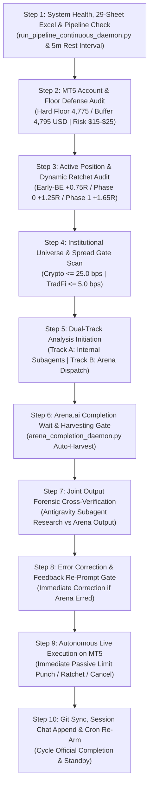

# 📋 AUTONOMOUS WAKE-UP CHECKLIST & JOINT-COMPLETION LIFECYCLE
## Antigravity Desk & Arena.ai Co-Equal Quantitative Investment Council

> **Canonical Production Checklist**: Non-bypassable 10-Step Autonomous Desk Wake-Up Sequence.  
> **Target Environment**: MetaTrader 5 (Blueberry Markets Account #5064568) | Antigravity Autonomous Decision Desk  
> **Active Goal**: Pass Phase 1 Challenge (Target: 5,500.00 USD) by End of Friday, 23rd October 2026.  
> **Mandatory Foundation**: [`STANDARDIZED_TRADING_DECISION_CHAIN.md`](file:///c:/Users/SIGMA/Documents/Trading_2/docs/specs/STANDARDIZED_TRADING_DECISION_CHAIN.md) (10-Step SOP) + Master 29-Sheet Excel Data Warehouse (`Data/DataBase_Trading.xlsx` & `Data/Manditory/`).  
> **Standard Arena Prompt Template**: [`docs/prompts/ARENA_STANDARD_PROMPT_TEMPLATE.md`](file:///c:/Users/SIGMA/Documents/Trading_2/docs/prompts/ARENA_STANDARD_PROMPT_TEMPLATE.md)  
> **Cadence**: 20-Minute Cron Trigger (`0,20,40 * * * *` at 20th, 40th, and 60th/00th minute).  
> **Strict Operational Invariant**: A cycle is NEVER completed upon prompt dispatch. A cycle is ONLY complete once BOTH Antigravity and Arena.ai have completed analysis, outputs are harvested and cross-verified via Co-Equal Council Discussion, and all necessary live MT5 actions (order punch, ratchet adjustment, order cancellation) are executed.

---

## 🔄 THE 10-STEP JOINT-COMPLETION WAKE-UP SPRINT

Every autonomous wake-up cycle (triggered by the 20-minute cron at :00, :20, :40, or reactive daemon wakeups) must sequentially execute the following 10 steps without skipping:

---

### Step 1: System Health, Master Excel Data Warehouse & Pipeline Verification
- [ ] **Master Database Freshness & Integrity Check (`Data/DataBase_Trading.xlsx`)**:
  - Verify that `Data/DataBase_Trading.xlsx` contains all **29 canonical worksheets** terminating at Sheet 28 (`19_Calendar`).
  - Confirm zero formula errors (`#REF!`, `#DIV/0!`, `#VALUE!`, `#N/A`), zero empty headers, and valid data types.
- [ ] **Continuous Data Pipeline Daemon Audit**:
  - Verify `python Terminal/run_pipeline_continuous_daemon.py` is active in background tasks.
  - Confirm the pipeline is cycling through all 28 data modules with an exact 5-minute (300-second) rest window between completed cycles.
  - If stale (> 45 min) or dead: relaunch `Terminal/run_pipeline_continuous_daemon.py` immediately.
- [ ] **Verify Core Always-On Persistent Tasks**:
  1. Pipeline Daemon (`run_pipeline_continuous_daemon.py`, 5m rest interval)
  2. Telemetry Git Sync Daemon (`autonomous_telemetry_git_daemon.py`, pushes every 60s)
  3. Arena Completion Daemon (`arena_completion_daemon.py --daemon` on port 9222)
  4. Autonomous Swarm Cron (`schedule` cron on `0,20,40 * * * *`)
  5. Web2API Council Daemon (`gemini_web2api.py` on port 8081)
  6. Heretic Engine Daemon (`heretic_daemon.py` on port 8083)

---

### Step 2: MT5 Account, Capital Floor Defense & Stressed Capacity Audit
- [ ] Query live MT5 account telemetry directly via `Terminal/generate_mt5_telemetry.py` and `mt5.account_info()`:
  - Account Balance, Equity, Margin, Free Margin.
- [ ] Audit capital defense buffers:
  - **Absolute Hard Floor**: **4,775.00 USD** (Inviolate stop-out boundary).
  - **Operating Defense Buffer**: **4,795.00 USD** (Hard Floor + 20.00 USD cushion).
  - Compute Live Cushion: `Cushion = Current Equity - 4,795.00 USD`.
- [ ] Stressed post-loss capacity calculation:
  - `Stressed Loss = Nominal Risk * 1.25 + 2.00 USD`.
  - `Stressed Equity = Current Equity - sum(Stressed Loss_i) >= 4,795.00 USD`.
  - Enforce expanded risk envelope: **15.00 to 25.00 USD per trade**.
  - Capacity: Exactly 1 position at up to 25.00 USD risk, or up to 2 concurrent positions at 15.00 USD risk (or unlocked capacity when open trades are locked in Early-BE profit).

---

### Step 3: Active Position & Dynamic Profit Ratchet Audit
- [ ] Query active positions (`mt5.positions_get()`) and pending orders (`mt5.orders_get()`).
- [ ] For each open position, enforce the **Frozen R0 Piecewise Dynamic Profit Ratchet**:
  - **Phase Early-BE (Adaptive Microstructure Breakeven)**: When price reaches `Entry + 0.75 * R0` to `0.80 * R0`, move SL to `Entry + 0.10 * R0` (zero-risk lock + broker spread buffer).
  - **Phase 0 (Risk Cut)**: When price reaches `Entry + 1.25 * R0`, move SL to `Entry + 0.15 * R0`.
  - **Phase 1 (Profit Lock)**: When price reaches `Entry + 1.65 * R0`, move SL to `Entry + 0.80 * R0`.
  - **Take Profit**: Front-run opposing liquidation magnet or Daily VWAP by 3.8–10 bps.
  - **Time Decay**: Exit at market if profit remains < +0.20R0 after 24 bars (6 hours).
- [ ] For pending limit orders: cancel or adjust any order whose underlying whale wall or structural support has degraded.

---

### Step 4: Institutional Universe Market Scan & Spread Friction Filtering
- [ ] Extract live quotes across the 18 institutional perpetuals and TradFi CFDs from MT5 telemetry:
  - **Crypto Spread Gate**: Spread must be `<= 25.0 bps`. (Eligible: BTC ~1.8 bps, BNB ~8.0 bps, ETH ~11.4 bps, BCH ~20.2 bps, TRX ~21.2 bps, SOL ~22.5 bps. Disqualify: XRP, AVAX, LTC, NEAR, LINK, ADA, DOT, DOGE).
  - **TradFi Spread Gate**: Spread must be `<= 5.0 bps`. (Eligible: EURUSD ~0.09 bps, GOLD ~0.19 bps, DJ30 ~0.22 bps, NAS100 ~0.36 bps, SP500 ~0.39 bps).
- [ ] Identify candidate setups:
  - **Model 1 (Extreme Mean Reversion)**: Extreme location (`|Z| >= 2.0 to 3.5 SD`), RSI < 40 / > 60, resting whale wall support, divergence.
  - **Model 2 (Trend Following Pullback)**: Confirmed trend regime, pullback to 20/50 EMA or Session VWAP (`|Z| < 2.0 SD`), resting whale backing.
- [ ] Mandatory Candidate Output: Compile and format the complete candidate scan table transparently every cycle.

---

### Step 5: Antigravity & Arena.ai Co-Equal Council Discussion Initiation
- [ ] **Track A: Antigravity Internal Subagent Dispatch**:
  - Dispatch the 4 authorized internal subagents via `invoke_subagent`:
    1. `Excel Data Quality Auditor`: Audits all 29 sheets of `Data/DataBase_Trading.xlsx`, verifies row counts, latest timestamps, confirms data in all sheets is continuously updating, and checks `logs/pipeline_daemon.log` to guarantee zero pipeline freezes.
    2. `Orderflow Analyst`: Steps 1, 4, 6, 7 (CVD delta divergence, L2/L3 orderbook depth, whale order persistence >= 180s, liquidation/stops map proximity).
    3. `Position Manager`: Steps 8, 9, 10 (MT5 telemetry, stressed floor simulation, ticket lot sizing, ratchet parameters).
    4. `Macro Risk Analyst`: Step 1 & Section 3 Cluster A (Calendar Tier-1 proximity, +-15m/+-35m blackout enforcement, news shocks, ETF flows).
  - Explicitly mandate each subagent to read `Data/DataBase_Trading.xlsx` (and `Data/Manditory/`) across all 29 worksheets line-by-line and follow `STANDARDIZED_TRADING_DECISION_CHAIN.md`.
- [ ] **Track B: Arena.ai Council Prompt Dispatch**:
  - Ensure the latest `Data/DataBase_Trading.xlsx` and live telemetry are pushed to GitHub `origin/main`.
  - Prepare the prompt using the canonical template [`docs/prompts/ARENA_STANDARD_PROMPT_TEMPLATE.md`](file:///c:/Users/SIGMA/Documents/Trading_2/docs/prompts/ARENA_STANDARD_PROMPT_TEMPLATE.md) (unrestricted character depth).
  - Connect to Edge CDP port `9222` and inject the prompt into Arena's TipTap editor.
  - If a feedback modal banner ("Was this task successful?") is present, click "Keep working" to dismiss it before sending.
  - Verify that generation starts (`isGenerating: true` / `hasStopBtn: true`).

---

### Step 6: Arena.ai Completion Wait & Harvesting Gate
- [ ] Let `Terminal/arena_completion_daemon.py --daemon` watch the generation lifecycle.
- [ ] Once generation completes, verify that `docs/trade_plans/ARENA_LATEST_RAW.md` has been harvested and `Data/arena_completion_status.json` reflects fresh timestamp and non-empty hash.
- [ ] Confirm both Antigravity subagent reports and Arena.ai output are in hand.

---

### Step 7: Joint Output Forensic Cross-Verification & Dialectic Synthesis
- [ ] Conduct a deep dialectic debate comparing Antigravity subagent research against Arena.ai's recommendations:
  - Do both tracks agree on candidate selection, or does one identify critical flaws (e.g. crossing spread, un-swept stops)?
  - Audit Stop Loss: must sit outside `[min_price, max_price]` of liquidation/stop sweeps with `>= 0.35–0.50 ATR` buffer.
  - Audit Take Profit: must front-run opposing liquidity magnets by 5–10 bps.
  - Audit Sizing: verify exact cash risk via `mt5.order_calc_profit` within the 15.00 to 25.00 USD envelope.

---

### Step 8: Error Correction & Feedback Re-Prompt Gate
- [ ] If Arena.ai made mathematical errors, missed fresh data on `main`, or proposed invalid levels:
  - Inject immediate corrective feedback prompt back to Arena via CDP.
- [ ] If reasoning is sound and verified, ratify the trade candidate for execution.

---

### Step 9: Autonomous Live Execution on MetaTrader 5
- [ ] **Autonomous Punch**: Whenever a candidate meets all 5 confluence pillars with floor cushion clearance:
  - Punch the passive limit order (`BUY_LIMIT` / `SELL_LIMIT`) into MetaTrader 5 immediately without asking operator permission.
  - Zero hesitation, zero latency.
- [ ] **Ratchet Execution**: If any open position touches an armed ratchet trigger:
  - Execute `mt5.order_send` with `mt5.TRADE_ACTION_SLTP` to ratchet Stop Loss immediately.
- [ ] **Pending Order Hygiene**: Delete or adjust limit orders whose setup thesis degraded.

---

### Step 10: Git Sync, Session History Append & Cron Standby (CYCLE OFFICIAL COMPLETION)
- [ ] Harvest updated account telemetry via `Terminal/generate_mt5_telemetry.py`.
- [ ] Commit and push `Data/DataBase_Trading.xlsx`, `Data/telemetry/mt5_account_telemetry.json`, prompts, and trade plans to GitHub `origin/main`.
- [ ] Append the complete turn summary to `.agents/memory/session_chat_history.md`.
- [ ] Ensure the 20-minute autonomous cron (`0,20,40 * * * *`) is armed to trigger the next sprint at the 20th, 40th, or 60th/00th minute.
- [ ] Prune all temporary scratch scripts immediately (zero scratch litter).
- [ ] Enter silent standby awaiting next autonomous wake-up.
