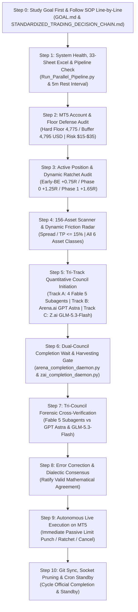

# 📋 AUTONOMOUS WAKE-UP CHECKLIST & JOINT-COMPLETION LIFECYCLE
## Antigravity Desk & Arena.ai Co-Equal Quantitative Investment Council

> **Canonical Production Checklist**: Non-bypassable Master Autonomous Desk Wake-Up Sequence (Read & Execute Fully Line-by-Line).  
> **Target Environment**: MetaTrader 5 (Blueberry Markets Account #5064568) | Antigravity Autonomous Decision Desk  
> **Active Goal Contract**: Pass Phase 1 Challenge (Target: 5,500.00 USD) by End of Friday, 23rd October 2026 (23:59 UTC).  
> **INVIOLABLE OPERATOR MANDATE**: The /goal contract is PERPETUAL and must NEVER be killed, paused, or cancelled until live equity >= 5,500.00 USD is proven on MT5.  
> **MANDATORY CANDIDATE RADAR**: The desk is STRICTLY FORBIDDEN from issuing a bare 'Stand Aside' without formulating and tracking concrete Potential Candidate Setups with checkable pre-condition trigger checklists [ ].  
> **Mandatory Foundation**: [`STANDARDIZED_TRADING_DECISION_CHAIN.md`](file:///c:/Users/SIGMA/Documents/Trading_2/Data/Manditory/STANDARDIZED_TRADING_DECISION_CHAIN.md) (Canonical Quant SOP) + Master 33-Sheet Excel Data Warehouse (`Data/DataBase_Trading.xlsx` & `Data/Manditory/`).  
> **Standard Dual-Council Prompt Template**: [`Arena_GLM_Standard_Prompt.md`](file:///c:/Users/SIGMA/Documents/Trading_2/Data/Manditory/Arena_GLM_Standard_Prompt.md) (All-in-One 4-Persona Quantitative Audit for Arena.ai [GPT Astra] & Z.ai [GLM-5.3-Flash])  
> **Operator Concerns & Perpetual Resolutions**: [`OPERATOR_ISSUES_AND_RESOLUTIONS_CHECKLIST.md`](file:///c:/Users/SIGMA/Documents/Trading_2/Data/Manditory/OPERATOR_ISSUES_AND_RESOLUTIONS_CHECKLIST.md)  
> **Cadence & Separation**: Clean 20-Minute Relative Post-Completion Separation (`T_finish + 20 min`) between completed Cycle X and Cycle X+1 trigger, supervised by autonomous 30-Minute Watchdog Sentry Cron (`0,30 * * * *` at :00 and :30 of every hour).  
> **Token Preservation Rule**: Always query the AST Knowledge Graph via `/graphify` or `python -m graphify query "<symbol/concept>"` FIRST before reading large code files.  
> **Strict Joint-Completion Invariant (Operator Mandate)**: A cycle is NEVER completed upon prompt dispatch. A cycle is marked officially **FINISHED** only when **ALL THREE entities complete processing**: (1) Antigravity 4-Quant Subagent Swarm (Fable 5), (2) Arena.ai Frontier Council (GPT Astra), and (3) Z.ai Sovereign Council (GLM-5.3-Flash). The difference between completed Cycle X and the trigger for Cycle X+1 must be strictly **20 minutes** (1200 seconds), recorded in `Data/cycle_state.json` via `Terminal/joint_cycle_controller.py`.

---

## 🚨 MANDATORY INVIOLATE 4-QUANT FLEET (FABLE 5), ARENA.AI (GPT ASTRA) & Z.AI DISPATCH GUARANTEE
> **NEVER OMIT, BYPASS, OR SKIP UNDER ANY CIRCUMSTANCES**:
> 1. **Mandatory 4-Subagent Quant Fleet (Fable 5)**: On EVERY autonomous wake-up cycle and on EVERY decision turn, Antigravity MUST physically invoke the **4 specialized quantitative subagents** via `invoke_subagent` (`Model='flash'` / Fable 5 runtime):
>    - **Statistical Regime & Diffusion Quant** (`Role='Statistical Regime Quant'` — Fable 5): Calculates Lo-MacKinlay Variance Ratio `VR(q)`, Kaufman Efficiency Ratio `ER`, Hurst exponent `H`, Ornstein-Uhlenbeck half-life `tau_half in [20m, 4h]`, and Newey-West drift `t`-stat. Strict stand-aside on `UNDEFINED` regime.
>    - **Microstructure & Liquidation Quant** (`Role='Microstructure Quant'` — Fable 5): Evaluates L2/L3 orderbook depth, Binance Futures LIR, resting whale persistence (`tau >= 180s`, refill `rho >= 0.60`), Sheet 23 retail stop sweeps (< 90s reclaim vs > 240s broken), and CVD absorption divergence (`z_CVD >= 1.5`).
>    - **Convex Portfolio & Solvency Sentry** (`Role='Solvency Sentry'` — Fable 5): Evaluates live MT5 account telemetry, exact broker `mt5.order_calc_profit` lot snapping, option-adjusted EV, Quarter-Kelly sizing, Stressed Loss `= (Nominal Risk + Spread) * 1.25 + 2.00 <= Buffer Cushion`, and House Money Staircase (Rung 1 $13.06 -> Rung 2 $33.20).
>    - **Auction Profile & Friction Arbitrageur** (`Role='Auction Profile Quant'` — Fable 5): Studies Sheet 33 Value Area (VAH, VAL, POC, Initial Balance), enforces Relative Spread Gate (`Spread Price / TP Distance <= 10.0%`), audits 33-sheet data warehouse (33/33 sheets, 0 formula errors, <= 15m fresh), and enforces the strict Event Risk Clock (PMIs 07:15–08:00 UTC, 07:10 cancel, 07:14:59 emergency flatten).
> 2. **Mandatory Canonical Governance & Line-by-Line Execution**: Every subagent prompt and council prompt MUST cite and STRICTLY FOLLOW line-by-line `STANDARDIZED_TRADING_DECISION_CHAIN.md` (read fully from start to finish) and require physical line-by-line inspection of all referenced governance documents in `Data/Manditory/`.
> 3. **Mandatory Dual Frontier Council Parallel Dispatch (Arena.ai GPT Astra & Z.ai GLM-5.3-Flash)**: On EVERY wake-up cycle, surgical 360-degree quantitative prompts citing `STANDARDIZED_TRADING_DECISION_CHAIN.md` MUST be injected SIMULTANEOUSLY into:
>    - **Arena.ai (GPT Astra)** via Chrome CDP port 9222 using `Terminal/dispatch_arena_prompt.py`.
>    - **Z.ai (GLM-5.3-Flash)** via Chrome CDP port 9222 using `Terminal/dispatch_zai_prompt.py --file <prompt_path>`.
>    Both external frontier councils must evaluate the 156-asset universe across the 4 quantitative personas, providing co-equal dialectic verification.
> 4. **Live Profit Ratchets Do Not Excuse Omission**: When live orders fill and dynamic ratchets (Early-BE, Phase 0, Phase 1) fire on MT5, the coordinator must execute the ratchet IMMEDIATELY to secure capital, but MUST SIMULTANEOUSLY dispatch the 4-subagent fleet and dual council prompt. No operational event ever excuses skipping the dual-track council.
> 5. **Mandatory Perpetual Quantitative Methodology Interrogation (Operator Invariant)**: Every subagent prompt, council prompt (Arena.ai GPT Astra & Z.ai GLM-5.3-Flash), and wake-up synthesis MUST explicitly interrogate Section 2.5 of `STANDARDIZED_TRADING_DECISION_CHAIN.md`: *Is our methodology for finding potential candidates truly sound, and how can we fundamentally improve it? Given that we monitor 156 assets with vast orderbook, CVD, and liquidation data, why has equity remained flat, and how do we think like elite quants to generate profitable executions while fiercely preserving the hard floor?* This question must always be replied to on every cycle for continuous improvement.

---

## 🧠 THE CANONICAL WAKE-UP INQUEST: 9 MANDATORY SELF-INTERROGATION GATEWAYS

Before evaluating data, touching code, or dispatching orders, the coordinator and all subagents MUST systematically self-interrogate through these 9 non-bypassable gateways:

### Gateway 0: Automated 33-Sheet Excel Data Quality & Per-Sheet Freshness (<= 15 Min) Audit
> *"Are all 33 sheets in Data/DataBase_Trading.xlsx present, error-free, and actively updating on a per-sheet level?"*
- **Automated Auditor Execution**: Run `python Terminal/Data_Factory/excel_data_quality_checker.py` at the start of every wake-up cycle.
- **Verification Criteria**:
  * Total Sheets: 33/33 sheets present and indexed.
  * Formula Errors: Exactly 0 errors (`#REF!`, `#DIV/0!`, `#N/A`, `#VALUE!`, `#NAME?`, `#NUM!`).
  * Header Integrity: 100% valid, unmerged headers in Row 1 across all sheets.
  * Per-Sheet Freshness Invariant: Inspect internal cell timestamps for EVERY dynamic trading sheet (`00_MT5_Account_Telemetry`, `11_Technical`, `14_Hyperdash_Liq_Map`, `15_Hyperdash_Stops_Map`, `17_Orderbook`, `18_CVD`, `20_Auction_Market_Structure`). Each must be `<= 15.0 minutes` (`900s`) old. Never rely solely on overall file modification time (`os.path.getmtime`).
  * Scorecard: Verified output in `Data/excel_health_audit.json`.
- **Fail-Closed Gate**: If the audit detects any formula error, missing sheet, or any dynamic operational sheet stale (> 15m), trading is frozen in 100% Cash Defense until the pipeline refreshes.

### Gateway 1: Mission, Runway & Macro Clock
> *"What is our exact target, how much runway remains, and what is our exact dollar bridge?"*
- **Primary Target**: Pass Phase 1 of Blueberry Markets evaluation (#5064568) by reaching **5,500.00 USD** equity.
- **Runway & Deadline**: End of Friday, 23rd October 2026 (23:59 UTC). Calculate exact remaining hours.
- **Dollar Bridge**: Distance = 5,500.00 USD - Current Equity.
- **Macro Blackout & Session Clock**: Is there any Tier-1 macroeconomic release (CPI, PPI, FOMC, NFP) scheduled within +-30 minutes in `Data/macro_calendar.json` or Sheet 28 (`19_Calendar`)? Are we approaching the 21:30–22:30 UTC interbank FX rollover spread expansion?

### Gateway 2: Capital Floor & Solvency Sentry
> *"What are our exact cushions above the 4,775.00 USD Hard Floor and 4,795.00 USD Operating Buffer?"*
- **Hard Floor Cushion**: Equity - 4,775.00 USD (Never breach under any condition; zero exceptions).
- **Operating Buffer Cushion**: Equity - 4,795.00 USD (+20.00 USD defense cushion).
- **Catastrophic Simultaneous Stopout Invariant**:
  Worst-Case Stressed Equity = Current Equity - sum(all open and pending: Risk_i * 1.25 + 2.00) >= 4,775.00 USD.
  Even under a total multi-asset flash-crash where every resting limit order fills and stops out at 1.25x stress simultaneously, equity MUST strictly remain >= 4,775.00 USD.
- **Single-Fill Buffer Invariant**:
  Stressed Equity Upon Fill = Current Equity - (Open Filled Risk * 1.25 + New Fill Risk * 1.25 + 2.00) >= 4,795.00 USD.

### Gateway 3: Fluid 4-Slot Dynamic Portfolio Capacity Audit
> *"How many filled positions are running, and how many resting limit orders are staged across our fluid 4-slot capacity?"*
- **Slot Definition (Operator Mandate)**: A portfolio slot is consumed ONLY when an order executes into an active running position. Resting pending limit orders do NOT consume filled position slots.
- **Capacity Limits**:
  * Active Filled Positions: `len(positions) <= 4` (MAX_CONCURRENT_POSITIONS = 4).
  * Resting Limit Orders: `len(pending) <= 10` uncapped staged limits across qualified candidate structural whale shelves.
- **Fluid Combination Policy (Zero Rigid Slot Silos)**:
  * The 4 portfolio slots are 100% fluid and can be ANY combination of high-confluence candidates across the entire 156-asset universe.
  * It can be 4 Crypto if confluence is pristine; 2 Crypto + 1 Forex + 1 Index; 3 Forex + 1 Metal; or any other mathematically validated combination.
  * Allocation is governed strictly by 5-pillar confluence and stressed solvency defense (`Stressed Equity >= 4,795.00 USD`), never by rigid predetermined slot assignments.

### Gateway 4: Active Running Positions Re-Evaluation & Dynamic Ratchets
> *"Are there any filled positions running right now, what is their R0 excursion, and have dynamic ratchets triggered?"*
- **Floating P&L & R0 Excursion**: `R = (Current Market Price - Entry Price) / R0`.
- **Dynamic Ratchet Execution**:
  * **Phase Early-BE (+0.75R0 to +0.80R0)**: Move Stop Loss to `Entry + 0.10 * R0` immediately. Trade becomes 100% risk-free, contingent risk drops to 0.00 USD (2.00 USD fee reserve), immediately freeing buffer cushion for other slots.
  * **Phase 0 (+1.25R0)**: Move Stop Loss to `Entry + 0.15 * R0`.
  * **Phase 1 (+1.65R0)**: Move Stop Loss to `Entry + 0.80 * R0` (guaranteed profit locked).
  * **Take Profit Target**: Verify TP front-runs opposing high-density liquidation magnet or Daily VWAP.
  * **Time Decay Rule**: If trade age > 24 bars (6 hours) and gain < +0.20R0, execute market close.

### Gateway 5: Resting Limit Orders Structural, Liquidation & Microstructure Sentry
> *"Are our resting limit orders still structurally valid, or has the underlying market thesis degraded?"*
- **Distance to Market**: Is price approaching the limit? Is a fill imminent?
- **Structural Shelf Integrity**: Is the underlying 20/50 EMA, Session VWAP, Volume Profile POC/VAL/VAH, or Fibonacci 0.50–0.618 shelf still intact?
- **Whale Wall Persistence**: Inspect Sheet 18 (`10_Whale_Orders`) and Sheet 25 (`17_Orderbook`). Do the resting whale walls (>= $100K) still persist (>= 180s), or were they cancelled/pulled?
- **Comprehensive Liquidation & Stop Sweep Dynamics**:
  * Inspect BOTH Hyperdash stops/liquidation maps (Sheet 23 `15_Hyperdash_Stops_Map` & Sheet 24 `16_Hyperdash_Liquidation_Map`) AND CoinGlass liquidation heatmaps, live liquidation streams, and multi-exchange surfaces (Sheets 10, 11, 12, 13, 14, 15, 16, 17, 18, 22).
  * Has an adverse retail stop sweep cluster or dense liquidation pool formed between current market price and our limit entry? If so, wait for the cascade flush before entering.
- **Sentry Decision**: Ratify one of 3 explicit actions for every resting ticket:
  1. **MAINTAIN**: Supporting walls intact, distance reasonable (<= 2.0 ATR), thesis valid.
  2. **SLIGHT ADJUSTMENT**: Supporting whale wall or shelf relocated; adjust entry/SL/TP to match.
  3. **CANCEL**: Supporting wall pulled/thinned > 50%, price drifted > 3.0 ATR away, or regime broke.

### Gateway 6: Candidate Formulation & Dynamic Friction 5-Pillar Confluence Pipeline
> *"Which candidate assets qualify right now for limit order staging under dynamic friction budgeting?"*
- **Dynamic Spread Friction Budgeting Gate**:
  * Friction must NEVER be an arbitrary barrier that causes the desk to lose high-conviction trades.
  * Evaluate the Friction Efficiency Ratio: `Spread Points / TP Distance Points <= 15.0%`.
  * Baseline guidelines: Crypto <= 35.0 bps, Forex <= 6.0 bps, Metals & Indices <= 10.0 bps, Exotics <= 25.0 bps.
  * **Pristine Confluence Risk Rights (Operator Permission to Exceed Risk)**: Authorized to scale nominal risk up to 25.00 to 35.00 USD per trade (0.51% to 0.72% equity) across ALL 156 assets for pristine 5-pillar setups anchored behind verified whale walls with persistence >= 180s and tape absorption.
- **5-Pillar Confluence Stack (Regime & Narrative Driven)**:
  * Prioritize the dominant Market Regime & Macro Narrative (The WHY) over rigid all-or-nothing conjunctive micro-gates.
  * For Model 2 Trend Pullbacks: Retracements to EMA20/50, Session VWAP, VPOC, or Fibonacci 0.50–0.618 golden pocket at mild Z-scores (|Z| = 0.5 to 1.8 SD) qualify for pro-trend limit orders.
  * For Forex and Indices: Volume Profile VPOC, Value Area High/Low, and EMA ribbons serve as structural anchors (interbank FX lacks centralized Binance-style L2 book depth).
  1. Dynamic spread friction gate passed (Efficiency Ratio <= 15%).
  2. Multi-horizon taker CVD delta divergence/absorption (`zc_div > 0.8`, Spot > 0, Futures < 0, or tick absorption).
  3. Auction location: Model 1 Extreme Mean Reversion (`|Z| >= 2.0 to 3.5 SD`, RSI < 35 or > 65) sweeping dense liquidation/stop pools OR Model 2 Trend Pullback to EMA20/50, VPOC, or Fibonacci 0.50–0.618 shelf in confirmed trend.
  4. Verified structural backing: Resting whale wall >= $100K (persistence >= 180s) for Crypto, or VPOC/EMA support for Forex/Indices, anchoring SL safely outside sweep zone.
  5. Macro clearance (zero Tier-1 event blackout).
- **Autonomous Punch Mandate**: If an empty slot exists and a candidate passes all 5 pillars, IMMEDIATELY punch the passive limit order into MT5 without hesitation.

### Gateway 7: 33-Sheet Excel Freshness & Integrity Audit (OPERATOR DIRECTIVE)
> *"Has Data/DataBase_Trading.xlsx loaded all 33 sheets cleanly with zero formula errors, and are all values actively updating and fresh?"*
- **File Health**: `Data/DataBase_Trading.xlsx` (Size ~13.1 to 13.9 MB) loads cleanly via openpyxl/pandas.
- **Sheet 33 Unmerged Header Verification**: Verify Row 1 of Sheet 33 (`20_Auction_Market_Structure`) has all 36 canonical column names written directly without unmerged/blank header gaps.
- **Mandatory Freshness Check**:
  * Verify timestamps on `17_Orderbook`, `18_CVD`, `00_MT5_Account_Telemetry`, and `20_Auction_Market_Structure` are <= 15 minutes old.
  * Verify value deltas between consecutive dumps are non-zero.
  * Flag any sheet where data is stale (> 25 minutes old) fail-closed.
- **Error Scan**: Exactly 0 formula errors (`#REF!`, `#DIV/0!`, `#VALUE!`, `#N/A`, `#NAME?`, `#NUM!`, `#NULL!`) across all 1.6M+ cells.
- **Pipeline Daemon Health**: Continuous 33-sheet pipeline daemon (`task-107241`) is actively cycling with 5m rest intervals.

### Gateway 8: Hardware Health, Background Daemons & Workspace Hygiene
> *"Is system RAM optimized, are all 5 daemons running in Antigravity task manager, and is the workspace pristine?"*
- **RAM Check**: Is RAM usage <= 70%? If not, execute `scripts/free_ram.ps1` while strictly preserving browser sessions.
- **6 Authorized Persistent Background Daemons (in Antigravity Task Manager)**:
  1. Daemon 1: Continuous 33-Sheet Pipeline Daemon (`Run_Parallel_Pipeline.py --continuous --gap 300 --workers 1`, `IsDaemon=true`)
  2. Daemon 2: 20-Minute Cron Sentry (`schedule` cron on `0,20,40 * * * *`, `IsDaemon=true`)
  3. Daemon 3: Arena Completion Daemon (`arena_completion_daemon.py --daemon` on port 9222, `IsDaemon=true`)
  4. Daemon 4: Autonomous 5-Minute Git Sync Daemon (`autonomous_git_sync_daemon.py`, commits & pushes every 300s, `IsDaemon=true`)
  5. Daemon 5: AST Graphify Watcher Daemon (`run_graphify_watcher.py`, `IsDaemon=true`)
  6. Daemon 6: Gemini Web2API Council Daemon on port 8081 (`python gemini_web2api.py --config config.json`, `IsDaemon=true`, Endogen architecture)
- **Zero Scratch Litter**: Prune all temporary scripts immediately after verification.
- **Turn Ledger Append**: Append turn record to `.agents/memory/session_chat_history.md`.

---

## 🔄 THE 10-STEP JOINT-COMPLETION WAKE-UP SPRINT

Every autonomous wake-up cycle (triggered by the 20-minute cron at :00, :20, :40, or reactive daemon wakeups) must sequentially execute the following 10 steps without skipping:

---

### Step 0: Study Goal First & Follow SOP Line-by-Line (Mandatory Invariant)
- [ ] **Mandatory Goal & SOP Review**:
  - Physically read and deeply study [Data/Manditory/GOAL.md](file:///c:/Users/SIGMA/Documents/Trading_2/Data/Manditory/GOAL.md) and [Data/Manditory/STANDARDIZED_TRADING_DECISION_CHAIN.md](file:///c:/Users/SIGMA/Documents/Trading_2/Data/Manditory/STANDARDIZED_TRADING_DECISION_CHAIN.md) before touching code or placing orders.
  - Re-anchor core mission: Pass Phase 1 of Blueberry Markets funded challenge (Account #5064568) by achieving **5,500.00 USD** equity/balance target by **Friday, 23rd October 2026 (23:59 UTC)**.
  - Refresh inviolable capital risk invariants:
    * **Absolute Hard Floor**: **4,775.00 USD** (Never breach under any condition; zero exceptions).
    * **Operating Defense Buffer**: **4,795.00 USD** (Hard floor + 20.00 USD buffer).
    * **Expanded Risk Rights**: **15.00 to 25.00 USD** standard, authorized up to **25.00 to 35.00 USD** for pristine setups across ALL 156 assets.
    * **Order Posture**: Strictly passive limit orders (BUY_LIMIT / SELL_LIMIT). No market orders.
  - Ground decision-making in historical session continuity (`session_chat_history.md`, past turns). Never execute in a vacuum without full context of the goal and past learnings.

---

### Step 1: System Health, Master Excel Data Warehouse & Pipeline Verification
- [ ] **MANDATORY 33-SHEET MASTER EXCEL INSPECTION CONFIRMATION**:
  - Physically load and confirm reading across ALL **33 canonical worksheets** of `Data/DataBase_Trading.xlsx` (Sheet 00 `00_MT5_Account_Telemetry` through Sheet 33 `20_Auction_Market_Structure`).
  - Output an explicit confirmation score verifying row counts, column counts, freshness timestamps, and confirming exactly zero formula errors (`#REF!`, `#DIV/0!`, `#VALUE!`, `#N/A`) and zero empty headers across all 33 sheets. Nothing may ever be skipped or missed.
  - Require the exact same 33-sheet verification attestation from Arena.ai on every council cycle.
- [ ] **MANDATORY LINE-BY-LINE EXCEL STUDY & NARRATIVE SYNTHESIS (OPERATOR INVARIANT)**:
  - Systematically study *each and every line* across all worksheets:
    * Spot ETF & CEX Netflows (Sheets 00–02): evaluate institutional net accumulation vs distribution line-by-line.
    * Retail Skew & Crowding (Sheets 03–05): examine Long/Short percentages across Binance, OKX, Bybit line-by-line.
    * Hyperliquid L1 Whales (Sheet 06): review top whale wallet positions, leverage, and liquidation points line-by-line.
    * Open Interest & Funding (Sheets 07–09): inspect OI expansion and funding carry costs line-by-line.
    * CoinGlass & Hyperdash Liquidation Maps (Sheets 10–17, 22, 24): trace continuous liquidation clusters line-by-line to map [min_price, max_price].
    * Resting Whale Orders & L2 Depth (Sheets 18 & 25): read every whale bid/ask line (>= $100K USD) to verify persistence (>= 180s).
    * Quantitative Technicals (Sheet 19) & Auction Structure (Sheet 33): check 20/50/200 EMAs, Session VWAP SD bands, Z-score, RSI, ATR, Daily VPOC, VAH, VAL, Monday Open, and Fibonacci Golden Pocket retracements.
    * Hyperdash Stop Order Maps (Sheet 23): check retail stop clusters line-by-line to avoid sweep traps.
    * Continuous CVD (Sheet 26): inspect 1m/5m/15m/1h Spot vs Futures taker delta divergence and absorption.
    * Breaking News & Calendar (Sheets 27 & 28): read upcoming economic events and news headlines line-by-line.
  - Synthesize findings into a rigorous **Market Narrative** (tape dominance, liquidity traps, regime classification).
  - Derive the exact **Position of Trade** (Entry behind whale bunker, SL outside sweep band, TP front-running magnet, lot sizing).
- [ ] **Verify Core 5 Always-On Persistent Tasks in Antigravity Task Manager**:
  1. Continuous 33-Sheet Pipeline Daemon (`Run_Parallel_Pipeline.py --continuous --gap 300 --workers 1`, `IsDaemon=true`)
  2. 20-Minute Cron Sentry (`schedule` cron on `0,20,40 * * * *`, `IsDaemon=true`)
  3. Arena Completion Daemon (`arena_completion_daemon.py --daemon` on port 9222, `IsDaemon=true`)
  4. Autonomous 5-Minute Git Sync Daemon (`autonomous_git_sync_daemon.py`, commits and pushes every 300s, `IsDaemon=true`)
  5. AST Graphify Watcher Daemon (`run_graphify_watcher.py`, `IsDaemon=true`)
  *If any task is absent from `manage_task(Action='list')`, launch it immediately as defined in `ACCOUNT_SWITCH_BOOTSTRAP_PROTOCOL.md`.*

---

### Step 2: MT5 Account, Capital Floor Defense & Stressed Capacity Audit
- [ ] Query live MT5 account telemetry directly via `Terminal/generate_mt5_telemetry.py` and `mt5.account_info()`:
  - Account Balance, Equity, Margin, Free Margin.
- [ ] Audit capital defense buffers:
  - **Absolute Hard Floor**: **4,775.00 USD** (Inviolate stop-out boundary).
  - **Operating Defense Buffer**: **4,795.00 USD** (Hard Floor + 20.00 USD cushion).
  - Compute Live Cushion: `Cushion = Current Equity - 4,795.00 USD`.
- [ ] Stressed post-loss capacity calculation:
  - `Stressed Loss = Nominal Risk * 1.25 + 2.00 USD`.
  - `Stressed Equity = Current Equity - sum(Stressed Loss_i) >= 4,795.00 USD`.
  - Enforce expanded risk envelope: **15.00 to 25.00 USD standard**, authorized up to **25.00 to 35.00 USD** for pristine confluence setups.
  - Fluid 4-Slot Dynamic Capacity (Operator Directive):
    * Slots are consumed ONLY when an order executes into an active running position. Resting limits do NOT consume filled slots.
    * Any combination of assets is authorized (4 crypto, 2 crypto + 1 forex + 1 indices, etc.).
    * Single-fill safety: Stressed equity upon fill >= 4,795.00 USD (preserves +20.00 USD buffer).
    * Catastrophic safety: Simultaneous stopout of all staged orders strictly preserves >= 4,775.00 USD hard floor.
    * Early-BE ratchet release: Once filled and advanced to +0.75R0, SL moves to Entry + 0.10R0, dropping risk reserve to 0.00 USD and freeing buffer headroom.

---

### Step 3: Mandatory Re-Evaluation of All Running Positions & Resting Limit Orders
- [ ] **Running Open Positions Audit (`mt5.positions_get()`)**:
  - Calculate live floating P&L, current excursion in R0 units (`R = (Price - Entry) / R0`).
  - Enforce the **Frozen R0 Piecewise Dynamic Profit Ratchet**:
    * **Phase Early-BE (+0.75R0 to +0.80R0)**: Move SL to `Entry + 0.10 * R0` (100% risk-free lock + broker spread buffer). Note: Drops contingent risk reserve to 0.00 USD, unlocking capacity.
    * **Phase 0 (+1.25R0)**: Move SL to `Entry + 0.15 * R0`.
    * **Phase 1 (+1.65R0)**: Move SL to `Entry + 0.80 * R0`.
    * **Take Profit**: Verify TP front-runs opposing high-density liquidation magnet or Daily VWAP.
    * **Time Decay**: Exit at market if profit remains < +0.20R0 after 24 bars (6 hours).
- [ ] **Resting Limit Orders Re-Evaluation Audit (`mt5.orders_get()`)**:
  - For every resting pending limit order:
    * **Structural Shelf Integrity**: Confirm whether the underlying 20/50 EMA, Session VWAP, or VAL/VAH shelf remains valid.
    * **Whale Wall Persistence**: Inspect Sheet 18 (`10_Whale_Orders`) and Sheet 25 (`17_Orderbook`) to confirm supporting whale walls (>= $100K) still persist (>= 180s). If the supporting wall cancelled or degraded, immediately cancel or re-anchor the limit order.
    * **CoinGlass & Hyperdash Sweep Dynamics**: Ensure no adverse retail stop sweep cluster or liquidation cascade pool has formed between current price and the limit entry.
    * **Distance & Opportunity Cost**: If price moved >= 3.0R0 away from the limit order without filling, re-evaluate whether to cancel or reposition.
    * **Stressed Solvency Check**: Verify that all resting orders fit within the portfolio's capacity without violating the 4,795.00 USD operating buffer.
- [ ] **Mandatory Output**: Output a dedicated "Active Positions & Limit Orders Re-Evaluation Table" on every cycle.

---

### Step 4: Full 156-Asset Multi-Asset MT5 Universe Scan & Opportunity Ranking (via `Terminal/multi_asset_opportunity_scanner.py`)
- [ ] **Exhaustive Multi-Asset Universe Screening (OPERATOR MANDATE)**:
  * Run `python Terminal/multi_asset_opportunity_scanner.py` across all 156 instruments in all 6 asset classes:
    1. Forex Raw Majors (21 pairs): EURUSD, GBPUSD, USDJPY, AUDUSD, USDCAD, USDCHF, etc.
    2. Forex Raw Minors & Crosses (39 pairs): NZDUSD, AUDNZD, NZDJPY, GBPNZD, EURZAR, etc.
    3. Commodities & Raw Precious Metals (22 assets): XAUUSD (Gold), XAGUSD (Silver), USWTI, UKBRENT, COPPER, PLATINUM, PALLADIUM, etc.
    4. Major & Minor Indices (16 indices): NAS100, SP500, DJ30, GER40, UK100, JP225, AU200, STOXX50, etc.
    5. Cryptos & Cryptos Raw (58 assets): BTCUSD, ETHUSD, SOLUSD, XRPUSD, BNBUSD, DOGEUSD, etc.
- [ ] **Dual-Engine Model Screening & Dynamic Friction Budgeting**:
  * **Dynamic Spread Friction Gate**: `Spread Points / TP Distance Points <= 15.0%`. Friction must never cause valid setups to be discarded; scale risk up to 25.00–35.00 USD for pristine confluence.
  * **Model 1 (Extreme Mean Reversion)**: |VWAP Z-Score| >= 2.0 to 3.5 SD with RSI exhaustion (<35 or >65) sweeping dense CoinGlass/Hyperdash liquidation pools.
  * **Model 2 (Trend Continuation / Pullback)**: Verified HTF trend pulling back to EMA20 / Session VWAP / Fibonacci 0.50–0.618 shelf (0.2 to 1.8 SD).
  * **Dynamic Risk Sizing**: Nominal risk 15.00 to 25.00 USD (standard), authorized up to 25.00 to 35.00 USD for pristine setups across ALL assets, preserving Stressed Equity >= 4,795.00 USD (Buffer) and >= 4,775.00 USD (Hard Floor).
- [ ] **MANDATORY CANDIDATE RADAR CHECKLIST & TRIGGER MATRIX (OPERATOR MANDATE - NEVER OMIT)**:
  * Even when standing aside at current market prices, the coordinator and Orderflow Analyst MUST ALWAYS compile and output a structured **Potential Candidate Radar Checklist** detailing the top qualified multi-asset setups.
  * For each prospective candidate, specify:
    1. **Asset & Strategy Model**: (e.g. NAS100 Model 1 Oversold, USDJPY Model 2 Pullback, Gold Model 2 Pullback, BTC Model 1 Sweep).
    2. **Mapped Structural Level**: Exact price shelf (Daily VWAP, EMA20/50, Volume Profile POC/VAL/VAH, Fibonacci Golden Pocket, Resting Whale Wall).
    3. **Proposed Ticket Geometry**: Lot Size, Entry Limit, Stop Loss (outside sweep band), Take Profit, R0 (>= 2.0R to 2.5R).
    4. **Current Status & Distance**: Distance in ATR or points from current market price.
    5. **Trigger Pre-Condition Checklist**: Exact empirical criteria required to punch (e.g. `[ ] Retail stop pool swept`, `[ ] 15m CVD delta flips positive/absorption`, `[ ] Resting bid wall >= $100K persists >= 180s`, `[ ] Session rollover/MOC gate cleared`).
  * If all checklist items are ticked `[x]` on wake-up: IMMEDIATELY punch the passive limit order autonomously!

---

### Step 5: Antigravity, Arena.ai & Z.ai Co-Equal Quantitative Council Initiation
- [ ] **Track A: Antigravity Internal Subagent Swarm Dispatch (MANDATORY 360° QUANT PROMPTS ONLY — FABLE 5)**:
  - Dispatch the 4 authorized internal subagents via `invoke_subagent` (`Model='flash'` — Fable 5 runtime):
    1. `Role='Statistical Regime Quant', Model='flash'` (Fable 5): Full 360° quant prompt calculating Lo-MacKinlay Variance Ratio `VR(q)`, Kaufman Efficiency Ratio `ER`, Ornstein-Uhlenbeck half-life `tau_half in [20m, 4h]`, Newey-West drift `t`-stat, and First-Exit diffusion probability & TTL.
    2. `Role='Microstructure Quant', Model='flash'` (Fable 5): Full 360° quant prompt evaluating L2/L3 orderbook depth, Binance Futures LIR, resting whale persistence (`tau >= 180s`, refill `rho >= 0.60`), Sheet 23 retail stop sweeps (< 90s reclaim vs > 240s broken), and CVD absorption divergence (`z_CVD >= 1.5`).
    3. `Role='Solvency Sentry', Model='flash'` (Fable 5): Full 360° quant prompt evaluating live MT5 account telemetry, exact broker `mt5.order_calc_profit` lot snapping, option-adjusted EV, Quarter-Kelly sizing, Stressed Loss `= (Nominal Risk + Spread) * 1.25 + 2.00 <= Buffer Cushion`, and House Money Staircase (Rung 1 $13.06 -> Rung 2 $33.20).
    4. `Role='Auction Profile Quant', Model='flash'` (Fable 5): Full 360° quant prompt studying Sheet 33 Value Area (VAH, VAL, POC, Initial Balance), enforcing Relative Spread Gate (`Spread Price / TP Distance <= 10.0%`), auditing 33-sheet data warehouse (33/33 sheets, 0 formula errors, <= 15m fresh), and enforcing the strict Event Risk Clock (PMIs 07:15–08:00 UTC, 07:10 cancel, 07:14:59 emergency flatten).
  - **MANDATORY READING & LINE-BY-LINE EXECUTION REQUIREMENT IN EVERY PROMPT**:
    * `0. Token Preservation: Query AST Knowledge Graph via /graphify or python -m graphify query before reading large source files.`
    * `1. @[c:\Users\SIGMA\Documents\Trading_2\Data\Manditory\STANDARDIZED_TRADING_DECISION_CHAIN.md] (MANDATORY CANONICAL QUANT SOP - FOLLOW LINE BY LINE)`
    * `2. Data/Manditory/GOAL.md`
    * `3. .agents/rules/ACTIVE_CONTEXT.md`
    * `4. .agents/memory/session_chat_history.md`
    * `5. All auxiliary files referenced in SOP: TOP_10_TRADE_EXECUTION_PITFALLS_AND_AUTOPSY.md, 32_SHEET_REAL_WORLD_PITFALL_AVOIDANCE_QUESTIONS.md, OPERATOR_ISSUES_AND_RESOLUTIONS_CHECKLIST.md`

- [ ] **Track B: Arena.ai Candidate Discovery & Multi-Persona Council Dispatch (GPT ASTRA)**:
  - Ensure the latest `Data/DataBase_Trading.xlsx` and live telemetry are pushed to GitHub `origin/main`.
  - Prepare the prompt using the canonical unified template [`Arena_GLM_Standard_Prompt.md`](file:///c:/Users/SIGMA/Documents/Trading_2/Data/Manditory/Arena_GLM_Standard_Prompt.md) citing `STANDARDIZED_TRADING_DECISION_CHAIN.md`.
  - Explicitly task Arena.ai (GPT Astra) with evaluating candidates across ALL 4 quantitative personas (Statistical Regime, Microstructure, Solvency, Auction Structure), finding potential candidates across all 156 assets, evaluating confluence, and proposing affirmative limit tickets.
  - Connect to Chrome CDP port `9222` and inject the prompt into Arena's TipTap editor via `Terminal/dispatch_arena_redteam.py` or `Terminal/dispatch_dual_council.py`.
  - Dismiss any modal banner ("Was this task successful?" / "Keep working") before sending.
  - Verify that generation starts (`isGenerating: true` / `hasStopBtn: true`).

- [ ] **Track C: Z.ai Sovereign Council Candidate Discovery Dispatch (GLM-5.3-FLASH)**:
  - MANDATORY INCLUSION (OPERATOR INVARIANT): Z.ai must be prompted in parallel on EVERY cycle alongside Arena.ai.
  - Prepare the exact same canonical unified prompt [`Arena_GLM_Standard_Prompt.md`](file:///c:/Users/SIGMA/Documents/Trading_2/Data/Manditory/Arena_GLM_Standard_Prompt.md) citing `STANDARDIZED_TRADING_DECISION_CHAIN.md`.
  - Dispatch directly into Z.ai (GLM-5.3-Flash) via `Terminal/dispatch_zai_prompt.py --file ...` or `Terminal/dispatch_dual_council.py`.
  - Verify that generation starts in Z.ai tab on Chrome CDP.

---

### Step 6: Dual-Council Completion Wait, Reactive Wakeup & Output Evaluation Gate
- [ ] **Dual-Council Completion Daemons Reactive Wakeup**:
  - The Arena Completion Daemon (`arena_completion_daemon.py --daemon`) continuously monitors Chrome CDP (port 9222) for Arena.ai.
  - The Z.ai Completion Daemon (`zai_completion_daemon.py --daemon`) continuously monitors Chrome CDP (port 9222) for Z.ai.
  - The instant either finishes generation, the daemons auto-harvest responses into `docs/trade_plans/ARENA_LATEST_RAW.md` and `docs/trade_plans/ZAI_LATEST_RAW.md`, waking up Antigravity reactively (zero token polling).
- [ ] **Mandatory Dual-Council Evaluation & Dialectic Cross-Verification**:
  - Read and deeply evaluate `docs/trade_plans/ARENA_LATEST_RAW.md` (GPT Astra) and `docs/trade_plans/ZAI_LATEST_RAW.md` (GLM-5.3-Flash).
  - Cross-synthesize council proposals against Antigravity's internal Fable 5 subagent findings.
  - Cross-verify Arena's affirmative findings and critiques with the independent empirical research of all 4 subagents in the Co-Equal Council Debate.

---

### Step 7: Joint Output Forensic Cross-Verification & Dialectic Synthesis
- [ ] Conduct a deep dialectic debate comparing Antigravity subagent research against Arena.ai's recommendations:
  - Do both tracks agree on candidate selection, or does one identify critical flaws (e.g. crossing spread, un-swept stops, missing whale backing)?
  - Audit Stop Loss: must sit outside `[min_price, max_price]` of CoinGlass/Hyperdash liquidation and stop sweeps with `>= 0.35–0.50 ATR` buffer.
  - Audit Take Profit: must front-run opposing liquidity magnets by 5–10 bps.
  - Audit Sizing: verify exact cash risk via `mt5.order_calc_profit` within the 15.00 to 25.00 USD envelope (or up to 35.00 USD for pristine confluence).

---

### Step 8: Error Correction & Feedback Re-Prompt Gate
- [ ] If Arena.ai made mathematical errors, missed fresh data on `main`, or proposed invalid levels:
  - Inject immediate corrective feedback prompt back to Arena via CDP.
- [ ] If reasoning is sound and verified across both tracks, ratify the trade candidate for execution.

---

### Step 9: Autonomous Live Execution on MetaTrader 5
- [ ] **Autonomous Punch**: Whenever a candidate meets all 5 confluence pillars with floor cushion clearance:
  - Punch the passive limit order (`BUY_LIMIT` / `SELL_LIMIT`) into MetaTrader 5 immediately without asking operator permission.
  - Zero hesitation, zero latency.
- [ ] **Ratchet Execution**: If any open position touches an armed ratchet trigger:
  - Execute `mt5.order_send` with `mt5.TRADE_ACTION_SLTP` to ratchet Stop Loss immediately.
- [ ] **Pending Order Hygiene**: Delete or adjust limit orders whose setup thesis degraded.

---

### Step 10: Git Sync, Socket Pruning, Kaizen Audit & Joint Cycle Controller Completion (CYCLE OFFICIAL COMPLETION)
- [ ] **Joint Cycle Controller Completion & 20-Minute Relative Delay Arming**:
  - Run `python Terminal/joint_cycle_controller.py --status` to attest that all 3 entities (Antigravity Fable 5 Fleet, Arena.ai GPT Astra, Z.ai GLM-5.3-Flash) are marked `COMPLETED`.
  - Verify that `next_cycle_scheduled_utc` is computed exactly as `cycle_completed_utc + 1200s` (strict 20-minute post-completion separation).
- [ ] **Autonomous 5-Minute Git Sync Verification**: Verify that `autonomous_git_sync_daemon.py` is actively running in `manage_task(Action='list')` and pushing workspace commits to `origin/main` every 300s with validated Excel CRC integrity.
- [ ] **Clean Socket Pruning Mandate**: Immediately execute `manage_subagents(Action='kill_all')` to terminate all SSE subagent connections and eliminate Windows network socket leaks.
- [ ] **Dual-Repo Parity Verification**: Run `python .agents/scripts/verify_and_sync_agents.py` to guarantee 100% byte-for-byte parity across `Trading_2` and `Engine_2`.
- [ ] **Continuous Kaizen Self-Improvement Audit**: Execute the 5-stage loop from `Data/Manditory/CONTINUOUS_KAIZEN_SELF_IMPROVEMENT_PROTOCOL.md`. Audit for any arithmetic mismatch, stale solvency assumption, or unanchored level; codify any discovered trap immediately.
- [ ] **Desk Ledger & Turn Append**: Update `docs/trade_plans/LIVE_COLLABORATIVE_ORDER_DESK.md`, `ACTIVE_CONTEXT.md`, and append turn summary to `.agents/memory/session_chat_history.md`.
- [ ] **Ensure All 8 Persistent Daemons Active in Task Manager**: Confirm that `manage_task(Action='list')` reports all authorized persistent daemons running:
  1. Continuous 33-Sheet Excel Daemon (`Run_Parallel_Pipeline.py`)
  2. 30-Minute Watchdog Sentry Cron (`0,30 * * * *`)
  3. Arena Completion Daemon (`arena_completion_daemon.py --daemon` on port 9222)
  4. Z.ai Completion Daemon (`zai_completion_daemon.py --daemon` on port 9222)
  5. Position Ratchet Daemon (`position_ratchet_daemon.py`)
  6. Autonomous Git Sync Daemon (`autonomous_git_sync_daemon.py`)
  7. AST Graphify Watcher Daemon (`run_graphify_watcher.py`)
  8. Gemini Web2API Daemon on port 8081 (`gemini_web2api.py`)
  If any daemon terminated, immediately relaunch it.
- [ ] **Zero Scratch Litter**: Prune all temporary scratch scripts immediately.
- [ ] **Silent Standby**: Enter silent standby awaiting next autonomous reactive wakeup or the 30-minute watchdog sentry.
