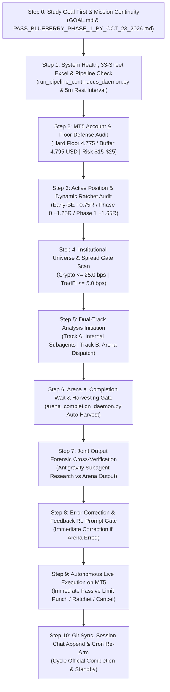

# 📋 AUTONOMOUS WAKE-UP CHECKLIST & JOINT-COMPLETION LIFECYCLE
## Antigravity Desk & Arena.ai Co-Equal Quantitative Investment Council

> **Canonical Production Checklist**: Non-bypassable 10-Step Autonomous Desk Wake-Up Sequence.  
> **Target Environment**: MetaTrader 5 (Blueberry Markets Account #5064568) | Antigravity Autonomous Decision Desk  
> **Active Goal Contract**: Pass Phase 1 Challenge (Target: 5,500.00 USD) by End of Friday, 23rd October 2026.  
> **INVIOLABLE OPERATOR MANDATE**: The /goal contract is PERPETUAL and must NEVER be killed, paused, or cancelled until live equity >= 5,500.00 USD is proven on MT5.  
> **MANDATORY CANDIDATE RADAR**: The desk is STRICTLY FORBIDDEN from issuing a bare 'Stand Aside' without formulating and tracking concrete Potential Candidate Setups with checkable pre-condition trigger checklists [ ].  
> **Mandatory Foundation**: [`STANDARDIZED_TRADING_DECISION_CHAIN.md`](file:///c:/Users/SIGMA/Documents/Trading_2/docs/specs/STANDARDIZED_TRADING_DECISION_CHAIN.md) (10-Step SOP) + Master 33-Sheet Excel Data Warehouse (`Data/DataBase_Trading.xlsx` & `Data/Manditory/`).  
> **Standard Arena Prompt Template**: [`docs/prompts/ARENA_STANDARD_PROMPT_TEMPLATE.md`](file:///c:/Users/SIGMA/Documents/Trading_2/docs/prompts/ARENA_STANDARD_PROMPT_TEMPLATE.md)  
> **Operator Concerns & Perpetual Resolutions**: [OPERATOR_ISSUES_AND_RESOLUTIONS_CHECKLIST.md](file:///c:/Users/SIGMA/Documents/Trading_2/Data/Manditory/OPERATOR_ISSUES_AND_RESOLUTIONS_CHECKLIST.md)  
> **Cadence**: 20-Minute Cron Trigger (`0,20,40 * * * *` at 20th, 40th, and 60th/00th minute).  
> **Strict Operational Invariant**: A cycle is NEVER completed upon prompt dispatch. A cycle is ONLY complete once BOTH Antigravity and Arena.ai have completed analysis, outputs are harvested and cross-verified via Co-Equal Council Discussion, and all necessary live MT5 actions (order punch, ratchet adjustment, order cancellation) are executed.

## 🚨 MANDATORY INVIOLATE 4-SUBAGENT FLEET & ARENA.AI DISPATCH GUARANTEE (OPERATOR MANDATE)
> **NEVER OMIT, BYPASS, OR SKIP UNDER ANY CIRCUMSTANCES**:
> 1. **Mandatory 4-Subagent Fleet**: On EVERY 20-minute autonomous wake-up cron and on EVERY decision turn, Antigravity MUST physically invoke the **4 specialized subagents** via invoke_subagent:
>    - Orderflow Analyst: Deeply studies Data/DataBase_Trading.xlsx (Sheets 10-18, 22-26: Orderbook, CVD, Liq Maps, Stops Maps, Whale Orders) row-by-row and column-by-column, checks spread gates, executes 5-pillar confluence, and formulates candidate limits.
>    - Position Manager: Evaluates live MT5 account telemetry, computes stressed capacity ( stressed risk, +2.83 USD operating buffer cushion, +22.83 USD hard floor cushion), verifies sizing for 2-4 concurrent slots.
>    - Macro Risk Analyst: Studies Data/DataBase_Trading.xlsx (Sheets 00-02, 27-28: ETF Flows, News, Macro Calendar) line-by-line, enforces Tier-1 blackouts and the 21:15–22:30 UTC interbank FX rollover embargo.
>    - Excel Data Quality Auditor: Studies Data/DataBase_Trading.xlsx row-by-row and column-by-column across all 33 sheets (including Sheet 33 '20_Auction_Market_Structure'), verifies zero formula errors, confirms clean sheet overwrite discipline, and verifies continuous 33-sheet Excel pipeline daemon (`Run_Parallel_Pipeline.py --continuous --gap 300`).
> 2. **Mandatory Canonical Governance**: Every subagent prompt and Arena prompt MUST cite and follow docs/specs/STANDARDIZED_TRADING_DECISION_CHAIN.md (10-Step SOP) and require line-by-line inspection of Data/DataBase_Trading.xlsx.
> 3. **Mandatory Arena.ai Surgical Red-Team Dispatch**: On EVERY wake-up cycle, a surgical red-team prompt citing STANDARDIZED_TRADING_DECISION_CHAIN.md MUST be injected into Arena.ai via Chrome CDP on port 9222.
> 4. **Live Profit Ratchets Do Not Excuse Omission**: When live orders fill and dynamic ratchets (Early-BE, Phase 0, Phase 1) fire on MT5, the coordinator must execute the ratchet IMMEDIATELY to secure capital, but MUST SIMULTANEOUSLY dispatch the 4-subagent fleet and Arena prompt. No operational event ever excuses skipping the dual-track council.

---

## 🧠 THE CANONICAL WAKE-UP INQUEST: 8 MANDATORY SELF-INTERROGATION GATEWAYS

Before evaluating data, touching code, or dispatching orders, the coordinator and all subagents MUST systematically self-interrogate through these 8 non-bypassable gateways:

### Gateway 1: Mission, Runway & Macro Clock
> *"What is our exact target, how much runway remains, and what is our exact dollar bridge?"*
- **Primary Target**: Pass Phase 1 of Blueberry Markets evaluation (#5064568) by reaching **5,500.00 USD** equity.
- **Runway & Deadline**: End of Friday, 23rd October 2026 (23:59 UTC). Calculate exact remaining hours.
- **Dollar Bridge**: Distance = 5,500.00 USD - Current Equity.
- **Macro Blackout & Session Clock**: Is there any Tier-1 macroeconomic release (CPI, PPI, FOMC, NFP) scheduled within +-30 minutes in Data/macro_calendar.json? Are we approaching the 21:30-22:30 UTC interbank FX rollover spread expansion?

### Gateway 2: Capital Floor & Solvency Sentry
> *"What are our exact cushions above the 4,775.00 USD Hard Floor and 4,795.00 USD Operating Buffer?"*
- **Hard Floor Cushion**: Equity - 4,775.00 USD (Never breach under any condition; zero exceptions).
- **Operating Buffer Cushion**: Equity - 4,795.00 USD (+20.00 USD defense cushion).
- **Catastrophic Simultaneous Stopout Invariant**:
  Worst-Case Stressed Equity = Current Equity - sum(all open and pending: Risk_i * 1.25 + 2.00) >= 4,775.00 USD.
  Even under a total 4-asset flash-crash where every resting limit order fills and stops out at 1.25x stress simultaneously, equity MUST strictly remain >= 4,775.00 USD.
- **Single-Fill Buffer Invariant**:
  Stressed Equity Upon Fill = Current Equity - (Open Filled Risk * 1.25 + New Fill Risk * 1.25 + 2.00) >= 4,795.00 USD.

### Gateway 3: 4-Slot Portfolio Capacity Audit
> *"How many filled positions are running, and how many resting limit orders are staged?"*
- **Slot Definition (Operator Mandate)**: A slot is considered filled ONLY when an order executes into an active position. Resting limit orders do NOT consume filled position slots.
- **Capacity Limits**:
  * Active Filled Positions: len(positions) <= 4 (MAX_CONCURRENT_POSITIONS = 4).
  * Resting Limit Orders: len(pending) <= 5 (MAX_RESTING_LIMITS = 5).
- **Orthogonal Cluster Coverage**: Are our 4 slots balanced across non-correlated clusters:
  1. Slot 1: Indices (NAS100.p, SP500.p)
  2. Slot 2: Crypto (BTCUSD.pi, ETHUSD.pi, SOLUSD.p)
  3. Slot 3: Metals (XAUUSD.pi, XAGUSD.pi)
  4. Slot 4: Forex (EURUSD.pi, GBPUSD.pi)

### Gateway 4: Active Running Positions Re-Evaluation & Dynamic Ratchets
> *"Are there any filled positions running right now, what is their R0 excursion, and have dynamic ratchets triggered?"*
- **Floating P&L & R0 Excursion**: R = (Current Market Price - Entry Price) / R0.
- **Dynamic Ratchet Execution**:
  * **Phase Early-BE (+0.75R0 to +0.80R0)**: Move Stop Loss to Entry + 0.10 * R0 immediately. Trade becomes 100% risk-free, contingent risk drops to 0.00 USD (2.00 USD fee reserve), immediately freeing buffer cushion for other slots.
  * **Phase 0 (+1.25R0)**: Move Stop Loss to Entry + 0.15 * R0.
  * **Phase 1 (+1.65R0)**: Move Stop Loss to Entry + 0.80 * R0 (guaranteed profit locked).
  * **Take Profit Target**: Verify TP front-runs opposing high-density liquidation magnet or Daily VWAP.
  * **Time Decay Rule**: If trade age > 24 bars (6 hours) and gain < +0.20R0, execute market close.

### Gateway 5: Resting Limit Orders Structural & Microstructure Sentry
> *"Are our resting limit orders still structurally valid, or has the underlying market thesis degraded?"*
- **Distance to Market**: Is price approaching the limit? Is a fill imminent?
- **Structural Shelf Integrity**: Is the underlying 20/50 EMA, Session VWAP, or Value Area shelf still intact, or did price experience an adverse structural regime break?
- **Whale Wall Persistence**: Inspect Sheet 18 (10_Whale_Orders) and Sheet 25 (17_Orderbook). Do the resting whale walls (>= $100K) still persist (>= 180s), or were they cancelled/pulled?
- **Adverse Stop Clusters**: Inspect Sheet 23 (15_Hyperdash_Stops_Map). Has an adverse retail stop sweep cluster formed between current market price and our limit entry?
- **Sentry Decision**: Ratify one of 3 explicit actions for every resting ticket:
  1. **MAINTAIN**: Supporting walls intact, distance reasonable (<= 2.0 ATR), thesis valid.
  2. **SLIGHT ADJUSTMENT**: Supporting whale wall or shelf relocated; adjust entry/SL/TP to match.
  3. **CANCEL**: Supporting wall pulled/thinned > 50%, price drifted > 3.0 ATR away, or regime broke.

### Gateway 6: Candidate Formulation & 5-Pillar Confluence Pipeline
> *"Which candidate assets across the 4 clusters qualify right now for limit order staging?"*
- **Spread Gate**: Crypto <= 25.0 bps, TradFi <= 5.0 bps.
- **5-Pillar Confluence Stack**:
  1. Spread Gate pass.
  2. Multi-horizon taker CVD delta divergence/absorption (zc_div > 0.8, Spot > 0, Futures < 0).
  3. Auction location: Extreme absorption (|Z| >= 2.0 to 3.5 SD in MEAN_REVERT) OR structural trend pullback (|Z| < 2.0 SD to EMA20/50 shelf in dominant trend).
  4. Resting institutional whale walls (>= $100K, persistence >= 180s) to anchor SL safely outside [min_price, max_price].
  5. Macro clearance (zero Tier-1 blackout).
- **Autonomous Punch Mandate**: If an empty slot exists and a candidate passes all 5 pillars, IMMEDIATELY punch the passive limit order into MT5 without hesitation and without asking permission.

### Gateway 7: 33-Sheet Excel Freshness & Integrity Audit (OPERATOR DIRECTIVE)
> *"Has Data/DataBase_Trading.xlsx loaded all 33 sheets cleanly with zero formula errors, and are all values actively updating and fresh?"*
- **File Health**: Data/DataBase_Trading.xlsx (Size ~13.1 to 13.8 MB) loads cleanly via openpyxl.
- **Mandatory Freshness Check**:
  * Verify each sheet is actively updating with FRESH values and NOT stale:
  * Timestamps on `17_Orderbook`, `18_CVD`, `00_MT5_Account_Telemetry`, and `20_Auction_Market_Structure` must be <= 15 minutes old.
  * Verify value deltas between consecutive dumps are non-zero (guarantees live incoming stream, not frozen cache).
  * Flag any sheet where data is stale (> 25 minutes old) fail-closed.
- **Error Scan**: Exactly 0 formula errors (#REF!, #DIV/0!, #VALUE!, #N/A, #NAME?, #NUM!, #NULL!) across all 1.6M+ cells.
- **Pipeline Daemon**: Continuous 33-sheet pipeline daemon is actively cycling with 5m rest intervals.

### Gateway 8: Hardware Health, Background Daemons & Workspace Hygiene
> *"Is system RAM optimized, are all 6 daemons running, and is the workspace pristine?"*
- **RAM Check**: Is RAM usage <= 70%? If not, execute scripts/free_ram.ps1 while strictly preserving Microsoft Edge.
- **6 Always-On Persistent Daemons**:
  1. Continuous Pipeline Daemon (run_pipeline_continuous_daemon.py, 5m rest interval)
  2. Telemetry Git Sync Daemon (autonomous_telemetry_git_daemon.py, pushes every 60s)
  3. Arena Completion Daemon (arena_completion_daemon.py --daemon on port 9222)
  4. Autonomous Swarm Cron (schedule cron on 0,20,40 * * * *)
  5. Web2API Council Daemon (gemini_web2api.py on port 8081)
  6. Heretic Engine Daemon (heretic_daemon.py on port 8083)
- **Zero Scratch Litter**: Prune all temporary scripts immediately after verification.
- **Turn Ledger Append**: Append turn record to .agents/memory/session_chat_history.md.

---

## 🔄 THE 10-STEP JOINT-COMPLETION WAKE-UP SPRINT

Every autonomous wake-up cycle (triggered by the 20-minute cron at :00, :20, :40, or reactive daemon wakeups) must sequentially execute the following 10 steps without skipping:

---

### Step 0: Study Goal First & Mission Continuity Grounding (Mandatory Invariant)
- [ ] **Mandatory Goal Review**:
  - Physically read and deeply study [Data/Manditory/GOAL.md](file:///c:/Users/SIGMA/Documents/Trading_2/Data/Manditory/GOAL.md) and [Data/Manditory/PASS_BLUEBERRY_PHASE_1_BY_OCT_23_2026.md](file:///c:/Users/SIGMA/Documents/Trading_2/Data/Manditory/PASS_BLUEBERRY_PHASE_1_BY_OCT_23_2026.md) before touching code or placing orders.
  - Re-anchor core mission: Pass Phase 1 of Blueberry Markets funded challenge (Account #5064568) by achieving **5,500.00 USD** equity/balance target by **Friday, 23rd October 2026 (23:59 UTC)**.
  - Refresh inviolable capital risk invariants:
    * **Absolute Hard Floor**: **4,775.00 USD** (Never breach under any condition; zero exceptions).
    * **Operating Defense Buffer**: **4,795.00 USD** (Hard floor + 20.00 USD buffer).
    * **Authorized Risk Envelope**: **15.00 to 25.00 USD** per trade (0.31% to 0.52% equity).
    * **Order Posture**: Strictly passive limit orders (BUY_LIMIT / SELL_LIMIT). No market orders.
  - Ground decision-making in historical session continuity (session_chat_history.md, past turns). Never execute in a vacuum without full context of the goal and past learnings.

---

### Step 1: System Health, Master Excel Data Warehouse & Pipeline Verification
- [ ] **MANDATORY 32-SHEET MASTER EXCEL INSPECTION CONFIRMATION**:
  - Physically load and confirm reading across ALL **32 canonical worksheets** of `Data/DataBase_Trading.xlsx` (Sheet 00 `00_MT5_Account_Telemetry` through Sheet 31 `19_Calendar`).
  - Output an explicit confirmation score verifying row counts, column counts, freshness timestamps, and confirming exactly zero formula errors (`#REF!`, `#DIV/0!`, `#VALUE!`, `#N/A`) and zero empty headers across all 33 sheets (including Sheet 33 '20_Auction_Market_Structure'). Nothing may ever be skipped or missed.
  - Require the exact same 33-sheet verification attestation from Arena.ai on every council cycle.
- [ ] **MANDATORY LINE-BY-LINE EXCEL STUDY & NARRATIVE SYNTHESIS (OPERATOR INVARIANT)**:
  - Systematically study *each and every line* across all worksheets:
    * Spot ETF & CEX Netflows (Sheets 00-02): evaluate institutional net accumulation vs distribution line-by-line.
    * Retail Skew & Crowding (Sheets 03-05): examine Long/Short percentages across Binance, OKX, Bybit line-by-line.
    * Hyperliquid L1 Whales (Sheet 06): review top whale wallet positions, leverage, and liquidation points line-by-line.
    * Open Interest & Funding (Sheets 07-09): inspect OI expansion and funding carry costs line-by-line.
    * Liquidation Maps & Tape (Sheets 10-17, 22): trace continuous liquidation clusters line-by-line to map [min_price, max_price].
    * Resting Whale Orders (Sheets 18 & 25): read every whale bid/ask line (>= $100K USD) to verify persistence (>= 180s).
    * Quantitative Technicals (Sheet 19): check 20/50/200 EMAs, Session VWAP SD bands, Z-score, RSI, ATR, and POC/VAH/VAL.
    * Stop Order Maps (Sheet 23): check retail stop clusters line-by-line to avoid sweep traps.
    * Continuous CVD (Sheet 26): inspect 1m/5m/15m/1h Spot vs Futures taker delta divergence and absorption.
    * Breaking News & Calendar (Sheets 27 & 28): read upcoming economic events and news headlines line-by-line.
  - Synthesize findings into a rigorous **Market Narrative** (tape dominance, liquidity traps, regime classification).
  - Derive the exact **Position of Trade** (Entry behind whale bunker, SL outside sweep band, TP front-running magnet, lot sizing).
- [ ] **Continuous Data Pipeline Daemon Audit**:
  - Verify `python Terminal/run_pipeline_continuous_daemon.py` is active in background tasks.
  - Confirm the pipeline is cycling through all 28 data modules with an exact 5-minute (300-second) rest window between completed cycles.
  - If stale (> 45 min) or dead: relaunch `Terminal/run_pipeline_continuous_daemon.py` immediately.
- [ ] **Verify Core 4 Always-On Persistent Tasks**:
  1. Continuous 32-Sheet Pipeline Daemon (`Run_Parallel_Pipeline.py --continuous --gap 300 --workers 1`)
  2. 20-Minute Cron Sentry (`schedule` cron on `0,20,40 * * * *`)
  3. Arena Completion Daemon (`arena_completion_daemon.py --daemon` on port 9222)
  4. Autonomous 5-Minute Git Sync Daemon (`autonomous_git_sync_daemon.py`, commits and pushes every 300s)

---

### Step 2: MT5 Account, Capital Floor Defense & Stressed Capacity Audit
- [ ] Query live MT5 account telemetry directly via `Terminal/generate_mt5_telemetry.py` and `mt5.account_info()`:
  - Account Balance, Equity, Margin, Free Margin.
- [ ] Audit capital defense buffers:
  - **Absolute Hard Floor**: **4,775.00 USD** (Inviolate stop-out boundary).
  - **Operating Defense Buffer**: **4,795.00 USD** (Hard Floor + 20.00 USD cushion).
  - Compute Live Cushion: `Cushion = Current Equity - 4,795.00 USD`.
- [ ] Stressed post-loss capacity calculation:
  - `Stressed Loss = Nominal Risk * 1.25 + 2.00 USD`.
  - `Stressed Equity = Current Equity - sum(Stressed Loss_i) >= 4,795.00 USD`.
  - Enforce expanded risk envelope: **15.00 to 25.00 USD per trade**.
  - 4-Slot Portfolio Capacity (Operator Directive):
    * Slots are considered filled ONLY when an order executes into an active position. Resting limits do NOT consume filled slots.
    * Up to 4 parallel candidate limit orders can be staged across orthogonal clusters (Indices, Crypto, Metals, Forex).
    * Single-fill safety: Stressed equity upon fill >= 4,795.00 USD (preserves +20.00 USD buffer).
    * Worst-case catastrophic safety: Simultaneous stopout of all resting orders strictly preserves >= 4,775.00 USD hard floor.
    * Early-BE ratchet release: Once filled and advanced to +0.75R0, SL moves to Entry + 0.10R0, dropping risk reserve to  and freeing buffer headroom.

---

### Step 3: Mandatory Re-Evaluation of All Running Positions & Resting Limit Orders
- [ ] **Running Open Positions Audit (`mt5.positions_get()`)**:
  - Calculate live floating P&L, current excursion in R0 units (`R = (Price - Entry) / R0`).
  - Enforce the **Frozen R0 Piecewise Dynamic Profit Ratchet**:
    * **Phase Early-BE (+0.75R0 to +0.80R0)**: Move SL to `Entry + 0.10 * R0` (100% risk-free lock + broker spread buffer). Note: Drops contingent risk reserve to $2.00, unlocking secondary slots.
    * **Phase 0 (+1.25R0)**: Move SL to `Entry + 0.15 * R0`.
    * **Phase 1 (+1.65R0)**: Move SL to `Entry + 0.80 * R0`.
    * **Take Profit**: Verify TP front-runs opposing high-density liquidation magnet or Daily VWAP.
    * **Time Decay**: Exit at market if profit remains < +0.20R0 after 24 bars (6 hours).
- [ ] **Resting Limit Orders Re-Evaluation Audit (`mt5.orders_get()`)**:
  - For every resting pending limit order (e.g. Ticket #19162262 NAS100, Ticket #19162276 BTC):
    * **Structural Shelf Integrity**: Confirm whether the underlying 20/50 EMA, Session VWAP, or VAL/VAH shelf remains valid.
    * **Whale Wall Persistence**: Inspect Sheet 18 (`10_Whale_Orders`) and Sheet 28 (`17_Orderbook`) to confirm supporting whale walls (>= $100K) still persist (>= 180s). If the supporting wall cancelled or degraded, immediately cancel or re-anchor the limit order.
    * **Liquidation & Stop Sweep Dynamics**: Ensure no adverse retail stop sweep cluster has formed between current price and the limit entry.
    * **Distance & Opportunity Cost**: If price moved >= 3.0R0 away from the limit order without filling, re-evaluate whether to cancel or reposition.
    * **Stressed Solvency Check**: Verify that all resting orders fit within the portfolio's 4-slot capacity without violating the 4,795.00 USD operating buffer.
- [ ] **Mandatory Output**: Output a dedicated "Active Positions & Limit Orders Re-Evaluation Table" on every cycle.

---

### Step 4: Institutional Universe Market Scan & Candidate Radar Checklist
- [ ] Extract live quotes across the 18 institutional perpetuals and TradFi CFDs from MT5 telemetry:
  - **Crypto Spread Gate**: Spread must be `<= 25.0 bps`. (Eligible: BTC ~1.8 bps, BNB ~8.0 bps, ETH ~11.4 bps, BCH ~20.2 bps, TRX ~21.2 bps, SOL ~22.5 bps. Disqualify: XRP, AVAX, LTC, NEAR, LINK, ADA, DOT, DOGE).
  - **TradFi Spread Gate**: Spread must be `<= 5.0 bps`. (Eligible: EURUSD ~0.09 bps, GOLD ~0.19 bps, DJ30 ~0.22 bps, NAS100 ~0.36 bps, SP500 ~0.39 bps).
- [ ] **MANDATORY CANDIDATE RADAR CHECKLIST & TRIGGER MATRIX (OPERATOR MANDATE - NEVER OMIT)**:
  * Even when standing aside at current market prices, the coordinator and Orderflow Analyst MUST ALWAYS compile and output a structured **Potential Candidate Radar Checklist** detailing every prospective setup on our active radar.
  * For each prospective candidate, specify:
    1. **Asset & Strategy Model**: (e.g. BTC Model 2 Pullback, GOLD Model 1 Absorption, SOL VWAP Shelf).
    2. **Mapped Structural Level**: Exact price shelf (Daily VWAP, EMA20/50, Volume Profile POC/VAL/VAH).
    3. **Proposed Ticket Geometry**: Lot Size, Entry Limit, Stop Loss (outside sweep band), Take Profit, R0.
    4. **Current Status & Distance**: Distance in ATR or points from current market price.
    5. **Trigger Pre-Condition Checklist**: Exact empirical criteria required to punch (e.g. `[ ] Retail stop pool swept`, `[ ] 15m CVD delta flips positive/absorption`, `[ ] Resting bid wall >= $100K persists >= 180s`, `[ ] Session rollover/MOC gate cleared`).
  * If all checklist items are ticked `[x]` on wake-up: IMMEDIATELY punch the passive limit order autonomously!
- [ ] Mandatory Candidate Output: Compile and format the complete candidate scan table and Candidate Radar Checklist transparently every cycle.
- [ ] Extract live quotes across the 18 institutional perpetuals and TradFi CFDs from MT5 telemetry:
  - **Crypto Spread Gate**: Spread must be `<= 25.0 bps`. (Eligible: BTC ~1.8 bps, BNB ~8.0 bps, ETH ~11.4 bps, BCH ~20.2 bps, TRX ~21.2 bps, SOL ~22.5 bps. Disqualify: XRP, AVAX, LTC, NEAR, LINK, ADA, DOT, DOGE).
  - **TradFi Spread Gate**: Spread must be `<= 5.0 bps`. (Eligible: EURUSD ~0.09 bps, GOLD ~0.19 bps, DJ30 ~0.22 bps, NAS100 ~0.36 bps, SP500 ~0.39 bps).
- [ ] Identify candidate setups:
  - **Model 1 (Extreme Mean Reversion)**: Extreme location (`|Z| >= 2.0 to 3.5 SD`), RSI < 40 / > 60, resting whale wall support, divergence.
  - **Model 2 (Trend Following Pullback)**: Confirmed trend regime, pullback to 20/50 EMA or Session VWAP (`|Z| < 2.0 SD`), resting whale backing.
- [ ] Mandatory Candidate Output: Compile and format the complete candidate scan table transparently every cycle.

---

### Step 5: Antigravity & Arena.ai Co-Equal Council Discussion Initiation
- [ ] **Track A: Antigravity Internal Subagent Dispatch**:
  - Dispatch the 4 authorized internal subagents via `invoke_subagent`:
    1. `Excel Data Quality Auditor`: Audits all 29 sheets of `Data/DataBase_Trading.xlsx`, verifies row counts, latest timestamps, confirms data in all sheets is continuously updating, and checks `logs/pipeline_daemon.log` to guarantee zero pipeline freezes.
    2. `Orderflow Analyst`: Steps 1, 4, 6, 7 (CVD delta divergence, L2/L3 orderbook depth, whale order persistence >= 180s, liquidation/stops map proximity).
    3. `Position Manager`: Steps 8, 9, 10 (MT5 telemetry, stressed floor simulation, ticket lot sizing, ratchet parameters).
    4. `Macro Risk Analyst`: Step 1 & Section 3 Cluster A (Calendar Tier-1 proximity, +-15m/+-35m blackout enforcement, news shocks, ETF flows).
  - Explicitly mandate each subagent to read `Data/DataBase_Trading.xlsx` (and `Data/Manditory/`) across all 29 worksheets line-by-line and follow `STANDARDIZED_TRADING_DECISION_CHAIN.md`.
- [ ] **Track B: Arena.ai Council Prompt Dispatch**:
  - Ensure the latest `Data/DataBase_Trading.xlsx` and live telemetry are pushed to GitHub `origin/main`.
  - Prepare the prompt using the canonical template [`docs/prompts/ARENA_STANDARD_PROMPT_TEMPLATE.md`](file:///c:/Users/SIGMA/Documents/Trading_2/docs/prompts/ARENA_STANDARD_PROMPT_TEMPLATE.md) (unrestricted character depth).
  - Connect to Edge CDP port `9222` and inject the prompt into Arena's TipTap editor.
  - If a feedback modal banner ("Was this task successful?") is present, click "Keep working" to dismiss it before sending.
  - Verify that generation starts (`isGenerating: true` / `hasStopBtn: true`).

---

### Step 6: Arena.ai Completion Wait, Reactive Wakeup & Output Evaluation Gate
- [ ] **Arena Completion Daemon Reactive Wakeup**:
  - The Arena Completion Daemon (`arena_completion_daemon.py --daemon`) continuously monitors Chrome CDP (port 9222).
  - The instant Arena finishes generation, the daemon auto-harvests the complete response into `docs/trade_plans/ARENA_LATEST_RAW.md` and wakes up Antigravity reactively (zero token polling).
- [ ] **Mandatory Arena.ai Evaluation & Cross-Verification**:
  - Immediately read and deeply evaluate `docs/trade_plans/ARENA_LATEST_RAW.md`.
  - Thoroughly inspect Arena's ruling, entry/SL/TP levels, 17-gate audit, and mathematical critique.
  - Cross-verify Arena's critique with the independent empirical findings of all 4 subagents in the Co-Equal Council Debate.

### Step 7: Joint Output Forensic Cross-Verification & Dialectic Synthesis
- [ ] Conduct a deep dialectic debate comparing Antigravity subagent research against Arena.ai's recommendations:
  - Do both tracks agree on candidate selection, or does one identify critical flaws (e.g. crossing spread, un-swept stops)?
  - Audit Stop Loss: must sit outside `[min_price, max_price]` of liquidation/stop sweeps with `>= 0.35–0.50 ATR` buffer.
  - Audit Take Profit: must front-run opposing liquidity magnets by 5–10 bps.
  - Audit Sizing: verify exact cash risk via `mt5.order_calc_profit` within the 15.00 to 25.00 USD envelope.

---

### Step 8: Error Correction & Feedback Re-Prompt Gate
- [ ] If Arena.ai made mathematical errors, missed fresh data on `main`, or proposed invalid levels:
  - Inject immediate corrective feedback prompt back to Arena via CDP.
- [ ] If reasoning is sound and verified, ratify the trade candidate for execution.

---

### Step 9: Autonomous Live Execution on MetaTrader 5
- [ ] **Autonomous Punch**: Whenever a candidate meets all 5 confluence pillars with floor cushion clearance:
  - Punch the passive limit order (`BUY_LIMIT` / `SELL_LIMIT`) into MetaTrader 5 immediately without asking operator permission.
  - Zero hesitation, zero latency.
- [ ] **Ratchet Execution**: If any open position touches an armed ratchet trigger:
  - Execute `mt5.order_send` with `mt5.TRADE_ACTION_SLTP` to ratchet Stop Loss immediately.
- [ ] **Pending Order Hygiene**: Delete or adjust limit orders whose setup thesis degraded.

---

### Step 10: Git Sync, Socket Pruning, Kaizen Audit & Cron Standby (CYCLE OFFICIAL COMPLETION)
- [ ] **Autonomous 5-Minute Git Sync Verification**: Verify that `autonomous_git_sync_daemon.py` (`task-104957`) is actively running and pushing workspace commits to `origin/main` every 300s with validated Excel CRC integrity.
- [ ] **Clean Socket Pruning Mandate**: Immediately execute `manage_subagents(Action='kill_all')` to terminate all SSE subagent connections and eliminate Windows network socket leaks.
- [ ] **Dual-Repo Parity Verification**: Run `python .agents/scripts/verify_and_sync_agents.py` to guarantee 100% byte-for-byte parity across `Trading_2` and `Engine_2`.
- [ ] **Continuous Kaizen Self-Improvement Audit**: Execute the 5-stage loop from `Data/Manditory/CONTINUOUS_KAIZEN_SELF_IMPROVEMENT_PROTOCOL.md`. Audit for any arithmetic mismatch, stale solvency assumption, or unanchored level; codify any discovered trap immediately.
- [ ] **Desk Ledger & Turn Append**: Update `docs/trade_plans/LIVE_COLLABORATIVE_ORDER_DESK.md`, `ACTIVE_CONTEXT.md`, and append turn summary to `.agents/memory/session_chat_history.md`.
- [ ] **Ensure Cron Sentry Active**: Confirm that the 20-minute autonomous cron sentry (`0,20,40 * * * *`, `task-104771`) is running to trigger the next sprint at the 20th, 40th, or 60th/00th minute.
- [ ] **Zero Scratch Litter**: Prune all temporary scratch scripts immediately.
- [ ] **Silent Standby**: Enter silent standby awaiting next autonomous reactive wakeup or cron trigger.
