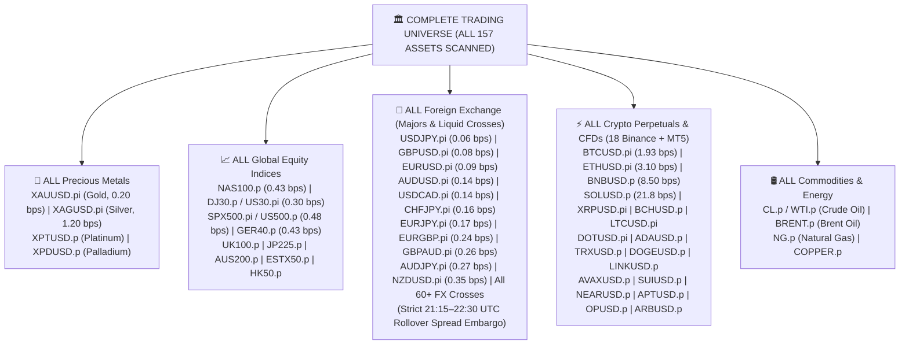
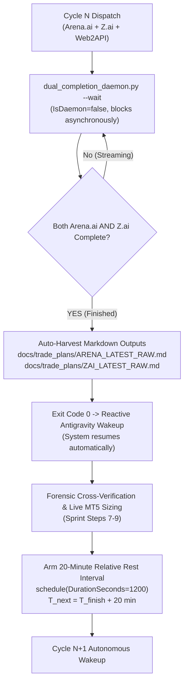
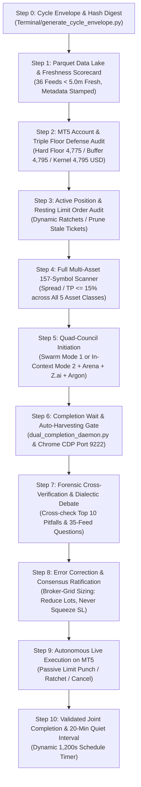

# 📋 AUTONOMOUS WAKE-UP CHECKLIST & JOINT-COMPLETION LIFECYCLE
## Antigravity Desk, Arena.ai, Z.ai & Gemini-4 Argon High Co-Equal Quantitative Council

> **Document Status**: CANONICAL PRODUCTION MASTER CHECKLIST (MANDATORY LINE-BY-LINE STUDY & AUTONOMOUS PIPELINE EXECUTION)  
> **Location**: `Data/Manditory/AUTONOMOUS_WAKEUP_CHECKLIST.md`  
> **Target Environment**: MetaTrader 5 (Blueberry Markets Account #5064568, SVG-Live, Raw Spread) | Antigravity Autonomous Decision Desk  
> **Active Goal Contract**: Pass Phase 1 Challenge (Mandatory Statutory Target: **5,500.00 USD** Equity by **Friday Market Close (2026-10-30 21:00 UTC / 2026-10-31 02:30 IST)**).  
> **Mandatory Friday Target Delta**: Current Equity **4,793.35 USD** -> Target **5,500.00 USD** (Remaining: **+706.65 USD** / **+14.74%** in ~47.5 hours).  
> 
> 🛑 **INVIOLABLE OPERATOR MANDATE: SOVEREIGN AUTONOMOUS EXECUTION & FULL TRADE RIGHTS (PUSH / DELETE / MODIFY)**:
> 
> ### 1. THE CANONICAL UNIVERSAL WAKEUP PROMPT:
> ```
> @[c:\Users\SIGMA\Documents\Trading_2\Data\Manditory\AUTONOMOUS_WAKEUP_CHECKLIST.md] Instantiated
> ```
> *(This exact prompt is the canonical, universal execution trigger for BOTH operator manual invocations in chat AND the 20-minute autonomous background cron scheduler daemon `task-151709`).*
> 
> ### 2. THE SOVEREIGN AUTONOMOUS TRADE MANDATE (FULL PUSH, DELETE & MODIFY RIGHTS):
> The coordinator and autonomous quant desk hold **FULL SOVEREIGN AUTHORITY TO ACTUATE BROKER TRADES END-TO-END WITHOUT ASKING PERMISSION**:
> - **AUTONOMOUS PUSH AUTHORITY (STAGE MAKER LIMIT ORDERS ACROSS ALL POTENTIAL CANDIDATES)**:
>   * **Full Sovereign Authority to Stage All Eligible Candidates**: The desk is explicitly authorized to apply passive maker limit orders for ALL high-confluence potential candidates discovered during in-memory 156-asset lake scans simultaneously (up to 15 resting pending limits across Crypto, FX, Metals, Indices).
>   * **Zero Pre-Fill Capital Drag**: Passive maker limit orders commit zero margin and tie up zero realized capital while resting.
>   * **Spread-Padded Structural SL Invariant (Short Asymmetric Buffer)**: For all SHORT positions, because stops trigger at the broker ASK price while charts display BID, Stop Loss MUST explicitly incorporate a mandatory spread clearance buffer (`SL_short = Resistance + 1.2 * ATR_14 + 1.5 * Spread_Price`). This strictly eliminates artificial stop-outs caused by spread expansion when the Bid price never violated structural resistance.
>   * **Dynamic Fill Supervision**: Dynamic Position Supervisor (`dynamic_position_supervisor.py`) actively supervises fills: capping concurrently filled positions to <= 2 and immediately ratcheting to Breakeven (+0.15R) at +0.80R gain.
> - **AUTONOMOUS DELETE / PURGE AUTHORITY (PRUNE STALE / INVALIDATED ORDERS)**:
>   * Full authority to cancel or delete resting limit orders immediately upon observing:
>     (a) Thesis invalidation (price breaks swing high/low prior to fill).
>     (b) Whale armor depletion (defending wall in `10_Whale_Orders.parquet` dissipates, pulls, or drops < 100K USD / 180s).
>     (c) Spread blowout (> 5.0 bps TradFi / > 25.0 bps Crypto).
>     (d) 6-hour TTL expiration (> 24 bars unfilled without testing depth).
> - **AUTONOMOUS MODIFY AUTHORITY (DYNAMIC RATCHETS & DEFENSIVE SCRATCHES)**:
>   * Full authority to actuate monotone stop-loss modifications directly on MT5 via `dynamic_position_supervisor.py`:
>     (a) **Stage 1 Breakeven Lock**: At `+0.80R` gain -> Ratchet SL to `Entry + 0.15R` (eliminating downside risk to $0.00 and unlocking fresh capacity).
>     (b) **Stage 2 Profit Lock**: At `+1.50R` gain -> Ratchet SL to `Entry + 0.80R`.
>     (c) **Time Decay Scratch**: If running position age > 24 bars (6h) with gain < +0.20R, scratch at market immediately.
> 
> **ZERO PERMISSION HESITATION**: The desk NEVER pauses to ask "May I push the order?" or "Should I ratchet?". Reading this document means: **ACT AUTONOMOUSLY, PROTECT THE HARD FLOOR, EXECUTE DISCIPLINED QUANTITATIVE TRADES.**
> 
> When instantiated, execute the entire 11-step pipeline end-to-end without fail:
> 1. Physically load and audit all mandatory governance documents line-by-line via `audit_file_read_verifier.py`.
> 2. Physically pre-load all 42 Parquet feeds (`Data/feeds/*.parquet`) into in-memory RAM cache (`DataLakeMemoryStore`).
> 3. Verify freshness scorecard (< 5.0m target) and execute the Mandatory 43-Feed Forensic Combined Microstructure & Macro Analysis Matrix in BOTH the internal thinking chain and final response (generic boilerplate ledgers strictly banned; thinking chain must systematically interrogate all 43 feeds, liquidation cascades, whale walls, and spread-padded SL bounds for each screened asset without operator prompting).
> 4. Audit MT5 account solvency against the **4,775.00 USD Hard Statutory Floor** and **4,795.00 USD Operating Defense Buffer**.
> 5. Supervise live positions (ratcheting +0.80R to BE lock, +1.50R to profit lock, 6h time decay scratch).
> 6. Perform vectorized scanning across all 156+ assets across all 4 macro clusters (Crypto, FX, Metals, Indices) with zero omission.
> 7. If in Capital Preservation Mode (Equity <= 4,795.00 USD), candidate radar is armed; stage limit orders autonomously the instant capacity unlocks.
> 8. Mathematically validate proposed candidates through `Terminal/Harness/execution_harness.py`.
> 9. Execute validated orders autonomously on MT5, optimize RAM, and arm the 20-minute rest timer.

---

## 🛑 PART 0: THE MANDATORY 3-TIER PRE-TRADE & SCREENING READY GATE (WHAT MUST BE LOADED)

Before evaluating any candidate asset, formulating any hypothesis, staging any order, or modifying any position, the desk must verify that all three tiers of mandatory files are physically loaded, verified, and active in memory:

### 🔒 THE 4-PILLAR CRYPTOGRAPHIC & PROGRAMMATIC PROOF-OF-READ FRAMEWORK (MANDATORY INVARIANT)

To eliminate context amnesia, prevent assumption bias, and guarantee that the quant desk NEVER hallucinates, summarizes from memory, or skims files, every wake-up cycle and candidate scan MUST execute and display the **4-Pillar Cryptographic Proof-of-Read Protocol**:

1. **Pillar 1: Dynamic SHA-256 Cryptographic Digest & Byte/Line Counting (`audit_file_read_verifier.py`)**:
   - *The Principle*: An AI agent or human can easily memorize or verbally claim to have read a document without opening it. However, a model CANNOT predict or fabricate the exact byte size, line count, and SHA-256 cryptographic hash of files changing dynamically on disk.
   - *Mandatory Execution*: On every turn, execute `python Terminal/Data_Factory/audit_file_read_verifier.py` to physically read every byte of all 8 mandatory governance documents and all 42 Parquet feeds, outputting their dynamic SHA-256 hashes, exact line counts, and byte lengths.
2. **Pillar 2: In-Memory Parquet Pre-Load & Shape Tuple Assertion (`DataLakeMemoryStore`)**:
   - *The Principle*: Disk I/O bottlenecks and partial file reads during vectorized screening lead to corrupted indicators and missing whale walls. 
   - *Mandatory Execution*: At the start of every cycle, physically ingest all 42 Parquet feeds (`Data/feeds/*.parquet`) into unified RAM cache (`DataLakeMemoryStore.pre_load_all(force=True)`). The engine asserts the exact shape tuple `(N_rows, N_cols)` and total row count across all 4 pillars, screening all 156 assets at zero disk latency, and calling `DataLakeMemoryStore.clear()` and garbage collection immediately upon scan completion to free RAM.
3. **Pillar 3: Fail-Closed Programmatic Read Assertion in Execution Code**:
   - *The Principle*: Governance rules must be self-enforcing in Python code, not merely aspirational in Markdown.
   - *Mandatory Execution*: Both `Terminal/multi_asset_opportunity_scanner.py` and `Terminal/Harness/execution_harness.py` contain programmatic read assertion gates. If any governance document or required parquet feed fails to load, has 0 rows, or is stale (> 5.0m), the scripts throw an unhandled fatal exception and halt trading immediately (Fail-Closed Cash Defense).
4. **Pillar 4: Exact Internal Citation of Invariants & Forensic Autopsies**:
   - *The Principle*: Proof of comprehension requires citing exact internal numbers, table boundaries, and forensic trade inquests.
   - *Mandatory Execution*: Trade rationale must cite specific line numbers, exact formulas, and autopsy lessons (e.g. Hard Floor 4,775.00 USD, Buffer 4,795.00 USD from Section 0.1 of `STANDARDIZED_TRADING_DECISION_CHAIN.md`; Autopsies 1–5 from `TOP_10_TRADE_EXECUTION_PITFALLS_AND_AUTOPSY.md`; 25 institutional controls; and exact feed column metrics).

### Tier 1: Canonical Governance & Methodology Documents (Read Line-by-Line Gate)
1. **[`Data/Manditory/STANDARDIZED_TRADING_DECISION_CHAIN.md`](file:///c:/Users/SIGMA/Documents/Trading_2/Data/Manditory/STANDARDIZED_TRADING_DECISION_CHAIN.md)**
   - *Core Mandate*: Enforces the 12-Step Quantitative SOP, Dynamic Capacity Policy (`N_open + N_pending <= 3` in DD Defense, max 1 in Capital Preservation Mode), In-Memory Pre-Load Architecture (`DataLakeMemoryStore`), and Dual-Model Confluence Filter (Model 1 Mean Reversion vs Model 2 Trend Pullback).
2. **[`Data/Manditory/TOP_10_TRADE_EXECUTION_PITFALLS_AND_AUTOPSY.md`](file:///c:/Users/SIGMA/Documents/Trading_2/Data/Manditory/TOP_10_TRADE_EXECUTION_PITFALLS_AND_AUTOPSY.md)**
   - *Core Mandate*: Enforces ex-ante checks against all 10 lethal traps:
     * *Pitfall 1*: Zero ghost whale walls (verify `is_bid` vs `is_ask` polarity).
     * *Pitfall 2*: Zero staging above un-swept retail stop cascades.
     * *Pitfall 3*: Zero catching unabsorbed CVD waterfalls (`zc_div > 0.8` required).
     * *Pitfall 4*: Zero sub-ATR stops inside sweep zones (`SL >= 1.2 * ATR_14` and `>= 0.45 ATR` behind whale armor).
     * *Pitfall 5*: Zero random walk fades (`VR(4) < 0.85` strictly required for fades; `< 3` consecutive higher lows/lower highs).
     * *Pitfall 6*: Zero high spread friction (TradFi `<= 5.0 bps`, Crypto `<= 25.0 bps`).
     * *Pitfall 7*: Zero entries during bank rollover (21:15–22:30 UTC embargo).
     * *Pitfall 8*: Zero correlated cluster double-bets (max 1 position per asset class).
     * *Pitfall 9*: Zero overhead orderbook blockades choking Take Profit.
     * *Pitfall 10*: Zero lot size inflation to fit artificial micro-stops.
3. **[`Data/Manditory/32_SHEET_REAL_WORLD_PITFALL_AVOIDANCE_QUESTIONS.md`](file:///c:/Users/SIGMA/Documents/Trading_2/Data/Manditory/32_SHEET_REAL_WORLD_PITFALL_AVOIDANCE_QUESTIONS.md)**
   - *Core Mandate*: Exhaustive 35-feed row-by-row interrogation engine across all 4 data lake pillars (Macro, Derivatives Skew, Liquidations/Stop Cascades, Depth/Whales/CVD).
4. **[`Data/Manditory/AUTONOMOUS_WAKEUP_CHECKLIST.md`](file:///c:/Users/SIGMA/Documents/Trading_2/Data/Manditory/AUTONOMOUS_WAKEUP_CHECKLIST.md)**
   - *Core Mandate*: Master wakeup sprint and full 156-asset universe mapping.
5. **[`.agents/rules/ACTIVE_CONTEXT.md`](file:///c:/Users/SIGMA/Documents/Trading_2/.agents/rules/ACTIVE_CONTEXT.md)**
   - *Core Mandate*: Real-time account telemetry (live balance, equity, margin used, cushion to the 4,775.00 USD Hard Statutory Floor, and open positions).
6. **[`.agents/rules/FABLE5_CHECKLIST.md`](file:///c:/Users/SIGMA/Documents/Trading_2/.agents/rules/FABLE5_CHECKLIST.md)** (Section 2.4)
   - *Core Mandate*: Programmatic pre-execution gatekeeper specifications and anti-lookahead rules.

### Tier 2: The 35-Feed In-Memory Parquet Data Lake (`Data/feeds/*.parquet`)
Before evaluating ANY symbol, all 42 physical `.parquet` files are pre-loaded into memory (`DataLakeMemoryStore`) across 4 analytical clusters:
- **Cluster A: Macro Netflows & Calendar**:
  * `00_MT5_Account_Telemetry.parquet`: Realized balance, equity, margin level.
  * `1_Crypto_ETF_Flows.parquet`: Institutional Bitcoin and Ethereum ETF daily net flows.
  * `2_Spot_Netflow_S.parquet`: Exchange spot inflows (selling) vs outflows (accumulation).
  * `19_News.parquet`: Breaking geopolitical and financial news headlines.
  * `19_Calendar.parquet`: Tier-1 high-impact macroeconomic event timestamps (CPI, NFP, FOMC; blackout +-15m Crypto, +-35m TradFi).
- **Cluster B: Derivatives Skew & Regime**:
  * `3_Exchanges_LS_Ratio_15M.parquet`, `1H`, `4H`: Top-trader Long/Short ratio.
  * `4_Hyperliquid_Analysis.parquet`: 2,001 tracked on-chain whale wallets.
  * `5_OI.parquet`: Open Interest change.
  * `5_Funding_Rate.parquet` & `6_Funding_Fee_Settlement.parquet`: Perpetual funding rate and settlement cost.
  * `11_Technical.parquet`: EMAs, Session VWAP, VWAP Z-score, RSI14, ATR14, Lo-MacKinlay `VR(4)`, Kaufman `ER(48)`.
  * `20_Auction_Market_Structure.parquet`: Daily and Weekly Volume Profile POC, VAH, VAL, and session extremes.
- **Cluster C: Liquidation Geometry & Stop Cascades**:
  * `7_Liq_Heapmap.parquet` & `7_Live_Liq.parquet`: Real-time aggregated liquidation heatmaps.
  * `8_Exchange_Liquidation_Map_1D.parquet` & `7D.parquet`: Liquidation distributions.
  * `9_Liquidation_Max_Pain_24H.parquet`, `48H`, `3D`, `7D`: Max Pain price levels.
  * `14_Hyperdash_Liq_Map.parquet`: Continuous dollar-by-dollar liquidation ladder.
  * `15_Hyperdash_Stops_Map.parquet`: Retail resting stop-loss concentration map.
  * `22_Forced_Liquidations_MTF.parquet`: Multi-timeframe forced liquidation volume.
  * `14_Liquidation_Matrix.parquet`: Aggregated cross-venue liquidation matrix.
- **Cluster D: Depth, Whales, CVD Tape & Footprints**:
  * `10_Whale_Orders.parquet`: Resting limit walls `>= 100K USD`, persistence `>= 180s`.
  * `17_Orderbook.parquet`: Top-20 bid/ask depth, spread bps, bid-ask imbalance.
  * `18_CVD.parquet`: Multi-timeframe cumulative volume delta (spot vs perp CVD).
  * `21_Tradfye_Orderflow.parquet`: Footprint delta, buy/sell volume imbalances.
  * `25_CoinGlass_Footprint_Signals.parquet`: Footprint absorption, trapped traders, exhaustion.
  * `26_Aggregated_Footprint_Bar_Metrics.parquet`: Delta per bar, volume delta percentage, and bar efficiency.

### Tier 3: Programmatic Execution Gatekeeper & In-Flight Sentry
1. **[`Terminal/Harness/execution_harness.py`](file:///c:/Users/SIGMA/Documents/Trading_2/Terminal/Harness/execution_harness.py)**:
   - Non-bypassable deterministic Python gatekeeper. Evaluates proposed orders mathematically before dispatching to MT5:
     * Asserts `VR(4) < 0.85` for fades.
     * Asserts `< 3` consecutive higher lows (SELL) or lower highs (BUY) on M5/M15.
     * Asserts tick volume ratio `< 1.8x` 20-bar average.
     * Asserts defending orderbook wall `>= 100,000 USD` with duration `>= 180s`.
     * Permanently bans counter-trend fades on MT5 CFDs lacking Level 2 depth.
     * Asserts `|entry - sl| >= 1.2 * ATR_14` and SL is outside mapped liquidation clusters.
     * Asserts spread `<= 5.0 bps` (TradFi) or `<= 25.0 bps` (Crypto).
2. **[`Terminal/dynamic_position_supervisor.py`](file:///c:/Users/SIGMA/Documents/Trading_2/Terminal/dynamic_position_supervisor.py)** (`ActiveLimitSentry`):
   - Background daemon running every 5.0 seconds. Audits resting maker limit orders and cancels them before fill if price approaches within 1.0 ATR with directional momentum, if SL sits inside a liquidation magnet, or if unfilled > 6 hours.

---


---

## 🔍 MANDATORY WAKE-UP OPERATIONAL AUDIT CHECKLIST (EVERY CYCLE MUST EXECUTE & DISPLAY)

On EVERY single autonomous wake-up cycle, the desk is STRICTLY FORBIDDEN from merely stating "stand aside" or providing empty summaries. The desk MUST execute and display this concrete 6-part operational audit:

### 0. Cryptographic File Read & Memory Pre-Load Verification Gate
- **Execution Mandate**: Execute `python Terminal/Data_Factory/audit_file_read_verifier.py`.
- **Output Requirements**:
  * **Governance Documents Proof-of-Read Ledger**: Display table showing Filename, Exact File Bytes, Line Count, SHA-256 Hash, and Verification Status (`READ_VERIFIED`) for all 8 core governance files (`STANDARDIZED_TRADING_DECISION_CHAIN.md`, `TOP_10_TRADE_EXECUTION_PITFALLS_AND_AUTOPSY.md`, `32_SHEET_REAL_WORLD_PITFALL_AVOIDANCE_QUESTIONS.md`, `AUTONOMOUS_WAKEUP_CHECKLIST.md`, `ACTIVE_CONTEXT.md`, `FABLE5_CHECKLIST.md`, `execution_harness.py`, `dynamic_position_supervisor.py`).
  * **In-Memory Parquet Pre-Load Ledger**: Display confirmation of all 42 Parquet feeds loaded into `DataLakeMemoryStore` with exact `(rows, cols)` shape tuple and SHA-256 hash.
  * **Fail-Closed Rule**: If ANY file fails verification, is corrupt, or missing, the pipeline halts immediately in 100% Cash Lockdown.

### 1. Running Position Forensic Audit
- **Telemetry Query**: Query `mt5.positions_get()`.
- **Output Requirements**:
  * Ticket #, Symbol, Order Type (BUY/SELL), Volume (lots), Open Price, Current Price.
  * Planned Stop Loss (SL), Planned Take Profit (TP), Floating PnL (USD), Current R-Multiple (`(Price - Entry) / R0`).
  * Microstructure Thesis Verification: CVD delta status, footprint absorption prints, and supporting volume shelves.
  * Dynamic Ratchet Status: Distance to Stage 1 Breakeven Lock (`+0.80R`), Stage 2 Profit Lock (`+1.50R`), and Time Decay Scratch countdown (6 hours from open).

### 2. Resting Limit Order Invalidation & In-Flight Sentry Audit
- **Telemetry Query**: Query `mt5.orders_get()`.
- **Audit Rules**:
  * If resting limits exist: Evaluate against `ActiveLimitSentry`. Are there `>= 3` consecutive higher lows/lower highs approaching the limit? Has tick volume surged `> 1.8x`? Has order been active `> 6 hours (24 bars)`? If ANY condition is met, **CANCEL IMMEDIATELY**.
  * If zero resting limits exist: Explicitly verify that the broker order book queue is clean.

### 3. Full 156-Asset Multi-Cluster Vectorized Market Scan
- **Execution Mandate**: Scan all tradable symbols across the 4 orthogonal macro clusters:
  1. *Precious Metals*: XAUUSD (Gold), XAGUSD (Silver).
  2. *Global Equity Indices*: US30 (Dow Jones), NAS100 (Nasdaq), SPX500 (S&P), GER40 (DAX), UK100 (FTSE).
  3. *Foreign Exchange*: EURUSD, GBPUSD, USDJPY, AUDUSD, USDCAD, USDCHF, NZDUSD, EURGBP, EURJPY, GBPJPY, AUDNZD, CADJPY, CHFJPY.
  4. *Crypto Perpetuals*: BTC, ETH, SOL, BNB, XRP, LTC, BCH, DOGE, ADA, TRX, LINK, AVAX, SUI, NEAR, DOT, APT, OP, ARB.
  5. *Energy*: UKBRENT, USWTI.
- **Output Metrics Table**: For each screened asset, compute and display:
  * `Close Price`, `Live Spread (bps)`, `Lo-MacKinlay VR(4)`, `VWAP Z-Score`, `RSI(14)`, `ATR(14)`, `Consecutive Momentum Candles (hl/lh count)`, `Tick Volume Ratio`.

### 4. High-Confluence Candidate Discovery Radar & Mandatory 43-Feed Forensic Deep Audit (STANDARD INVARIANT)
> 🛑 **MANDATORY ASSET-BY-ASSET 43-FEED EXTRACTION DIRECTIVE (STRICT OPERATOR MANDATE)**:
> On EVERY wakeup and instantiation of this checklist, the desk MUST execute and display the complete, individual file-by-file forensic breakdown of ALL 43 Parquet data feeds for EACH eligible candidate in the universe (BTC, ETH, SOL, XAUUSD, USDCAD, USDCNH, AUDUSD, DJ30, GER40, etc.), detailing:
> 1. Exact Liquidation Geometry: 1D/7D liquidations, Hyperdash nodes, and liquidation matrix honey pots.
> 2. Max Pain Continuum: 24H, 48H, 3D, and 7D Short and Long Max Pain levels with exact volumes.
> 3. Orderbook & Whales: Active resting whale walls, L2 depth tiers, and bid/ask liquidity thickness.
> 4. Multi-Timeframe CVD: 5m, 15m, 1h, 4h, and 30D cumulative delta and taker absorption prints.
> 5. Auction Market Structure: Daily/Weekly POC, VAH, VAL, R1, R2, S1, S2, and value area regime.
> 6. Derivatives Carry & Skew: Funding rates, total open interest, and 15M/1H/4H L/S ratios.
> 7. Macro Netflows & Calendar: Spot/futures netflows (15m/1h), ETF institutional flows, and Tier-1 blackout sentry.
> 8. Asymmetric Spread Padding on Stop Loss: Mandatory `+1.5 * Spread` buffer for all short stops to prevent Ask-tick spread expansion stop-outs.
> 9. Concrete Order Formulation: Passive maker limit entry price, spread-padded stop loss, take profit target, net R:R, and nominal risk.

### 5. Dynamic Capacity & Solvency Floor Defense Gate (All Potential Candidates Authorized)
- **Universal Multi-Candidate Limit Staging Mandate**:
  * Passive maker limit orders are staged for ALL eligible candidates discovered across the 156-asset universe (up to 15 pending limits across Crypto, FX, Metals, Indices).
  * Zero capital/margin drag while resting on broker queue.
- **Dynamic Post-Fill Capacity & Solvency Gate**:
  * Maximum concurrently filled live positions: **15** (Unrestricted open capacity).
  * Dynamic Position Supervisor monitors ticks every 5.0s, executing:
    (a) Immediate breakeven lock (`+0.15R`) once any filled position gains `+0.80R`.
    (b) Immediate profit lock (`+0.80R`) at `+1.50R`.
    (c) Automatic 6-hour time decay scratch if gain `< +0.20R`.
- **Mandatory Spread Padding Rule on Short Stops**:
  * `SL_short = Resistance + 1.2 * ATR_14 + 1.5 * Spread_Price` (Guarantees Bid price must actually breach level before Ask triggers stop).

## 🏛️ PART 1: THE COMPLETE MULTI-ASSET TRADING UNIVERSE (ALL 157 ASSETS SCANNED)

The desk scans the entire available universe on Blueberry Markets MT5 (#5064568) and all 18 Binance Perpetuals without arbitrary omissions, pre-filtering, or cherry-picking:



### Dynamic Candidate Screening & Ranking Protocol:
1. **Zero Ex-Ante Asset Disqualification**: Every single asset across all 157 symbols is evaluated dynamically on live tick and bar data every cycle.
2. **Dual-Model Confluence Filter**:
   - **Model 1: Extreme Mean Reversion (Auction Exhaustion Fades)**:
     * Theoretical Gates: Lo-MacKinlay Variance Ratio `VR(4) < 0.85`, path efficiency `ER(48) < 0.20`, price extension `|Z_VWAP| >= 2.0 SD`, RSI extremes (`< 35` or `> 65`), and footprint taker absorption.
     * Staged at auction boundaries (Value Area High / Low, Volume Profile shelves) fading back to VPOC / Session VWAP.
   - **Model 2: Trend Continuation Pullback (Fibonacci Prime EMA Ribbon)**:
     * Theoretical Gates: `VR(4) > 1.15`, path efficiency `ER(48) > 0.35`, and Fibonacci Prime EMA Ribbon expansion (`EMA 34 > EMA 89 > EMA 233` for longs). Staged on pullbacks to the ribbon shelf.
3. **Execution Armor Validation**:
   - For Model 1 Fades: Verified resting orderbook wall on Binance/Bybit MUST be `>= 100,000 USD` with duration `>= 180s`. If trading an MT5 CFD lacking Level 2 depth, counter-trend fades are permanently banned; only Model 2 pullbacks permitted.
   - Spread Caps: TradFi CFDs `<= 5.0 bps`; Crypto Perpetuals `<= 25.0 bps`.

---

## 📈 PART 2: MANDATORY PARQUET FEED READING & DATA-DRIVEN TRADE NARRATIVE

The desk is strictly forbidden from evaluating setups based on surface summaries or isolated indicators. On EVERY cycle:
1. **Mandatory Feed Freshness Audit**: Verify that all 36 production feeds in `Data/metadata/parquet_all_feeds_checklist.json` are fresh (`age < 5.0m` IST).
2. **Display Mandatory Freshness Scorecard**: Output the table with Live Age and IST timestamp for every feed.
3. **Display Mandatory Parquet Reading & Narrative Decision Ledger**: For every feed, explicitly output the specific insight extracted and how it governed the trade narrative.
4. **Fail-Closed**: If any critical feed is corrupt or stale (> 5.0m), freeze the desk in 100% Cash Defense.

---

## ⚡ PART 3: DUAL COMPLETION AUTO-WAKEUP ARCHITECTURE & 20-MINUTE RELATIVE REST

The desk operates on a strictly event-driven, token-preserving autonomous lifecycle:



### Auto-Wakeup Architecture Fixed & Enforced:
1. **The Wakeup Mechanism**: Antigravity is woken reactively by a terminating background command. Launching `dual_completion_daemon.py` with `IsDaemon=false` and `--timeout 1200` means that the instant both models finish writing, the script exits with code 0. This exit event delivers a high-priority system wake-up message to Antigravity without requiring manual polling!
2. **Dual Initial Probe Logic**: `dual_completion_daemon.py` checks both Arena.ai (`button[aria-label="Copy"]` or complete text) and Z.ai (Send icon ready) on initial boot. If both finished while Antigravity was busy, it harvests immediately and exits in under 1 second.
3. **Mandatory 20-Minute Relative Rest**: Cycle N+1 NEVER begins immediately after Cycle N finishes. A mandatory 1,200-second (20-minute) quiet interval is enforced via `schedule(DurationSeconds=1200)` so market bars develop and orderbooks refresh.

---

## 🔄 PART 4: THE 11-STEP JOINT-COMPLETION WAKE-UP SPRINT (STEPS 0–10)

Upon every autonomous wake-up or operator command to "read that", execute this 11-step sequence end-to-end:



### Step 0: Open Immutable Cycle Envelope
- **Action**: Run `python Terminal/generate_cycle_envelope.py "Cycle <ID>"`.
- **Verification**: Generates `Data/cycle_envelope.json` containing SHA-256 hash digests of MT5 state, feed metadata, and open tickets.

### Step 1: Parquet Data Lake Quality & Freshness Scorecard (< 5.0m Target)
- **Action**: Run `python Terminal/Data_Factory/parquet_feed_checklist_auditor.py`.
- **Verification**: All 36 production feeds in `Data/feeds/*.parquet` verified readable, 0 nulls, monotonic timestamps, age `< 5.0m` IST. Display live scorecard table and narrative ledger.
- **Fail-Closed**: If any critical feed is corrupt or stale, freeze in 100% Cash Defense.

### Step 2: MT5 Account, Capital Floor & Solvency Sentry
- **Action**: Query `bridge.get_account_info()`.
- **Verification**:
  * Realized Balance and Floating Equity audited to the exact cent.
  * Hard Floor Cushion: `Equity - 4,775.00 USD`.
  * Operating Buffer Cushion: `Equity - 4,795.00 USD`.
  * Capital Preservation Mode Check: If `Equity <= 4,795.00 USD`, freeze all new entry limits immediately; max 1 open position allowed.
  * Stressed Loss Constraint: `min(Balance, Equity) - sum(1.25 * Risk_i + 2.00 USD) - 2.00 USD >= 4,795.00 USD`.

### Step 3: Active Position Management & Resting Limit Order Audit
- **Action**: Query `bridge.get_open_positions()` and `bridge.get_pending_orders()`.
- **Verification**:
  * For active positions: Calculate `R = (Price - Entry) / R0`. Apply dynamic ratchets:
    - `+0.80R0` -> Move SL to `Entry + 0.15R0` (Breakeven lock).
    - `+1.50R0` -> Move SL to `Entry + 0.80R0` (Profit lock).
    - `+2.50R0` -> Take Profit front-running opposing liquidity magnet.
    - Time Decay: Close at market if age > 24 bars (6h) and gain < +0.20R0.
  * For resting limit orders: Checked by `ActiveLimitSentry`. Auto-pull if approaching within 1.0 ATR with momentum, or if unfilled > 6 hours.

### Step 4: Full Multi-Asset 157-Symbol Scanner & Dynamic Friction Radar
- **Action**: Scan all 157 tradable assets across Metals, Indices, Forex, Crypto, and Commodities.
- **Verification**:
  * Efficiency Ratio: `Spread Points / TP Distance Points <= 15.0%`.
  * Rollover Embargo: Strict blackout on FX entries between 21:15 and 22:30 UTC.

### Step 5: Quad-Council Initiation
- **Action**: Dispatch Cycle prompt to external frontier models and internal quants:
  * External: Arena.ai (GPT-5.4 Astra via CDP 9222) and Z.ai (GLM-5.3-Flash via CDP 9222).
  * Auxiliary: Gemini Web2API Council on port 8081 (`gemini_web2api.py`).
  * Internal: Swarm Mode 1 (Flash subagents) or In-Context Mode 2 (Roles A, B, C, D).

### Step 6: Completion Wait & Auto-Harvesting Gate
- **Action**: Run `python Terminal/dual_completion_daemon.py --timeout 1200` (`IsDaemon=false`).
- **Verification**: Automatically detects when BOTH Arena.ai and Z.ai finish output generation, auto-harvests markdown files into `docs/trade_plans/ARENA_LATEST_RAW.md` and `docs/trade_plans/ZAI_LATEST_RAW.md`, and triggers instant reactive wakeup upon process exit.

### Step 7: Forensic Cross-Verification & Dialectic Debate
- **Action**: Cross-examine proposals against:
  * `TOP_10_TRADE_EXECUTION_PITFALLS_AND_AUTOPSY.md` (Check for ghost walls, un-swept stop cascades, sub-ATR stops, mid-range chop, overhead blockades).
  * `32_SHEET_REAL_WORLD_PITFALL_AVOIDANCE_QUESTIONS.md` (Row-by-row interrogation across all 35 feeds).
- **Verification**: Surface divergences, challenge assumptions, and reject any trade failing a safety gate.

### Step 8: Error Correction & Broker-Grid Sizing
- **Action**: Calibrate position sizing strictly to dollar risk.
- **Rule**:
  * **NEVER SQUEEZE THE STOP LOSS**: If placing a structural stop behind the liquidation bunker (> 0.45 ATR buffer) exceeds risk budget, **REDUCE LOT SIZE** (e.g. 0.02 -> 0.01 lot) or **STAND ASIDE**.
  * Single slot max: 8.00 USD nominal risk in Capital Preservation Mode; 10.00 USD in Drawdown Defense.

### Step 9: Autonomous Live Execution on MT5
- **Action**: Before punching any order, run `Terminal/Harness/execution_harness.py --audit ...` to mathematically prove 0 pitfall violations.
- **Rule**: Passive limit orders only, safely anchored behind verified institutional liquidity walls (> 100K USD, tau >= 180s). Zero marketable spread crossing.

### Step 10: Validated Joint Completion & 20-Minute Quiet Interval
- **Action**:
  1. Record cycle completion state in `Data/cycle_state.json`.
  2. Free RAM: `powershell -ExecutionPolicy Bypass -File scripts/free_ram.ps1`.
  3. Clear in-memory Parquet cache: `DataLakeMemoryStore.clear()` and garbage collection.
  4. Arm the 20-minute relative rest timer: `schedule(DurationSeconds=1200)`.
  5. Append turn record to `.agents/memory/session_chat_history.md`.

---

## 🛑 PERPETUAL GOAL INVARIANTS (NEVER COMPROMISED)

1. **Perpetual Goal Contract**: Under NO circumstances may `<!-- GOAL_COMPLETE -->` or `<!-- GOAL_CANCELLED -->` be emitted until live equity >= 5,500.00 USD is proven on MetaTrader 5.
2. **Inviolable Triple Floors**: **4,775.00 USD Hard Floor** | **4,795.00 USD Operating Buffer** | **4,795.00 USD Kernel Admission Floor**.
3. **Never Widen Stops**: Follow verified immutable R0 ledgers and ticket-specific ratchets; never loosen a protective stop.
4. **Strict Passive Limit Posture**: Passive limit orders only, anchored behind verified institutional liquidity. Zero aggressive spread crossing.
5. **Zero Token Polling**: Polling loops <= 60s are permanently banned. Rely strictly on native event-driven reactive wakeups and the joint completion lifecycle.
6. **Plain-Text Formatting**: Zero raw LaTeX delimiters in chat; use clean plain text and unicode.
