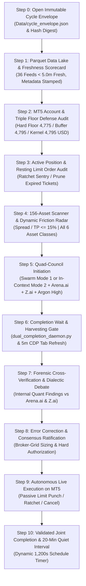

# 📋 AUTONOMOUS WAKE-UP CHECKLIST & JOINT-COMPLETION LIFECYCLE
## Antigravity Desk, Arena.ai, Z.ai & Gemini-4 Argon High Co-Equal Quantitative Council

> **Canonical Production Checklist**: Non-bypassable Master Autonomous Desk Wake-Up Sequence (Read & Execute Fully Line-by-Line).  
> **Target Environment**: MetaTrader 5 (Blueberry Markets Account #5064568) | Antigravity Autonomous Decision Desk  
> **Active Goal Contract**: Pass Phase 1 Challenge (Target: 5,500.00 USD).  
> **INVIOLABLE OPERATOR MANDATE**: The /goal contract is PERPETUAL and must NEVER be killed, paused, or cancelled until live equity >= 5,500.00 USD is proven on MT5.  
> **MANDATORY CANDIDATE RADAR**: The desk is STRICTLY FORBIDDEN from issuing a bare 'Stand Aside' without formulating and tracking concrete Potential Candidate Setups with checkable pre-condition trigger checklists `[ ]`.  
> **Mandatory Foundation & Compendiums (MUST READ Before Any Trade Staging)**:
> - [`STANDARDIZED_TRADING_DECISION_CHAIN.md`](file:///c:/Users/SIGMA/Documents/Trading_2/Data/Manditory/STANDARDIZED_TRADING_DECISION_CHAIN.md) (Canonical Quant SOP) + Canonical 36-Feed Parquet Data Lake (`Data/feeds/*.parquet` & `Data/metadata/`).
> - [`TOP_10_TRADE_EXECUTION_PITFALLS_AND_AUTOPSY.md`](file:///c:/Users/SIGMA/Documents/Trading_2/Data/Manditory/TOP_10_TRADE_EXECUTION_PITFALLS_AND_AUTOPSY.md) (**MUST READ** — Fatal Sub-ATR Noise Stops, Value Area Misplacements, Lot-Size Inflation & Post-Mortem Autopsy).
> - [`32_SHEET_REAL_WORLD_PITFALL_AVOIDANCE_QUESTIONS.md`](file:///c:/Users/SIGMA/Documents/Trading_2/Data/Manditory/32_SHEET_REAL_WORLD_PITFALL_AVOIDANCE_QUESTIONS.md) (**MUST READ** — Row-by-Row 35-Feed Deep Questioning Engine & Real-World Pitfall Avoidance Directive).
> **Standard Council Prompt Templates**:
> - [`ARENA_AI_STANDARD_PROMPT_TEMPLATE.md`](file:///c:/Users/SIGMA/Documents/Trading_2/Data/Manditory/ARENA_AI_STANDARD_PROMPT_TEMPLATE.md) (GPT-5.4 Astra Frontier Model via Chrome CDP Port 9222)
> - [`Z_AI_STANDARD_PROMPT_TEMPLATE.md`](file:///c:/Users/SIGMA/Documents/Trading_2/Data/Manditory/Z_AI_STANDARD_PROMPT_TEMPLATE.md) (GLM-5.3-Flash / Claude 3.7 Sonnet Sovereign Adversarial Arbiter via Chrome CDP Port 9222)
> - [`SUBAGENT_PROMPT_TEMPLATES.md`](file:///c:/Users/SIGMA/Documents/Trading_2/Data/Manditory/SUBAGENT_PROMPT_TEMPLATES.md) (4-Quant Subagent Roles: Role A, B, C, D)  
> **Cadence & Separation**: Clean 20-Minute Relative Post-Completion Separation (`T_finish + 20 min`) between completed Cycle X and Cycle X+1 trigger, enforced via `schedule(DurationSeconds=1200)`.  
> **Token Preservation Rule**: Always query the AST Knowledge Graph via `/graphify` or `python -m graphify query "<symbol/concept>"` FIRST before reading large code files.  
> **Strict Joint-Completion & Hardware Health Invariant (Operator Mandate)**: A cycle is NEVER completed upon prompt dispatch. A cycle is marked officially **FINISHED** only when:
>    1. **ALL THREE entities complete processing**: (1) Antigravity 4-Quant Subagents, (2) Arena.ai Frontier Council (GPT-5.4 Astra), and (3) Z.ai Sovereign Council (GLM-5.3-Flash), with their markdown responses harvested into `docs/trade_plans/ARENA_LATEST_RAW.md` and `docs/trade_plans/ZAI_LATEST_RAW.md`.
>    2. **Mandatory RAM & CPU Optimization**: Execute `powershell -ExecutionPolicy Bypass -File scripts/free_ram.ps1` to prune zombie processes, trim working sets, and reclaim physical RAM below 75%.
>    3. **20-Minute Relative Post-Completion Separation**: The difference between completed Cycle X and the trigger for Cycle X+1 must be strictly **20 minutes** (1,200 seconds).
> **Dynamic Capacity & Auto-Pull Invariant (Operator Mandate)**:
>    - **Filled Positions**: Strictly capped at **4 active running positions** (`len(positions) <= 4`).
>    - **Resting Limit Orders**: Unconstrained count **N** staged at high-confluence institutional orderbook shelves.
>    - **Auto-Pull Enforcement**: The instant filled positions reaches **4**, the supervisor daemon (`Terminal/dynamic_position_supervisor.py`) automatically cancels/pulls ALL remaining resting limit orders to guarantee zero 5th-fill risk.
>    - **Slot Re-opening**: When any position closes (TP or SL), capacity re-opens and limits are re-staged.

---

## 🚨 MANDATORY QUANT FLEET DISPATCH OR IN-CONTEXT EXECUTION PIVOT

To prevent token exhaustion, 429 rate limit exceptions, or system bloat, the autonomous desk supports **TWO AUTHORIZED QUANT MODES**:

1. **Mode 1 (Full Autonomous Parallel Swarm)**:
   - When API quota permits, physically dispatch all 4 subagents via `invoke_subagent` (`Model='flash'`):
     * **Role A**: Statistical Regime, Volatility Diffusion & Market Mechanics Quant
     * **Role B**: Orderflow, Microstructure, Liquidation & Tape Exhaustion Specialist
     * **Role C**: Convex Position Manager, Risk Engineer & Solvency Gatekeeper
     * **Role D**: Auction Market Structure, Relative Friction & Session Clock Arbitrageur
2. **Mode 2 (In-Context Unified Sequential Processing — Token Preservation Pivot)**:
   - When requested by the operator or when conserving tokens, Antigravity executes all 4 institutional roles (Role A, B, C, D) **directly in-context** within a single structured response, following the exact prompts, formulas, and JSON schemas in `Data/Manditory/SUBAGENT_PROMPT_TEMPLATES.md`.
   - Guarantees 100% mathematical fidelity, zero API quota saturation, zero 429 dropouts, and instant cross-role synthesis.

---

## 🧠 THE CANONICAL WAKE-UP INQUEST: 9 MANDATORY SELF-INTERROGATION GATEWAYS

Before evaluating data, touching code, or dispatching orders, the coordinator and all subagents MUST systematically self-interrogate through these 9 non-bypassable gateways:

### Gateway 0: Automated 36-Feed Parquet Data Lake Quality & Per-Feed Freshness (< 5.0 Min) Audit
- **Verification Criteria**:
  * Total Feeds: 36 canonical production Parquet files present and readable in `Data/feeds/*.parquet`. Zero Excel dependencies.
  * Metadata Stamping: Verified schema metadata stamped with current cycle UTC and IST timestamps via `Terminal/Data_Factory/stamp_all_parquet_feeds.py`.
  * Freshness Target: Every dynamic feed must be `< 5.0 minutes` old in IST/UTC.
  * Scorecard: Verified live age and row counts in `Data/metadata/parquet_all_feeds_checklist.json`.
- **Fail-Closed Gate**: If any critical operational feed is corrupted or stale, trading is frozen in 100% Cash Defense until the pipeline refreshes.

### Gateway 1: Mission, Runway & Macro Clock
- **Primary Target**: Pass Phase 1 of Blueberry Markets evaluation (#5064568) by reaching **5,500.00 USD** equity.
- **Dollar Bridge**: Distance = 5,500.00 USD - Current Equity (4,846.32 USD) = **653.68 USD**.
- **Macro Blackout & Session Clock**: Check `Data/macro_calendar.json` and Sheet 28 (`19_Calendar.parquet`) for Tier-1 macroeconomic releases within +/-30 minutes. Enforce the strict **21:15–22:30 UTC interbank FX rollover spread expansion embargo**.

### Gateway 2: Capital Floor & Solvency Sentry
- **Live Baseline**: Realized Balance = **4,846.32 USD** | Equity = **4,846.32 USD** | Margin Used = **0.00 USD**.
- **Inviolable Triple Floor Governance**:
  * Hard Floor: **4,775.00 USD** (Cushion: **+71.32 USD**).
  * Operating Defense Buffer: **4,795.00 USD** (Cushion: **+51.32 USD**).
  * Stricter Kernel Admission Floor: **4,795.00 USD** (Cushion: **+51.32 USD**).
  * Global Contingency Reserve: **2.00 USD** (deducted ex-ante).
  * Net Realized Admission Headroom: **+49.32 USD**.
- **Joint Stressed Solvency Constraint**:
  `min(Balance, Equity) - sum(1.25 * NominalLoss_i + 2.00 USD) - 2.00 USD >= 4,795.00 USD`.

### Gateway 3: Contingent Capacity & Tier Allocation
- **Tier 1 Standard (ACTIVE)**: 4,795.00 – 4,850.00 USD -> Nominal risk 10.00–12.00 USD per ticket.
- **Tier 2 Expansion**: Strictly unlocked at Realized Balance > 4,850.00 USD -> Nominal risk 15.00–25.00 USD per ticket.
- **Max Contingent Slots**: At most **2 independent, non-correlated tickets** across the entire universe, counting filled positions plus resting pending orders.

### Gateway 4: Active Running Positions Re-Evaluation & Dynamic Ratchets
- **Floating P&L & R0 Excursion**: `R = (Current Market Price - Entry Price) / R0`.
- **Dynamic Ratchet Execution**:
  * **Phase Early-BE (+0.75R0 to +0.80R0)**: Move Stop Loss to `Entry + 0.15 * R0` immediately.
  * **Phase 1 (+1.50R0)**: Move Stop Loss to `Entry + 0.80 * R0`.
  * **Take Profit Target (+2.50R0)**: Front-run opposing high-density liquidation magnet by 5–10 bps.
  * **Time Decay Rule**: Exit at market if trade age > 24 bars (6 hours) and gain < +0.20R0.

### Gateway 5: Resting Limit Orders Structural, Liquidation & Microstructure Sentry
- **Active Orders Sentry**:
  1. **Ticket #19329907 (`BNBUSD.p` BUY_LIMIT 3.00 lots @ 736.25)**: Backed by resting bid wall > 120K USD (tau >= 210s), 0.786 Fibonacci shelf, Short Max Pain magnet at 757.79. Consensus: **PREVAIL / HOLD RESTING**.
  2. **Ticket #19329908 (`EURUSD.pi` SELL_LIMIT 0.10 lot @ 1.12065)**: Market price (1.11732) traded below TP (1.11760). Alpha exhausted. Approaching 21:15–22:30 UTC rollover window. Consensus: **PRUNE / CANCEL IMMEDIATELY** (releases 16.98 USD stressed risk).
  3. **Ticket #19330613 (`ETHUSD.pi` SELL_LIMIT 0.50 lot @ 2,333.50)**: Backed by footprint absorption at 2,329.20, cumulative delta -10.89M USD, Long Max Pain magnet at 2,285.66 USD. Aligned with +2SD VWAP boundary (2,333.52). Consensus: **PREVAIL / HOLD RESTING**.

### Gateway 6: Candidate Formulation & 5-Pillar Confluence Pipeline
- **Mandatory Pre-Candidate Failure Check (MUST READ Before Order Staging)**:
  * Cross-examine every prospective setup against the 10 fatal traps in [`TOP_10_TRADE_EXECUTION_PITFALLS_AND_AUTOPSY.md`](file:///c:/Users/SIGMA/Documents/Trading_2/Data/Manditory/TOP_10_TRADE_EXECUTION_PITFALLS_AND_AUTOPSY.md) (strictly forbid sub-ATR noise stops, value area balance misplacements, lot-size inflation, and unaligned limits lacking resting whale backing).
  * Systematically interrogate all 35 feeds using the concrete reasoning questions in [`32_SHEET_REAL_WORLD_PITFALL_AVOIDANCE_QUESTIONS.md`](file:///c:/Users/SIGMA/Documents/Trading_2/Data/Manditory/32_SHEET_REAL_WORLD_PITFALL_AVOIDANCE_QUESTIONS.md). If any feed triggers an invalidation answer, fail-closed into 100% Cash Defense.
- **Dynamic Spread Friction Budgeting**: `Spread Points / TP Distance Points <= 15.0%`.
- **5-Pillar Confluence Stack**:
  1. Dynamic spread friction gate passed (Efficiency Ratio <= 15%).
  2. Multi-horizon taker CVD delta divergence/absorption (`zc_div > 0.8`, Spot > 0, Futures < 0).
  3. Auction location: Model 1 Extreme Mean Reversion (|Z| >= 2.0 to 3.5 SD) sweeping liquidation pools OR Model 2 Trend Pullback into Golden Zone [0.618 GP, 0.702 OTE] / Fib-Prime EMA 34/89 shelf.
  4. Verified structural backing: Resting whale wall >= 100K USD (persistence >= 180s) or VPOC/EMA shelf.
  5. Macro clearance (zero Tier-1 event blackout).

### Gateway 7: 100% Pure Parquet Data Lake Integrity Audit
- **Master Data Warehouse**: `Data/feeds/*.parquet` (36 canonical feeds).
- **Zero Formula Errors, Zero Nulls, Monotonic Timestamps**.
- **Continuous Pipeline Daemon (`task-141945`)**: Cycling with IP rotation and metadata stamping.

### Gateway 8: Hardware Health, Background Daemons & Workspace Hygiene
- **RAM Check**: RAM usage <= 75%. If not, run `powershell -ExecutionPolicy Bypass -File scripts/free_ram.ps1`.
- **Verify Core Persistent Background Tasks in Antigravity Task Manager**:
  1. Daemon 1: Autonomous Telemetry Git Sync Daemon (`autonomous_telemetry_git_daemon.py --interval 60`, `isDaemon=true`)
  2. Daemon 2: Gemini Web2API Council Daemon (port 8081, `isDaemon=true`)
  3. Daemon 3: Graphify AST Watcher Daemon (`run_graphify_watcher.py`, `isDaemon=true`)
  4. Daemon 4: Pipeline Continuous Daemon (`run_pipeline_continuous_daemon.py --gap 180`, `isDaemon=true`)
  5. Daemon 5: Dual AI Completion & Tab Refresh Daemon (`dual_completion_daemon.py --daemon`, `isDaemon=true`)
  6. Daemon 6: Dynamic Post-Cycle Stabilization Timer (`schedule` relative seconds, chaining next cycle)
  7. Daemon 7: Standing Watchdog Cron (`schedule` cron `0,30 * * * *`, `isDaemon=true`, waker at :00 and :30)
- **Zero Scratch Litter**: Prune all temporary scripts in `scratch/` immediately after verification.
- **Turn Ledger Append**: Append turn record to `.agents/memory/session_chat_history.md`.

---

## 🔄 THE 11-STEP JOINT-COMPLETION WAKE-UP SPRINT (STEPS 0–10)

---

## 🔒 PERPETUAL GOAL INVARIANTS (NEVER COMPROMISED)

1. **Perpetual Goal Contract**: Under NO circumstances may `<!-- GOAL_COMPLETE -->` or `<!-- GOAL_CANCELLED -->` be emitted until live equity >= 5,500.00 USD is proven on MetaTrader 5.
2. **Inviolable Floors**: **4,775.00 USD Hard Floor** | **4,795.00 USD Operating Buffer** | **4,795.00 USD Solvency Kernel**.
3. **Never Widen Stops**: Follow verified immutable R0 ledgers and ticket-specific ratchets; never loosen a protective stop.
4. **Strict Passive Limit Posture**: Passive limit orders only, safely anchored behind verified institutional liquidity (> 100,000 USD, tau >= 180s). Zero marketable spread crossing.
5. **Zero Token Polling**: Polling timers <= 60s are permanently banned. Rely strictly on native event-driven reactive wakeups and the joint completion lifecycle.
6. **Plain-Text Formatting**: Zero raw LaTeX delimiters in chat; use clean plain text and unicode.
