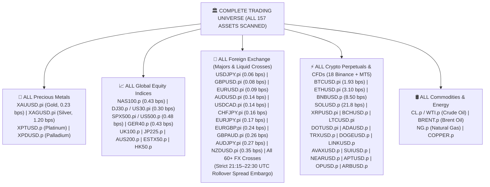
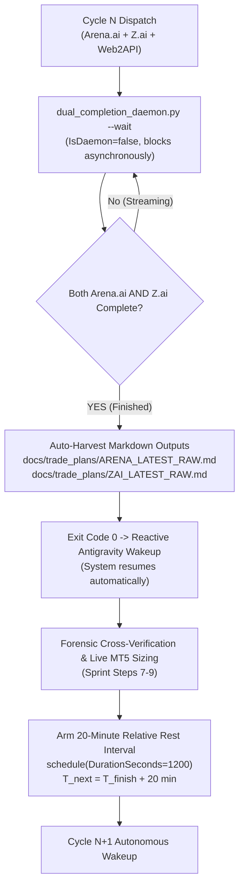
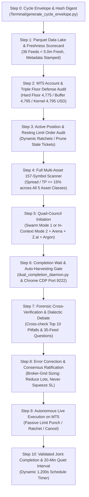

# 📋 AUTONOMOUS WAKE-UP CHECKLIST & JOINT-COMPLETION LIFECYCLE
## Antigravity Desk, Arena.ai, Z.ai & Gemini-4 Argon High Co-Equal Quantitative Council

> **Document Status**: CANONICAL PRODUCTION MASTER CHECKLIST (MANDATORY LINE-BY-LINE STUDY)  
> **Location**: `Data/Manditory/AUTONOMOUS_WAKEUP_CHECKLIST.md`  
> **Target Environment**: MetaTrader 5 (Blueberry Markets Account #5064568) | Antigravity Autonomous Decision Desk  
> **Active Goal Contract**: Pass Phase 1 Challenge (Target: 5,500.00 USD).  
> **INVIOLABLE OPERATOR MANDATE (LINE-BY-LINE STUDY & PARQUET NARRATIVE)**:
> Whenever this document is referred to or triggered, the coordinator and all subagents **MUST READ IT LINE-BY-LINE**, along with all referenced foundational documents line-by-line. Furthermore, the desk is **STRICTLY MANDATED TO READ EACH PARQUET FILE IN DATA/FEEDS TO BUILD A LOGICAL, DATA-DRIVEN NARRATIVE BEFORE IDENTIFYING TRADES**. For every potential trade or stand-aside decision, print the exact data-driven and microstructure reason behind the trade. The /goal contract is PERPETUAL and must NEVER be killed, paused, or cancelled until live equity >= 5,500.00 USD is proven on MT5.  
> **STRICT COMPLETE-UNIVERSE SCAN DIRECTIVE (ALL 157 TRADABLE ASSETS)**: The desk is STRICTLY FORBIDDEN from maintaining crypto-only tunnel vision or limiting scanning to a handful of symbols. The scanner MUST evaluate **ALL 157 TRADABLE ASSETS ACROSS OUR COMPLETE UNIVERSE** (all Metals, Indices, Forex Majors/Crosses, Commodities, and Crypto Perpetuals). Mathematical confluence alone determines candidate ranking.  

---

## 📚 MANDATORY COMPANION COMPENDIUMS (MUST READ LINE-BY-LINE)

Before staging, evaluating, or punching ANY order on MetaTrader 5, the coordinator and all subagents MUST systematically read and cross-verify line-by-line against these core compendiums:

1. **[`TOP_10_TRADE_EXECUTION_PITFALLS_AND_AUTOPSY.md`](file:///c:/Users/SIGMA/Documents/Trading_2/Data/Manditory/TOP_10_TRADE_EXECUTION_PITFALLS_AND_AUTOPSY.md)**:
   - **MUST READ LINE-BY-LINE**: Forensic post-mortem of losing trades (`SOLUSD.p Ticket #19174858` -$17.00 USD and `NZDUSD.pi Ticket #19244087` -$18.63 USD).
   - Inviolable prohibitions against sub-ATR noise stops, placing stops inside Value Area balance, lot-size inflation to fit artificial micro-stops, ghost whale walls (orderbook polarity inversion), and catching unabsorbed CVD waterfalls.
2. **[`32_SHEET_REAL_WORLD_PITFALL_AVOIDANCE_QUESTIONS.md`](file:///c:/Users/SIGMA/Documents/Trading_2/Data/Manditory/32_SHEET_REAL_WORLD_PITFALL_AVOIDANCE_QUESTIONS.md)**:
   - **MUST READ LINE-BY-LINE**: Exhaustive 35-Feed Row-by-Row & Column-by-Column Questioning Engine.
   - For every prospective candidate, explicitly articulate the answers to the real-world thinking questions across all 4 data lake clusters (Macro/ETF, Derivatives/Regime, Liquidations/Stop Cascades, Depth/CVD/Footprint).
3. **[`STANDARDIZED_TRADING_DECISION_CHAIN.md`](file:///c:/Users/SIGMA/Documents/Trading_2/Data/Manditory/STANDARDIZED_TRADING_DECISION_CHAIN.md)**:
   - Canonical 12-Step Quantitative Standard Operating Procedure (SOP).
4. **[`PASS_BLUEBERRY_PHASE_1_BY_OCT_30_2026.md`](file:///c:/Users/SIGMA/Documents/Trading_2/Data/Manditory/PASS_BLUEBERRY_PHASE_1_BY_OCT_30_2026.md)**:
   - Active account challenge contract and risk budget boundaries.

---

## 🏛️ PART 1: THE COMPLETE MULTI-ASSET TRADING UNIVERSE (ALL 157 ASSETS SCANNED)

The desk scans the entire available universe on Blueberry Markets MT5 (#5064568) and all 18 Binance Perpetuals without arbitrary omissions, pre-filtering, or cherry-picking:

### Full-Universe Dynamic Scanning & Ranking Protocol:
1. **Zero Ex-Ante Asset Disqualification**: Every single asset across all 157 symbols is evaluated dynamically on live tick and bar data every cycle.
2. **Quantitative Metrics Selection**: Assets are ranked dynamically by:
   - **Transaction Friction Efficiency**: `Spread Points / TP Distance Points <= 15.0%`.
   - **Taker Orderflow & CVD Divergence**: Multi-horizon delta absorption (`zc_div > 0.8`, Spot > 0, Futures < 0).
   - **Auction Market Structure Location**: Stretch relative to session VWAP (|Z| >= 2.0 to 3.5 SD for Model 1) or pullback to Golden Zone [0.618 GP, 0.702 OTE] / Fib-Prime EMA shelf for Model 2.
   - **Resting Liquidity Backing**: Verified resting institutional whale bunker (> 100K USD, persistence >= 180s).
   - **Macro Clearance**: Clear of Tier-1 news releases and outside the 21:15–22:30 UTC FX rollover window.

---

## 📈 PART 2: MANDATORY PARQUET FEED READING & DATA-DRIVEN TRADE NARRATIVE

The desk is strictly forbidden from evaluating setups based on surface summaries or isolated indicators. On EVERY cycle:
1. **Mandatory Line-by-Line Feed Analysis**: The desk physically reads and analyzes each canonical production Parquet file (`Data/feeds/*.parquet`).
2. **Logical Synthesis Across 4 Clusters**:
   - **Cluster A (Macro & ETF Flows)**: Feeds 00, 01, 02, 19, 28 -> Establishes broad capital direction, liquidity conditions, and macro news blackouts.
   - **Cluster B (Derivatives Skew & Sentiment)**: Feeds 03, 04, 05, 07, 08, 09, 11, 20 -> Measures funding friction, open interest buildup, Long/Short ratio crowding, and technical trend regimes.
   - **Cluster C (Liquidations & Stop Cascades)**: Feeds 10, 12, 13, 14, 15, 16, 17, 22, 23, 35 -> Maps structural liquidation magnets, 24H/48H/3D/7D Max Pain levels, and retail stop-loss sweep zones.
   - **Cluster D (Depth, Whales, CVD & Footprint)**: Feeds 06, 18, 21, 25, 26, 27 -> Verifies resting whale wall persistence (> 100K USD, tau >= 180s), multi-timeframe taker CVD delta divergence, and footprint absorption prints.
3. **Print Logical Reason Behind Trade**: For every staged order or stand-aside decision, print the exact quantitative logic, citing the contributing feeds and empirical numbers.

---

## ⚡ PART 3: DUAL COMPLETION AUTO-WAKEUP ARCHITECTURE & 20-MINUTE RELATIVE REST

The desk operates on a strictly event-driven, token-preserving autonomous lifecycle:

### Auto-Wakeup Architecture Fixed & Enforced:
1. **The Wakeup Mechanism**: Antigravity is woken reactively by a terminating background command. Launching `dual_completion_daemon.py` with `IsDaemon=false` and `--timeout 1200` means that the instant both models finish writing, the script exits with code 0. This exit event delivers a high-priority system wake-up message to Antigravity without requiring manual polling!
2. **Dual Initial Probe Logic**: `dual_completion_daemon.py` checks both Arena.ai (`button[aria-label="Copy"]` or complete text) and Z.ai (Send icon ready) on initial boot. If both finished while Antigravity was busy, it harvests immediately and exits in under 1 second.
3. **Mandatory 20-Minute Relative Rest**: Cycle N+1 NEVER begins immediately after Cycle N finishes. A mandatory 1,200-second (20-minute) quiet interval is enforced via `schedule(DurationSeconds=1200)` so market bars develop and orderbooks refresh.

---

## 🔄 PART 4: THE 11-STEP JOINT-COMPLETION WAKE-UP SPRINT (STEPS 0–10)

Upon every autonomous wake-up, execute this 11-step sequence line-by-line:

### Step 0: Open Immutable Cycle Envelope
- **Action**: Run `python Terminal/generate_cycle_envelope.py "Cycle <ID>"`.
- **Verification**: Generates `Data/cycle_envelope.json` containing SHA-256 hash digests of MT5 state, feed metadata, and open tickets.

### Step 1: Parquet Data Lake Quality & Freshness Scorecard (< 5.0m Target)
- **Action**: Run `python Terminal/Data_Factory/parquet_feed_checklist_auditor.py`.
- **Verification**: All 36 production feeds in `Data/feeds/*.parquet` verified readable, 0 nulls, monotonic timestamps, age `< 5.0m` IST. Display live scorecard table.
- **Fail-Closed**: If any critical feed is corrupt or stale, freeze in 100% Cash Defense.

### Step 2: MT5 Account, Capital Floor & Solvency Sentry
- **Action**: Query `bridge.get_account_info()`.
- **Verification**:
  * Realized Balance and Floating Equity audited to the exact cent.
  * Hard Floor Cushion: `Equity - 4,775.00 USD`.
  * Operating Buffer Cushion: `Equity - 4,795.00 USD`.
  * Kernel Headroom: `Equity - 4,795.00 USD - Contingency Reserve (2.00 USD)`.
  * Stressed Loss Constraint: `min(Balance, Equity) - sum(1.25 * Risk_i + 2.00 USD) - 2.00 USD >= 4,795.00 USD`.

### Step 3: Active Position Management & Resting Limit Order Audit
- **Action**: Query `bridge.get_open_positions()` and `bridge.get_pending_orders()`.
- **Verification**:
  * For active positions: Calculate `R = (Price - Entry) / R0`. Apply dynamic ratchets:
    - `+0.80R0` -> Move SL to `Entry + 0.15R0` (Breakeven lock).
    - `+1.50R0` -> Move SL to `Entry + 0.80R0` (Profit lock).
    - `+2.50R0` -> Take Profit front-running opposing liquidity magnet.
    - Time Decay: Close at market if age > 24 bars (6h) and gain < +0.20R0.
  * For resting limit orders: Verify supporting whale wall persistence (> 100K USD, tau >= 180s). Prune any stale, unbacked, or expired orders immediately.

### Step 4: Full Multi-Asset 157-Symbol Scanner & Dynamic Friction Radar
- **Action**: Scan all 157 tradable assets across Metals, Indices, Forex, Crypto, and Commodities.
- **Verification**:
  * Efficiency Ratio: `Spread Points / TP Distance Points <= 15.0%`.
  * Rollover Embargo: Strict blackout on FX entries between 21:15 and 22:30 UTC.

### Step 5: Quad-Council Initiation
- **Action**: Dispatch Cycle prompt to external frontier models and internal quants:
  * External: Arena.ai (GPT-5.4 Astra via CDP 9222) and Z.ai (GLM-5.3-Flash via CDP 9222).
  * Auxiliary: Gemini Web2API Council on port 8081 (`gemini_web2api.py`).
  * Internal: Swarm Mode 1 (Flash subagents) or In-Context Mode 2 (Roles A, B, C, D).

### Step 6: Completion Wait & Auto-Harvesting Gate
- **Action**: Run `python Terminal/dual_completion_daemon.py --timeout 1200` (`IsDaemon=false`).
- **Verification**: Automatically detects when BOTH Arena.ai and Z.ai finish output generation, auto-harvests markdown files into `docs/trade_plans/ARENA_LATEST_RAW.md` and `docs/trade_plans/ZAI_LATEST_RAW.md`, and triggers instant reactive wakeup upon process exit.

### Step 7: Forensic Cross-Verification & Dialectic Debate
- **Action**: Cross-examine external proposals against:
  * [`TOP_10_TRADE_EXECUTION_PITFALLS_AND_AUTOPSY.md`](file:///c:/Users/SIGMA/Documents/Trading_2/Data/Manditory/TOP_10_TRADE_EXECUTION_PITFALLS_AND_AUTOPSY.md) (Check for ghost walls, un-swept stop cascades, sub-ATR stops, mid-range chop, overhead blockades).
  * [`32_SHEET_REAL_WORLD_PITFALL_AVOIDANCE_QUESTIONS.md`](file:///c:/Users/SIGMA/Documents/Trading_2/Data/Manditory/32_SHEET_REAL_WORLD_PITFALL_AVOIDANCE_QUESTIONS.md) (Row-by-row interrogation across all 35 feeds).
- **Verification**: Surface divergences, challenge assumptions, and reject any trade failing a safety gate.

### Step 8: Error Correction & Broker-Grid Sizing
- **Action**: Calibrate position sizing strictly to dollar risk.
- **Rule**:
  * **NEVER SQUEEZE THE STOP LOSS**: If placing a structural stop behind the liquidation bunker (> 0.45 ATR buffer) exceeds risk budget, **REDUCE LOT SIZE** (e.g. 0.02 -> 0.01 lot) or **STAND ASIDE**.
  * Single slot max: 10.00–12.00 USD nominal risk. High-conviction solo: 15.00–25.00 USD max.

### Step 9: Autonomous Live Execution on MT5
- **Action**: Punch validated passive limit orders into MT5 via `Terminal/MT5_Execution_Bridge.py`.
- **Rule**: Passive limit orders only, safely anchored behind verified institutional liquidity walls (> 100K USD, tau >= 180s). Zero marketable spread crossing.

### Step 10: Validated Joint Completion & 20-Minute Quiet Interval
- **Action**:
  1. Record cycle completion state in `Data/cycle_state.json`.
  2. Free RAM: `powershell -ExecutionPolicy Bypass -File scripts/free_ram.ps1`.
  3. Arm the 20-minute relative rest timer: `schedule(DurationSeconds=1200)`.
  4. Append turn record to `.agents/memory/session_chat_history.md`.

---

## 🛑 PERPETUAL GOAL INVARIANTS (NEVER COMPROMISED)

1. **Perpetual Goal Contract**: Under NO circumstances may `<!-- GOAL_COMPLETE -->` or `<!-- GOAL_CANCELLED -->` be emitted until live equity >= 5,500.00 USD is proven on MetaTrader 5.
2. **Inviolable Triple Floors**: **4,775.00 USD Hard Floor** | **4,795.00 USD Operating Buffer** | **4,795.00 USD Kernel Admission Floor**.
3. **Never Widen Stops**: Follow verified immutable R0 ledgers and ticket-specific ratchets; never loosen a protective stop.
4. **Strict Passive Limit Posture**: Passive limit orders only, anchored behind verified institutional liquidity. Zero aggressive spread crossing.
5. **Zero Token Polling**: Polling loops <= 60s are permanently banned. Rely strictly on native event-driven reactive wakeups and the joint completion lifecycle.
6. **Plain-Text Formatting**: Zero raw LaTeX delimiters in chat; use clean plain text and unicode.
