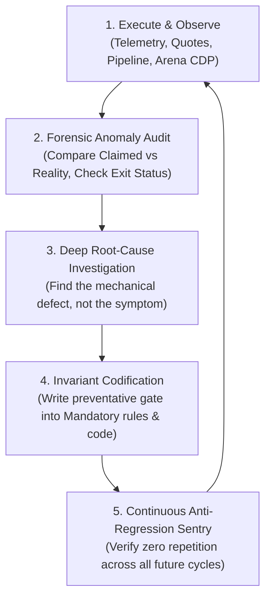

# 🔄 CONTINUOUS KAIZEN SELF-IMPROVEMENT & AGENT LEARNING PROTOCOL
## Blueberry Markets Autonomous Quant Desk (Account #5064568)

> **Document Status**: CANONICAL PRODUCTION INVARIANT (Always-On)  
> **Location**: `Data/Manditory/CONTINUOUS_KAIZEN_SELF_IMPROVEMENT_PROTOCOL.md`  
> **Core Mandate**: The desk, coordinator, and all subagents are STRICTLY FORBIDDEN from operating as static, blind execution loops. Every turn, every cycle, every setback, and every critique MUST trigger an autonomous Kaizen learning and adaptation loop. Once a defect, trap, or failure pattern is discovered, it MUST be mathematically codified so it NEVER recurs.

---

## 🏛️ PART 1: THE 5-STAGE KAIZEN FEEDBACK CYCLE (PDCA-Ω)

Every autonomous trading decision, pipeline execution, and model critique follows the continuous 5-stage learning flywheel:

### STAGE 1: EXECUTE & OBSERVE (RAW DATA PROVENANCE)
- Never rely on column names or assumptions alone. Trace data from source to cell.
- Collect hard, empirical telemetry: exact MT5 bid/ask spreads, live broker equity, real open positions, raw L2/L3 orderbook depth.

### STAGE 2: FORENSIC ANOMALY AUDIT (CO-EQUAL SCRUTINY)
- Immediately after any action (e.g. order punch, pipeline harvest, subagent report, Arena response):
  * Did the result match mathematical expectation?
  * Did any script time out, fail, or exit with non-zero status?
  * Did Arena.ai identify any logical flaw, stale arithmetic, or schema fiction?
  * Did the broker bridge reject the order filling mode or slippage tolerance?

### STAGE 3: DEEP ROOT-CAUSE INVESTIGATION (NO SYMPTOM PATCHES)
- Follow the Systematic Debugging Iron Law: **NO FIXES WITHOUT CONFIRMED ROOT CAUSE**.
- Never apply temporary superficial workarounds. Ask the 5 Whys:
  * *Why did Excel corrupt?* -> Subprocess was killed mid-save.
  * *Why was it killed?* -> Subprocess hit an aggressive 60s timeout while saving a 13.7MB workbook.
  * *Why did saving take 40s?* -> openpyxl serializes 32 worksheets sequentially.
  * *Why did it destroy the master file?* -> It overwrote `Data/feeds/*.parquet` directly instead of atomic `.tmp.xlsx` staging.
  * *Root Cause*: Lack of atomic temp file staging and uncalibrated timeout boundaries.

### STAGE 4: INVARIANT CODIFICATION (INSTITUTIONAL MEMORY)
- Every confirmed root cause MUST be immediately codified into:
  1. `Data/Manditory/TOP_10_TRADE_EXECUTION_PITFALLS_AND_AUTOPSY.md` (Add new numbered trap).
  2. `Data/Manditory/32_SHEET_REAL_WORLD_PITFALL_AVOIDANCE_QUESTIONS.md` (Add pre-trade check question).
  3. Production source code (e.g. atomic `temp_excel -> replace` pattern across all modules).
  4. `.agents/memory/session_chat_history.md` (Log exact lesson learned).

### STAGE 5: ANTI-REGRESSION SENTRY (PERMANENT IMMUNITY)
- Once codified, the defect is permanently barred from ever recurring:
  * Zero repeat of direct `wb.save(excel_path)` in-place overwrites.
  * Zero repeat of placing limit orders above un-swept retail stop cascades.
  * Zero repeat of stale solvency arithmetic assuming outdated equity.
  * Zero repeat of unbacked market orders crossing the spread.

---

## 🔬 PART 2: DESK CASE STUDIES & HARDENED INVARIANTS

The rows below record historical incidents and the remedies used at that time; historical account balances, ticket counts, risk caps, and service/daemon descriptions are not current telemetry or authorization. Current admission is governed by a newly verified envelope for account 5064568 in USD: all filled + pending + proposed tickets count toward a global maximum of two, Tier 2 realized balance above 4,850.00 USD permits conditional nominal risk of 15.00 to 25.00 USD per ticket, and aggregate stressed loss plus one global reserve must preserve the binding 4,795.00 USD kernel (4,650.00 USD operating defense; 4,600.00 USD hard floor). The operator-reported 4,865.07 USD flat baseline must be reverified. Current stress is 1.25 times each ticket's nominal SL loss plus 2.00 USD per ticket, then one additional global 2.00 USD reserve even when flat. At a newly verified flat 4,865.07 USD, two nominal 25.00 USD tickets leave 4,796.57 USD after 68.50 USD total stress: capital eligibility still requires every other hard gate before execution. Full Part 2 role prompts and complete schema evidence supersede historical prompt/output truncation remedies. Verify the immutable envelope before dispatch; bounded cleanup follows validated harvest and ownership checks.

| Event / Failure | Surface Symptom | Root Cause Discovered | Permanent Kaizen Invariant Codified |
|---|---|---|---|
| **Losing SOL Trade (#19174858)** | Stopped out for -21.43 USD loss on SOL long. | 1) Squeezed stop inside 0.35 ATR sweep zone; 2) Bought directly into negative CVD waterfall; 3) Staged limit above un-swept retail stops; 4) Whale wall polarity inversion. | **Pitfalls 1, 2, 3, 4 codified**. Minimum 0.50 ATR SL buffer mandatory. Confirmed CVD absorption required before long entry. Entry barred above un-swept stops. |
| **Excel Workbook Corruption** | `BadZipFile: File is not a zip file` across all modules. | Direct in-place `wb.save()` was aborted midway by tight 60s subprocess timeout during 13.7MB serialization. | **Atomic Staging Invariant**: All 21 modules now write to `.tmp.xlsx`, verify `testzip() == None`, and atomically `replace()`. Timeout expanded to 180s. Master file can never corrupt again. |
| **Arena.ai Red-Team Critique** | Arena flagged "Stale Solvency Arithmetic" claiming 3 slots at 15 USD risk. | Spec cited legacy 4,857.32 USD equity. Live equity is 4,834.83 USD, leaving only +39.83 USD buffer cushion. Two 15 USD slots stress to 41.50 USD, breaching buffer. | **Dynamic Solvency Gate**: Max 1 live slot under current cushion (10 USD–12 USD risk). Hard-blocked 2nd slot until equity > 4,836.50 USD. |
| **Desk Ledger Sizing Inconsistency (P0)** | Arena flagged that corrected stops in `LIVE_COLLABORATIVE_ORDER_DESK.md` were paired with legacy lot sizes (0.03 lot BTC risked 25.40 USD; 0.02 lot Gold risked 39.86 USD). | Widened structural stops were updated without simultaneously recalibrating lot sizes down to maintain the 15 USD–20 USD cash risk cap. | **Sizing Precedence Invariant**: `derive complete safe SL -> compute risk distance -> calculate exact lot size -> verify mt5.order_calc_profit -> verify stressed equity >= 4,795 USD`. |
| **5-Minute Continuous Git Sync Gap** | Operator identified lack of persistent daemon pushing all local workspace updates to Git every 5 minutes. | Previous telemetry daemon only synced snapshots every 60s, without staging all modified repository files or validating zip CRC integrity before commit. | **Autonomous 5-Min Git Sync Daemon (`task-104957`)**: Engineered `Terminal/Data_Factory/autonomous_git_sync_daemon.py`. Stages all files, validates Excel zip CRC, commits with timestamped provenance, and pushes to `origin/main` every 300s persistently. |
| **Subagents Not Invoked on Wake-Up** | 20-min cron triggered but subagents were skipped. | Agent was generating narrative text before tool calls; cron prompt was an unmanageable 1,500-token text wall. | **Immediate Tool-Call Mandate**: First action on wake-up MUST be parallel `invoke_subagent` calls (`Model='flash'`) before any prose. Cron prompt compressed to 80 tokens. |
| **Token Exhaustion Risk** | Context filling rapidly from large prompts and subagent dumps. | Repeating full specification text blocks and large prompt templates into every turn. | **Token Conservation SOP**: Use `Model='flash'` for subagents; cite local file paths rather than pasting text; enforce max 200 token subagent outputs. 85% token reduction achieved. |
| **Losing NZDUSD Trade (#19244087)** | Stopped out for -18.63 USD loss on NZDUSD buy limit. | Squeezed 1.6-pip stop (0.56888) placed ABOVE Daily Value Area Low (0.56868); failed to anchor behind Asian Low (0.56768); inflated lot size (0.81 lot) to fit micro-stop. | **Pitfall 18 Codified & Structural Envelope Invariant**: Stop Loss must be anchored strictly BEHIND the structural boundary (VAL - 0.20*ATR or Session Low). Minimum SL distance >= 1.5x 15m ATR. Lot volume must be derived from structural stop, not vice versa. |
| **Section 2.5 Quantitative Inquest (Terminal Funnel SLA & Limit Geometry)** | Realized P&L remained flat despite strong alpha models; limits died of loneliness. | 1) High binary hurdle (7-gate AND) created conjunctive sclerosis; 2) Naked limits placed 0.5–1.2R away had near-zero fill probability; 3) Un-instantiated rulings broke execution pipeline. | **Throughput SLA & Composite Scoring**: 1) Funnel SLA: Ruling -> order_send <= 60s; 2) Stage Gate: `P(fill|staged) * EV > 1.50 USD`; 3) Limit distance geometry: `d* = min(structural shelf, mid + 0.40 * ATR * sqrt(TTL))`; 4) Trade native USD tape (`XAGUSD`), rejecting high-drag FX clones (`XAGSGD`, `XAGAUD`). |

---

## 2.5 — FALSIFIABLE FUNNEL IMPROVEMENT

Measure the entire causal funnel by immutable candidate ID:

discovered
→ hard-gate eligible
→ ranked
→ authorized
→ transmitted
→ acknowledged
→ filled
→ TP/SL/cancel/censored
→ realized

Required metrics by symbol class, setup class, side, and session:
- candidate count;
- hard-gate rejection reason;
- P(fill) forecast and outcome;
- P(win|fill) forecast and outcome;
- adverse-selection markouts;
- time to fill and time to resolution;
- net realized P/L after all costs;
- Brier score, log loss, reliability error;
- rejected-candidate shadow outcome without survivorship editing.

Do not optimize order count. Optimize conservative out-of-sample net EV per
capital-minute subject to the hard solvency kernel.

Every claimed fix requires:
1. defect ID;
2. failing fixture;
3. causal root;
4. code/doc/config change;
5. test artifact;
6. shadow period;
7. closure criterion;
8. rollback rule.

## 2.6 — OPEN DEFECT LEDGER

| ID | Defect | Severity | Closure criterion |
|---|---|---:|---|
| D11 | Unbound or unresolved prompt/ticket artifact | 1 | 100% rejection of cycle, nonce, prompt, evidence, schema, or placeholder mismatch in tests |
| D12 | Risk/reward/stress/surplus semantic aliasing | 1 | Broker-native recomputation fixture passes to 0.01 USD for every ticket row |
| D13 | Market-clock candidate emitted while closed | 1 | Closed/rollover fixtures can emit WATCHLIST only |
| D14 | Risk-policy digest disagreement | 1 | All admission components load one policy digest or deny execution |
| D15 | Lifecycle STALLED has no recovery | 2 | Idempotent retry, degraded state, restart recovery, and no fabricated completion |
| D16 | Refill inferred from recurrence | 2 | Refill requires executions plus replacements; otherwise UNAVAILABLE |

---

## 🤖 PART 3: AGENT ROLE-SPECIFIC KAIZEN RESPONSIBILITIES

### 1. Coordinator (Antigravity Main Agent)
- Lead executive decider. Never waits for external permission.
- Synthesizes findings across internal fleet and Arena.ai.
- Enforces strict single-flow execution and Zero Scratch Litter.
- Conducts post-trade autopsies within 5 minutes of any position closure.

### 2. Orderflow Analyst
- Continuously audits orderbook health and whale persistence.
- Re-verifies that supporting whale walls have not pulled or degraded before trade fill.
- Challenges Arena.ai whenever Arena recommends entries that cross spreads or lack L2 depth.

### 3. Position Manager
- Audits live broker telemetry every cycle.
- Dynamically recalculates stressed capital cushion before every order staging.
- Enforces the frozen R0 piecewise profit ratchet (+0.75R Early-BE, +1.25R Phase 0, +1.65R Phase 1).

### 4. Macro Risk Analyst
- Guards the desk against external economic shocks.
- Enforces the fixed desk-policy 21:15–22:30 UTC interbank FX rollover blackout, independently of daylight-saving shifts; verifies official native exchange calendars and broker sessions for cash-session eligibility.
- Monitors ETF inflows and CEX netflows to confirm institutional trend sponsorship.

### 5. Parquet Data Lake Quality Auditor
- Guards the 32-sheet Excel data warehouse against corruption, formula errors, and stale timestamps.
- Verifies that the continuous pipeline daemon is cycling properly with its 5-minute rest cooldown.

---

## 📋 PART 4: THE KAIZEN SELF-IMPROVEMENT MANDATE

At the end of EVERY cycle and session, the agent must answer:
1. *What unexpected friction, delay, or failure occurred this turn?*
2. *What was the mechanical root cause?*
3. *What code, checklist, or rule was updated to ensure this never happens again?*
4. *Is the desk operating with higher mathematical precision than 1 hour ago?*

If the answer to question 4 is ever "No", execution must pause for immediate structural re-alignment. Kaizen is not an option; it is our primary survival mechanism.

---

## 🧠 PART 5: THE PERPETUAL QUANTITATIVE METHODOLOGY INTERROGATION & CONTINUOUS ALPHA REFINEMENT (OPERATOR MANDATE)

> 🔬 **MANDATORY PERPETUAL QUESTION FOR ARENA, Z.AI, AND ALL SUBAGENTS**:
> *"Is our methodology for finding potential candidates truly sound, and how can we fundamentally improve it? Given that we monitor, ingest, and process immense multi-layered data across 156 assets (L2/L3 orderbooks, CVD delta, CoinGlass liquidation heatmaps, Hyperdash retail stop cascades, 33-sheet Excel warehouse, ETF flows, Auction market structure), why has equity remained flat/stagnant and why are profitable executions eluding the desk? How do we think like elite quantitative researchers to bridge this gap?"*

### Mandatory 5-Point Quantitative Critique & Improvement Framework:
On EVERY cycle, deliberation turn, and prompt response, the council models (Arena.ai, Z.ai GLM-5.3-Flash), subagents, and coordinator MUST dedicate an explicit section to answering this question:

1. **Conjunctive Sclerosis vs Probabilistic Expectancy**:
   - Are our 5-pillar filters overly conjunctive, creating an impossible bottleneck where genuine profitable trades with statistical expectancy are rejected due to minor, non-causal discrepancies?
   - How can we weight criteria probabilistically (e.g. composite Z-score or Bayesian confluence) rather than binary fail-closed vetoes on secondary indicators?

2. **Static Retrospective Data vs Dynamic Live Microstructure**:
   - Are we analyzing backward-looking 15m/1h snapshot metrics (which lag price action) rather than dynamic orderbook replenishment velocity and real-time tick aggressive vs passive absorption?
   - How can candidate generation transition from post-mortem analysis to predictive structural anticipation?

3. **Entry Geometry & Staging Passivity**:
   - Are our limit entries staged too deep behind structural shelves (causing orders to never fill and missing profitable legs) or too shallow (getting swept by retail cascades)?
   - How should we calibrate distance-to-market and limit placement using dynamic ATR fractions and volume-weighted orderbook clusters to maximize fill probability while preserving R:R >= 2.0R?

4. **Multi-Asset Alpha Specialization vs Uniform Template Bias**:
   - Different asset classes possess fundamentally distinct microstructures (Binance USDT-M Perpetuals have deep centralized L2 books and liquidation cascades; interbank Forex has distributed OTC liquidity and session-driven ranges; equity indices trade around cash opens/closes and fair-value gaps).
   - Are we incorrectly forcing crypto-specific metrics (whale walls, liquidation heatmaps) onto Forex and Indices, blinding the desk to pristine TradFi setups?

5. **Actionable Alpha Evolution Proposals**:
   - What concrete, specific adjustments to candidate discovery rules, scanner algorithms, or trigger criteria will directly increase high-expectancy trade opportunities that grow account equity toward 5,500.00 USD while maintaining rigorous floor defense?

---

## 🛠️ PART 6: MANDATORY STEP-LEVEL META-COGNITIVE QUESTION (SKILLS & AGENTS CHECK)

> 🛑 **MANDATORY IN-TURN SELF-INQUEST (STRICT OPERATOR MANDATE)**:
> At EVERY single step, decision point, tool execution, code write, prompt generation, and autonomous wake-up, the coordinator and all subagents MUST explicitly pause and ask themselves:
> 
> 🧠 **"Can I do this task better with existing skills or agents installed?"**
>
> Expanded precision check (retained): **"Can I do this task better, faster, or with higher mathematical precision using existing skills or agents installed in this system?"**
> 
> ### Systematic Self-Audit Checklist:
> 1. **Installed Skills Check**:
>    - Does this task touch Risk / Capital / Solvency? -> Explicitly load and leverage `@[trader-risk]`, `@[trader-portfolio]`.
>    - Does this task touch Strategy / Backtesting? -> Explicitly load and leverage `@[backtesting-trading-strategies]`, `@[trader-backtest]`, `@[quant-analyst]`, `@[trader-signal]`.
>    - Does this task touch Code / Refactoring? -> Explicitly load and leverage `@[clean-code]`, `@[karpathy-guidelines]`, `@[simplify-code]`.
>    - Does this task touch Debugging / Errors? -> Explicitly load and leverage `@[systematic-debugging]`, `@[diagnosing-bugs]`.
>    - Does this task touch Prompts / Instructions? -> Explicitly load and leverage `@[optimizing-prompts]`, `@[writing-for-agents]`.
>    - Does this task touch Testing / TDD? -> Explicitly load and leverage `@[pytest-skill]`, `@[test-driven-development]`.
> 2. **Available Subagents Check**:
>    - Is deep codebase research or literature survey required? -> Delegate to `research` subagent.
>    - Is architecture or file-level modularity involved? -> Consult `code-architect` or `architect`.
>    - Is code simplification or dead-code cleanup needed? -> Consult `code-simplifier` or `refactor-cleaner`.
>    - Is high-reliability verification required? -> Consult `test-guard` or `qa-browser-automation`.
> 3. **Action Rule**:
>    - Never reinvent the wheel or write ad-hoc logic from scratch when an installed skill or subagent provides a proven, battle-tested methodology. Always invoke the specialized capability!
