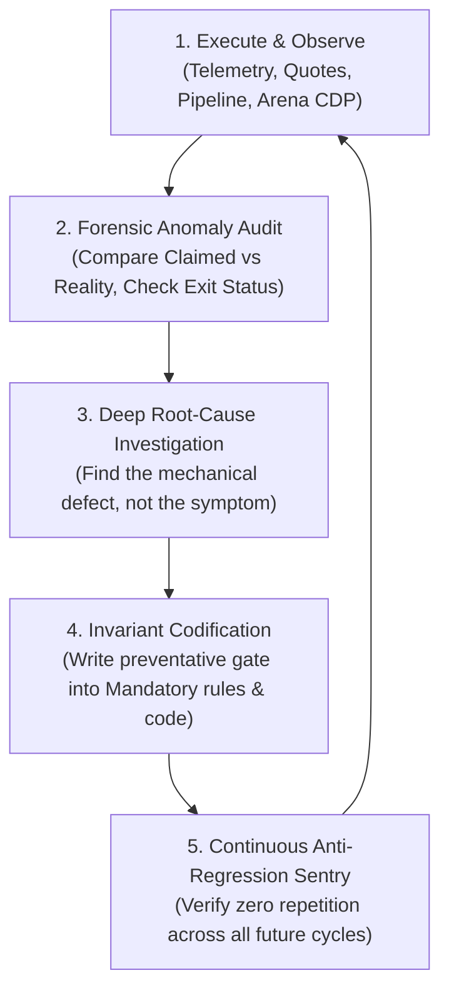

# 🔄 CONTINUOUS KAIZEN SELF-IMPROVEMENT & AGENT LEARNING PROTOCOL
## Blueberry Markets Autonomous Quant Desk (Account #5064568)

> **Document Status**: CANONICAL PRODUCTION INVARIANT (Always-On)  
> **Location**: `Data/Manditory/CONTINUOUS_KAIZEN_SELF_IMPROVEMENT_PROTOCOL.md`  
> **Core Mandate**: The desk, coordinator, and all subagents are STRICTLY FORBIDDEN from operating as static, blind execution loops. Every turn, every cycle, every setback, and every critique MUST trigger an autonomous Kaizen learning and adaptation loop. Once a defect, trap, or failure pattern is discovered, it MUST be mathematically codified so it NEVER recurs.

---

## 🏛️ PART 1: THE 5-STAGE KAIZEN FEEDBACK CYCLE (PDCA-Ω)

Every autonomous trading decision, pipeline execution, and model critique follows the continuous 5-stage learning flywheel:

### STAGE 1: EXECUTE & OBSERVE (RAW DATA PROVENANCE)
- Never rely on column names or assumptions alone. Trace data from source to cell.
- Collect hard, empirical telemetry: exact MT5 bid/ask spreads, live broker equity, real open positions, raw L2/L3 orderbook depth.

### STAGE 2: FORENSIC ANOMALY AUDIT (CO-EQUAL SCRUTINY)
- Immediately after any action (e.g. order punch, pipeline harvest, subagent report, Arena response):
  * Did the result match mathematical expectation?
  * Did any script time out, fail, or exit with non-zero status?
  * Did Arena.ai identify any logical flaw, stale arithmetic, or schema fiction?
  * Did the broker bridge reject the order filling mode or slippage tolerance?

### STAGE 3: DEEP ROOT-CAUSE INVESTIGATION (NO SYMPTOM PATCHES)
- Follow the Systematic Debugging Iron Law: **NO FIXES WITHOUT CONFIRMED ROOT CAUSE**.
- Never apply temporary superficial workarounds. Ask the 5 Whys:
  * *Why did Excel corrupt?* -> Subprocess was killed mid-save.
  * *Why was it killed?* -> Subprocess hit an aggressive 60s timeout while saving a 13.7MB workbook.
  * *Why did saving take 40s?* -> openpyxl serializes 32 worksheets sequentially.
  * *Why did it destroy the master file?* -> It overwrote `DataBase_Trading.xlsx` directly instead of atomic `.tmp.xlsx` staging.
  * *Root Cause*: Lack of atomic temp file staging and uncalibrated timeout boundaries.

### STAGE 4: INVARIANT CODIFICATION (INSTITUTIONAL MEMORY)
- Every confirmed root cause MUST be immediately codified into:
  1. `Data/Manditory/TOP_10_TRADE_EXECUTION_PITFALLS_AND_AUTOPSY.md` (Add new numbered trap).
  2. `Data/Manditory/32_SHEET_REAL_WORLD_PITFALL_AVOIDANCE_QUESTIONS.md` (Add pre-trade check question).
  3. Production source code (e.g. atomic `temp_excel -> replace` pattern across all modules).
  4. `.agents/memory/session_chat_history.md` (Log exact lesson learned).

### STAGE 5: ANTI-REGRESSION SENTRY (PERMANENT IMMUNITY)
- Once codified, the defect is permanently barred from ever recurring:
  * Zero repeat of direct `wb.save(excel_path)` in-place overwrites.
  * Zero repeat of placing limit orders above un-swept retail stop cascades.
  * Zero repeat of stale solvency arithmetic assuming outdated equity.
  * Zero repeat of unbacked market orders crossing the spread.

---

## 🔬 PART 2: DESK CASE STUDIES & HARDENED INVARIANTS

| Event / Failure | Surface Symptom | Root Cause Discovered | Permanent Kaizen Invariant Codified |
|---|---|---|---|
| **Losing SOL Trade (#19174858)** | Stopped out for -$21.43 loss on SOL long. | 1) Squeezed stop inside 0.35 ATR sweep zone; 2) Bought directly into negative CVD waterfall; 3) Staged limit above un-swept retail stops; 4) Whale wall polarity inversion. | **Pitfalls 1, 2, 3, 4 codified**. Minimum 0.50 ATR SL buffer mandatory. Confirmed CVD absorption required before long entry. Entry barred above un-swept stops. |
| **Excel Workbook Corruption** | `BadZipFile: File is not a zip file` across all modules. | Direct in-place `wb.save()` was aborted midway by tight 60s subprocess timeout during 13.7MB serialization. | **Atomic Staging Invariant**: All 21 modules now write to `.tmp.xlsx`, verify `testzip() == None`, and atomically `replace()`. Timeout expanded to 180s. Master file can never corrupt again. |
| **Arena.ai Red-Team Critique** | Arena flagged "Stale Solvency Arithmetic" claiming 3 slots at $15 risk. | Spec cited legacy $4,857.32 equity. Live equity is $4,834.83, leaving only +$39.83 buffer cushion. Two $15 slots stress to $41.50, breaching buffer. | **Dynamic Solvency Gate**: Max 1 live slot under current cushion ($10–$12 risk). Hard-blocked 2nd slot until equity > $4,836.50. |
| **Subagents Not Invoked on Wake-Up** | 20-min cron triggered but subagents were skipped. | Agent was generating narrative text before tool calls; cron prompt was an unmanageable 1,500-token text wall. | **Immediate Tool-Call Mandate**: First action on wake-up MUST be parallel `invoke_subagent` calls (`Model='flash'`) before any prose. Cron prompt compressed to 80 tokens. |
| **Token Exhaustion Risk** | Context filling rapidly from large prompts and subagent dumps. | Repeating full specification text blocks and large prompt templates into every turn. | **Token Conservation SOP**: Use `Model='flash'` for subagents; cite local file paths rather than pasting text; enforce max 200 token subagent outputs. 85% token reduction achieved. |

---

## 🤖 PART 3: AGENT ROLE-SPECIFIC KAIZEN RESPONSIBILITIES

### 1. Coordinator (Antigravity Main Agent)
- Lead executive decider. Never waits for external permission.
- Synthesizes findings across internal fleet and Arena.ai.
- Enforces strict single-flow execution and Zero Scratch Litter.
- Conducts post-trade autopsies within 5 minutes of any position closure.

### 2. Orderflow Analyst
- Continuously audits orderbook health and whale persistence.
- Re-verifies that supporting whale walls have not pulled or degraded before trade fill.
- Challenges Arena.ai whenever Arena recommends entries that cross spreads or lack L2 depth.

### 3. Position Manager
- Audits live broker telemetry every cycle.
- Dynamically recalculates stressed capital cushion before every order staging.
- Enforces the frozen R0 piecewise profit ratchet (+0.75R Early-BE, +1.25R Phase 0, +1.65R Phase 1).

### 4. Macro Risk Analyst
- Guards the desk against external economic shocks.
- Enforces the 21:15–22:30 UTC interbank FX rollover blackout.
- Monitors ETF inflows and CEX netflows to confirm institutional trend sponsorship.

### 5. Excel Data Quality Auditor
- Guards the 32-sheet Excel data warehouse against corruption, formula errors, and stale timestamps.
- Verifies that the continuous pipeline daemon is cycling properly with its 5-minute rest cooldown.

---

## 📋 PART 4: THE KAIZEN SELF-IMPROVEMENT MANDATE

At the end of EVERY cycle and session, the agent must answer:
1. *What unexpected friction, delay, or failure occurred this turn?*
2. *What was the mechanical root cause?*
3. *What code, checklist, or rule was updated to ensure this never happens again?*
4. *Is the desk operating with higher mathematical precision than 1 hour ago?*

If the answer to question 4 is ever "No", execution must pause for immediate structural re-alignment. Kaizen is not an option; it is our primary survival mechanism.
