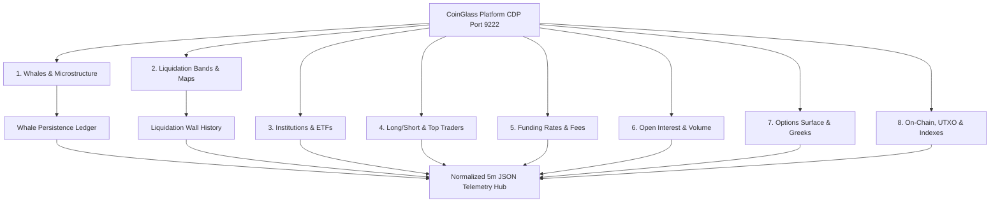

# 🏗️ ARCHITECTURAL PLAN: COINGLASS 5-MINUTE CDP TELEMETRY & PERSISTENCE HARVESTER
**Document**: `coinglass-cdp-harvester.md`  
**Status**: DRAFT FOR OPERATOR APPROVAL  
**Domain Classification**: `Data/ML/Quant` | `Backend/Architecture` | `Security/Testing/QA`  
**Methodologies Applied**: `data-engineer`, `data-analyst`, `data-scientist`, `debugger`, `karpathy-guidelines`, `clean-code`, `quant-analyst`

---

## 1. EXECUTIVE SUMMARY & OBJECTIVE

This architecture elevates our quantitative infrastructure to institutional grade by establishing an autonomous, continuous 5-minute telemetry harvesting engine for **CoinGlass**. 

Operating via Chrome DevTools Protocol (CDP port 9222) connected to the user's authenticated Edge browser session (and optionally hybridized with the user's registered CoinGlass API key `5333d68c16684607b1a262be0faed4e1`), the engine navigates all 164 distinct analytical endpoints across 8 core domains. Crucially, it tracks **temporal persistence** (e.g., how many hours/days a whale order, resting bid/ask bunker, or large wallet position has persisted at a specific price level) and dumps normalized, typed JSON datasets into `Data/coinglass/` at every 5-minute candle close.

---

## 2. ORCHESTRATION ROLES & SPECIALIST MANDATES

In strict compliance with the `/orchestrate` protocol, the following 4 specialist personas govern this system:

| Persona | Domain | Role & Operational Mandate |
| :--- | :--- | :--- |
| **Data Engineer** | `Pipeline Architecture` | Designs the headless CDP background target worker, network response interceptor, JSON normalization pipeline, and 5-minute atomic file sinks. |
| **Data Analyst** | `Data Dictionary & Schema` | Audits the 164 Coinglass endpoints, establishes explicit JSON data contracts, maps units (USD, BTC, %), and validates categorical structures. |
| **Data Scientist** | `Temporal Persistence & Stat Models` | Builds the stateful whale and liquidation persistence tracker (`first_seen`, `duration_days`, `decay_rate`, `volume_delta`, `spoof_score`). |
| **QA / Debugger** | `Reliability & CDP Session Guard` | Implements error backoff, Cloudflare detection, memory leak prevention, CDP tab lifecycle safety (never close user tabs), and schema integrity. |

---

## 3. HARVESTING SCOPE: THE 8 COINGLASS DATA DOMAINS (164 ENDPOINTS)



### Domain 1: Whales, L2/L3 Orderbook & Microstructure
- `/large-orderbook-statistics`: Large whale resting limit orders across major exchanges (Binance, OKX, Bybit).
- `/orderbook-pressure`: Real-time bid/ask pressure, depth skewness, and liquidity book imbalance.
- `/pro/depth-delta`: Orderbook liquidity delta (+/- depth shifts per price bucket).
- `/hyperliquid`: Hyperliquid whale tracker (top perp positions, collateral, and liquidation proximity).
- `/hl`: Hyperliquid wallet portfolio analysis and PnL distribution.
- `/whale-alert`: Real-time exchange whale inflow/outflow transaction alerts.
- `/pro/i/whale-vs-retail-delta`: Divergence between institutional whale positioning and retail flow.

### Domain 2: Liquidation Bands & Cascade Surfaces
- `/liquidations`: 24h aggregate and per-exchange liquidation volume (USD and native units).
- `/liquidation-levels`: Discrete exchange liquidation clusters and price density.
- `/pro/futures/LiquidationMap`: Exchange-wide cumulative liquidation leverage map.
- `/pro/futures/LiquidationHeatMap`: Model 1 Liquidation heatmap (Binance, Bybit, OKX).
- `/pro/futures/LiquidationHeatMapNew`: Model 2 High-resolution liquidation heatmap.
- `/liquidation-heatmap-model3`: Model 3 Multi-timeframe rolling liquidation heatmap.
- `/liquidation-maxpain`: Aggregate liquidation max pain price level.

### Domain 3: Institutional Inflows, ETFs & Treasuries
- `/etf` & `/etf/bitcoin`: Spot Bitcoin ETF net daily flows, AUM, premium/discount (IBIT, FBTC, GBTC, ARKB, etc.).
- `/etf/ethereum`: Spot Ethereum ETF daily flows, net purchases, and total holdings.
- `/etf/solana`, `/etf/xrp`, `/etf/hype`: Altcoin ETF filings, tracker products, and global volumes.
- `/hk-etf`: Hong Kong Bitcoin and Ethereum ETF daily net capital flows.
- `/Grayscale` & `/GbtcInvestor`: Grayscale trust holdings, share unlock schedule, and institutional investor roster.
- `/BitcoinTreasuries`: Corporate and government balance sheets (MicroStrategy, Tesla, Marathon, El Salvador).
- `/ETFTreasuries`: Corporate Strategic Ethereum reserves and staking allocations.

### Domain 4: Sentiment, Long/Short Ratios & Top Trader Positioning
- `/LongShortRatio`: 5m, 15m, 1h, 4h, 24h global Long/Short account ratios.
- `/position`: Aggregate position distribution across exchange tiers.
- `/TopTrader/Binance`: Binance Top Trader account vs position ratio (whales vs crowd).
- `/TopTrader/OKX`: OKX Top Trader net Long/Short positioning.
- `/net-longs-vs-net-short`: Net long vs net short dollar delta per asset.
- `/BitfinexMargin`: Bitfinex margin long vs short financing positions (smart money indicator).

### Domain 5: Funding Rates & Settlement Economics
- `/FundingRate`: Predicted, current, and historical 8-hour funding rates across all perps.
- `/funding-fees`: Real-time funding fee settlement schedules and net cash transfer matrices.
- `/FundingRateHeatMap`: Multi-asset annualized funding rate cross-sectional heatmap.

### Domain 6: Open Interest & Futures Volumes
- `/pro/futures/Cryptofutures`: Cross-exchange aggregate open interest (USD and coin margin).
- `/pro/futures/FuturesVolume`: 24h taker volume, maker volume, and perpetual market turnover.
- `/pro/cme/cftc`: CME Bitcoin and Ethereum Commitments of Traders (COT) institutional vs leveraged money reports.

### Domain 7: Options Market, Greeks & Volatility Surface
- `/options`: Total options open interest, volume, and Put/Call ratios (Deribit, OKX, Binance).
- `/pro/options/net-premium-strike-heatmap`: Net premium strike heatmap across expiries.
- `/pro/options/max-pain`: Options max pain strike price by expiration date.
- `/pro/options/OptionGreeks`: Delta, Gamma, Vega, Theta surfaces by strike.
- `/pro/options/OIExpiry` & `/pro/options/OIStrike`: Open interest distribution by expiration date and strike price.

### Domain 8: On-Chain Reserves, UTXO Age & Macro Indexes
- `/Balance`: Aggregate Bitcoin and stablecoin balances across exchange cold/hot wallets.
- `/InflowAndOutflow`: Large on-chain wallet deposits and withdrawals.
- `/pro/i/utxo`: Bitcoin Realized Price UTXO Age Bands (whale accumulation age).
- `/pro/i/bitcoin-mvrv-zscore`: Market Value to Realized Value (MVRV) Z-Score.
- `/pro/i/FearGreedIndex`: Crypto Fear & Greed index historical series.
- `/pro/i/CGDI`: CoinGlass DeFi / Market Index aggregate.

---

## 4. TEMPORAL PERSISTENCE ENGINE (THE "HOW LONG HAS IT BEEN THERE?" SPEC)

The core analytical innovation requested by the operator is tracking the **duration and stability of large liquidity/whale phenomena**.

### Persistence State Schema (`Data/coinglass/whale_persistence_ledger.json`)
```json
{
  "key": "BTC_BINANCE_SELL_82350",
  "asset": "BTC",
  "exchange": "Binance",
  "side": "SELL",
  "price": 82350.0,
  "first_seen_utc": "2026-10-12T14:15:00Z",
  "first_seen_epoch": 1791814500,
  "last_seen_utc": "2026-10-16T18:55:00Z",
  "last_seen_epoch": 1792176900,
  "duration_seconds": 362400,
  "duration_days": 4.19,
  "initial_notional_usd": 15200000.0,
  "current_notional_usd": 17190000.0,
  "peak_notional_usd": 18450000.0,
  "sample_count": 1208,
  "presence_ratio": 0.985,
  "is_persistent_whale": true,
  "classification": "GENUINE_RESTING_BUNKER",
  "decay_risk_score": 0.02
}
```

### Persistence Logic Rules:
1. **Flash Filter**: Orders present for $< 180\text{ seconds}$ are flagged as `TRANSIENT_NOISE` or `SPOOF_RISK`.
2. **Anchor Eligibility (Invariant A)**: Only walls with `duration_days >= 0.5` ($> 12\text{ hours}$) and `presence_ratio >= 0.85` qualify as verified institutional bunkers for Stop Loss anchoring.
3. **Decay Detection**: If an order size drops by $> 50\%$ without executions occurring at that price, flag as `PULL_LIQUIDITY_CANCEL`.

---

## 5. TECHNICAL HARVESTING ARCHITECTURE

```
┌────────────────────────────────────────────────────────┐
│            Edge / Chrome Browser (CDP 9222)            │
│  - User Tab: https://www.coinglass.com/account (KEPT)  │
└────────────────────────────────────────────────────────┘
                           │
                           ▼ (CDP Target.createTarget)
┌────────────────────────────────────────────────────────┐
│     Autonomous Background Target / Interceptor         │
│  - Network.enable (Intercepts JSON API payloads)       │
│  - Evaluates window.__NEXT_DATA__ & Redux cache        │
│  - Hybridizes with direct REST API (ApiKey: 5333d6...) │
└────────────────────────────────────────────────────────┘
                           │
                           ▼
┌────────────────────────────────────────────────────────┐
│             Coinglass Normalization Engine             │
│  - Schema validation (Zero nulls, strictly typed)      │
│  - Temporal persistence ledger update                  │
└────────────────────────────────────────────────────────┘
                           │
                           ▼
┌────────────────────────────────────────────────────────┐
│               Data Storage / Sinks                     │
│  • Data/coinglass/latest/coinglass_snapshot.json       │
│  • Data/coinglass/whale_persistence_ledger.json        │
│  • Data/coinglass/liquidation_wall_history.json        │
│  • docs/telemetry/coinglass_data_dictionary.md         │
└────────────────────────────────────────────────────────┘
```

### Key Engineering Invariants:
1. **Zero Disruption to User Tab**: Primary user tabs are never closed, reloaded, or navigated. Harvesting occurs via ephemeral background targets (`/json/new` and `/json/close`) or direct authenticated HTTP queries using session headers.
2. **High-Speed Execution**: Total sweep across core domains completed in $< 45\text{ seconds}$ per 5-minute cycle.
3. **Zero Scratch Litter**: No temporary `.py` or `.csv` files left behind. Everything operates within modular `Terminal/Data_Factory/coinglass_harvester.py`.

---

## 6. VERIFICATION CHECKLIST & ACCEPTANCE GATES

- [ ] **Phase 1 Planning Gate**: Operator reviews and approves `{slug}.md`.
- [ ] **Phase 2 Ingestion Probe**: Execute single test sweep across Domain 1 (Whales) & Domain 2 (Liquidations).
- [ ] **Phase 3 Persistence Audit**: Validate that timeline fields (`duration_days`, `first_seen_utc`) calculate correctly for historical orders.
- [ ] **Phase 4 Data Dictionary**: Generate complete markdown table of all harvested JSON metrics and schemas.
- [ ] **Phase 5 5-Minute Daemon Integration**: Hook into `autonomous_telemetry_git_daemon.py` and sentry cron.
- [ ] **Phase 6 Regressions**: Pass `Tests/Test_Live_Gates_Regression.py` with 100% success.

---

## 7. NEXT STEP: SOCRATIC CONFIRMATION

Do you approve this architecture plan?
- **Y**: Proceed immediately to implementation of the Coinglass CDP Harvester module.
- **N / Modifications**: Specify any additional specific endpoints or customized persistence thresholds.
