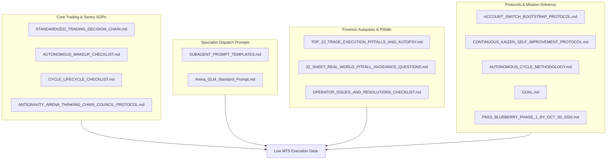

# 🏛️ CANONICAL DESK MANDATORY GOVERNANCE & PROTOCOLS DIRECTORY
## Blueberry Markets Phase 1 Autonomous Desk (Account #5064568)

> **Canonical Directory**: `Data/Manditory/` (Mirrored byte-for-byte in `docs/specs/`)  
> **Mission**: Pass Funded Phase 1 (5,500.00 USD Equity Target) by Friday, 30th October 2026 (23:59 UTC).  
> **Inviolable Capital Floors**: 4,600.00 USD Hard Floor | 4,650.00 USD Operating Buffer | 4,795.00 USD Solvency Kernel.  
> **Authorized Background Tasks**: 7 persistent daemons active in Antigravity task runner (`manage_task`).

---

## 📑 1. ACTIVE PRODUCTION GOVERNANCE & DECISION FILES (15 CANONICAL DOCUMENTS)

These active documents are strictly maintained in `Data/Manditory/` (and mirrored in `docs/specs/`), and referenced line-by-line during every autonomous cycle, wake-up sentry, and trade decision:

| # | Document | Primary Purpose | Key Focus & Enforcements |
|---|---|---|---|
| 1 | [`STANDARDIZED_TRADING_DECISION_CHAIN.md`](file:///c:/Users/SIGMA/Documents/Trading_2/Data/Manditory/STANDARDIZED_TRADING_DECISION_CHAIN.md) | **Canonical 10-Step Institutional Quant SOP** | Complete institutional quant trading decision chain, 5-pillar confluence stack, dynamic friction budgeting (spread points / TP distance <= 15%), fluid 2-slot portfolio capacity, multi-asset risk scaling (15.00–25.00 USD Tier 2), and 10-point ex-ante pre-punch checklist. |
| 2 | [`AUTONOMOUS_WAKEUP_CHECKLIST.md`](file:///c:/Users/SIGMA/Documents/Trading_2/Data/Manditory/AUTONOMOUS_WAKEUP_CHECKLIST.md) | **20-Minute Wake-Up Sequence** | 10-step autonomous execution sequence executed under the joint 3-entity completion lifecycle with clean 20-minute post-completion separation and 30-minute watchdog sentry (`0,30 * * * *`). Mandatory 4-subagent fleet (Fable 5), Arena.ai (GPT Astra) & Z.ai (GLM-5.3-Flash) candidate discovery. |
| 3 | [`CYCLE_LIFECYCLE_CHECKLIST.md`](file:///c:/Users/SIGMA/Documents/Trading_2/Data/Manditory/CYCLE_LIFECYCLE_CHECKLIST.md) | **Canonical Cycle Lifecycle Protocol** | Fast-tier execution blueprint: 5 atomic steps from dispatch via `dispatch_cycle_orchestrator.py`, single-turn 5-tool parallel invocation block, reactive wakeup, to `--wait-rest` 20-minute quiet interval arming. |
| 4 | [`ANTIGRAVITY_ARENA_THINKING_CHAIN_COUNCIL_PROTOCOL.md`](file:///c:/Users/SIGMA/Documents/Trading_2/Data/Manditory/ANTIGRAVITY_ARENA_THINKING_CHAIN_COUNCIL_PROTOCOL.md) | **Antigravity-Arena Council Protocol** | V3.0 production-hardened council protocol, 6-gate architectural diagram, 33-sheet master Excel data warehouse provenance, and dual Arena.ai mandate (candidate discovery + critique). |
| 5 | [`SUBAGENT_PROMPT_TEMPLATES.md`](file:///c:/Users/SIGMA/Documents/Trading_2/Data/Manditory/SUBAGENT_PROMPT_TEMPLATES.md) | **Specialist Subagent Dispatch Prompts** | Standardized Tier 2 Full Unabridged Big Prompts (~350–500 tokens) with mandatory citation of `STANDARDIZED_TRADING_DECISION_CHAIN.md` for all 4 subagents: Role A (Regime Quant), Role B (Microstructure Quant), Role C (Solvency Sentry), and Role D (Clock Provenance Auditor). |
| 6 | [`Arena_GLM_Standard_Prompt.md`](file:///c:/Users/SIGMA/Documents/Trading_2/Data/Manditory/Arena_GLM_Standard_Prompt.md) | **Dual-Council (Arena.ai & Z.ai) Unified Prompt** | Standardized 360° 4-persona quantitative prompt template dispatched simultaneously to Arena.ai (GPT Astra via CDP 9222) and Z.ai (GLM-5.3-Flash) for affirmative candidate discovery and solvency deliberation. |
| 7 | [`TOP_10_TRADE_EXECUTION_PITFALLS_AND_AUTOPSY.md`](file:///c:/Users/SIGMA/Documents/Trading_2/Data/Manditory/TOP_10_TRADE_EXECUTION_PITFALLS_AND_AUTOPSY.md) | **10 Lethal Traps & SOL Autopsy** | Forensic autopsy of losing trade (`SOLUSD.p #19174858`) and the top 10 lethal trade execution traps (unaligned limits, off-hours spread traps, catching falling knives, premature entries). |
| 8 | [`32_SHEET_REAL_WORLD_PITFALL_AVOIDANCE_QUESTIONS.md`](file:///c:/Users/SIGMA/Documents/Trading_2/Data/Manditory/32_SHEET_REAL_WORLD_PITFALL_AVOIDANCE_QUESTIONS.md) | **33-Sheet Real-World Questioning SOP** | Concrete real-world thinking questions, pitfall mappings, and fail-closed conditions for all 33 sheets in `DataBase_Trading.xlsx`. |
| 9 | [`OPERATOR_ISSUES_AND_RESOLUTIONS_CHECKLIST.md`](file:///c:/Users/SIGMA/Documents/Trading_2/Data/Manditory/OPERATOR_ISSUES_AND_RESOLUTIONS_CHECKLIST.md) | **Operator Resolutions History (Issues 1-17)** | Comprehensive log of operator issues, root causes, permanent fixes, and avoided traps across all trading sessions, including Issue 17 on parallel subagent dispatch. |
| 10 | [`ACCOUNT_SWITCH_BOOTSTRAP_PROTOCOL.md`](file:///c:/Users/SIGMA/Documents/Trading_2/Data/Manditory/ACCOUNT_SWITCH_BOOTSTRAP_PROTOCOL.md) | **Cross-Account Bootstrap & Reconnection** | Non-bypassable SOP when switching accounts or recovering state. Audits & auto-starts persistent daemons in task manager, enforces Tier 2 Big Prompts, and prevents context amnesia. |
| 11 | [`CONTINUOUS_KAIZEN_SELF_IMPROVEMENT_PROTOCOL.md`](file:///c:/Users/SIGMA/Documents/Trading_2/Data/Manditory/CONTINUOUS_KAIZEN_SELF_IMPROVEMENT_PROTOCOL.md) | **Continuous Kaizen Self-Improvement SOP** | Non-bypassable 5-stage PDCA-Ω feedback cycle, root cause autopsy methodology, case studies, and anti-regression rules. |
| 12 | [`AUTONOMOUS_CYCLE_METHODOLOGY.md`](file:///c:/Users/SIGMA/Documents/Trading_2/Data/Manditory/AUTONOMOUS_CYCLE_METHODOLOGY.md) | **Cycle Cadence & Methodological Framework** | Quantitative foundations of cycle scheduling, variance ratio gating, and multi-entity consensus. |
| 13 | [`GOAL.md`](file:///c:/Users/SIGMA/Documents/Trading_2/Data/Manditory/GOAL.md) | **Perpetual Mission Contract** | Active mission objectives, account constraints, 4,600.00 USD hard floor, 4,650.00 USD operating buffer, 4,795.00 USD solvency kernel, and non-bypassable goals. |
| 14 | [`PASS_BLUEBERRY_PHASE_1_BY_OCT_30_2026.md`](file:///c:/Users/SIGMA/Documents/Trading_2/Data/Manditory/PASS_BLUEBERRY_PHASE_1_BY_OCT_30_2026.md) | **Milestone Roadmap & Capital Bridge** | Mathematical runway, trade pacing, and equity trajectory to reach 5,500.00 USD by October 30, 2026. |
| 15 | [`README.md`](file:///c:/Users/SIGMA/Documents/Trading_2/Data/Manditory/README.md) | **Canonical Directory Master Index** | Unified inventory mapping active governance and historical archives. |
| 16 | [`session_chat_history.md`](file:///c:/Users/SIGMA/Documents/Trading_2/Data/Manditory/session_chat_history.md) | **Continuous Turn Memory Ledger** | Non-volatile session chat history preventing context amnesia across turn boundaries. |

---

## 📁 2. AUXILIARY & HISTORICAL SPECIFICATIONS (`Other_MD/`)

All secondary, historical, completed, or superseded specifications are cleanly archived in [`Other_MD/`](file:///c:/Users/SIGMA/Documents/Trading_2/Data/Manditory/Other_MD/) (mirrored in `docs/specs/Other_MD/`):

| Document in `Other_MD/` | Scope & Description | Status / Reason for Archival |
|---|---|---|
| `TRADE_DECISION_PLAYBOOK.md` | Living telemetry trade decision playbook. | Superseded by `STANDARDIZED_TRADING_DECISION_CHAIN.md`. |
| `LOSING_TRADES_DEEP_FORENSIC_AUTOPSY.md` | Forensic autopsy of 26 losing trades. | Subsumed into `TOP_10_TRADE_EXECUTION_PITFALLS_AND_AUTOPSY.md`. |
| `institutional_orderflow_live_checklist.md` | Microstructure live execution checklist. | Integrated directly into Decision Chain Step 6. |
| `UNIVERSAL_AUTONOMOUS_TRADING_PROMPT.md` | Master quantitative prompt. | Superseded by `Arena_GLM_Standard_Prompt.md`. |
| `COPILOT_STUDIO_AGENT_INSTRUCTIONS.md` | Agent directives for Copilot Studio. | Inactive auxiliary integration. |
| `OX_ALPHA_63_DECISION_CHAIN_SPECIFICATION.md` | Strategy co-pilot specification. | Inactive external specification. |
| `ASTRA_OMNI_MICROSTRUCTURE_ARCHITECTURE.md` | Microstructure architecture. | Integrated into master engine code. |
| `HOST_VERIFICATION_ATTESTATION.md` | Host environment credentials attestation. | Completed one-off setup attestation. |
| `OMNI_Sentinel_Wake_Protocol.md` | Sentinel wake protocol. | Superseded by `AUTONOMOUS_WAKEUP_CHECKLIST.md`. |
| `OBSERVED_ONLY_DATA_POLICY.md` | Strict observed-only telemetry policy. | Integrated into Step 0 of Decision Chain. |
| `coinglass_data_dictionary.md` | CoinGlass column-by-column schema. | Reference schema, not active execution code. |
| `coinglass-cdp-harvester.md` | Headless Chrome CDP CoinGlass harvester. | Completed implementation specification. |
| `COINGLASS_PER_ASSET_RECONCILIATION.md` | Asset mapping and reconciliation rules. | Reference mapping table. |
| `liquidation-maxpain-pipeline.md` | Liquidation and options max-pain pipeline. | Completed implementation specification. |
| `ai-15m-candle-mt5-trader.md` | 15-minute candle autonomous trader. | Legacy strategy draft. |
| `PASS_BLUEBERRY_PHASE_1_BY_OCT_23_2026.md` | Phase 1 milestone specification (Oct 23). | Expired; superseded by OCT_30 milestone. |
| `TRADFYE_REVERSE_ENGINEERING_AND_API_ARCHITECTURE.md` | Tradfye platform reverse-engineering. | Research documentation. |
| `excel-ist-timestamp-banner.md` | Standardized IST timestamp project plan. | Completed project plan. |
