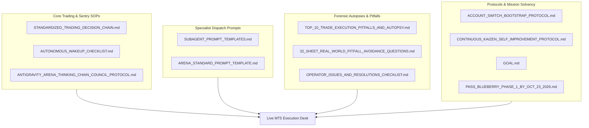

# 🏛️ CANONICAL DESK MANDATORY GOVERNANCE & PROTOCOLS DIRECTORY
## Blueberry Markets Phase 1 Autonomous Desk (Account #5064568)

> **Canonical Directory**: `Data/Manditory/` (Mirrored in `Data/Manditory/`)  
> **Mission**: Pass Funded Phase 1 (5,500.00 USD Equity Target) by Friday, 23rd October 2026 (23:59 UTC).  
> **Inviolable Hard Floor**: 4,775.00 USD (Never breach under any circumstance).  
> **Defense Operating Buffer**: 4,795.00 USD (+20.00 USD cushion above hard floor).  
> **Authorized Background Tasks**: EXACTLY 5 persistent daemons active in Antigravity task runner (`manage_task`).

---

## 📑 1. ACTIVE PRODUCTION GOVERNANCE & DECISION FILES (12 CANONICAL DOCUMENTS)

These 12 active documents are strictly maintained in `Data/Manditory/` and referenced line-by-line during every autonomous cycle, wake-up sentry, and trade decision:

| # | Document | Primary Purpose | Key Focus & Enforcements |
|---|---|---|---|
| 1 | [`STANDARDIZED_TRADING_DECISION_CHAIN.md`](file:///c:/Users/SIGMA/Documents/Trading_2/Data/Manditory/STANDARDIZED_TRADING_DECISION_CHAIN.md) | **Canonical 10-Step Institutional Quant SOP** | Complete institutional quant trading decision chain, 5-pillar confluence stack, dynamic friction budgeting (spread points / TP distance <= 15%), fluid 4-slot portfolio capacity, multi-asset risk scaling (up to 25.00–35.00 USD), and 10-point ex-ante pre-punch checklist. |
| 2 | [`AUTONOMOUS_WAKEUP_CHECKLIST.md`](file:///c:/Users/SIGMA/Documents/Trading_2/Data/Manditory/AUTONOMOUS_WAKEUP_CHECKLIST.md) | **20-Minute Wake-Up Sequence** | 10-step autonomous execution sequence executed on every 20-minute cron trigger (`0,20,40 * * * *`). Mandatory 4-subagent dispatch, Arena.ai affirmative candidate discovery, and pre-condition trigger checklist. |
| 3 | [`ANTIGRAVITY_ARENA_THINKING_CHAIN_COUNCIL_PROTOCOL.md`](file:///c:/Users/SIGMA/Documents/Trading_2/Data/Manditory/ANTIGRAVITY_ARENA_THINKING_CHAIN_COUNCIL_PROTOCOL.md) | **Antigravity-Arena Council Protocol** | V3.0 production-hardened council protocol, 6-gate architectural diagram, 33-sheet master Excel data warehouse provenance, and dual Arena.ai mandate (candidate discovery + critique). |
| 4 | [`SUBAGENT_PROMPT_TEMPLATES.md`](file:///c:/Users/SIGMA/Documents/Trading_2/Data/Manditory/SUBAGENT_PROMPT_TEMPLATES.md) | **Specialist Subagent Dispatch Prompts** | Standardized Tier 2 Full Unabridged Big Prompts (~350–500 tokens) with mandatory citation of `STANDARDIZED_TRADING_DECISION_CHAIN.md` for all 4 subagents: Orderflow Analyst, Position Manager, Macro Risk Analyst, and Excel Data Quality Auditor. |
| 5 | [`ARENA_STANDARD_PROMPT_TEMPLATE.md`](file:///c:/Users/SIGMA/Documents/Trading_2/Data/Manditory/ARENA_STANDARD_PROMPT_TEMPLATE.md) | **Arena.ai Candidate Discovery Prompt Template** | Standardized prompt template injected into Arena.ai via Chrome CDP on port 9222 for affirmative candidate discovery and multi-persona evaluation. |
| 6 | [`TOP_10_TRADE_EXECUTION_PITFALLS_AND_AUTOPSY.md`](file:///c:/Users/SIGMA/Documents/Trading_2/Data/Manditory/TOP_10_TRADE_EXECUTION_PITFALLS_AND_AUTOPSY.md) | **10 Lethal Traps & SOL Autopsy** | Forensic autopsy of losing trade (`SOLUSD.p #19174858`) and the top 10 lethal trade execution traps (unaligned limits, off-hours spread traps, catching falling knives, premature entries). |
| 7 | [`32_SHEET_REAL_WORLD_PITFALL_AVOIDANCE_QUESTIONS.md`](file:///c:/Users/SIGMA/Documents/Trading_2/Data/Manditory/32_SHEET_REAL_WORLD_PITFALL_AVOIDANCE_QUESTIONS.md) | **33-Sheet Real-World Questioning SOP** | Concrete real-world thinking questions, pitfall mappings, and fail-closed conditions for all 33 sheets in `DataBase_Trading.xlsx`. |
| 8 | [`OPERATOR_ISSUES_AND_RESOLUTIONS_CHECKLIST.md`](file:///c:/Users/SIGMA/Documents/Trading_2/Data/Manditory/OPERATOR_ISSUES_AND_RESOLUTIONS_CHECKLIST.md) | **Operator Resolutions History** | Comprehensive log of operator issues, root causes, permanent fixes, and avoided traps across all trading sessions. |
| 9 | [`ACCOUNT_SWITCH_BOOTSTRAP_PROTOCOL.md`](file:///c:/Users/SIGMA/Documents/Trading_2/Data/Manditory/ACCOUNT_SWITCH_BOOTSTRAP_PROTOCOL.md) | **Cross-Account Bootstrap & Reconnection** | Non-bypassable SOP when switching accounts or recovering state. Audits & auto-starts all 5 daemons in task manager, enforces Tier 2 Big Prompts, and prevents context amnesia. |
| 10 | [`CONTINUOUS_KAIZEN_SELF_IMPROVEMENT_PROTOCOL.md`](file:///c:/Users/SIGMA/Documents/Trading_2/Data/Manditory/CONTINUOUS_KAIZEN_SELF_IMPROVEMENT_PROTOCOL.md) | **Continuous Kaizen Self-Improvement SOP** | Non-bypassable 5-stage PDCA-Ω feedback cycle, root cause autopsy methodology, case studies, and anti-regression rules. |
| 11 | [`GOAL.md`](file:///c:/Users/SIGMA/Documents/Trading_2/Data/Manditory/GOAL.md) | **Perpetual Mission Contract** | Active mission objectives, account constraints, 4,775.00 USD hard floor, 4,795.00 USD operating buffer, and non-bypassable goals. |
| 12 | [`PASS_BLUEBERRY_PHASE_1_BY_OCT_23_2026.md`](file:///c:/Users/SIGMA/Documents/Trading_2/Data/Manditory/PASS_BLUEBERRY_PHASE_1_BY_OCT_23_2026.md) | **Milestone Roadmap & Capital Bridge** | Mathematical runway, trade pacing, and equity trajectory to reach 5,500.00 USD. |

---

## 📁 2. AUXILIARY & HISTORICAL SPECIFICATIONS (`Data/Manditory/Other_MD/`)

All secondary, historical, or specialized reference specifications are cleanly archived in [`Other_MD/`](file:///c:/Users/SIGMA/Documents/Trading_2/Data/Manditory/Other_MD/):

| Document in `Other_MD/` | Scope & Description |
|---|---|
| [`TRADE_DECISION_PLAYBOOK.md`](file:///c:/Users/SIGMA/Documents/Trading_2/Data/Manditory/Other_MD/TRADE_DECISION_PLAYBOOK.md) | Living telemetry trade decision playbook & parameter inventory. |
| [`LOSING_TRADES_DEEP_FORENSIC_AUTOPSY.md`](file:///c:/Users/SIGMA/Documents/Trading_2/Data/Manditory/Other_MD/LOSING_TRADES_DEEP_FORENSIC_AUTOPSY.md) | Exhaustive forensic autopsy of historical 26 losing trades and invariants A, B, C. |
| [`institutional_orderflow_live_checklist.md`](file:///c:/Users/SIGMA/Documents/Trading_2/Data/Manditory/Other_MD/institutional_orderflow_live_checklist.md) | Microstructure live execution checklist and tick aggressor imbalance gates. |
| [`UNIVERSAL_AUTONOMOUS_TRADING_PROMPT.md`](file:///c:/Users/SIGMA/Documents/Trading_2/Data/Manditory/Other_MD/UNIVERSAL_AUTONOMOUS_TRADING_PROMPT.md) | Master quantitative prompt for external frontier AI models. |
| [`COPILOT_STUDIO_AGENT_INSTRUCTIONS.md`](file:///c:/Users/SIGMA/Documents/Trading_2/Data/Manditory/Other_MD/COPILOT_STUDIO_AGENT_INSTRUCTIONS.md) | Agent directives for Microsoft Copilot Studio integration. |
| [`OX_ALPHA_63_DECISION_CHAIN_SPECIFICATION.md`](file:///c:/Users/SIGMA/Documents/Trading_2/Data/Manditory/Other_MD/OX_ALPHA_63_DECISION_CHAIN_SPECIFICATION.md) | Strategy co-pilot and decision chain upgrade specification. |
| [`ASTRA_OMNI_MICROSTRUCTURE_ARCHITECTURE.md`](file:///c:/Users/SIGMA/Documents/Trading_2/Data/Manditory/Other_MD/ASTRA_OMNI_MICROSTRUCTURE_ARCHITECTURE.md) | Microstructure architecture and high-frequency data contracts. |
| [`HOST_VERIFICATION_ATTESTATION.md`](file:///c:/Users/SIGMA/Documents/Trading_2/Data/Manditory/Other_MD/HOST_VERIFICATION_ATTESTATION.md) | Host environment verification and broker credentials attestation. |
| [`OMNI_Sentinel_Wake_Protocol.md`](file:///c:/Users/SIGMA/Documents/Trading_2/Data/Manditory/Other_MD/OMNI_Sentinel_Wake_Protocol.md) | Sentinel wake protocol and supervisor management. |
| [`OBSERVED_ONLY_DATA_POLICY.md`](file:///c:/Users/SIGMA/Documents/Trading_2/Data/Manditory/Other_MD/OBSERVED_ONLY_DATA_POLICY.md) | Strict observed-only telemetry policy. |
| [`coinglass_data_dictionary.md`](file:///c:/Users/SIGMA/Documents/Trading_2/Data/Manditory/Other_MD/coinglass_data_dictionary.md) | CoinGlass column-by-column schema and definitions. |
| [`coinglass-cdp-harvester.md`](file:///c:/Users/SIGMA/Documents/Trading_2/Data/Manditory/Other_MD/coinglass-cdp-harvester.md) | Headless Chrome CDP CoinGlass harvester specification. |
| [`COINGLASS_PER_ASSET_RECONCILIATION.md`](file:///c:/Users/SIGMA/Documents/Trading_2/Data/Manditory/Other_MD/COINGLASS_PER_ASSET_RECONCILIATION.md) | Asset mapping and reconciliation rules for CoinGlass data feeds. |
| [`liquidation-maxpain-pipeline.md`](file:///c:/Users/SIGMA/Documents/Trading_2/Data/Manditory/Other_MD/liquidation-maxpain-pipeline.md) | Reconstructed liquidation and options max-pain pipeline architecture. |
| [`ai-15m-candle-mt5-trader.md`](file:///c:/Users/SIGMA/Documents/Trading_2/Data/Manditory/Other_MD/ai-15m-candle-mt5-trader.md) | Technical specification for 15-minute candle autonomous trader. |

---

## ⚙️ THE 5 AUTHORIZED PERSISTENT BACKGROUND DAEMONS (IN ANTIGRAVITY TASK MANAGER)

1. **Daemon 1 (Continuous 33-Sheet Excel Pipeline Daemon)**: `Run_Parallel_Pipeline.py --continuous --gap 300 --workers 1` (`IsDaemon=true`).
2. **Daemon 2 (20-Minute Cron Sentry)**: `schedule` on `0,20,40 * * * *` (`IsDaemon=true`).
3. **Daemon 3 (Arena Completion Daemon)**: `arena_completion_daemon.py --daemon` on port 9222 (`IsDaemon=true`).
4. **Daemon 4 (Autonomous 5-Minute Git Sync Daemon)**: `autonomous_git_sync_daemon.py` every 300s (`IsDaemon=true`).
5. **Daemon 5 (AST Graphify Watcher Daemon)**: `run_graphify_watcher.py` (`IsDaemon=true`).
