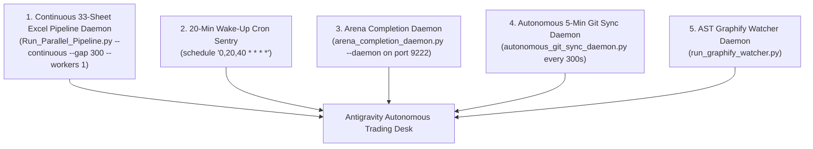

# 🏛️ MANDATORY DESK GOVERNANCE & PROTOCOLS INDEX
## Blueberry Markets Phase 1 Autonomous Desk (Account #5064568)

> **Location**: `Data/Manditory/`  
> **Mission**: Pass Funded Phase 1 ($5,500.00 USD Equity Target) by Friday, 23rd October 2026 (23:59 UTC).  
> **Inviolable Hard Floor**: 4,775.00 USD (Never breach under any circumstance).  
> **Defense Operating Buffer**: 4,795.00 USD (+20.00 USD cushion above hard floor).  
> **Authorized Background Tasks**: EXACTLY 5 persistent daemons active in Antigravity task runner (manage_task).

---

## 📑 MASTER DOCUMENT DIRECTORY

| Document | Primary Purpose | Key Focus & Enforcements |
|---|---|---|
| [`ACCOUNT_SWITCH_BOOTSTRAP_PROTOCOL.md`](file:///c:/Users/SIGMA/Documents/Trading_2/Data/Manditory/ACCOUNT_SWITCH_BOOTSTRAP_PROTOCOL.md) | **Cross-Account Bootstrap & Reconnection** | Non-bypassable SOP when switching accounts or recovering state. Audits & auto-starts all 5 daemons in task manager, enforces Tier 2 Big Prompts, and prevents context amnesia. |
| [`CONTINUOUS_KAIZEN_SELF_IMPROVEMENT_PROTOCOL.md`](file:///c:/Users/SIGMA/Documents/Trading_2/Data/Manditory/CONTINUOUS_KAIZEN_SELF_IMPROVEMENT_PROTOCOL.md) | **Continuous Kaizen Self-Improvement SOP** | Non-bypassable 5-stage PDCA-Ω feedback cycle, root cause autopsy methodology, case studies, and anti-regression rules. |
| [`AUTONOMOUS_WAKEUP_CHECKLIST.md`](file:///c:/Users/SIGMA/Documents/Trading_2/Data/Manditory/AUTONOMOUS_WAKEUP_CHECKLIST.md) | **20-Minute Wake-Up Sequence** | 10-step autonomous execution sequence executed on every 20-minute cron trigger (`0,20,40 * * * *`). |
| [`32_SHEET_REAL_WORLD_PITFALL_AVOIDANCE_QUESTIONS.md`](file:///c:/Users/SIGMA/Documents/Trading_2/Data/Manditory/32_SHEET_REAL_WORLD_PITFALL_AVOIDANCE_QUESTIONS.md) | **33-Sheet Real-World Questioning SOP** | Concrete real-world thinking questions, pitfall mappings, and fail-closed conditions for all 33 sheets in `DataBase_Trading.xlsx`. |
| [`TOP_10_TRADE_EXECUTION_PITFALLS_AND_AUTOPSY.md`](file:///c:/Users/SIGMA/Documents/Trading_2/Data/Manditory/TOP_10_TRADE_EXECUTION_PITFALLS_AND_AUTOPSY.md) | **10 Lethal Traps & SOL Autopsy** | Forensic autopsy of losing trade (`SOLUSD.p #19174858`) and the top 10 lethal trade execution traps. |
| [`SUBAGENT_PROMPT_TEMPLATES.md`](file:///c:/Users/SIGMA/Documents/Trading_2/Data/Manditory/SUBAGENT_PROMPT_TEMPLATES.md) | **Specialist Subagent Dispatch Prompts** | Standardized Tier 2 Full Unabridged Big Prompts (~350–500 tokens) with mandatory citation of `STANDARDIZED_TRADING_DECISION_CHAIN.md` for all 4 subagents. |
| [`ARENA_STANDARD_PROMPT_TEMPLATE.md`](file:///c:/Users/SIGMA/Documents/Trading_2/Data/Manditory/ARENA_STANDARD_PROMPT_TEMPLATE.md) | **Arena.ai Red-Team Prompt Template** | Standardized prompt injected into Arena.ai via Chrome CDP port 9222. |
| [`STANDARDIZED_TRADING_DECISION_CHAIN.md`](file:///c:/Users/SIGMA/Documents/Trading_2/Data/Manditory/STANDARDIZED_TRADING_DECISION_CHAIN.md) | **Canonical 10-Step Institutional Quant SOP** | Complete institutional quant trading decision chain, 5-pillar confluence stack, and risk formulas. |
| [`GOAL.md`](file:///c:/Users/SIGMA/Documents/Trading_2/Data/Manditory/GOAL.md) | **Perpetual Mission Contract** | Active mission objectives, account constraints, and non-bypassable goals. |
| [`PASS_BLUEBERRY_PHASE_1_BY_OCT_23_2026.md`](file:///c:/Users/SIGMA/Documents/Trading_2/Data/Manditory/PASS_BLUEBERRY_PHASE_1_BY_OCT_23_2026.md) | **Milestone Roadmap & Capital Bridge** | Mathematical runway, trade pacing, and equity trajectory to reach $5,500.00 USD. |
| [`OPERATOR_ISSUES_AND_RESOLUTIONS_CHECKLIST.md`](file:///c:/Users/SIGMA/Documents/Trading_2/Data/Manditory/OPERATOR_ISSUES_AND_RESOLUTIONS_CHECKLIST.md) | **Operator Resolutions History** | Comprehensive log of operator issues, root causes, permanent fixes, and avoided traps. |

---

## ⚙️ THE 5 AUTHORIZED PERSISTENT BACKGROUND DAEMONS (IN ANTIGRAVITY TASK MANAGER)

Under strict desk governance, all 5 daemons MUST be started via Antigravity's task manager (`run_command` with `IsDaemon=true` or `schedule`) so they are registered in `manage_task(Action='list')` and provide event-driven wakeups:

1. **Daemon 1 (Continuous 33-Sheet Excel Pipeline Daemon)**:
   - Tool Call: `run_command(CommandLine="python Data/Excel_Modules/Run_Parallel_Pipeline.py --continuous --gap 300 --workers 1", IsDaemon=true, WaitMsBeforeAsync=500, toolSummary="Launch Continuous 33-Sheet Excel Pipeline Daemon")`
   - Purpose: Updates all 33 sheets in `Data/DataBase_Trading.xlsx`, cooling down for exactly 5 minutes (300 seconds) between cycles.
2. **Daemon 2 (20-Minute Cron Sentry)**:
   - Tool Call: `schedule(CronExpression="0,20,40 * * * *", IsDaemon=true, Prompt="...")`
   - Purpose: Fires at the 20th, 40th, and 60th/00th minute for the multi-agent council audit.
3. **Daemon 3 (Arena Completion Daemon)**:
   - Tool Call: `run_command(CommandLine="python Terminal/arena_completion_daemon.py --daemon", IsDaemon=true, WaitMsBeforeAsync=500, toolSummary="Launch Arena Completion Daemon")`
   - Purpose: Monitors Chrome CDP for Arena completion and auto-harvests responses into `docs/trade_plans/ARENA_LATEST_RAW.md`.
4. **Daemon 4 (Autonomous 5-Minute Git Sync Daemon)**:
   - Tool Call: `run_command(CommandLine="python Terminal/Data_Factory/autonomous_git_sync_daemon.py", IsDaemon=true, WaitMsBeforeAsync=500, toolSummary="Launch Autonomous Git Sync Daemon")`
   - Purpose: Stages, commits, and pushes all workspace modifications and uncorrupted Excel dumps to `origin/main` every 300s.
5. **Daemon 5 (AST Graphify Watcher Daemon)**:
   - Tool Call: `run_command(CommandLine="python Terminal/run_graphify_watcher.py", IsDaemon=true, WaitMsBeforeAsync=500, toolSummary="Launch AST Graphify Watcher Daemon")`
   - Purpose: Continuous low-RAM AST watcher monitoring `Terminal/` and `Engine/` to synchronize code graph memory without token waste.

---

## 🤖 MANDATORY SUBAGENT FLEET & TIER 2 BIG PROMPTS

On EVERY 20-minute wake-up, the agent MUST immediately invoke all 4 subagents using `invoke_subagent` (`Model='flash'`) with the **FULL UNABRIDGED TIER 2 BIG PROMPTS** (~350–500 tokens each) from `SUBAGENT_PROMPT_TEMPLATES.md` (Part 2):
- **Orderflow Analyst**: Evaluates CVD, orderbook depth, resting whale walls, and candidate radar.
- **Position Manager**: Audits MT5 live account, cushions, stressed capacity, and ratchets.
- **Macro Risk Analyst**: Audits Tier-1 event calendar, ETF flows, and FX rollover embargo.
- **Excel Data Quality Auditor**: Verifies all 33 sheets loaded, 0 formula errors, and pipeline daemon health.

> 🛑 **MANDATORY INVARIANT**: Every subagent prompt MUST explicitly include `@[c:\Users\SIGMA\Documents\Trading_2\docs\specs\STANDARDIZED_TRADING_DECISION_CHAIN.md]` as the first non-bypassable reading requirement. Short or truncated prompts are strictly forbidden.
