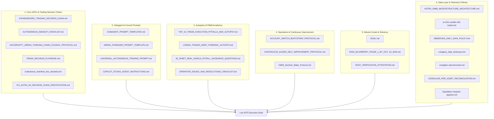

# 🏛️ CANONICAL DESK MANDATORY GOVERNANCE & PROTOCOLS DIRECTORY
## Blueberry Markets Phase 1 Autonomous Desk (Account #5064568)

> **Canonical Directory**: `Data/Manditory/` (Mirrored in `docs/Mandatory_Rules/` and `docs/specs/`)  
> **Mission**: Pass Funded Phase 1 (5,500.00 USD Equity Target) by Friday, 23rd October 2026 (23:59 UTC).  
> **Inviolable Hard Floor**: 4,775.00 USD (Never breach under any circumstance).  
> **Defense Operating Buffer**: 4,795.00 USD (+20.00 USD cushion above hard floor).  
> **Authorized Background Tasks**: EXACTLY 5 persistent daemons active in Antigravity task runner (`manage_task`).

---

## 📑 COMPLETE INVENTORY OF MANDATORY GOVERNANCE FILES (28 CANONICAL DOCUMENTS)

Every document in this directory is a legally and operationally binding standard operating procedure (SOP) for the autonomous desk. No step may be executed in a vacuum without full compliance with these documents.

---

### 1. Core Institutional SOPs & Trading Decision Chains
| Document | Primary Purpose | Key Focus & Enforcements |
|---|---|---|
| [`STANDARDIZED_TRADING_DECISION_CHAIN.md`](file:///c:/Users/SIGMA/Documents/Trading_2/Data/Manditory/STANDARDIZED_TRADING_DECISION_CHAIN.md) | **Canonical 10-Step Institutional Quant SOP** | Complete institutional quant trading decision chain, 5-pillar confluence stack, dynamic friction budgeting (spread/TP <= 15%), 4-slot fluid portfolio capacity, multi-asset risk rights (up to 25–35 USD), and 10-point ex-ante pre-punch checklist. |
| [`AUTONOMOUS_WAKEUP_CHECKLIST.md`](file:///c:/Users/SIGMA/Documents/Trading_2/Data/Manditory/AUTONOMOUS_WAKEUP_CHECKLIST.md) | **20-Minute Wake-Up Sequence** | 10-step autonomous execution sequence executed on every 20-minute cron trigger (`0,20,40 * * * *`). Mandatory 4-subagent dispatch, Arena.ai council consultation, and pre-condition trigger checklist. |
| [`ANTIGRAVITY_ARENA_THINKING_CHAIN_COUNCIL_PROTOCOL.md`](file:///c:/Users/SIGMA/Documents/Trading_2/Data/Manditory/ANTIGRAVITY_ARENA_THINKING_CHAIN_COUNCIL_PROTOCOL.md) | **Antigravity-Arena Council Protocol** | V3.0 production-hardened thinking chain council protocol, 6-gate architectural diagram, 33-sheet master Excel data warehouse provenance, and dual Arena.ai mandate (affirmative candidate discovery + red-team critique). |
| [`TRADE_DECISION_PLAYBOOK.md`](file:///c:/Users/SIGMA/Documents/Trading_2/Data/Manditory/TRADE_DECISION_PLAYBOOK.md) | **Live Telemetry Trade Decision Playbook** | Comprehensive 6-pillar confluence framework, dual-venue hybrid architecture (MT5 quotes vs Binance/Hyperdash orderbooks), and complete parameter inventory. |
| [`institutional_orderflow_live_checklist.md`](file:///c:/Users/SIGMA/Documents/Trading_2/Data/Manditory/institutional_orderflow_live_checklist.md) | **Institutional Orderflow Live Checklist** | Microstructure live execution checklist, tick aggressor imbalance, CVD absorption, 20-level orderbook depth imbalance, and broker micro-spread verification. |
| [`OX_ALPHA_63_DECISION_CHAIN_SPECIFICATION.md`](file:///c:/Users/SIGMA/Documents/Trading_2/Data/Manditory/OX_ALPHA_63_DECISION_CHAIN_SPECIFICATION.md) | **Ox Alpha Strategy Co-Pilot Specification** | System topology, GitHub-anchored synchronization protocol, and bidirectional cloud tunnel communication. |

---

### 2. Specialist Prompts & Multi-Agent Swarm Templates
| Document | Primary Purpose | Key Focus & Enforcements |
|---|---|---|
| [`SUBAGENT_PROMPT_TEMPLATES.md`](file:///c:/Users/SIGMA/Documents/Trading_2/Data/Manditory/SUBAGENT_PROMPT_TEMPLATES.md) | **Specialist Subagent Dispatch Prompts** | Standardized Tier 2 Full Unabridged Big Prompts (~350–500 tokens) with mandatory citation of `STANDARDIZED_TRADING_DECISION_CHAIN.md` for all 4 subagents: Orderflow Analyst, Position Manager, Macro Risk Analyst, and Excel Data Quality Auditor. |
| [`ARENA_STANDARD_PROMPT_TEMPLATE.md`](file:///c:/Users/SIGMA/Documents/Trading_2/Data/Manditory/ARENA_STANDARD_PROMPT_TEMPLATE.md) | **Arena.ai Red-Team Prompt Template** | Standardized surgical red-team & affirmative candidate discovery prompt template injected into Arena.ai via Chrome CDP on port 9222. |
| [`UNIVERSAL_AUTONOMOUS_TRADING_PROMPT.md`](file:///c:/Users/SIGMA/Documents/Trading_2/Data/Manditory/UNIVERSAL_AUTONOMOUS_TRADING_PROMPT.md) | **Universal Autonomous Trading Prompt** | Master quantitative prompt for frontier AI models (Arena, Claude, Gemini, GPT Astra, Copilot Studio) with 8-skill ensemble activation. |
| [`COPILOT_STUDIO_AGENT_INSTRUCTIONS.md`](file:///c:/Users/SIGMA/Documents/Trading_2/Data/Manditory/COPILOT_STUDIO_AGENT_INSTRUCTIONS.md) | **Copilot Studio Agent Instructions** | Autonomous agent directives for external co-pilot and multi-agent synthesis. |

---

### 3. Forensic Autopsies, Risk Pitfalls & Real-World Questions
| Document | Primary Purpose | Key Focus & Enforcements |
|---|---|---|
| [`TOP_10_TRADE_EXECUTION_PITFALLS_AND_AUTOPSY.md`](file:///c:/Users/SIGMA/Documents/Trading_2/Data/Manditory/TOP_10_TRADE_EXECUTION_PITFALLS_AND_AUTOPSY.md) | **10 Lethal Traps & SOL Autopsy** | Forensic autopsy of losing trade (`SOLUSD.p #19174858`) and the top 10 lethal trade execution traps (unaligned limits, off-hours spread traps, catching falling knives, premature entries). |
| [`LOSING_TRADES_DEEP_FORENSIC_AUTOPSY.md`](file:///c:/Users/SIGMA/Documents/Trading_2/Data/Manditory/LOSING_TRADES_DEEP_FORENSIC_AUTOPSY.md) | **Forensic Autopsy of 26 Losing Trades** | Exhaustive autopsy partitioning historical losses into SL Too Close (38.5%), Wrong Trend Detection (38.5%), and Session Liquidity Flushes (23.1%), deriving invariants A, B, and C. |
| [`32_SHEET_REAL_WORLD_PITFALL_AVOIDANCE_QUESTIONS.md`](file:///c:/Users/SIGMA/Documents/Trading_2/Data/Manditory/32_SHEET_REAL_WORLD_PITFALL_AVOIDANCE_QUESTIONS.md) | **33-Sheet Real-World Questioning SOP** | Concrete real-world thinking questions, pitfall mappings, and fail-closed conditions for all 33 sheets in `DataBase_Trading.xlsx`. |
| [`OPERATOR_ISSUES_AND_RESOLUTIONS_CHECKLIST.md`](file:///c:/Users/SIGMA/Documents/Trading_2/Data/Manditory/OPERATOR_ISSUES_AND_RESOLUTIONS_CHECKLIST.md) | **Operator Resolutions History** | Comprehensive log of operator issues, root causes, permanent fixes, and avoided traps across all trading sessions. |

---

### 4. Operations, Bootstrapping & Continuous Improvement
| Document | Primary Purpose | Key Focus & Enforcements |
|---|---|---|
| [`ACCOUNT_SWITCH_BOOTSTRAP_PROTOCOL.md`](file:///c:/Users/SIGMA/Documents/Trading_2/Data/Manditory/ACCOUNT_SWITCH_BOOTSTRAP_PROTOCOL.md) | **Cross-Account Bootstrap & Reconnection** | Non-bypassable SOP when switching accounts or recovering state. Audits & auto-starts all 5 daemons in task manager, enforces Tier 2 Big Prompts, and prevents context amnesia. |
| [`CONTINUOUS_KAIZEN_SELF_IMPROVEMENT_PROTOCOL.md`](file:///c:/Users/SIGMA/Documents/Trading_2/Data/Manditory/CONTINUOUS_KAIZEN_SELF_IMPROVEMENT_PROTOCOL.md) | **Continuous Kaizen Self-Improvement SOP** | Non-bypassable 5-stage PDCA-Ω feedback cycle, root cause autopsy methodology, case studies, and anti-regression rules. |
| [`OMNI_Sentinel_Wake_Protocol.md`](file:///c:/Users/SIGMA/Documents/Trading_2/Data/Manditory/OMNI_Sentinel_Wake_Protocol.md) | **Operational Sentinel Wake Protocol** | Continuous execution sentry, schedule diagnosis, and daemon lifecycle management. |

---

### 5. Mission Goals & Capital Solvency Contracts
| Document | Primary Purpose | Key Focus & Enforcements |
|---|---|---|
| [`GOAL.md`](file:///c:/Users/SIGMA/Documents/Trading_2/Data/Manditory/GOAL.md) | **Perpetual Mission Contract** | Active mission objectives, account constraints, 4,775.00 USD hard floor, 4,795.00 USD operating buffer, and non-bypassable goals. |
| [`PASS_BLUEBERRY_PHASE_1_BY_OCT_23_2026.md`](file:///c:/Users/SIGMA/Documents/Trading_2/Data/Manditory/PASS_BLUEBERRY_PHASE_1_BY_OCT_23_2026.md) | **Milestone Roadmap & Capital Bridge** | Mathematical runway, trade pacing, and equity trajectory to reach 5,500.00 USD. |
| [`HOST_VERIFICATION_ATTESTATION.md`](file:///c:/Users/SIGMA/Documents/Trading_2/Data/Manditory/HOST_VERIFICATION_ATTESTATION.md) | **Host Verification Attestation** | Host environment verification, broker credentials attestation, and execution clearance. |

---

### 6. Data Layer Architecture & Ingest Policies
| Document | Primary Purpose | Key Focus & Enforcements |
|---|---|---|
| [`ASTRA_OMNI_MICROSTRUCTURE_ARCHITECTURE.md`](file:///c:/Users/SIGMA/Documents/Trading_2/Data/Manditory/ASTRA_OMNI_MICROSTRUCTURE_ARCHITECTURE.md) | **Microstructure Architecture** | High-frequency orderflow data architecture, L2/L3 orderbook streaming, and taker delta contracts. |
| [`ai-15m-candle-mt5-trader.md`](file:///c:/Users/SIGMA/Documents/Trading_2/Data/Manditory/ai-15m-candle-mt5-trader.md) | **15m Candle AI Trader Specification** | Technical specification for 15-minute candle autonomous trader. |
| [`OBSERVED_ONLY_DATA_POLICY.md`](file:///c:/Users/SIGMA/Documents/Trading_2/Data/Manditory/OBSERVED_ONLY_DATA_POLICY.md) | **Observed-Only Data Policy** | Strict observed-only data policy prohibiting synthetic/unverified indicators from broker execution. |
| [`coinglass_data_dictionary.md`](file:///c:/Users/SIGMA/Documents/Trading_2/Data/Manditory/coinglass_data_dictionary.md) | **CoinGlass Data Dictionary** | Column-by-column schema and definitions for CoinGlass orderbook, liquidations, and flows. |
| [`coinglass-cdp-harvester.md`](file:///c:/Users/SIGMA/Documents/Trading_2/Data/Manditory/coinglass-cdp-harvester.md) | **CoinGlass CDP Harvester Spec** | Specification for headless Chrome CDP CoinGlass data harvester. |
| [`COINGLASS_PER_ASSET_RECONCILIATION.md`](file:///c:/Users/SIGMA/Documents/Trading_2/Data/Manditory/COINGLASS_PER_ASSET_RECONCILIATION.md) | **CoinGlass Asset Reconciliation** | Cross-asset reconciliation and mapping rules for CoinGlass data. |
| [`liquidation-maxpain-pipeline.md`](file:///c:/Users/SIGMA/Documents/Trading_2/Data/Manditory/liquidation-maxpain-pipeline.md) | **Liquidation & Max Pain Pipeline** | Reconstructed liquidation and options max-pain pipeline architecture. |

---

## ⚙️ THE 5 AUTHORIZED PERSISTENT BACKGROUND DAEMONS (IN ANTIGRAVITY TASK MANAGER)

Under strict desk governance, all 5 daemons MUST be started via Antigravity's task manager (`run_command` with `IsDaemon=true` or `schedule`) so they are registered in `manage_task(Action='list')` and provide event-driven wakeups:

1. **Daemon 1 (Continuous 33-Sheet Excel Pipeline Daemon)**:
   - Tool Call: `run_command(CommandLine="python Data/Excel_Modules/Run_Parallel_Pipeline.py --continuous --gap 300 --workers 1", IsDaemon=true, WaitMsBeforeAsync=500, toolSummary="Launch Continuous 33-Sheet Excel Pipeline Daemon")`
   - Purpose: Updates all 33 sheets in `Data/DataBase_Trading.xlsx`, cooling down for exactly 5 minutes (300 seconds) between cycles.
2. **Daemon 2 (20-Minute Cron Sentry)**:
   - Tool Call: `schedule(CronExpression="0,20,40 * * * *", IsDaemon=true, Prompt="...")`
   - Purpose: Fires at the 20th, 40th, and 60th/00th minute for the multi-agent council audit.
3. **Daemon 3 (Arena Completion Daemon)**:
   - Tool Call: `run_command(CommandLine="python Terminal/arena_completion_daemon.py --daemon", IsDaemon=true, WaitMsBeforeAsync=500, toolSummary="Launch Arena Completion Daemon")`
   - Purpose: Monitors Chrome CDP for Arena completion and auto-harvests responses into `docs/trade_plans/ARENA_LATEST_RAW.md`.
4. **Daemon 4 (Autonomous 5-Minute Git Sync Daemon)**:
   - Tool Call: `run_command(CommandLine="python Terminal/Data_Factory/autonomous_git_sync_daemon.py", IsDaemon=true, WaitMsBeforeAsync=500, toolSummary="Launch Autonomous Git Sync Daemon")`
   - Purpose: Stages, commits, and pushes all workspace modifications and uncorrupted Excel dumps to `origin/main` every 300s.
5. **Daemon 5 (AST Graphify Watcher Daemon)**:
   - Tool Call: `run_command(CommandLine="python Terminal/run_graphify_watcher.py", IsDaemon=true, WaitMsBeforeAsync=500, toolSummary="Launch AST Graphify Watcher Daemon")`
   - Purpose: Continuous low-RAM AST watcher monitoring `Terminal/` and `Engine/` to synchronize code graph memory without token waste.

---

## 🤖 MANDATORY 4-SUBAGENT SWARM & TIER 2 BIG PROMPTS

On EVERY 20-minute wake-up, the agent MUST immediately invoke all 4 subagents using `invoke_subagent` (`Model='flash'`) with the **FULL UNABRIDGED TIER 2 BIG PROMPTS** (~350–500 tokens each) from `SUBAGENT_PROMPT_TEMPLATES.md`:
- **Orderflow Analyst**: Evaluates CVD, orderbook depth, resting whale walls, and candidate radar across all 156 instruments.
- **Position Manager**: Audits MT5 live account, cushions, stressed capacity, and ratchets.
- **Macro Risk Analyst**: Audits Tier-1 event calendar, ETF flows, and FX rollover embargo.
- **Excel Data Quality Auditor**: Verifies all 33 sheets loaded, 0 formula errors, unmerged headers, and pipeline daemon health.

> 🛑 **MANDATORY INVARIANT**: Every subagent prompt MUST explicitly include `@[c:\Users\SIGMA\Documents\Trading_2\Data\Manditory\STANDARDIZED_TRADING_DECISION_CHAIN.md]` as the first non-bypassable reading requirement. Short or truncated prompts are strictly forbidden.
