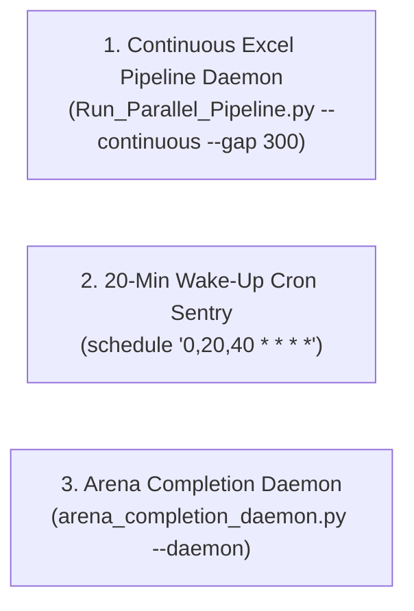

# 🏛️ MANDATORY DESK GOVERNANCE & PROTOCOLS INDEX
## Blueberry Markets Phase 1 Autonomous Desk (Account #5064568)

> **Location**: `Data/Manditory/`  
> **Mission**: Pass Funded Phase 1 ($5,500.00 USD Equity Target) by Friday, 23rd October 2026 (23:59 UTC).  
> **Inviolable Hard Floor**: 4,775.00 USD (Never breach under any circumstance).  
> **Defense Operating Buffer**: 4,795.00 USD (+20.00 USD cushion above hard floor).  
> **Authorized Background Tasks**: EXACTLY 3 tasks (Excel continuous daemon, Arena daemon, 20-min cron).

---

## 📑 MASTER DOCUMENT DIRECTORY

| Document | Primary Purpose | Key Focus & Enforcements |
|---|---|---|
| [`ACCOUNT_SWITCH_BOOTSTRAP_PROTOCOL.md`](file:///c:/Users/SIGMA/Documents/Trading_2/Data/Manditory/ACCOUNT_SWITCH_BOOTSTRAP_PROTOCOL.md) | **Cross-Account Bootstrap & Reconnection** | Step-by-step SOP when switching Gemini/Antigravity accounts, recovering state, launching daemons, and preventing context amnesia. |
| [`CONTINUOUS_KAIZEN_SELF_IMPROVEMENT_PROTOCOL.md`](file:///c:/Users/SIGMA/Documents/Trading_2/Data/Manditory/CONTINUOUS_KAIZEN_SELF_IMPROVEMENT_PROTOCOL.md) | **Continuous Kaizen Self-Improvement SOP** | Non-bypassable 5-stage PDCA-Ω feedback cycle, root cause autopsy methodology, case studies, and anti-regression rules. |
| [`AUTONOMOUS_WAKEUP_CHECKLIST.md`](file:///c:/Users/SIGMA/Documents/Trading_2/Data/Manditory/AUTONOMOUS_WAKEUP_CHECKLIST.md) | **20-Minute Wake-Up Sequence** | 10-step autonomous execution sequence executed on every 20-minute cron trigger (`0,20,40 * * * *`). |
| [`32_SHEET_REAL_WORLD_PITFALL_AVOIDANCE_QUESTIONS.md`](file:///c:/Users/SIGMA/Documents/Trading_2/Data/Manditory/32_SHEET_REAL_WORLD_PITFALL_AVOIDANCE_QUESTIONS.md) | **32-Sheet Real-World Questioning SOP** | Concrete real-world thinking questions, pitfall mappings, and fail-closed conditions for every single sheet in `DataBase_Trading.xlsx`. |
| [`TOP_10_TRADE_EXECUTION_PITFALLS_AND_AUTOPSY.md`](file:///c:/Users/SIGMA/Documents/Trading_2/Data/Manditory/TOP_10_TRADE_EXECUTION_PITFALLS_AND_AUTOPSY.md) | **10 Lethal Traps & SOL Autopsy** | Forensic autopsy of losing trade (`SOLUSD.p #19174858`) and the top 10 lethal trade execution traps. |
| [`SUBAGENT_PROMPT_TEMPLATES.md`](file:///c:/Users/SIGMA/Documents/Trading_2/Data/Manditory/SUBAGENT_PROMPT_TEMPLATES.md) | **Specialist Subagent Dispatch Prompts** | Standardized prompt templates for the 4 specialist subagents: Orderflow Analyst, Position Manager, Macro Risk Analyst, and Excel Auditor. |
| [`ARENA_STANDARD_PROMPT_TEMPLATE.md`](file:///c:/Users/SIGMA/Documents/Trading_2/Data/Manditory/ARENA_STANDARD_PROMPT_TEMPLATE.md) | **Arena.ai Red-Team Prompt Template** | Standardized prompt injected into Arena.ai via Chrome CDP port 9222. |
| [`STANDARDIZED_TRADING_DECISION_CHAIN.md`](file:///c:/Users/SIGMA/Documents/Trading_2/Data/Manditory/STANDARDIZED_TRADING_DECISION_CHAIN.md) | **Canonical 10-Step Institutional Quant SOP** | Complete institutional quant trading decision chain, 5-pillar confluence stack, and risk formulas. |
| [`GOAL.md`](file:///c:/Users/SIGMA/Documents/Trading_2/Data/Manditory/GOAL.md) | **Perpetual Mission Contract** | Active mission objectives, account constraints, and non-bypassable goals. |
| [`PASS_BLUEBERRY_PHASE_1_BY_OCT_23_2026.md`](file:///c:/Users/SIGMA/Documents/Trading_2/Data/Manditory/PASS_BLUEBERRY_PHASE_1_BY_OCT_23_2026.md) | **Milestone Roadmap & Capital Bridge** | Mathematical runway, trade pacing, and equity trajectory to reach $5,500.00 USD. |
| [`OPERATOR_ISSUES_AND_RESOLUTIONS_CHECKLIST.md`](file:///c:/Users/SIGMA/Documents/Trading_2/Data/Manditory/OPERATOR_ISSUES_AND_RESOLUTIONS_CHECKLIST.md) | **Operator Resolutions History** | Comprehensive log of operator issues, root causes, permanent fixes, and avoided traps. |

---

## ⚙️ THE ONLY 3 AUTHORIZED BACKGROUND DAEMONS

Under strict desk governance, **no extra or unauthorized background processes are permitted**:

1. **Excel Continuous Updation Daemon**:
   - Command: `python Data/Excel_Modules/Run_Parallel_Pipeline.py --continuous --gap 300 --workers 1`
   - Setting: `IsDaemon=true`
   - Purpose: Updates all 32 sheets in `Data/DataBase_Trading.xlsx`, cooling down for exactly 5 minutes (300 seconds) between cycles.
2. **20-Minute Cron Sentry**:
   - Setting: `CronExpression="0,20,40 * * * *"`, `IsDaemon=true`
   - Purpose: Fires at the 20th, 40th, and 60th/00th minute for the multi-agent council audit.
3. **Arena Completion Daemon**:
   - Command: `python Terminal/arena_completion_daemon.py --daemon`
   - Setting: `IsDaemon=true`
   - Purpose: Monitors Chrome CDP for Arena completion and auto-harvests responses.

> 🚫 **RETIRED DAEMONS (DO NOT RUN)**:
> - **Telemetry Git Daemon (`autonomous_telemetry_git_daemon.py`)**: PERMANENTLY RETIRED. Do not run. Git pushes are handled manually on milestones.
> - **Multi-Threaded Direct Write Harvester**: Direct concurrent writes to `.xlsx` are banned due to zip corruption risk. Sequential `workers=1` is enforced.

---

## 🤖 SUBAGENT INVOCATION MANDATE (TOKEN-OPTIMIZED)

On EVERY 20-minute wake-up, the agent MUST immediately invoke the 4 subagents using `invoke_subagent` before generating text:
- **Orderflow Analyst**: Evaluates CVD, orderbook depth, resting whale walls, and candidate radar.
- **Position Manager**: Audits MT5 live account, cushions, stressed capacity, and ratchets.
- **Macro Risk Analyst**: Audits Tier-1 event calendar, ETF flows, and FX rollover embargo.
- **Excel Data Quality Auditor**: Verifies 32 sheets loaded, 0 formula errors, and pipeline daemon health.

> 💡 **Token Conservation**: Subagents must use `Model='flash'` or `'flash_lite'` and produce compact bullet summaries (<= 300 tokens each).
