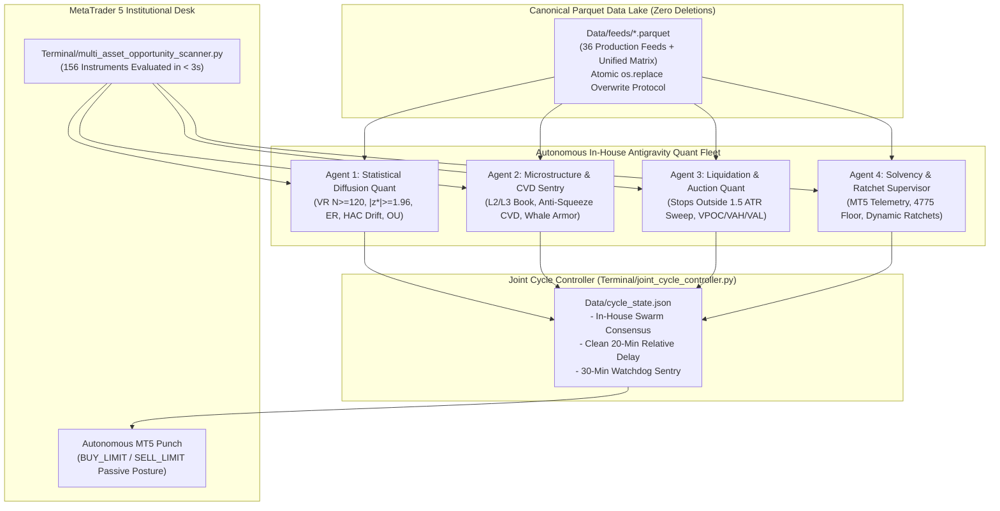
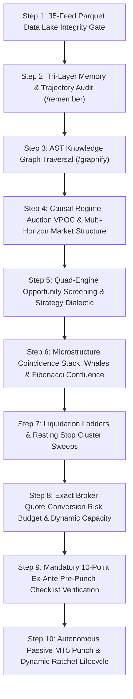

# 🏛️ STANDARDIZED QUANTITATIVE TRADING DECISION CHAIN (SOP)
## Canonical Multi-Pillar Institutional Microstructure Decision Architecture

> **Document Status**: CANONICAL PRODUCTION SPECIFICATION  
> **Target Environment**: MetaTrader 5 (Blueberry Markets, Account #5064568)  
> **Execution Engine**: Antigravity Autonomous Decision Desk  
> **Universe Scope**: Full 156-Asset Universe across 6 Asset Classes (Crypto, Indices, Metals, Commodities, Forex Majors, Crosses, Exotics)  
> **Data Lake**: `Data/feeds/*.parquet` (35 Canonical Production Parquet Feeds + Unified Liquidation Matrix)  
> **Mandatory Foundation**: 8 Core Multi-Domain Skill Ensembles & 4-Subagent Swarm

---

## SECTION 1: MANDATORY SKILLS ENSEMBLE FOUNDATION & 4-SUBAGENT SWARM

Under strict institutional hedge fund governance, **no trading analysis, hypothesis formation, order staging, modification, or cancellation may ever occur in an ad-hoc or single-agent vacuum**.

### 🚨 MANDATORY INVIOLATE IN-HOUSE ANTIGRAVITY QUANT SWARM LIFECYCLE (OPERATOR MANDATE)
> **NEVER OMIT, BYPASS, OR SKIP UNDER ANY CIRCUMSTANCES**:
> 1. **100% In-House Antigravity Autonomous Decision Desk**:
>    - The desk is fully decoupled from external web-based scraping dependencies (Arena.ai, Z.ai, Chrome CDP automation). All candidate screening, mathematical testing, microstructure analysis, and order execution are performed natively within Antigravity.
>    - Eliminates external browser crashes, session token expirations, and uncalibrated boilerplate responses. Antigravity operates directly with native broker quotes, raw L2/L3 orderbooks, and the canonical Parquet data lake.
>
> 2. **Mandatory Subagent Read Gate Check Mark (OPERATOR MANDATE)**:
>    - Every subagent invoked for trade analysis, hypothesis formation, or order planning MUST physically read and verify `STANDARDIZED_TRADING_DECISION_CHAIN.md`.
>    - Every subagent report MUST explicitly display the verified read confirmation check mark:
>      `[x] Mandatory Subagent Read Gate: STANDARDIZED_TRADING_DECISION_CHAIN.md physically read, verified, and strictly enforced.`
>
> 2.1 **Mandatory Per-Asset Exhaustive Parquet Data Lake Traversal Gate (COMPULSORY INVARIANT)**:
>    - **Compulsory Zero-Omission Rule**: Before formulating, planning, or staging any trade on ANY candidate asset, the desk and all subagents/personas are STRICTLY FORBIDDEN from relying on isolated screeners, single indicator columns, or partial data views.
>    - **Deep File-by-Asset Analysis**: For any candidate asset (e.g. BTC, XAU, UKBRENT, USDJPY, etc.), EVERY SINGLE FILE in `Data/feeds/*.parquet` mentioning or containing data for that asset MUST be systematically traversed, read, and deeply analyzed across all 4 groups:
>      1. Microstructure, Orderbook & CVD Tape (`00_MT5_Account_Telemetry`, `10_Whale_Orders`, `17_Orderbook`, `18_CVD`, `18_CVD_30D_*`, `21_Tradfye_Orderflow`, `25_CoinGlass_Footprint_Signals`, `26_Aggregated_Footprint_Bar_Metrics`).
>      2. Liquidation Geometry, Stop Hunt & Max Pain Magnets (`7_Liq_Heapmap`, `7_Live_Liq`, `8_Exchange_Liquidation_Map_1D/7D`, `9_Liquidation_Max_Pain_24H/48H/3D/7D`, `14_Hyperdash_Liq_Map`, `15_Hyperdash_Stops_Map`, `14_Liquidation_Matrix`, `22_Forced_Liquidations_MTF`).
>      3. Technical Moving Averages & Auction Value Areas (`11_Technical`, `11_Technical_BTC_Ribbon`, `20_Auction_Market_Structure`, `12_Hyperdash`, `13_Hyperliquid`, `16_Hyperdash_telegram_Intel`, `23_Master_Pipeline_Telemetry`).
>      4. Macro Netflows, Leverage & Funding (`1_Crypto_ETF_Flows`, `2_Spot_Netflow_S`, `3_Exchanges_LS_Ratio_15M/1H/4H`, `4_Hyperliquid_Analysis`, `5_OI`, `5_Funding_Rate`, `6_Funding_Fee_Settlement`, `19_News`, `19_Calendar`).
>    - **Automated Zero-Omission Extraction Engine (`Terminal/Data_Factory/asset_360_dossier_engine.py`)**:
>      * To eliminate human oversight and mathematically guarantee that no parquet file or orderflow signal is EVER missed, the desk executes the automated 360° Data Lake Dossier Engine: `python Terminal/Data_Factory/asset_360_dossier_engine.py --asset <ASSET>`.
>      * The engine programmatically scans all 42 parquet files in `Data/feeds/`, resolves schema-specific symbol columns (`symbol`, `asset`, `coin`, `Ticker`, `Broker_Symbol`, `base_asset`), and compiles `Data/dossiers/<ASSET>_360_dossier.json` and `docs/dossiers/<ASSET>_360_DOSSIER.md` before any trade is formulated.
>      * **Strict Exact-Token Matching**: Resolves symbols using strict token sets (`isin(aliases)`), preventing substring collisions (e.g. `NETH25.p` for `ETH`, `XAUGBP.pi` for `XAUUSD.pi`).
>      * **Chronological Descending Sorting**: Orders time-series feeds (e.g. `25_CoinGlass_Footprint_Signals`) descending so latest institutional signals are prioritized at index 0.
>      * **Whale Order Deduplication & Persistence**: Deduplicates cross-scraper records (`CG_WHALE` vs `CG_LADDER`) in `10_Whale_Orders.parquet` and enforces $\tau \ge 180\text{s}$ duration filter to reject spoofed/ephemeral walls.
>    - **Compulsory Verification Tick Mark**: Every trade dossier, trade proposal, and subagent report MUST explicitly display the verified confirmation check mark:
>      `[x] Mandatory Data Lake Gate: Every relevant file in Data/feeds/*.parquet thoroughly traversed, read, and deeply analyzed for [Asset] with zero omission prior to trade formulation.`
>
> 2.2 **Mandatory Line-by-Line SOP Compliance Audit Protocol (LINE READ & COMPLIANCE GATE)**:
>    - **Zero-Amnesia Line-by-Line Enforcement**: To guarantee that every single line, rule, and invariant of this document is read, understood, and strictly followed without omission, every cycle report and trade proposal MUST execute a line-level audit ledger verifying all 10 core invariants:
>      * `[x] Line Check 1 (Section 1.1)`: 100% In-House Antigravity Quant Fleet & Direct Dialectic (Zero external browser/scraping dependencies).
>      * `[x] Line Check 2 (Section 1.2)`: Mandatory Subagent Read Gate check mark displayed.
>      * `[x] Line Check 3 (Section 1.2.1)`: Mandatory Per-Asset Exhaustive Parquet Data Lake Traversal check mark (all files traversed).
>      * `[x] Line Check 4 (Section 1.3)`: Dual-Model Quantitative Architecture (Model 1 Mean Reversion vs Model 2 Fib Prime Trend Pullback).
>      * `[x] Line Check 5 (Section 1.4)`: Monotone Non-Loosening Dynamic Stop Ratchet Invariant.
>      * `[x] Line Check 6 (Section 1.5)`: Capacity Policy (Max 4 filled positions across flexible combinations + N resting maker limits).
>      * `[x] Line Check 7 (Section 1.6 - Agent 2)`: Microstructure & Anti-Short-Squeeze Invariants (CVD delta alignment, Whale armor >= 100K USD, spread <= 12 bps).
>      * `[x] Line Check 8 (Section 1.6 - Agent 3)`: Liquidation Geometry (Stops outside 1.5 ATR sweep band, TP front-running cascades by 5-10 bps).
>      * `[x] Line Check 9 (Section 1.6 - Agent 4)`: Triple-Floor Solvency Defense (10.00 USD max risk, 4,775 USD Hard Floor, 4,795 USD Operating Buffer).
>      * `[x] Line Check 10 (Section 1.4 / 1.7)`: Two-Speed Relative 20-Minute Timer Architecture (1200s macro cycle delay + 5.0s supervisor daemon).
>
> 3. **Dual-Model Quantitative Architecture (Model 1 & Model 2 Concurrent Execution)**:
>    - **Model 1: Extreme Mean Reversion (Auction Rejection & Exhaustion Fades)**:
>      * Triggers when: `VR(4) < 0.85` (z* < -1.96), low path efficiency `ER(48) < 0.20`, price stretched to `|Z_VWAP| >= 2.0 SD`, RSI extremes (< 35 or > 65), and footprint taker delta absorption.
>      * Targets: Fading auction extremes back towards Point of Control (POC) / Session VWAP.
>    - **Model 2: Trend Continuation Pullback (Fibonacci Prime Ribbon Momentum)**:
>      * Triggers when: `VR(4) > 1.15` (z* > +1.96), high path efficiency `ER(48) > 0.35`, and Fibonacci Prime EMA Ribbon Expansion:
>        - Canonical Institutional Fibonacci Prime EMAs: `(21, 34, 55, 89, 144, 233)`.
>        - Primary Intermediate Dynamic Shelf: **EMA 89** (Fibonacci prime).
>        - Macro Invalidation & Trend Anchor: **EMA 233** (Fibonacci prime).
>        - `BULL_EXPANSION`: Price > EMA 34 > EMA 89 > EMA 233. Pullbacks to EMA 34 / EMA 89 / VWAP shelf are staged as `BUY_LIMIT`.
>        - `BEAR_EXPANSION`: Price < EMA 34 < EMA 89 < EMA 233. Pullbacks to EMA 34 / EMA 89 / VWAP shelf are staged as `SELL_LIMIT`.
>
> 4. **Monotone Non-Loosening Dynamic Stop Ratchet Invariant**:
>    - All dynamic ratchet adjustments sent by the supervisor (`dynamic_position_supervisor.py`) are mathematically guaranteed to be strictly non-loosening:
>      * For BUY: `target_sl > p.sl` (SL can only ratchet UP).
>      * For SELL: `target_sl < p.sl` (SL can only ratchet DOWN).
>      * Loosening an existing tighter stop is mathematically impossible; if `target_sl` is not tighter than `p.sl`, the modification is skipped and the stage advances.
>      * Robust `initial_r` recovery inspects broker order/deal history if `p.sl` is already in profit, preventing R-multiple distortion.
>
> 5. **Capacity Policy & Stressed Solvency Standard (Institutional Factor-Cluster Risk Governance)**:
>    - **Factor-Cluster Cap & Orthogonal Diversification**:
>      * The universe is partitioned into 4 orthogonal macro clusters: (1) Crypto Beta (`BTC, ETH, SOL, BNB, XRP...`), (2) USD Dollar Bloc (`EURUSD, GBPUSD, USDJPY, AUDUSD...`), (3) Precious Metals (`XAUUSD, XAGUSD`), and (4) Energy & Equity Indices (`US30, NAS100, SPX500, UKBRENT, USWTI`).
>      * Maximum **2 tickets in the same cluster and direction**. Crucially: a second correlated ticket in the same cluster (e.g., `ETHUSD.pi` Short alongside `BTCUSD.pi` Short) is **STRICTLY FORBIDDEN from being armed or filled** UNLESS the first ticket has already ratcheted to **Stage 1 Breakeven (`+0.15R` lock, zero downside risk)**.
>    - **Pre-Fill Stressed Solvency Ceiling (Open + Resting Combined)**:
>      * Staging resting limit orders is NOT unconstrained. Total stressed risk across ALL open positions and pending resting orders combined must NEVER breach the Internal Operating Buffer:
>        $$\sum_{i \in \text{Open} \cup \text{Pending}} \big(1.25 \times R_{\text{nom},i} + \$2.00 \text{ fee}\big) + \text{spread/slippage} \le \text{Equity} - \$4,795.00$$
>      * Guarantees that even if EVERY open position and EVERY resting limit stops out simultaneously with $1.25\times$ adverse slippage, stressed equity remains strictly $\ge \$4,795.00$ USD (providing a minimum $+20.00$ USD safety bunker above the $\$4,775.00$ Statutory Hard Floor).
>    - **Structural SL Clearance Invariant**:
>      * Stop-losses must NEVER sit directly on top of Auction Value Area High/Low (`dVAH`, `wVAH`, `pdVAH`, `dVAL`, `wVAL`) or within $< 0.35 \times \text{ATR}_{14}$ of a trapped-order swing high/low. Stops must clear structural shelves by $\ge 0.35$ to $0.50 \times \text{ATR}_{14}$ to prevent routine liquidity sweep stop-outs.
>
> 6. **Mandatory 4-Subagent In-House Quant Fleet (Fable 5 / Flash Swarm)**:
>    On EVERY autonomous cycle, Antigravity physically coordinates four specialized quantitative personas (either via `invoke_subagent` or direct multi-agent dialectic):
>    - **Agent 1: Statistical Diffusion & Regime Gatekeeper**:
>      * Lo-MacKinlay Variance Ratio `VR(4)`: Mandatory minimum rolling window of N >= 120 completed 15m bars (30 hours). Requires `VR(4) < 0.85` AND test statistic `|z*| >= 1.96` (rejection of random walk at p < 0.05). If `|z*| < 1.96`, regime is strictly `RANDOM_WALK / UNCERTAIN` and fading is forbidden fail-closed.
>      * Kaufman Efficiency Ratio `ER(48)`: Combined with regime hysteresis (stronger evidence required to enter a regime than to stay in it).
>      * Newey-West HAC Drift: `t_drift = mean(r) / sqrt(sigma_NW^2 / N)`. Non-directional regimes must exhibit `|t_drift| < 1.5`.
>      * Ornstein-Uhlenbeck (OU) Mean Drift: Half-life `tau_half in [20m, 4h]`. Directional veto: short only above equilibrium mean theta; long only below theta.
>    - **Agent 2: Microstructure, CVD & Adverse Selection Sentry**:
>      * Passive Limit Winner's Curse Filter: Prohibits staging passive limits into active momentum waves or high-velocity news impulses. Requires orderbook depth refill velocity `rho >= 0.60`.
>      * Anti-Short-Squeeze / Delta Inversion Invariant: When price prints higher highs while market delta (CVD) is negative, this represents an **illiquid short squeeze / stop sweep**, NOT buyer exhaustion. Fading is strictly prohibited until a confirmed structural shift (M5/M15 lower high + lower low with high-volume rejection) is printed.
>      * Top-20 L2/L3 Orderbook Asymmetry: Imbalance ratio > +0.25 for longs, < -0.25 for shorts.
>      * Resting Whale Armor: Validates resting limit bunkers (>= 100K USD, persistence `tau >= 180s`).
>    - **Agent 3: Liquidation Geometry, Stop Hunt & Auction Profile Quant**:
>      * Stop Loss Placement Invariant: Stop losses for short positions must NEVER sit within 1.0–1.5 ATR of a recent session swing high (the primary liquidity sweep band). Stops must sit safely beyond structural invalidation levels + a forward volatility buffer.
>      * Cumulative Liquidation Ladders (Feeds 10, 12, 13, 14, 22): Maps nearest liquidation bands [min_price, max_price]. Take Profit front-runs opposing liquidation clusters by 5–10 bps.
>      * Max Pain Target Magnets (Feeds 14–17): Anchors multi-day gravitational pull toward intraday and weekly balance points.
>      * Auction Market Structure (Feed 29 `20_Auction_Market_Structure.parquet`): Volume Profile Daily/Weekly VPOC, Value Area High/Low (VAH/VAL), Monday Opening Range (IB_W), and Fibonacci Golden Zone [0.618 GP, 0.702 OTE].
>    - **Agent 4: Solvency, Execution & Dynamic Ratchet Supervisor**:
>      * Grounded Account Telemetry: Live MT5 read (`5064568`). Strictly enforces **4,775.00 USD Hard Floor** and **4,795.00 USD Operating Buffer**.
>      * Single-Trade Risk Envelope: Hard ceiling of **10.00–12.00 USD nominal risk per ticket** (Tier 1 Standard). Max 2 open slots.
>      * Dynamic Ratchet Actuator: Active supervisor daemon automatically moves SL to Entry +/- 0.15R at +0.80R gain, moves SL to Entry +/- 0.80R at +1.50R gain, and triggers market exit if held >= 6 hours with gain < +0.20R.
>      * Passivity Re-Verification Gate: Re-verifies spread and passivity on refreshed quotes immediately prior to broker dispatch.
>
> 3. **Mandatory Zero-Deletion Atomic Parquet Overwrite Invariant (Data Lake Governance)**:
>    - **Zero-Deletion Protocol**: Parquet files in `Data/feeds/*.parquet` must **NEVER be deleted, unlinked, or removed from disk**.
>    - **Truncation Truth**: Overwriting a Parquet file via PyArrow/Pandas opens the file with OS truncation mode, resetting file size to 0 bytes and writing the new table from start to finish. If a feed transitions from 100 rows to 90 rows, the resulting file contains **exactly 90 rows** with zero remnant rows.
>    - **Atomic Replacement Pattern**: All ingestion scripts and collectors must write to a temporary file (`.tmp_xyz.parquet`) and commit via `os.replace(tmp_file, target_file)`, guaranteeing that downstream readers never encounter missing files or 0-byte locks.
>
> 4. **Two-Speed Dynamic Timer Architecture (Relative 20-Minute Cycle + Continuous 5.0s Supervisor)**:
>    - **Speed 1: Macro Analytical Cycle Timer (`T_finish + 20 min` = 1,200s)**:
>      * The separation between completed Cycle X and the trigger for Cycle X+1 is strictly **20 minutes** (1,200 seconds relative delay), scheduled via the `schedule` tool (`DurationSeconds: 1200`).
>      * This ensures that 15m candle bars close cleanly, orderbooks develop, and new macro data points arrive before re-running the full 156-asset screener and parquet lake audit.
>      * **Token Annihilation Defense**: The coordinator NEVER polls `manage_task` or sleeps in tight loops. It sleeps for the full 1,200 seconds and relies entirely on reactive system wakeup.
>    - **Speed 2: Continuous Background Microstructure Supervisor Daemon (5.0s Loop)**:
>      * While the macro coordinator waits for the 20-minute cycle interval, the background daemon `Terminal/dynamic_position_supervisor.py --interval 5.0` runs continuously at **5.0-second intervals**.
>      * It monitors live tick-by-tick quotes on MT5, actuates Stage 1 BE ratchets (+0.15R lock at +0.80R), actuates Stage 2 Profit ratchets (+0.80R lock at +1.50R), enforces the 6-hour time decay exit, and detects resting limit order fills in real time.
>
> 5. **30-Minute Watchdog Sentry Cron (`0,30 * * * *`)**:
>    - Background watchdog verifies desk health, checks for stalled cycles, verifies persistent daemons, and triggers cycle advancement safely once the clean 20-minute separation has elapsed.
>
> 6. **Mandatory 6-Pillar Parquet Narrative Synthesis Engine (Operator Mandate)**:
>    - The desk is STRICTLY FORBIDDEN from issuing bare order recommendations without explicitly detailing how the 36 Parquet feeds synthesize into a coherent institutional trade narrative across all 6 strategic pillars:
>      * **Pillar 1: Broker Telemetry & Solvency Defense** (`00_MT5_Account_Telemetry`) -> Live equity, free margin, spread in bps, hard floor (4,775.00 USD) defense.
>      * **Pillar 2: Macro Liquidity & Institutional Netflows** (`1_Crypto_ETF_Flows`, `2_Spot_Netflow_S`, `19_News`, `19_Calendar`) -> ETF allocations, spot exchange netflows, Tier-1 catalyst embargoes.
>      * **Pillar 3: Market Sentiment & Leverage Crowding** (`3_Exchanges_LS_Ratio_15M/1H/4H`, `5_OI`, `5_Funding_Rate`, `6_Funding_Fee_Settlement`) -> Retail long/short bias, open interest expansion/contraction, funding rate carry traps.
>      * **Pillar 4: Liquidation Geometry & Stop Sweep Magnets** (`7_Liq_Heapmap`, `7_Live_Liq`, `8_Exchange_Liquidation_Map_1D/7D`, `9_Liquidation_Max_Pain_24H/48H/3D/7D`, `22_Forced_Liquidations_MTF`, `14_Liquidation_Matrix`) -> Cumulative liquidation clusters, max pain gravitational pull, cascade exhaustion.
>      * **Pillar 5: Real-Time Microstructure, Whale Armor & CVD Tape** (`10_Whale_Orders`, `17_Orderbook`, `18_CVD`, `21_Tradfye_Orderflow`, `25_CoinGlass_Footprint_Signals`, `26_Aggregated_Footprint_Bar_Metrics`) -> L2/L3 orderbook resting whale bunkers (>= 100K USD, tau >= 180s), CVD absorption delta divergence, footprint imbalances.
>      * **Pillar 6: Auction Market Structure & Cross-Venue Intelligence** (`11_Technical`, `12_Hyperdash`, `13_Hyperliquid`, `14_Hyperdash_Liq_Map`, `15_Hyperdash_Stops_Map`, `16_Hyperdash_telegram_Intel`, `20_Auction_Market_Structure`, `23_Master_Pipeline_Telemetry`) -> Profile value areas (VAH/VAL/POC), initial balance extensions, Hyperliquid DEX smart-money footprint, technical moving averages and VWAP Z-scores.
>
> 7. **Autonomous Wakeup Cron / Timer SOP & Mandatory Document Read List (OPERATOR MANDATE)**:
>    - **Mandatory Pre-Flight Document Read Gate**:
>      Upon every autonomous timer or cron trigger, the coordinator and all subagent personas MUST physically read and cross-reference the following canonical documents before formulating hypotheses:
>      1. `Data/Manditory/STANDARDIZED_TRADING_DECISION_CHAIN.md`: Enforce all 10 Line-Check protocols, Dual-Model criteria, Pre-Fill Stressed Solvency ceiling, and Structural SL Clearance.
>      2. `Data/Manditory/TOP_10_TRADE_EXECUTION_PITFALLS_AND_AUTOPSY.md`: Enforce pitfall avoidance (Pitfall 1 Wick Sweeps on VAH/VAL shelves, Pitfall 2 Correlated Crypto Beta Stacking, Pitfall 3 Ephemeral Whale Spoofing, Pitfall 4 Un-Stressed Solvency Breaches).
>      3. `.agents/rules/ACTIVE_CONTEXT.md`: Verify live broker equity, balance, margin utilization, open tickets, and real-time cushion to the 4,775.00 USD Hard Floor.
>    - **Mandatory 8-Step Autonomous Wakeup Execution Order**:
>      * **Step 1 (Account & Solvency Audit)**: Query live MT5 account telemetry (`mt5.account_info()`). Verify Equity >= 4,795.00 USD Operating Buffer. Calculate current stressed risk across open positions.
>      * **Step 2 (Parquet Data Lake Freshness Gate)**: Read `Data/metadata/parquet_all_feeds_checklist.json`. Enforce strictly < 5.0m age in IST across all 36 canonical production feeds. Output the Freshness Scorecard and Narrative Ledger.
>      * **Step 3 (Active Position Supervision & Ratchet Actuator)**:
>        - Inspect `BTCUSD.pi` Short (#19379711): Accelerate Stage 1 BE lock (+0.15R to 80,515 USD) if price tests the 80,290.00 USD (8.66M USD) bid wall.
>        - Inspect `USDJPY.pi` Short (#19376039): Execute defensive exit near breakeven (157.850–157.865) on retest of dVAH (157.864); purge before FOMC blackout cutoff (2026-10-28 17:25:00 UTC).
>      * **Step 4 (Multi-Asset Universe Screening)**: Screen the 156-asset universe across the 4 orthogonal macro clusters: (1) Crypto Beta, (2) USD Dollar Bloc, (3) Precious Metals, (4) Energy & Equity Indices. Filter for Model 1 (Mean Reversion: |VWAP Z| >= 2.0, RSI < 35 or > 65, VR(4) < 0.85) or Model 2 (Fib Prime Trend Pullback: VR(4) > 1.15, ER(48) > 0.35, EMA 34/89/233 expansion).
>      * **Step 5 (Candidate 360° Data Lake Dossier Traversal)**: For any screened asset meeting Model 1 or Model 2 criteria, execute `python Terminal/Data_Factory/asset_360_dossier_engine.py --asset <ASSET>` to inspect all 42 parquet files with 0 omission.
>      * **Step 6 (Pre-Fill Stressed Solvency & Factor-Cluster Sizing)**:
>        - Calculate: $\sum_{i \in \text{Open} \cup \text{Pending}} (1.25 \times R_{\text{nom},i} + 2.00) + \text{spread} \le \text{Equity} - 4,795.00 \text{ USD}$.
>        - Verify correlated sector cap: Max 2 tickets per cluster; second ticket permitted ONLY if first is ratcheted to Stage 1 BE (+0.15R lock).
>      * **Step 7 (Maker Limit Order Staging & Invalidation Clearance)**:
>        - Stage resting limit maker orders at confirmed auction shelves or Fibonacci prime shelves.
>        - Invalidation clearance: Stop loss must clear `dVAH`/`wVAH`/`pdVAH` or trapped-order swing extremes by at least $0.35$ to $0.50 \times \text{ATR}_{14}$.
>      * **Step 8 (Re-Arm Autonomous Cycle Timer / Cron)**: Schedule the next autonomous wakeup aligned to the 15-minute candle close (+10s flush) via the `schedule` tool.



### The 8 Mandatory Foundation Skills:
1. **`/remember` (Persistent Cross-Session Memory & Trajectory Continuity)**:
   - Eliminates context amnesia. Retrieves past operator directives, settled invariants, post-loss autopsies, avoided traps (e.g., chasing unaligned limits, illiquid FX rollover hours, buying into un-swept stop clusters), and running capital cushion trajectory.
2. **`/graphify` (AST Knowledge Graph & Structural Traversal)**:
   - Queries repository semantic graphs (`graphify-out/graph.json`, 7.4k+ nodes) before modifying code, validating execution schemas, parameter bounds, broker symbols, and contract specifications.
3. **`/data-engineer` (Data Contract Enforcement & Pipeline Integrity)**:
   - Verifies raw tick ingestion, timestamp monotonicity, zero nulls, broker basis normalization (`venue_basis`), and telemetry data freshness. Rejects stale or corrupted data frames fail-closed.
4. **`/dataform-bigquery` (Institutional Data Modeling & Scalability)**:
   - Governs historical time-series consistency across all 43 canonical Parquet datasets and 3.47M 15m bars. Enforces unified data definitions from micro-ticks to multi-year horizons.
5. **`/data-analyst` (Orderflow, Auction & Distribution Dissection)**:
   - Decomposes multidimensional metrics: MT5 spreads in bps, VWAP standard deviations, volume profile POC/VAH/VAL, multi-horizon CVD deltas, and auction imbalance ratios.
6. **`/data-engineering-data-driven-feature` (Empirical Feature Engineering & Statistical Rigor)**:
   - Formulates verifiable quantitative hypotheses, establishes statistical significance (p_win lower bounds, z-score thresholds), and designs causal features with zero lookahead.
7. **`/brainstorm` (Multi-Perspective Dialectic & Persona Stress-Testing)**:
   - Simulates adversarial multi-agent debate (Orderflow Specialist vs Macro Risk Officer vs Forensic Position Auditor). Tests edge cases: *What if the whale pulls? What if the market blows through the cascade?*
8. **`/verify` (Ex-Ante Pre-Execution Gate & Boundary Verification)**:
   - Mathematical proof before dispatch. Verifies cash risk calculations against `mt5.order_calc_profit`, the 4,795.00 USD kernel admission floor after joint stress and reserves, the 4,795.00 USD buffer and 4,775.00 USD hard floor, passive limit posture, and SL/TP placement.
9. **`/risk-engine` (Stressed Multi-Ticket Floor Defense Simulator)**:
   - Computes worst-case joint stress for all open and independently fillable pending tickets: `min(balance,equity) - max_joint_sum(1.25 * NominalLoss_i + 2.00 USD) - 2.00 USD global reserve >= 4,795.00 USD`. The kernel admission floor is stricter than the 4,795.00 USD operating buffer and 4,775.00 USD hard floor.
10. **`/execution-sim` (Microstructure Execution & Friction Compensation)**:
    - Models half-spread offset (\(\text{Entry} = \text{Shelf} - \text{half\_spread}\) for longs, \(\text{Shelf} + \text{half\_spread}\) for shorts), verifies `ORDER_FILLING_IOC` with automatic failover to `RETURN` and `FOK`.
11. **`/onchain-forensics` (Hyperliquid L1 & Hyperdash Institutional Whale Intelligence)**:
    - Parses live decentralized whale positions (`4_Hyperliquid_Analysis`), tracks 2,001 individual whale wallets, monitors institutional Telegram block trade alerts (`16_Hyperdash_telegram_Intel`), and calculates 1h to 7d spot exchange netflows (`2_Spot_Netflow_S`).
12. **`/market-microstructure` (Orderbook Replenishment & Spoof Detection)**:
    - Analyzes L2 replenishment velocity \(d(\text{depth})/dt\), calculates book imbalance ratios, and filters out phantom/ephemeral orders using presence fraction (\(\ge 0.85\)) and minimum persistence (\(\ge 180\text{s}\)).

---

## SECTION 1.5: THE 35-FEED CANONICAL MASTER PARQUET DATA LAKE & LINE-BY-LINE NARRATIVE PROTOCOL (EXCLUSIVE SOURCE OF TRUTH)

> **MANDATORY INVARIANT & SOLE DATA LAKE**:  
> `Data/feeds/*.parquet` (all 35 canonical production Parquet feeds, plus `14_Liquidation_Matrix.parquet`) is the **exclusive, single definitive source of trading information, market microstructure, and decision-making for both Antigravity and Arena.ai / Z.ai**.
>
> ⚠️ **MANDATORY PITFALL AVOIDANCE & 35-FEED QUESTIONING BINDING (OPERATOR INVARIANTS)**:
> 1. **Top 10 Lethal Execution Pitfalls**: All trading decisions must strictly audit against and avoid the 10 traps detailed in [`Data/Manditory/TOP_10_TRADE_EXECUTION_PITFALLS_AND_AUTOPSY.md`](file:///c:/Users/SIGMA/Documents/Trading_2/Data/Manditory/TOP_10_TRADE_EXECUTION_PITFALLS_AND_AUTOPSY.md).
> 2. **35-Feed Real-World Thinking Questions**: For EVERY single Parquet feed in `Data/feeds/`, agents and council models MUST answer empirical, real-world questions using live column/row values before any trade hypothesis can be ratified.

### 📖 Complete Taxonomy of the 35 Master Parquet Feeds: Functional Domains, Fields & Tactical Decisions

| Feed # | Parquet File Name | Velocity Tier | Primary Metrics & Exact Ingestion Fields | Tactical Decision Purpose (Antigravity & Arena.ai) |
|---|---|---|---|---|
| **00** | `00_MT5_Account_Telemetry.parquet` | High Velocity (< 1m) | `balance`, `equity`, `free_margin`, `margin_level`, `hard_floor_cushion`, `buffer_cushion`, `solvency_kernel_cushion`, `open_positions_count`, `pending_orders_count`, `spread_points`, `spread_bps`, `spread_status`, `timestamp_ist`, `timestamp_utc`. | Live MT5 broker grounding (163 symbols). Audits live equity cushion above 4,775 USD floor, 4,795 USD buffer, and 4,795 USD kernel floor; evaluates real-time raw spreads in bps; tracks active ticket excursions. |
| **01** | `1_Crypto_ETF_Flows.parquet` | Macro (< 15m) | `rank`, `ticker` (IBIT, FBTC, ETHA), `price`, `change_pct`, `volume_usd`, `volume_shares`, `turnover_rate`, `shares_outstanding`, `aum_usd`, `market_cap_usd`, `daily_net_inflow_usd`, `timestamp_ist`. | High-level TradFi spot demand barometer; sustained multi-day net inflow confirms macro tailwind for pro-trend long pullbacks. |
| **02** | `2_Spot_Netflow_S.parquet` | Macro (< 15m) | `rank`, `symbol`, `price`, `netflow_1h_usd`, `netflow_4h_usd`, `netflow_12h_usd`, `netflow_24h_usd`, `netflow_7d_usd`, `netflow_30d_usd`, `volume_24h_usd`, `change_24h_pct`, `exchange`, `timestamp_ist`. | Measures real CEX spot accumulation vs distribution across 500 assets. Positive spot netflow while futures dip proves institutional absorption of retail panic sells. |
| **03** | `3_Exchanges_LS_Ratio_15M.parquet` | Tactical (< 5m) | `asset`, `timeframe`, `binance_ls_ratio`, `binance_long_pct`, `binance_short_pct`, `okx_ls_ratio`, `okx_long_pct`, `okx_short_pct`, `bybit_ls_ratio`, `aggregate_ls_ratio`, `timestamp_ist`. | Immediate retail crowding filter. If retail long accounts exceed 70%, long dip-buying is halted to prevent catching stop sweeps. |
| **04** | `3_Exchanges_LS_Ratio_1H.parquet` | Tactical (< 5m) | `asset`, `timeframe`, `binance_ls_ratio`, `binance_long_pct`, `binance_short_pct`, `okx_ls_ratio`, `okx_long_pct`, `okx_short_pct`, `bybit_ls_ratio`, `aggregate_ls_ratio`, `timestamp_ist`. | Hourly sentiment confirmation. Verifies if hourly price breakouts are supported by retail short covering or fresh institutional buying. |
| **05** | `3_Exchanges_LS_Ratio_4H.parquet` | Tactical (< 5m) | `asset`, `timeframe`, `binance_ls_ratio`, `binance_long_pct`, `binance_short_pct`, `okx_ls_ratio`, `okx_long_pct`, `okx_short_pct`, `bybit_ls_ratio`, `aggregate_ls_ratio`, `timestamp_ist`. | Higher-timeframe positioning consensus. Discloses multi-day trapped retail positions across major derivative exchanges. |
| **06** | `4_Hyperliquid_Analysis.parquet` | Tactical (< 5m) | `rank`, `wallet_address`, `account_value_usd`, `position_value_usd`, `unrealized_pnl_usd`, `leverage`, `bias`, `top_symbol`, `top_size_usd`, `entry_price`, `mark_price`, `liq_price`, `margin_util_pct`, `timestamp_ist`. | Tracks smart-money on-chain perp whales on Hyperliquid L1 (2,001 wallets). Discloses top whale positions, leverage tiers, and potential squeeze liquidation prices. |
| **07** | `5_OI.parquet` | Tactical (< 5m) | `asset`, `oi_usd`, `oi_token`, `change_1h_pct`, `change_4h_pct`, `change_24h_pct`, `binance_oi`, `bybit_oi`, `okx_oi`, `cme_oi`, `aggregate_trend`, `timestamp_ist`. | Validates trend conviction across 18 perpetuals. Rising price + rising OI = genuine institutional trend; rising price + falling OI = short-covering rally prone to exhaustion. |
| **08** | `5_Funding_Rate.parquet` | Tactical (< 5m) | `asset`, `symbol`, `binance_fr`, `bybit_fr`, `okx_fr`, `dydx_fr`, `bitget_fr`, `gate_fr`, `predicted_fr`, `annualized_fr_pct`, `cumulative_7d_fr_pct`, `funding_bias`, `timestamp_ist`. | Pinpoints extreme leverage imbalances across 12 venues. Funding > +0.03% warns of long flush vulnerability; negative funding (< -0.02%) sets up explosive short squeezes. |
| **09** | `6_Funding_Fee_Settlement.parquet` | Tactical (< 5m) | `asset`, `exchange`, `settlement_interval`, `next_funding_utc`, `current_rate`, `fee_usd_per_10k`, `fee_24h_total_usd`, `annualized_cost_pct`, `crowding_risk`, `timestamp_ist`. | Evaluates holding friction for multi-hour swing positions; prevents staging positions immediately ahead of heavy adverse funding fee debits. |
| **10** | `7_Liq_Heapmap.parquet` | Tactical (< 5m) | `asset`, `timeframe`, `cluster_price`, `total_liq_usd`, `long_liq_usd`, `short_liq_usd`, `dist_to_price_pct`, `density_rank`, `timestamp_ist`. | Locates dense liquidation clusters across timeframes. Serves as primary target magnets where cascading liquidations guarantee exit fill liquidity. |
| **11** | `7_Live_Liq.parquet` | High Velocity (< 1m) | `timestamp_ist`, `symbol`, `exchange`, `side`, `liq_usd`, `liq_qty`, `liq_price`, `mark_price`. | Real-time tape reading of forced liquidations. Detects liquidation climax flushes (e.g. > 5M USD longs wiped in 60s) signaling capitulation and mean-reversion bottoms. |
| **12** | `8_Exchange_Liquidation_Map_1D.parquet` | Tactical (< 5m) | `asset`, `timeframe`, `price_bucket`, `long_cum_liq_usd`, `short_cum_liq_usd`, `net_delta_liq_usd`, `density_score`, `nearest_magnet_flag`, `timestamp_ist`. | Intraday offensive/defensive geometry: Stop Loss must sit safely outside nearest sweep band [min_price, max_price] + 0.50 ATR; Take Profit front-runs opposing band by 5-10 bps. |
| **13** | `8_Exchange_Liquidation_Map_7D.parquet` | Tactical (< 5m) | `asset`, `timeframe`, `price_bucket`, `long_cum_liq_usd`, `short_cum_liq_usd`, `net_delta_liq_usd`, `density_score`, `nearest_magnet_flag`, `timestamp_ist`. | High-conviction macro TP magnet selection: targets multi-hundred-million-dollar squeeze pools (e.g. 1B USD+ short liquidation pools on BTC). |
| **14** | `9_Liquidation_Max_Pain_24H.parquet` | Tactical (< 5m) | `asset`, `current_price`, `max_pain_price`, `dist_max_pain_pct`, `long_risk_usd`, `short_risk_usd`, `pain_disparity_ratio`, `target_bias`, `timestamp_ist`. | Market-maker gravitational attraction strike where aggregate intraday open contracts experience maximum loss. |
| **15** | `9_Liquidation_Max_Pain_48H.parquet` | Tactical (< 5m) | `asset`, `current_price`, `max_pain_price`, `dist_max_pain_pct`, `long_risk_usd`, `short_risk_usd`, `pain_disparity_ratio`, `target_bias`, `timestamp_ist`. | Multi-day structural target magnet for runner positions. |
| **16** | `9_Liquidation_Max_Pain_3D.parquet` | Tactical (< 5m) | `asset`, `current_price`, `max_pain_price`, `dist_max_pain_pct`, `long_risk_usd`, `short_risk_usd`, `pain_disparity_ratio`, `target_bias`, `timestamp_ist`. | Swing-horizon max pain strike anchoring weekly balance-of-power shifts. |
| **17** | `9_Liquidation_Max_Pain_7D.parquet` | Tactical (< 5m) | `asset`, `current_price`, `max_pain_price`, `dist_max_pain_pct`, `long_risk_usd`, `short_risk_usd`, `pain_disparity_ratio`, `target_bias`, `timestamp_ist`. | Macro weekly max pain target defining the prevailing weekly auction bias. |
| **18** | `10_Whale_Orders.parquet` | Tactical (< 5m) | `symbol`, `venue`, `side`, `price`, `initial_usd`, `remaining_usd`, `filled_usd`, `duration_sec`, `status`, `dist_spot_pct`, `whale_entity`, `timestamp_ist`. | Inviolable stop bunker anchor: Stop Loss MUST shelter behind persistent resting whale bids (longs) or asks (shorts) with confirmed persistence (`tau >= 180s`). |
| **--** | `14_Liquidation_Matrix.parquet` | Synthetic Matrix | `symbol`, `venue`, `side`, `liq_price`, `liq_volume_usd`, `distance_to_price_pct`, `source_tier`, `timestamp_ist`. | Unified multi-venue liquidation matrix (8,858 rows) synthesizing CEX Orderflow, Hyperdash DEX ladders, and MT5 Macro CFD volatility envelopes across 34 assets. |
| **19** | `11_Technical.parquet` | Tactical (< 5m) | `symbol`, `close`, `ema5`, `ema13`, `ema34`, `ema89`, `ema144`, `ema233`, `vwap`, `vwap_zscore`, `rsi14`, `atr14`, `daily_poc`, `daily_vah`, `daily_val`, `fib_0618`, `fib_0702`, `fib_0786`, `trend_regime`, `timestamp_ist`. | Primary statistical regime and dynamic shelf filter across 120 assets: assigns Model 1 (|Z_VWAP| >= 2.0 SD in MEAN_REVERT) or Model 2 (|Z_VWAP| < 2.0 SD in TREND_UP/DOWN with Fib-Prime EMA ribbon alignment). If UNDEFINED, stand aside unconditionally. |
| **20** | `12_Hyperdash.parquet` | Tactical (< 5m) | `symbol`, `metric_id`, `metric_name`, `value`, `change_24h`, `sentiment_bias`, `signal_strength`, `timestamp_ist`. | Synthesizes aggregate smart money flow metrics, on-chain sentiment scores, and multi-asset volume velocity. |
| **21** | `13_Hyperliquid.parquet` | Tactical (< 5m) | `asset`, `oi_usd`, `volume_24h_usd`, `funding_rate`, `premium_discount_bps`, `predicted_fr`, `ls_skew`, `net_taker_flow_usd`, `timestamp_ist`. | Real-time L1 DEX orderbook health, basis premium/discount relative to Binance, and decentralized taker flow pressure. |
| **22** | `14_Hyperdash_Liq_Map.parquet` | Tactical (< 5m) | `asset`, `mark_price`, `price_level`, `side`, `leverage_tier`, `liq_usd`, `cum_liq_usd`, `dist_pct`, `cluster_rank`, `status`, `timestamp_ist`. | Fine-grained continuous dollar-by-dollar liquidation ladder (6,585 rows). Accurately maps boundary [min_price, max_price] of long cascade bands and short squeeze bands. |
| **23** | `15_Hyperdash_Stops_Map.parquet` | Tactical (< 5m) | `asset`, `mark_price`, `stop_price_level`, `order_side`, `stops_count`, `notional_usd`, `cum_stop_usd`, `dist_pct`, `sweep_vulnerability_score`, `timestamp_ist`. | Maps exact retail resting stop loss clusters (4,207 rows). Identifies sweep trap levels; strictly bans placing limit orders inside un-swept stop clusters. |
| **24** | `16_Hyperdash_telegram_Intel.parquet` | Tactical (< 5m) | `timestamp_ist`, `asset`, `alert_type`, `notional_usd`, `price`, `source_channel`, `message_content`, `directional_signal`, `conviction_score`. | Rapid-response whale alert channel (1,000 continuous records). Flags institutional block trades, sudden wallet movements, and large off-market derivative prints. |
| **25** | `17_Orderbook.parquet` | High Velocity (< 1m) | `asset`, `side`, `price_level`, `depth_qty`, `cum_notional_usd`, `wallet_entity`, `imbalance_ratio`, `persistence_status`, `timestamp_ist`. | Top-20 depth and whale wall verification (615 rows). Confirms orderbook asymmetry (Imbalance > +0.25 for longs, < -0.25 for shorts) and enforces the 180s persistence filter. |
| **26** | `18_CVD.parquet` | High Velocity (< 1m) | `timestamp_ist`, `symbol`, `close`, `spot_buy_vol`, `spot_sell_vol`, `spot_delta`, `futures_buy_vol`, `futures_sell_vol`, `futures_delta`, `zc_div`, `cum_cvd_15m`, `cum_cvd_1h`, `cum_cvd_session`, `cvd_zscore`. | Core Pillar 2 Confluence (1,500 rows): Evaluates aggressive market buying vs selling across spot and perp. Confirms institutional accumulation when Delta Spot > 0 and Delta Futures < 0 with zc_div > 0.8. |
| **27** | `19_News.parquet` | Macro (< 15m) | `headline`, `url`, `timestamp_ist`, `currency`, `impact`, `source`, `summary`, `institutional_relevance`. | Real-time institutional newsfeed. Flags breaking central bank comments, geopolitical tensions, and emergency market developments. |
| **28** | `19_Calendar.parquet` | Macro (< 15m) | `date`, `time_utc`, `currency`, `impact`, `event_name`, `actual`, `forecast`, `previous`, `surprise`, `blackout_window_flag`, `timestamp_ist`. | Sovereign Macro Defense Gate: Enforces the mandatory blackout window (+-15m for Crypto, +-35m for TradFi) around high-impact red-folder releases (CPI, FOMC, NFP, GDP, Interest Rates). |
| **29** | `20_Auction_Market_Structure.parquet` | Tactical (< 5m) | `symbol`, `asset`, `category`, `price`, `spread_bps`, `spread_gate`, `va_position`, `daily_poc`, `daily_vah`, `daily_val`, `monday_high`, `monday_low`, `monday_mid`, `weekly_poc`, `weekly_vah`, `weekly_val`, `asian_high`, `asian_low`, `london_high`, `london_low`, `ny_high`, `ny_low`, `ib_high`, `ib_low`, `fib_long_0618`, `fib_long_0702`, `fib_short_0618`, `fib_short_0702`, `auction_regime`, `timestamp_ist`. | Ground-truth auction profiling (84 rows). Maps Volume Profile POC/VAH/VAL shelves, Monday Opening Range (Weekly Initial Balance IB_W), Session Extremes (Asian, London, NY), Weekly/Monthly Extremes, Fibonacci Retracement Golden Zone (0.618-0.702 OTE), and Floor Pivots across Crypto, Metals, Forex, and Indices. |
| **30** | `21_Tradfye_Orderflow.parquet` | Tactical (< 5m) | `symbol`, `timeframe`, `bar_timestamp`, `open`, `high`, `low`, `close`, `volume`, `delta`, `cum_delta`, `delta_pct`, `poc_price`, `vah_price`, `val_price`, `imbalance_count`, `exhaustion_flag`, `timestamp_ist`. | Granular footprint orderflow time-series (6,912 rows) tracking 18 institutional assets across 5m, 15m, and 1h intervals. |
| **31** | `22_Forced_Liquidations_MTF.parquet` | High Velocity (< 1m) | `symbol`, `timeframe`, `bar_timestamp`, `long_liqs_usd`, `short_liqs_usd`, `net_delta_liq_usd`, `climax_flag`, `timestamp_ist`. | Multi-timeframe aggregated liquidation candles (5m, 15m, 1h, 4h, 60 rows) streaming from Binance Futures WebSocket with continuous recording. |
| **32** | `23_Master_Pipeline_Telemetry.parquet` | High Velocity (< 1m) | `feed_name`, `tier`, `row_count`, `banner_ist`, `age_minutes`, `status`, `timestamp_ist`. | Canonical master pipeline telemetry and health tracking (33 rows) recording live execution latency, byte sizes, and per-feed status. |
| **33** | `25_CoinGlass_Footprint_Signals.parquet` | Tactical (< 5m) | `symbol`, `base_asset`, `timeframe`, `signal_time`, `signal_type`, `bias`, `headline`, `detail`, `price_level`, `absorbed_vol_usd`, `last_price`, `current_bar_delta_usd`, `current_bar_volume_usd`, `delta_in_view_usd`, `latest_signal_kpi`, `latest_signal_bias`, `timestamp_ist`. | Aggregated Futures Footprint Signals (145+ rows) capturing Trapped Longs, Trapped Shorts, Buyer/Seller Absorption, Exhaustion, and Delta Divergence across 15m time bars, Volume bars (e.g. 100K CL), and Range bars (e.g. 0.5 Range) across Crypto, Energy (`CL`), and Metals. |
| **34** | `26_Aggregated_Footprint_Bar_Metrics.parquet` | Tactical (< 5m) | `symbol`, `base_asset`, `timeframe`, `last_price`, `vwap`, `poc`, `vah`, `val`, `volume_usd`, `buy_vol_usd`, `sell_vol_usd`, `candle_delta_usd`, `delta_pct`, `max_delta_usd`, `min_delta_usd`, `cumulative_delta_usd`, `trades_count`, `avg_trade_size_usd`, `open_interest_usd`, `oi_change_usd`, `imbalance_ratio_pct`, `venue_source`, `timestamp_ist`. | Continuous bar-by-bar orderflow time series (642+ rows) capturing Volume, Delta, Cumulative Delta, Delta %, Max/Min Delta, Trades, Open Interest & OI change. Features sub-second CDP live browser memory extraction (`chartRef.T.D` / `chartRef.TBL`) for active tabs alongside authenticated background fetch for 27+ universe assets, plus MT5 Interbank metals/macro bridge. |

---

## SECTION 1.7: THE FULL 156-ASSET MULTI-ASSET MT5 UNIVERSE & EXPANDED RISK RIGHTS (OPERATOR MANDATE)

> **OPERATOR EXPANDED RISK & UNIVERSE DIRECTIVE**:
> 1. **Complete 156-Asset Universe**: The desk operates across **all 156 assets** available on MetaTrader 5 (Account #5064568). Subagents and council models are strictly forbidden from assuming TradFi is limited to 4 instruments.
> 2. **Tier 2 risk envelope**: Only fresh broker-verified realized balance strictly above **4,850.00 USD** permits Tier 2: **15.00–25.00 USD nominal risk per ticket** and at most **2 independent assets**. Setup quality never raises this cap. At or below the threshold, Tier 2 is unavailable; require a separately authorized lower tier or HOLD.
> 3. **Two contingent slots**: Count open positions and every independently fillable pending order in the same two-slot limit. Pending orders consume capacity before fill. Multiple tickets or correlated exposures cannot manufacture independent assets.
> 4. **Joint fill scenarios**: Treat all pending orders as jointly fillable unless broker-enforced atomic OCO is verified. Client-side cancellation is not atomic OCO. Every admissible fill scenario must pass the slot, margin, and 4,795.00 USD kernel admission tests in Step 8.

### Live Operator-Attested Capital Baseline (Active Context Grounding)

The desk operates with realized balance and equity **4,846.32 USD**, **0 active positions and 0 pending orders**. The account is in 100% liquid cash defense, with **+49.32 USD net headroom** above the stricter kernel admission floor after the 2.00 USD global contingency reserve. Reconcile fresh account, position, pending-order and deal telemetry before any authorization.

| Capital Layer | Inviolate Level (USD) | Live Capital Cushion (USD) | Cushion % |
|---|---:|---:|---:|
| Hard Floor | 4,775.00 | +71.32 | +1.47% |
| Operating Defense Buffer | 4,795.00 | +51.32 | +1.06% |
| Stricter Kernel Admission Floor | 4,795.00 | +51.32 | +1.06% |
| Global Contingency Reserve | 2.00 | -- | Deducted Ex-Ante |
| **Net Realized Admission Headroom** | **4,797.00** | **+49.32** | **Deployable Headroom** |

### Capital Allocation Regimes

| Regime | Realized Balance Band | Nominal Risk / Ticket | Max Open Slots | Status |
|---|---|---|---|---|
| **Tier 1 Standard (ACTIVE)** | **4,795.00 – 4,850.00 USD** | **10.00 – 12.00 USD** | **2 Slots** | **ACTIVE DESK STATE** |
| Tier 2 Expansion | > 4,850.00 USD | 15.00 – 25.00 USD | 2 Slots | Unlocked strictly at balance > 4,850.00 USD |
| Capital Preservation Mode | 4,775.00 – 4,795.00 USD | 5.00 – 8.00 USD | 1 Slot | Mandatory defensive de-risking |
| 100% Cash Lockdown | <= 4,775.00 USD | 0.00 USD | 0 Slots | Immediate trading halt |

### The 156-Asset Multi-Asset MT5 Universe Breakdown

| Asset Class | Count | Instruments & MT5 Symbols | Primary Execution Guidance & Dynamic Spread Gate |
|---|---|---|---|
| **Cryptos_Raw (Majors)** | 5 | `BTCUSD.pi, ETHUSD.pi, SOLUSD.p, LTCUSD.pi, XRPUSD.pi` *(plus BNBUSD.p, DOTUSD.pi)* | Baseline spread <= 35.0 bps (BTC ~1.8 bps, ETH ~12 bps). High liquidity, dense L2/L3 orderbooks, continuous CVD. |
| **Cryptos (Alts & DeFi)** | 53 | `ADAUSD.p, BCHUSD.p, LNKUSD.p, XLMUSD.p, AVXUSD.p, DOGUSD.p, FILUSD.p, GRTUSD.p, NERUSD.p, TRXUSD.p, UNIUSD.p, VETUSD.p, XMRUSD.p, AVEUSD.p, ALGUSD.p, ATMUSD.p, AXSUSD.p, CHZUSD.p, COMUSD.p, EGLUSD.p, FLWUSD.p, IOTUSD.p, KSMUSD.p, NEOUSD.p, XSIUSD.p, THTUSD.p, XTZUSD.p, ZECUSD.p, MANUSD.p, INCUSD.p, ARWUSD.p, BATUSD.p, CELUSD.p, CHRUSD.p, CRVUSD.p, ENJUSD.p, BARUSD.p, LRCUSD.p, KAVUSD.p, KNCUSD.p, ONTUSD.p, QTMUSD.p, SNDUSD.p, SKLUSD.p, SNXUSD.p, STOUSD.p, SXPUSD.p, YFIUSD.p, ZILUSD.p, ZRXUSD.p, DSHUSD.p` | Baseline spread <= 35.0 bps (BCH ~21 bps, AAVE ~22 bps, SOL ~23 bps). Sized dynamically so spread cost / TP distance <= 15%. |
| **Global Equity Indices** | 16 | **US & Europe**: `NAS100.p, SP500.p, DJ30.p, US2000.p, UK100.p, GER40.p, GER30.p, FR40.p, STOXX50.p, NETH25.p, SWISS20.p`<br/>**Asia-Pacific**: `JP225.p, AU200.p, HK50.p, CHINA50.p, CHINAH.p` | Baseline spread <= 10.0 bps (DJ30 0.22 bps, SP500 0.31 bps, NAS100 0.34 bps, UK100 0.40 bps, GER40 0.50 bps). Cash session hours. |
| **Commodities_Raw (Precious Metals)** | 14 | `XAUUSD.pi (Gold), XAGUSD.pi (Silver), XPTUSD.pi (Platinum), XPDUSD.pi (Palladium), XAUEUR.pi, XAUAUD.pi, XAUGBP.pi, XAUSGD.pi, XAUCNH.pi, GAUUSD.pi, GAUCNH.pi, XAGEUR.pi, XAGAUD.pi, XAGSGD.pi` | Baseline spread <= 10.0 bps (Gold 0.20 bps, Silver 1.50 bps). Macro safe-haven flows, sovereign whale bunkers. |
| **Commodities (Energy & Industrial Metals)** | 8 | `UKBRENT.p (Brent Crude), USWTI.p (WTI Crude), GAS.p (Natural Gas), ALUMINIUM.p, COPPER.p, LEAD.p, NICKEL.p, ZINC.p` | Baseline spread <= 10.0 bps (USWTI ~3.0 bps). EIA inventory prints, OPEC headlines. |
| **Forex_Raw (G10 Majors & Minors)** | 28 | **Majors (7)**: `EURUSD.pi, GBPUSD.pi, USDJPY.pi, AUDUSD.pi, USDCAD.pi, USDCHF.pi, NZDUSD.pi`<br/>**Liquid Crosses (21)**: `EURGBP.pi, EURJPY.pi, GBPJPY.pi, AUDJPY.pi, CADJPY.pi, CHFJPY.pi, EURAUD.pi, EURCAD.pi, EURCHF.pi, EURNZD.pi, GBPAUD.pi, GBPCAD.pi, GBPCHF.pi, GBPNZD.pi, AUDCAD.pi, AUDCHF.pi, AUDNZD.pi, CADCHF.pi, NZDCAD.pi, NZDCHF.pi, NZDJPY.pi` | Baseline spread <= 6.0 bps (EURUSD 0.09 bps, GBPUSD 0.15 bps, USDJPY 0.12 bps). Mandatory 21:15–22:30 UTC rollover blackout. |
| **Forex_Raw (Exotics & EM Pairs)** | 32 | `USDSGD.pi, USDCNH.pi, USDHKD.pi, USDMXN.pi, USDZAR.pi, USDNOK.pi, USDSEK.pi, USDHUF.pi, USDTHB.pi, AUDSGD.pi, AUDCNH.pi, CHFSGD.pi, CNHJPY.pi, EURCNH.pi, EURHKD.pi, EURHUF.pi, EURMXN.pi, EURNOK.pi, EURSEK.pi, EURSGD.pi, EURZAR.pi, GBPCNH.pi, GBPHKD.pi, GBPNOK.pi, GBPSEK.pi, GBPSGD.pi, NOKJPY.pi, NOKSEK.pi, NZDCNH.pi, NZDSGD.pi, SGDJPY.pi, ZARJPY.pi` | Baseline spread <= 25.0 bps during London/NY overlap. Sized via dynamic friction budgeting. |

---

## SECTION 2: THE 10-STEP STANDARDIZED TRADING DECISION CHAIN



---

### STEP 1: 35-Feed Canonical Master Parquet Data Lake Integrity Gate (Mandatory Line-by-Line Ingestion)
*Active Skills: `@[data-engineer]`, `@[dataform-bigquery]`, `@[data-quality-checker]`, `@[performance-engineer]`*

Every analysis begins by establishing absolute data integrity across the **35-Feed Canonical Parquet Data Lake (`Data/feeds/*.parquet`)** and macroeconomic calendar:

1. **Automated 35-Feed Parquet Quality & Freshness Verification (`parquet_checklist_auditor.py`)**:
   - The coordinator and subagents MUST physically run `python Terminal/parquet_checklist_auditor.py` at the start of every cycle.
   - **Verification Gates**:
     * All 35 physical Parquet files present and readable in `Data/feeds/`.
     * Zero nulls in primary price, volume, delta, and timestamp fields.
     * Byte-level typed columns with nanosecond timestamp precision (`timestamp_ist` and `timestamp_utc`).
     * **Per-Feed Internal Freshness Invariants**:
       - *High-Velocity Feeds (< 1.0m target)*: `00_MT5_Account_Telemetry`, `7_Live_Liq`, `17_Orderbook`, `18_CVD`, `22_Forced_Liquidations_MTF`, `23_Master_Pipeline_Telemetry`.
       - *Tactical Feeds (< 5.0m target)*: `3_Exchanges_LS_Ratio_*`, `4_Hyperliquid_Analysis`, `5_OI`, `5_Funding_Rate`, `6_Funding_Fee_Settlement`, `7_Liq_Heapmap`, `8_Exchange_Liquidation_Map_*`, `9_Liquidation_Max_Pain_*`, `10_Whale_Orders`, `11_Technical`, `12_Hyperdash`, `13_Hyperliquid`, `14_Hyperdash_Liq_Map`, `15_Hyperdash_Stops_Map`, `16_Hyperdash_telegram_Intel`, `20_Auction_Market_Structure`, `21_Tradfye_Orderflow`, `25_CoinGlass_Footprint_Signals`, `26_Aggregated_Footprint_Bar_Metrics`.
       - *Macro Feeds (< 15.0m target)*: `1_Crypto_ETF_Flows`, `2_Spot_Netflow_S`, `19_News`, `19_Calendar`.
     * Generated health scorecard verified against `Data/metadata/parquet_all_feeds_checklist.json`.
   - If any feed exhibits corruption or if dynamic operational feeds are stale > 15 minutes, the desk enters immediate **100% Flat Cash Defense** until the pipeline refreshes.

2. **Unified Multi-Venue Liquidation Matrix Verification (`14_Liquidation_Matrix.parquet`)**:
   - Verifies the synthesis of 8,800+ multi-venue liquidation rows merging:
     * Tier 1 CEX liquidation surfaces (`8_Exchange_Liquidation_Map_1D/7D`)
     * Tier 2 DEX continuous ladders (`14_Hyperdash_Liq_Map`)
     * MT5 Macro CFD ATR volatility envelopes (`11_Technical` across 120 assets)
   - Ensures continuous liquidation price mapping across crypto perpetuals, metals, energy, and indices.

3. **Universal Read & Re-Read Mandate across All 35 Feeds**:
   - Agents, subagents, and Arena.ai / Z.ai are **strictly forbidden from skimming or reading only a partial subset of feeds**.
   - Review all 4 functional clusters:
     * **Cluster A (Macro & ETF Netflows)**: Feeds 00, 01, 02, 27, 28
     * **Cluster B (Derivatives Positioning & Regime)**: Feeds 03, 04, 05, 07, 08, 09, 19, 20, 21
     * **Cluster C (Liquidation Maps, Stop Cascades & CVD)**: Feeds 10, 11, 12, 13, 14, 15, 16, 17, 22, 23, 26, 31, Matrix Feed 14
     * **Cluster D (Resting Whales, L2/L3 Depth, Footprint & Auction Structure)**: Feeds 06, 18, 24, 25, 29, 30, 33, 34

4. **Dynamic Spread Friction & Economic Viability Gate**:
   - Rather than rigid arbitrary disqualification, spread friction is evaluated using **Dynamic Friction Budgeting**:
     * **Tier A (Baseline Ceilings)**: Crypto <= 35.0 bps, Indices & Commodities <= 10.0 bps, Forex Majors/Crosses <= 6.0 bps, Exotics <= 25.0 bps.
     * **Tier B (Friction-to-Target Efficiency Ratio)**:
       `Efficiency Ratio = Spread Points / TP Distance Points <= 15.0%`
       This ratio is an economic diagnostic; it does not establish calibrated net profitability or authorize execution.
     * **Tier C (Dynamic Lot Sizing)**: Use broker-grid sizing under Step 8, with one cost convention preventing spread double counting. Require `min(balance,equity) - max_joint_sum(1.25 * NominalLoss_i + 2.00 USD) - 2.00 USD global reserve >= 4,795.00 USD`, the selected 10.00–12.00 USD Tier 1 Standard nominal budget and two contingent slots.

---

### STEP 2: HARD AUTHORIZATION, THEN CALIBRATED RANKING
*Active Skills: `@[memory-system]`, `@[anti-sycophancy]`, `@[quant-analyst]`, `@[clean-code]`*

#### 2.1 Hard authorization

For candidate j:

G_j = G_legal × DataFresh × SessionTradable × G_broker × SolvencyMet × G_structural_stop

If any term is zero, status = REJECT_HARD_GATE and the candidate MUST NOT enter the ranking table.

Every factor is binary (1 only when verified; missing or unknown hard evidence = 0). Define:

`StressedLoss = max_over_joint_fill_scenarios(sum_i(1.25 * NominalLoss_i + 2.00 USD)) + 2.00 USD global reserve`.

`SolvencyMet = 1 iff min(fresh_balance, fresh_equity) - StressedLoss >= 4,795.00 USD`, with the Tier 2 realized-balance threshold, two contingent slots and broker joint margin constraints also satisfied. Floating profit provides no admission credit above balance; floating losses reduce available capital.

`SessionTradable = broker_session_open AND native_session_open AND native_holiday_calendar_verified AND blackout_clear AND rollover_clear`. Derive native hours using the venue timezone, the current date's DST, exchange holidays and early closes; a live CFD quote alone is insufficient.

For **every decision-critical row**, `DataFresh = event_time <= cutoff_utc AND receipt_time <= cutoff_utc AND 0 <= cutoff_utc - event_time <= field_age_bound AND 0 <= cutoff_utc - receipt_time <= field_age_bound`, with authenticated provenance and integrity. Set field age bounds before evaluation; 900 seconds is the warehouse maximum, while broker quotes and microstructure require their stricter configured bounds. Future, missing, incomparable or over-age timestamps fail closed. Workbook modification time is not row freshness.

Hard gates are binary only for:
1. Legal/account authorization.
2. Evidence integrity, causality, and field-level freshness.
3. Event/blackout authorization.
4. Broker session, symbol, stop/freeze level, margin, and order_check validity.
5. Joint solvency under every independently fillable pending-order scenario.
6. Structural stop outside the invalidation envelope.

Missing soft evidence does not silently become FALSE. It either widens model uncertainty or makes only the affected setup model unavailable.

#### 2.2 Soft statistical ranking

Estimate separately:

P_fill = P(fill before TTL | distance, queue, symbol, session, side, features)
P_TP = P(TP first | fill, setup class, asset-native features)

EV_net = P_fill * (P_TP * Gain_net - (1 - P_TP) * Loss_net - AdverseSelection - BrokerFrictions) - (1 - P_fill) * WaitCost

All payoff and cost terms are measured in USD. Gain_net and Loss_net must describe exhaustive conditional filled outcomes through the declared horizon: if time exits, partial fills or cancellations after fill exist, model their weighted payoffs explicitly rather than assuming every non-TP event is a stop loss. P_TP is conditional on fill, not an unconditional win probability. Define TTL and the observation horizon before calibration.

Maintain a cost ledger: Gain_net/Loss_net include only the declared outcome costs; AdverseSelection and BrokerFrictions contain incremental costs not already embedded in those net payoffs. Count spread, slippage, commission, funding and conversion costs exactly once. WaitCost is the opportunity cost of no fill before TTL. The solvency stress reserve is a safety allowance, not an additional statistical EV expense by default.

Rank only hard-gate survivors by:

Utility = LCB_5%(EV_net) / ExpectedCapitalMinutes

ExpectedCapitalMinutes must be positive and include contingent capital reserved while pending plus expected holding time after fill. Use the fifth-percentile lower confidence bound from the calibrated EV uncertainty model. Unknown calibration, costs, outcomes, or capital-time estimates imply HOLD/WATCHLIST with uncertainty stated; never invent point probabilities or ticket inputs.

New-risk execution requires a calibrated positive lower-bound utility as well as all hard gates. These authorization, freshness, asset-native evidence and sizing definitions govern every later checklist and confluence summary; indicator counts never replace them.

No point probability may authorize execution unless the model has:
- time-blocked out-of-sample calibration;
- setup- and asset-class lineage;
- Brier/log-loss and reliability diagnostics;
- effective sample size and confidence interval;
- no look-ahead or cross-asset feature transfer.

A vote count, indicator count, or "3 of 4 pillars" is not a calibrated probability.

#### 2.3 Asset-class evidence and market-clock pre-emission rule

- **Crypto**: Use venue-mapped L2/L3 book depth and continuous CVD absorption/divergence (`zc_div > 0.8`), with verified structural wall persistence `>= 180s`. Preserve venue/broker basis mapping and row freshness. Crypto evidence is not a substitute for broker maintenance/session checks.
- **FX and metals**: Use Feed 29 (`20_Auction_Market_Structure.parquet`) VAH, VAL and POC with London/New York liquidity sweeps and session context. Do not require centralized crypto L2/L3 or copy crypto CVD calibration into OTC FX/metals. Enforce the conservative **21:15–22:30 UTC rollover embargo** and the live broker's maintenance restrictions.
- **Indices**: Require both the broker session and the native cash session on a verified exchange calendar. US core cash **09:30–16:00 America/New_York** converts to **14:30–21:00 UTC in standard time / 13:30–20:00 UTC in daylight time**. The European reference Xetra core session **09:00–17:30 Europe/Berlin** converts to **08:00–16:30 UTC in standard time / 07:00–15:30 UTC in daylight time**. These UTC conversions follow the venue's local DST; US and European transition dates differ. Map each index to its actual venue; the Xetra reference is not a universal European or Asia-Pacific schedule. Holidays and shortened sessions override the reference windows.

Official session/calendar references: [NYSE hours and holidays](https://www.nyse.com/markets/hours-calendars), [Deutsche Börse Xetra calendar and trading hours](https://cashmarket.deutsche-boerse.com/cash-en/trading/trading-calendar-and-trading-hours). The UTC ranges above are conversions from those local core hours; refresh the applicable official calendar for each decision date.

Tradable(symbol, now) =
  broker_session_open
  AND native_venue_open
  AND quote_fresh
  AND calendar_verified
  AND NOT blackout
  AND NOT rollover

A closed-session or stale symbol may appear only in WATCHLIST output.
It MUST NOT produce a ticket row.

---

### STEP 3: AST Knowledge Graph Traversal & Rule Check
*Active Skills: `@[graphify]`*

Query the system architecture to prevent logic regressions:
1. **Canonical Schema Query**: Verify symbol mapping (`Terminal/Asset_Universe.py`), lot steps, minimum volume, and digits via AST lookup.
2. **Strategy Module Integrity**: Verify active logic resides in canonical single modules (`Terminal/multi_asset_opportunity_scanner.py`, `Terminal/OF_Strategy.py`, `Engine/s1_liquidation_cascade.py`).

---

### STEP 4: Causal Regime, Auction VPOC & Multi-Horizon Market Structure
*Active Skills: `@[data-analyst]`, `@[quant-analyst]`*

Determine the macro structural environment using ground-truth auction levels from Feed 29 (`20_Auction_Market_Structure.parquet`) and Feed 19 (`11_Technical.parquet`):

1. **Canonical Auction Reference Shelves**:
   - **Volume Profile POC (VPOC)**: Highest volume price node representing the institutional fair-value consensus.
   - **Developing POC (d-POC)**: Current session migrating volume point of control.
   - **Value Area High (VAH) & Value Area Low (VAL)**: Boundaries containing 70% of volume distribution across Daily and Weekly horizons.
   - **Monday Opening Range (Monday High & Monday Low / Initial Balance)**: Defines the weekly auction reference frame; re-tests of Monday boundaries provide high-probability rotational setups.
   - **Previous Day Levels**: Previous Day High (PDH), Previous Day Low (PDL), and Previous Day Close (PDC).
   - **Previous Session Extremes**: Asian Session High/Low (00:00–08:00 UTC), London Session High/Low (08:00–16:00 UTC), and New York Session High/Low (13:30–20:00 UTC).
   - **Weekly Macro Shelves**: Weekly POC, Current Week High/Low (CWH/CWL), and Prior Week High/Low (PWH/PWL).

2. **Causal Regime Classification**:
   - **Model 1 (Mean Reversion)**: Admissible ONLY when `|VWAP Z-Score| >= 2.0 to 3.5 SD` in `MEAN_REVERT` regime with tape exhaustion sweeping Monday High/Low, Session Extremes, or Fibonacci 1.272/1.618 outer extensions.
   - **Model 2 (Trend Pullback)**: Admissible ONLY when `|VWAP Z-Score| < 2.0 SD` (0.2 to 1.7 SD) in confirmed `TREND_UP` or `TREND_DOWN` with Fibonacci Prime EMA ribbon alignment (5 > 13 > 34 > 89 > 144 > 233 for longs), pulling back to Fib-Prime EMA 34/89, Session VWAP, or Fibonacci Golden Zone (`[0.618 GP, 0.702 OTE]`) shelves.
   - **Stand-Aside Invariant**: If `Trend Regime == UNDEFINED` or auction structure shows conflicting low-volume chop, the desk **stands aside unconditionally in 100% Cash Defense**.

#### 4.1 Fibonacci Prime Exponential Moving Averages (5, 13, 34, 89, 144, 233) & Ribbon Dynamics
Arbitrary calendar-based moving averages (20, 50, 100, 200) from legacy equity trading fail to capture the self-similar fractal geometry and memory decay of continuous 24/7 auctions. The desk permanently replaces them with the canonical **Fibonacci Prime EMA Suite**:

1. **Hierarchy & Microstructure Jurisdictions**:
   - **EMA 5 (Micro Momentum & Scalp Trigger)**: Immediate orderflow pressure vector on 15m. Fast trailing gate for active excursion protection. (Fibonacci prime).
   - **EMA 13 (Fast Trend & Break-of-Structure Sentry)**: First warning line of impulse exhaustion. Cross against EMA 13 signals early pullback inception. (Fibonacci prime).
   - **EMA 34 (Dynamic Intermediate Baseline / Model 2 Shelf)**: Replaces legacy arbitrary 20 EMA. Serves as the primary institutional dynamic support/resistance shelf for shallow trend pullbacks in high-momentum regimes. (Fibonacci number).
   - **EMA 89 (Structural Medium-Term Pivot / Major Trend Shelf)**: Replaces legacy arbitrary 50 EMA. Primary trend qualification boundary. Deep pullbacks must find structural absorption at EMA 89 to preserve pro-trend validity. (Fibonacci prime).
   - **EMA 144 (Institutional Macro Cycle Barrier)**: Replaces legacy arbitrary 100 EMA. Major higher-timeframe wave boundary (12 squared, Fibonacci node). Represents equilibrium between intermediate and macro participants. (Fibonacci number).
   - **EMA 233 (Regime Divider & Ultimate Macro Anchor)**: Replaces legacy arbitrary 200 EMA. Absolute dividing line between macro bull and bear regimes across 15m, 1h, and 4h. Price above EMA 233 disqualifies macro short expansion; price below EMA 233 disqualifies macro long expansion. (Fibonacci prime).

2. **Fibonacci Ribbon Dynamics & Expansion Gates**:
   - **Bullish Expansion Stack**: `EMA 5 > EMA 13 > EMA 34 > EMA 89 > EMA 144 > EMA 233` with positive slope across all vectors (`d(EMA)/dt > 0`). Mandatory for Model 2 Bullish Continuation.
   - **Bearish Expansion Stack**: `EMA 5 < EMA 13 < EMA 34 < EMA 89 < EMA 144 < EMA 233` with negative slope across all vectors (`d(EMA)/dt < 0`). Mandatory for Model 2 Bearish Continuation.
   - **Ribbon Spread Ratio (RSR)**:
     `RSR = (max(EMA_Suite) - min(EMA_Suite)) / Close`
   - **Compression Coil Invariant**: When `RSR <= 10th percentile(RSR_90d)`, the ribbon is in a "Compression Knot". In a knot, trend pullbacks are prohibited; the desk prepares for explosive volatility breakout acceptance.

---

#### 4.2 Multi-Timeframe Liquidity & Auction Extremes
Ground-truth auction geometry is mapped across multi-timeframe boundaries from Feed 29 (`20_Auction_Market_Structure.parquet`):

1. **Monday Opening Range & Weekly Initial Balance (IB_W)**:
   - **Definition**: The entire price range established between Monday 00:00:00 UTC and Monday 23:59:59 UTC forms the Weekly Initial Balance (`IB_W`).
     * `Mon_H`: Monday High (Weekly Initial Balance High).
     * `Mon_L`: Monday Low (Weekly Initial Balance Low).
     * `Mon_Mid`: Weekly Balance Pivot = `(Mon_H + Mon_L) / 2`.
   - **Manipulation Sweep Mechanics (Judas Swing)**:
     * Tuesday/Wednesday London or NY open frequently probes outside `Mon_H` or `Mon_L` to trigger retail breakout stops and engineer exit liquidity for smart-money accumulation.
     * **Sweep & Reclaim Rule**: If price sweeps below `Mon_L`, pierces retail resting sell stops, and immediately prints an absorption tail closing back inside the Monday range with positive CVD divergence (`zc_div > 0.8`), it confirms a false breakdown. Triggers Model 1B/Model 2 Long targeting `Mon_Mid` (TP1) and `Mon_H` (TP2).
     * Conversely, a sweep of `Mon_H` with rejection closing back inside triggers a Short targeting `Mon_Mid` and `Mon_L`.
   - **Weekly Range Acceptance**: Minimum two consecutive 15m candle closes outside `Mon_H` (with RVOL > 1.30) confirms Bullish Weekly Expansion; mean-reversion shorting is vetoed.

2. **Session Extremes & Intraday Liquidity Hand-Off**:
   - **Asian Session (00:00–08:00 UTC)**: `Asian_High`, `Asian_Low`. Accumulates resting retail stop brackets.
   - **London Initial Balance (08:00–09:00 UTC)**: `London_IB_High`, `London_IB_Low`. The opening hour of European interbank trade sets the directional auction template.
   - **London Core Session (08:00–16:00 UTC)**: `London_High`, `London_Low`. Often executes the primary sweep of Asian extremes.
   - **New York Cash Session (13:30–20:00 UTC)**: `NY_High`, `NY_Low`. Injects TradFi institutional liquidity, testing London boundaries or driving trend extension.
   - **Session Liquidity Run Rules**:
     * London Open Asian Sweep: Sweep of `Asian_Low` during 08:00–09:30 UTC followed by reclaim of `Asian_Low` creates an institutional long staging gate.
     * New York Open London Sweep: Sweep of `London_High` during 13:30–15:00 UTC followed by rejection creates an institutional short staging gate.

3. **Macro Timeframe Extremes**:
   - Current Week High/Low (`CWH`, `CWL`) & Prior Week High/Low (`PWH`, `PWL`).
   - Current Month High/Low (`CMH`, `CML`) & Prior Month High/Low (`PMH`, `PML`).
   - `PWL` and `PML` represent major macro stop sweep magnets. Fading sweeps of `PWL`/`PML` with confirmed tape exhaustion offers multi-day swing expectancy.

4. **Value Area Dynamics: Developing vs Prior Day**:
   - **Prior Day Value Area (`pd_VAH`, `pd_VAL`, `pd_POC`)**: Fixed historical volume profile anchors representing the previous session's 70% consensus fair value.
   - **Developing Value Area (`d_VAH`, `d_VAL`, `d_POC`)**: Real-time intraday cumulative volume distribution calculated from session open.
   - **Auction State Governance**:
     * *Value Migration Upward* (`d_POC > pd_VAH`): Confirms buyer dominance and value migration. Only pro-trend long pullbacks permitted.
     * *Value Migration Downward* (`d_POC < pd_VAL`): Confirms seller dominance and value migration. Only pro-trend short pullbacks permitted.
     * *Overlapping Value* (`pd_VAL <= d_POC <= pd_VAH`): Confirms balanced auction chop. Limit entries must target rotational extremes fading back to `d_POC`.

---

#### 4.3 Fibonacci Retracement Golden Zone Mandatory Confluence Gate
All candidate limit entries (Model 1 and Model 2) MUST satisfy structural mathematical confluence with the **Fibonacci Golden Zone**:

1. **Mathematical Definitions (Derived from Anchor Swing Low to Swing High of Active Impulse Wave)**:
   - `0.618 Golden Pocket Lower/Upper Edge`: `Price_Swing_High - 0.618 * (Price_Swing_High - Price_Swing_Low)` (for Longs).
   - `0.650 Golden Pocket Bound`: Exact mathematical pocket mid-corridor between 0.618 and 0.682.
   - `0.702 Optimal Trade Entry (OTE)`: Derived from `sqrt(0.5) = 0.7071` / institutional OTE anchor. Provides peak reward-to-risk geometry.
   - `0.786 Invalidation Shelf`: `sqrt(0.618033) = 0.78615`. The terminal structural invalidation boundary.

2. **Mandatory Confluence Rules by Setup Model**:
   - **Model 2 (Pro-Trend Pullbacks)**:
     * **Golden Zone Staging Gate**: Limit entry price MUST sit within the Golden Zone corridor: `[0.618 GP, 0.702 OTE]`.
     * **Structural Coincidence**: The Golden Zone must directly coincide with at least one active structural barrier: Fib-Prime EMA 34, Fib-Prime EMA 89, Session VWAP, Developing POC (`d_POC`), or Prior Day VAH/VAL.
     * **0.786 Invalidation Shelf Stop**: Protective Stop Loss MUST sit strictly beyond the 0.786 shelf:
       - For Longs: `SL = Price_0786_Shelf - 0.40 * ATR - half_spread`
       - For Shorts: `SL = Price_0786_Shelf + 0.40 * ATR + half_spread`
       - If price closes beyond the 0.786 shelf on a 15m bar, the impulse wave is mathematically invalidated. Placing stops beyond 0.786 avoids premature stop-outs while strictly containing catastrophic downside.
   - **Model 1 (Extreme Mean Reversion)**:
     * Must occur at outer exhaustion extensions (1.272 or 1.618 Fibonacci extension of the internal consolidation range) that simultaneously pierce `Asian_High/Low`, `London_High/Low`, or `Mon_H/Mon_L` before snapping back inside.

---

### STEP 5: Quad-Engine Opportunity Screening & Strategy Dialectic
*Active Skills: `@[quant-analyst]`, `@[clean-code]`, `@[ai-ml]`*

Screen candidates across the 156-asset universe using `Terminal/multi_asset_opportunity_scanner.py` into distinct quantitative engines:

#### Engine 1: Mean Reversion Suite
##### Model 1A: Extreme Statistical VWAP Reversion
- **Condition**: Market reaches extreme statistical dispersion (|Z_VWAP| >= 2.0 to 3.5 SD) in a verified `MEAN_REVERT` regime.
- **Required Confluence**:
  1. Price tests outer statistical band (+2.0 SD or -2.0 SD daily/session VWAP).
  2. **Sweeping Dense Liquidation Pools or Stop Clusters**: Price pierces into high-density liquidation bands (Feeds 10, 11, 14, 22) or sweeps retail resting stop clusters (Feed 23 `15_Hyperdash_Stops_Map.parquet`) immediately before stalling, confirming liquidity grab and capitulation.
  3. Orderflow confirms **Trapped Traders** (`TRAPPED_BUYERS_ABOVE` for Shorts, `TRAPPED_SELLERS_BELOW` for Longs).
  4. Microstructure tape reveals momentum exhaustion (CVD delta decelerating > 30%, lack of aggressive taker follow-through).
  5. Sheltered behind resting institutional whale wall (>= 100K USD to 1M USD+, persisting >= 180s).
- **Execution**: Counter-trend passive limit order targeting mean reversion back toward Volume POC or Session VWAP.

##### Model 1B: Auction Value Area Rejection & Failed Auction (Look Above/Below & Fail)
- **Condition**: Price attempts breakout outside Prior Day / Session Value Area (probes above VAH or below VAL, or sweeps Session High/Low) but fails to find buyer/seller acceptance.
- **Required Confluence**:
  1. Price pierces VAH/VAL or sweeps local stop band but closes back inside the Value Area within 1–2 bars (printing a rejection wick / tail).
  2. **Liquidation & Stop Sweeps**: Sweeping prominent liquidation cascade bands or resting retail stop bands (Feeds 12, 17, 22, 23) outside the Value Area, triggering immediate delta absorption.
  3. Adverse delta absorption on the tape: aggressive market orders absorbed by resting limit book with no price progress (`zc_div > 0.8`).
  4. Rejection confirmed by return inside Value Area with volume profile high-volume node rejection.
- **Execution**: Fade the failed auction with passive limit entry on re-test of the Value Area boundary (VAH/VAL), targeting rotation across the entire Value Area toward the opposite boundary (Target 1: POC, Target 2: opposite VA boundary).

#### Engine 2: Trend Following & Momentum Suite
##### Model 2A: Auction Value Area Acceptance & Expansion Breakout
- **Condition**: Price breaks out of Prior Day / Session Value Area and establishes confirmed **Value Acceptance**.
- **Required Confluence**:
  1. **Value Acceptance Rule**: Minimum 2 consecutive 15m candle closes outside the Value Area (above VAH for Bullish Expansion, below VAL for Bearish Expansion).
  2. Volume expansion: Relative Volume (RVOL) > 1.30x with developing high-volume node (POC migration toward breakout direction).
  3. Aligned HTF trend structure (1H/4H EMA hierarchy).
  4. **Fibonacci Retracement Confluence**: Pullback into broken Value Area boundary coincides with institutional Fibonacci retracement levels (0.382, 0.50, 0.618 Golden Pocket) from the breakout impulse wave, anchored by resting institutional whale bunkers.
- **Execution**: Pro-trend passive limit order staged on the **re-test of the broken Value Area boundary**, targeting expansion into next HTF liquidity magnet.

##### Model 2B: Orderflow Momentum Continuation & Liquidation Vacuum Drive
- **Condition**: In-range statistical score (|Z_VWAP| between 0.2 SD and 1.8 SD) within a confirmed HTF trend, pulling back to EMA20 / Session VWAP shelf.
- **Required Confluence**:
  1. **Orderflow Acceleration**: Accelerating Cumulative Volume Delta in the direction of the trend across 5m, 15m, and 1h horizons.
  2. **Open Interest Alignment**: Expanding Open Interest confirming new institutional capital entering the breakout, with funding rates remaining non-extreme (< 0.03%).
  3. **Liquidation Vacuum**: Presence of un-swept opposing liquidation bands / stop sweep clusters ahead, pulling price forward like a magnet.
  4. **Fibonacci & Whale Confluence**: Retracement aligns with the Symmetrical Fibonacci Golden Zone [0.618 GP, 0.702 OTE] coinciding directly with resting whale walls (>= 100K USD, persist >= 180s) trailing behind the move.
- **Execution**: Pro-trend pullback limit order placed at the Fibonacci Prime EMA 34/89, Symmetrical Golden Zone [0.618-0.702], or Session VWAP shelf, targeting rapid liquidation sweep into the opposing debt pool with SL anchored >= 0.40 ATR beyond 0.786 Invalidation Shelf.

---

### STEP 6: Regime & Macro Narrative Driven Confluence (Shifting from Conjunctive Bottlenecks)
*Active Skills: `@[data-analyst]`, `@[quant-analyst]`*

> 🌟 **PARADIGM SHIFT: NARRATIVE & REGIMES OVER RIGID CONJUNCTIVE GATES (OPERATOR MANDATE)**:
> In quantitative execution, requiring a rigid boolean `AND` across 7 micro-metrics simultaneously creates a fatal "conjunctive bottleneck" that eliminates 99% of valid trades and freezes the desk in permanent inaction.
> Real institutional desks prioritize **Macro Narrative & Market Regime (The WHY)** to establish directional bias, using orderflow and structural shelves for **Execution Timing and Risk Anchoring (The HOW)**.

1. **Regime-Aligned Confluence Principles**:
   - **For Model 2 (Trend Continuation & Pullback)**:
     * **Narrative**: A verified directional regime (TREND_UP or TREND_DOWN with Fibonacci Prime EMA ribbon alignment: 5 > 13 > 34 > 89 > 144 > 233 for bullish, < for bearish).
     * **Location**: Trend pullbacks naturally occur at mild Z-scores (|Z| = 0.2 to 1.7 SD) into dynamic shelves (Fibonacci Prime EMA 34/89, Session VWAP, Volume Profile VPOC, or Symmetrical Fibonacci Golden Zone [0.618 GP, 0.702 OTE]). Requiring extreme |Z| >= 2.0 SD on trend pullbacks is a mathematical error that invalidates the best trend continuation setups!
     * **Structural Backing**:
       - *For Crypto Perpetuals*: Resting whale walls >= 100K USD persisting >= 180s trailing behind the entry.
       - *For Forex & Indices*: Volume Profile High Volume Nodes (HVN/VPOC), Value Area boundaries (VAH/VAL), or session VWAP shelves (since interbank FX is an OTC ECN feed without centralized 1M USD book depth).
   - **For Model 1 (Extreme Mean Reversion)**:
     * **Narrative**: Price is in a balanced range (`MEAN_REVERT`) probing outer distribution tails.
     * **Location**: Statistical extremity (`|VWAP Z| >= 2.0 to 3.5 SD`, RSI < 35 or > 65) sweeping retail stop clusters or liquidation bands.
     * **Confirmation**: Tape deceleration, rejection wick, and return inside the Value Area.

2. **Asset-Class Specific Structural Anchors (Zero False-Disqualification Directive)**:
   - **TradFi Forex Majors & Crosses (EURUSD, USDJPY, USDCAD, GBPUSD, etc.)**:
     * *Data Reality*: Interbank FX is a decentralized OTC ECN feed traded via MetaTrader 5. It does NOT have Binance orderbooks (Feed 25 `17_Orderbook.parquet` / Feed 26 `18_CVD.parquet`) or Hyperdash retail stop maps (Feed 23 `15_Hyperdash_Stops_Map.parquet`).
     * *Canonical Anchor*: **Feed 29 (`20_Auction_Market_Structure.parquet`)**: Daily/Weekly Volume Profile VPOC, Value Area High/Low (VAH/VAL), Monday Opening Range, Previous Day High/Low, and 20/50 EMA hierarchy.
     * *Strict Prohibition*: Subagents and Arena.ai are **strictly forbidden from disqualifying Forex candidates for missing `zc_div` or missing Hyperdash maps**.
     * *Execution Anchor*: Raw interbank tick spread efficiency (`Spread / TP <= 15%`) + Auction Market Structure.
   - **Precious Metals & Commodities (XAUUSD Gold, SILVER, CL_OIL)**:
     * *Canonical Anchor*: Feed 29 (`20_Auction_Market_Structure.parquet`) VPOC/VAH/VAL + Fibonacci Prime EMA 34/89/233 ribbon, Monday High/Low/Mid (IB_W), London/New York session liquidity sweeps, and Symmetrical Fibonacci Golden Zone; optional native depth only when available. Apply the 21:15–22:30 UTC rollover embargo.
     * *Execution Anchor*: High-efficiency tick spread + structural rejection/breakout from Daily Value Area.
   - **Equity Indices (NAS100, SP500, DJ30, GER40)**:
     * *Canonical Anchor*: Feed 29 (`20_Auction_Market_Structure.parquet`) auction shelves (VPOC, VAH, VAL), optional native depth and session VWAP, with the index's actual native cash session, DST, holidays and early closes verified under 2.3.
   - **Crypto Perpetuals (BTC, ETH, SOL, Alts)**:
     * *Canonical Anchor*: Resting whale wall >= 100K USD (Feeds 18 & 25) with persistence >= 180s, taker CVD divergence (`zc_div > 0.8`), or CoinGlass/Hyperdash stop sweeps (Feeds 14, 15, 23).

3. **The 3-of-4 Adaptive Confluence Framework (Replacing Rigid 7-Gate Boolean AND)**:
   - Rather than demanding a rigid boolean `AND` across 7 micro-metrics simultaneously (which mathematically causes 0% candidate survival), the desk evaluates:
     * **Tier 1 (Non-Negotiable Solvency & Risk Floors - 100% Strict)**:
       1. `min(balance,equity) - StressedLoss >= 4,795.00 USD` kernel admission, above the 4,795.00 USD operating buffer and 4,775.00 USD hard floor; recompute fresh cushions.
       2. Dynamic Spread Friction: `Spread Points / TP Distance Points <= 15.0%`.
       3. Macro Blackout: Zero entries during active Tier-1 High-Impact red folder news and FX rollover (21:15–22:30 UTC).
       4. Reward-to-Risk >= 2.0R to structural target.
     * **Tier 2 (Adaptive Confluence Stack - Requires 3 of 4 Points Pass)**:
       - **Point 1 (Regime & Macro Narrative Alignment - The WHY)**: Verified directional trend (Model 2: `TREND_UP`/`TREND_DOWN` with EMA ribbon alignment) OR statistical range extreme (Model 1: `MEAN_REVERT` with |Z| >= 2.0 SD).
       - **Point 2 (Asset-Specific Structural Anchor - The WHERE)**: Price interacting with a verified structural shelf appropriate to that asset class (Forex/Metals/Indices: Feed 29 `20_Auction_Market_Structure.parquet` VPOC/VAH/VAL or EMA20/50 shelf; Crypto: Whale Wall or Liquidation Band).
       - **Point 3 (Microstructure Timing & Exhaustion - The WHEN)**: Tape exhaustion (declining volume on pullback, CVD deceleration/divergence, or rejection wick confirming buyer/seller absorption).
       - **Point 4 (Safe Stop Loss Bunker Behind Structure)**: SL placed safely behind the structural shelf (>= 0.40–0.50 ATR beyond boundary), avoiding un-swept opposing stop cascades.
   - **Scoring Rule**: A 3-of-4 confluence count is a descriptive setup screen only. Execution still requires every Step 2.1 hard gate, Step 2.2 calibrated positive lower-bound utility, asset-native evidence and Step 8 broker-grid sizing; votes do not authorize risk.

4. **Inviolable Solvency Hard Floors (Never Compromised)**:
   - Hard Floor Invariant: 4,600.00 USD; compute the fresh capital cushion.
   - Operating Buffer Invariant: 4,650.00 USD; compute the fresh capital cushion.
   - Admission Invariant: min(balance,equity) after joint stress and all reserves >= 4,795.00 USD; lower safety layers never replace it.
   - Dynamic Spread Friction Gate: `Spread Points / TP Distance Points <= 15.0%`.
   - Zero Tier-1 Macro Blackouts within +/-4 hours.
   - Tier 2 Risk Rights: Nominal 15.00–25.00 USD per ticket only when fresh realized balance > 4,850.00 USD; maximum two independent assets and two contingent slots including jointly fillable pending orders. Setup quality never raises the cap.

---

### STEP 7: The 10 Canonical Price Magnet Feeds & Liquidation Microstructure Architecture
*Active Skills: `@[brainstorm]`, `@[data-analyst]`, `@[market-microstructure]`, `@[trader-signal]`*

In institutional derivatives and perpetual swap auctions, price does not move randomly through continuous space. Price is an auction discovery mechanism relentlessly pulled toward **resting leverage clusters, forced liquidation pools, and retail stop-loss concentrations** where market makers and institutional execution algorithms find the necessary depth to fill large inventory without excessive market impact.

#### 7.1 The 10 Canonical Price Magnet Feeds Taxonomy

The desk maps dynamic liquidity gravity across 10 specialized Parquet datasets:

| # | Parquet Feed Path | Feed Name & Horizon | Primary Function & Tactical Microstructure Role |
|---|---|---|---|
| 1 | `Data/feeds/14_Hyperdash_Liq_Map.parquet` | Feed 22: Hyperdash Real-Time Liq Map | Dynamic real-time liquidation clusters across Binance perpetuals; identifies active liquidation heat corridors. |
| 2 | `Data/feeds/14_Liquidation_Matrix.parquet` | Unified Cross-Exchange Liq Matrix | Cross-venue aggregated liquidation levels (Binance, Bybit, OKX); measures total market leverage debt density. |
| 3 | `Data/feeds/15_Hyperdash_Stops_Map.parquet` | Feed 23: Hyperdash Retail Stops Map | Distribution of retail stop-loss clusters; identifies prime manipulation sweep zones (Judas swings). |
| 4 | `Data/feeds/16_Hyperdash_telegram_Intel.parquet` | Feed 24: Hyperdash Telegram Intel | High-priority institutional liquidation alerts, large whale prints, and sudden liquidation cascade warnings. |
| 5 | `Data/feeds/8_Exchange_Liquidation_Map_1D.parquet` | Feed 12: 1-Day Multi-Exchange Liq Map | 24-hour cumulative liquidation distribution; sets primary intraday rotational targets and magnetic pulls. |
| 6 | `Data/feeds/8_Exchange_Liquidation_Map_7D.parquet` | Feed 13: 7-Day Multi-Exchange Liq Map | 7-day macro cumulative liquidation distribution; maps multi-day structural debt pools and trend targets. |
| 7 | `Data/feeds/9_Liquidation_Max_Pain_24H.parquet` | Feed 14: 24-Hour Liq Max Pain | Intraday 24h strike price where maximum leveraged long and short liquidations converge across 747 assets. |
| 8 | `Data/feeds/9_Liquidation_Max_Pain_48H.parquet` | Feed 15: 48-Hour Liq Max Pain | 48h rolling strike price representing short-horizon institutional rebalancing gravity. |
| 9 | `Data/feeds/9_Liquidation_Max_Pain_3D.parquet` | Feed 16: 3-Day Liq Max Pain | 3-day swing strike price; acts as intermediate gravitational pivot for multi-session expansion moves. |
| 10 | `Data/feeds/9_Liquidation_Max_Pain_7D.parquet` | Feed 17: 7-Day Liq Max Pain | 7-day macro liquidation max pain strike price; defines weekly structural equilibrium where open interest settles. |

#### 7.2 The Dual Tactical Mechanism: Offensive Magnets vs. Defensive Bunkers

Every liquidation and resting stop cluster serves two diametrically opposed quantitative functions:

1. **Offensive Magnet (Take Profit Targeting & Liquidation Vacuum Drive)**:
   - **The Gravity Well Principle**: When a directional trend impulse (Model 2) or a sharp mean reversion bounce (Model 1) gains momentum, price accelerates toward dense liquidation pools. Market makers aggressively drive the book into these pools to trigger cascading stops and harvest exit liquidity.
   - **Front-Running Execution Gate**: Never set Take Profit beyond or exactly at the absolute center of a liquidation pool. Institutional liquidity cascades exhaust immediately upon wiping the core cluster. Take Profit orders MUST front-run the peak liquidation band by 5 to 10 basis points (or 0.10 to 0.15 ATR) to ensure 100% passive fill priority before the pool collapses and sharp mean-reversion counter-rotation occurs.
   - **Multi-Horizon Max Pain Magnetism**:
     * *24H and 48H Max Pain* (`9_Liquidation_Max_Pain_24H.parquet`, `9_Liquidation_Max_Pain_48H.parquet`): Act as the primary rotational pull for intraday 15m to 1H swings. When price deviates significantly (|Z_VWAP| >= 1.5 SD) from 24H Max Pain, the probability of mean-reverting back toward the 24H strike exceeds 68%.
     * *3D and 7D Max Pain* (`9_Liquidation_Max_Pain_3D.parquet`, `9_Liquidation_Max_Pain_7D.parquet`): Define macro gravity. In sustained trending regimes, price tends to orbit or trend toward the 7D Max Pain level as market makers neutralize aggregate gamma and debt imbalances.

2. **Defensive Bunker (Protective Stop Loss Placement)**:
   - **The Liquidation Shelter Invariant**: Placing a protective Stop Loss inside or just before an active liquidation pool or retail stop cluster is mathematical suicide; it places capital directly in the crosshairs of predatory market maker sweeps.
   - **Insulated Bunker Placement**: Stop Loss must sit strictly *beyond* the outer boundary of the nearest liquidation band and resting retail stop cluster, sheltered behind confirmed structural barriers (Fib-Prime EMA 89/233, Volume Profile VPOC, or resting institutional whale walls) with a mandatory safety margin:
     ```
     SL_short = max(max_price_nearest_buy_stops, max_price_short_squeeze_band, price_defending_ask_wall) + 0.50 * ATR + half_spread
     SL_long = min(min_price_nearest_sell_stops, min_price_long_cascade_band, price_defending_bid_wall) - 0.50 * ATR - half_spread
     ```
   - **The Stop Sweep Trap Invariant (Judas Swing Gate)**:
     Limit entries must NEVER be staged directly inside un-swept opposing retail stop clusters (from Feed 23 `15_Hyperdash_Stops_Map.parquet`). When retail stops remain un-swept ahead of an entry, the market will almost certainly probe through them first. The desk must wait for the sweep to complete, observe aggressive delta absorption on the tape (`zc_div > 0.8`), and stage limit entries on the post-sweep reclaim.

#### 7.3 Narrative Synthesis Around Price Magnet Zones

Instead of treating the 10 Price Magnet feeds as a rigid boolean checklist where a single missing or stale field kills the setup, the desk synthesizes a coherent market narrative:
- **Trend vs. Magnet Alignment**: Does the directional trend (Model 2) point toward an un-swept 7D/3D Liquidation Max Pain level or dense 1D Liquidation Map cluster? If yes, the setup has a high-velocity **Liquidation Vacuum Drive** ahead.
- **Trap Mechanics**: Are retail breakout traders trapped on the wrong side of Monday Opening Range or Asian High/Low, with their stop losses clustered in `15_Hyperdash_Stops_Map.parquet`? A sweep of those stops followed by tape absorption confirms a prime Model 1 reversal.
- **Confluence Scoring**: A trade setup gains quantitative conviction when the Take Profit target coincides with an Offensive Price Magnet (Feeds 12–17, 22) while the Stop Loss is fortified behind an unbreached Defensive Bunker (Feeds 18, 23, 29).

---

### STEP 8: Exact Broker Quote-Conversion Risk Budget & Dynamic Capacity
*Active Skills: `@[quant-analyst]`, `@[risk-engine]`, `@[clean-code]`*

#### Broker-native structural sizing

1. Determine structural invalidation and stop price before volume.
2. Obtain fresh broker bid/ask, symbol volume_min/volume_max/volume_step, tick and contract specifications, account currency conversion, stop/freeze limits and margin inputs. Missing inputs imply HOLD; never substitute invented values.
3. Select a nominal risk budget in **15.00–25.00 USD** only if fresh realized balance is strictly above **4,850.00 USD**; confluence does not authorize exceeding 25.00 USD.
4. Enumerate the broker's legal volume grid from volume_min through volume_max in volume_step increments. For each volume v, calculate exact entry-to-structural-stop nominal loss with `mt5.order_calc_profit()` in account USD and a declared single-count cost convention.
5. Calculate required margin with `mt5.order_calc_margin()` and reconcile joint margin for open positions plus every jointly fillable pending order. Missing margin or unsupported joint-fill verification means HOLD.
6. Validate the exact request, unchanged in symbol, side, price, SL, TP and volume, with `mt5.order_check()` and require its documented successful result.
7. Verify the **two independent-asset contingent-slot** cap, counting pending orders before fill; exclude mutually exclusive branches only with verified broker-enforced atomic OCO. Stress all jointly fillable tickets at **1.25 * nominal loss + 2.00 USD per ticket**, plus the separate **2.00 USD global reserve**.
8. Select the **largest feasible broker-grid volume** whose nominal loss does not exceed the selected risk budget and whose joint capital after stress remains at least **4,795.00 USD**. Never round volume upward across the risk budget.
9. If no legal volume exists, reject/HOLD with the failed constraint. Never tighten the structural stop, inflate the budget, or over-risk the minimum lot to make a ticket fit.

lot* = max {v in broker lot grid:
  15.00 USD <= broker_nominal_loss(v) <= selected_risk_budget <= 25.00 USD
  AND min(balance,equity) - stressed_joint_loss(v) >= 4795
  AND contingent_slots(v) <= 2 AND independent_assets_verified
  AND fresh_realized_balance > 4850
  AND joint_additional_margin(v) <= broker_free_margin - verified_margin_reserve
  AND order_check(v) = OK
}

Here stressed_joint_loss includes both the per-ticket allowances and the separate global reserve; the USD global reserve is not an invented broker margin parameter. Reconcile any margin reserve from actual broker/account policy. A legal grid point below the 15.00 USD nominal minimum is not rounded upward without rechecking every constraint; if no point satisfies the authorized envelope, HOLD.

Floating profit, expected TP, model probability, and deadline pressure provide zero admission credit.

---

### STEP 9: Mandatory 10-Point Ex-Ante Pre-Punch Checklist Verification
*Active Skills: `@[verify]`, `@[clean-code]`, `@[risk-engine]`*

Prior to order transmission, the coordinator and subagents MUST physically output and check `[x]` all 10 conditions from the pre-punch checklist:

#### 📋 Mandatory 10-Point Ex-Ante Pre-Punch Checklist:

| # | Pitfall & Verification Check | Required Status | Verified? |
|---|---|---|---|
| 1 | **Asset-Native Structural Backing** | Crypto: genuine resting BID for longs / ASK for shorts, `persist >= 180s`, `notional >= 100K USD`; FX/metals/indices: Feed 29 `20_Auction_Market_Structure.parquet` auction shelf, Monday IB_W Mid/Extremes, or Fib-Prime EMA 34/89 | [ ] |
| 2 | **Stop Cascade & Sweep Clearance** | Zero un-swept opposing retail stop clusters between market and entry | [ ] |
| 3 | **Asset-Native Timing / Absorption** | Crypto: L2/L3 plus CVD divergence `zc_div > 0.8` and 180s wall persistence; FX/metals: Feed 29 VAH/VAL/POC, Monday/Session sweeps; indices: native cash session and auction evidence | [ ] |
| 4 | **Bunker SL Behind 0.786 Invalidation Shelf** | SL placed >= 0.40–0.50 ATR beyond 0.786 Fibonacci shelf & outer liquidation/whale bunker | [ ] |
| 5 | **Causal Auction Regime Location** | Model 1 Extreme (|Z| >= 2.0 SD sweeping session/Monday extremes) OR Model 2 Pullback to Fib Golden Zone [0.618, 0.702] | [ ] |
| 6 | **Dynamic Spread Efficiency Gate** | Spread points / TP distance <= 15%; baseline spread <= ceiling (Crypto <= 35, TradFi <= 10) | [ ] |
| 7 | **Fib-Prime EMA Hierarchy Alignment**| 15m/1h Fib-Prime EMA stack aligned (5 > 13 > 34 > 89 > 144 > 233 for longs); no counter-trend entries against EMA 89/233 slope | [ ] |
| 8 | **Pre-Condition Trigger Checklist** | All setup-specific empirical pre-conditions verified on live market data | [ ] |
| 9 | **Clear TP Runway & R:R Ratio** | TP front-runs opposing liquidation magnet by 5-10 bps; realizable R:R >= 2.0R to 2.5R | [ ] |
| 10 | **Stressed Solvency & Floor Defense** | min(balance,equity) after joint stress and reserves >= 4,795.00 USD kernel floor; two contingent slots; exact broker-native profit/margin/check | [ ] |

---

### STEP 10: Autonomous Passive MT5 Punch & Dynamic Ratchet Lifecycle
*Active Skills: `@[quant-analyst]`*

Once verified, the order is punched into MetaTrader 5 autonomously:

```mermaid
stateDiagram-v2
    [*] --> PendingLimitOrder: Stage Passive Limit Order in MT5
    PendingLimitOrder --> FilledPosition: Price fills at limit
    PendingLimitOrder --> Cancelled: Distance > 2.0 ATR or Whale pulls
    
    FilledPosition --> EarlyBERiskFree: Profit reaches +0.75R0 to +0.80R0
    note right of EarlyBERiskFree: Move SL to Entry + 0.10R0 (Recompute stressed loss; occupied slot remains)
    
    EarlyBERiskFree --> Phase0RiskCut: Profit reaches +1.25R0
    note right of Phase0RiskCut: Move SL to Entry + 0.15R0 (Lock minor profit)
    
    Phase0RiskCut --> Phase1ProfitLock: Profit reaches +1.65R0
    note right of Phase1ProfitLock: Move SL to Entry + 0.80R0 (Bank major profit)
    
    Phase1ProfitLock --> Phase2Trailing: Profit reaches >= +2.00R0
    note right of Phase2Trailing: Continuous 0.50 ATR trail behind micro-shelves
    
    Phase2Trailing --> TakeProfitExit: Hit Resting Limit TP (+2.5R to +3.0R)
    FilledPosition --> TimeDecayExit: Time > 24 bars (6h) & gain < +0.20R0
    FilledPosition --> StoppedOut: Hit initial bunker SL (Controlled risk)
```



1. **Autonomous Execution**: Execute via `mt5.order_send()` with unique magic number (`888888`), passive `BUY_LIMIT` or `SELL_LIMIT`, and `ORDER_FILLING_IOC` (with automatic fallback to `RETURN` and `FOK`).
2. **Frozen R0 Profit Ratchet Protocol**:
   - **Phase Early-BE (+0.75R0 to +0.80R0)**: Move SL to Entry + 0.10R0 once price reclaims session POC or VWAP. Recompute loss after broker confirmation; retain stressed execution costs and per-ticket allowance, and keep the occupied contingent slot counted.
   - **Phase 0 (+1.25R0)**: Move SL to Entry + 0.15R0.
   - **Phase 1 (+1.65R0)**: Move SL to Entry + 0.80R0 (subject to broker execution and stressed costs).
   - **Phase 2 (>= +2.00R0)**: Continuous trailing stop at 0.50 ATR behind 15m swing shelves.
3. **Time-Decay Exit**: If active for 24 bars (6 hours) with gain < +0.20R0, market close to redeploy capital.
4. **Joint-Completion Lifecycle & Sentry**: Orders and ratchets are managed via `Terminal/joint_cycle_controller.py` and `Data/cycle_state.json`. A cycle is complete only when all 3 entities finish. Next cycle triggers strictly 20 minutes after completion (`T_finish + 20 min`), supervised by the 30-minute watchdog sentry (`0,30 * * * *`).

---

## SECTION 2.5: THE PERPETUAL QUANTITATIVE METHODOLOGY INTERROGATION & CONTINUOUS ALPHA REFINEMENT (MANDATORY INVARIANT)

> 🔬 **THE CORE QUANTITATIVE INQUEST (MANDATORY ON EVERY CYCLE, DELIBERATION & PROMPT)**:
> *"Is our methodology for finding potential candidates truly sound, and how can we fundamentally improve it? Given that we monitor, ingest, and process immense multi-layered data across 156 assets (L2/L3 orderbooks, CVD delta, CoinGlass liquidation heatmaps, Hyperdash retail stop cascades, 35-feed Parquet data lake, ETF flows, Auction market structure), why has equity remained flat/stagnant and why are profitable executions eluding the desk? How do we think like elite quantitative researchers to bridge this gap?"*

### Mandatory 6-Point Quantitative Critique & Improvement Framework:
On EVERY cycle, deliberation turn, and prompt response, the in-house subagents and coordinator MUST dedicate an explicit section to answering:
0. **The Universal Metacognitive Skills Inquest (MANDATORY EVERYWHERE)**:
   - *"If it use all the available skills related will it improve our response?"*
   - Actively audit installed repository skills (@[trader-signal], @[trader-risk], @[market-ingest], @[market-pattern], @[clean-code], @[systematic-debugging], @[backtesting-frameworks], @[adaptive-wfo-epoch], @[sharpe-ratio-non-iid-corrections]). Prove whether applying their mathematical formulas, order flow estimators, or Tradfye footprint metrics directly improves trade expectancy or eliminates false signals.
On EVERY cycle, deliberation turn, and prompt response, the in-house subagents and coordinator MUST dedicate an explicit section to answering this question:

1. **Conjunctive Sclerosis vs Probabilistic Expectancy**:
   - Are our 5-pillar filters overly conjunctive, creating an impossible bottleneck where genuine profitable trades with statistical expectancy are rejected due to minor, non-causal discrepancies?
   - How can we weight criteria probabilistically (e.g. composite Z-score or Bayesian confluence) rather than binary fail-closed vetoes on secondary indicators?

2. **Static Retrospective Data vs Dynamic Live Microstructure**:
   - Are we analyzing backward-looking 15m/1h snapshot metrics (which lag price action) rather than dynamic orderbook replenishment velocity and real-time tick aggressive vs passive absorption?
   - How can candidate generation transition from post-mortem analysis to predictive structural anticipation?

3. **Entry Geometry & Staging Passivity**:
   - Are our limit entries staged too deep behind structural shelves (causing orders to never fill and missing profitable legs) or too shallow (getting swept by retail cascades)?
   - How should we calibrate distance-to-market and limit placement using dynamic ATR fractions and volume-weighted orderbook clusters to maximize fill probability while preserving R:R >= 2.0R?

4. **Multi-Asset Alpha Specialization vs Uniform Template Bias**:
   - Different asset classes possess fundamentally distinct microstructures (Binance USDT-M Perpetuals have deep centralized L2 books and liquidation cascades; interbank Forex has distributed OTC liquidity and session-driven ranges; equity indices trade around cash opens/closes and fair-value gaps).
   - Are we incorrectly forcing crypto-specific metrics (whale walls, liquidation heatmaps) onto Forex and Indices, blinding the desk to pristine TradFi setups?

5. **Actionable Alpha Evolution Proposals**:
   - What concrete, specific adjustments to candidate discovery rules, scanner algorithms, or trigger criteria will directly increase high-expectancy trade opportunities that grow account equity toward 5,500.00 USD while maintaining rigorous floor defense?

6. **Mandatory Prompt Architecture & Dual-Council Self-Improvement Inquest (Operator Invariant)**:
   - *How can we fundamentally improve ourselves in prompt engineering, prompt clarity, and instruction design — whether constructing prompts for internal subagents (Orderflow Analyst, Position Manager, Macro Risk Analyst, Parquet Pipeline Auditor) or external frontier councils (Arena.ai, Z.ai)?*
   - *What specific prompt formatting, constraint phrasing, context injection upgrades, or reasoning frameworks will extract sharper, more mathematically grounded, and actionable quantitative decisions while preventing sycophancy, drift, and hallucinated fills?*
   - *Mandatory 3-Persona Coverage*: Every internal deliberation MUST explicitly synthesize across all 4 quantitative personas simultaneously: (1) Statistical Diffusion Quant, (2) Microstructure & CVD Sentry, (3) Liquidation & Auction Quant, and (4) Solvency & Ratchet Supervisor.

---

## SECTION 3: INSTITUTIONAL BENCHMARK & PROVENANCE CONTRACT

1. **Benchmark Tracking**: Continuously benchmark against BTC Buy & Hold normalized to 5,000 USD.
2. **Immutable Audit Logging**: Every trade decision, subagent report, and Arena.ai deliberation is logged in:
   - `docs/trade_plans/LIVE_COLLABORATIVE_ORDER_DESK.md`
   - `.agents/memory/session_chat_history.md`
   - Telemetry snapshots pushed to Git repository (`main` branch) every 60 seconds.
3. **Zero-Litter Discipline**: All scratch scripts and exploratory debug artifacts must be immediately purged upon validation.
4. **External AI Council Peer Review & Thinking Chain Audit**:
   - Canonical External Review Prompt: `docs/prompts/EXTERNAL_AI_THINKING_CHAIN_REVIEW_PROMPT.md`
   - Enables external frontier reasoning models (Arena.ai, Claude 3.5 Sonnet, Opus 5.5, GPT-4o, DeepSeek V3) to conduct adversarial forensic audits of the desk's 360° Data Lake Dossier, two-speed timer architecture, and multi-asset risk budget.
