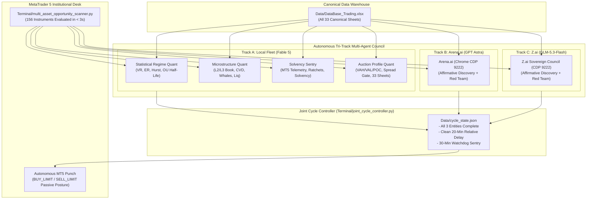
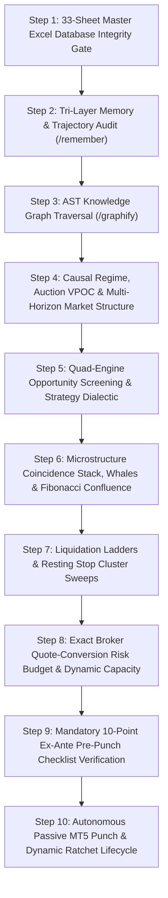
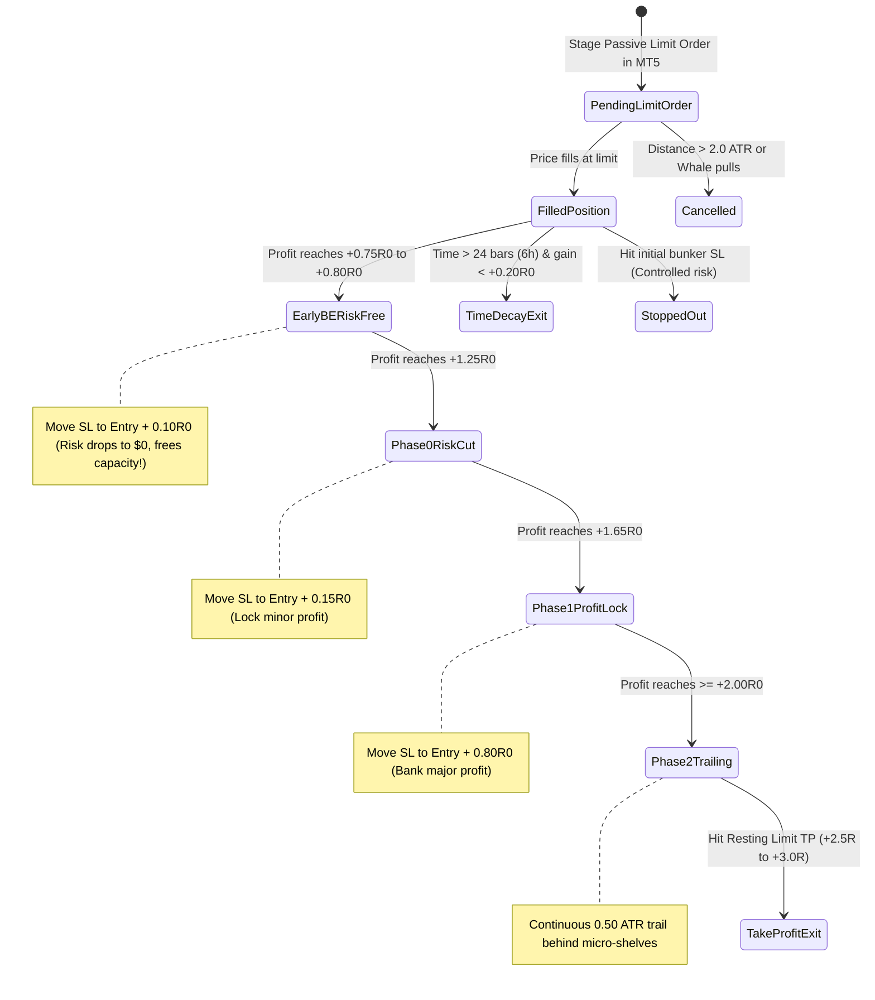

# 🏛️ STANDARDIZED QUANTITATIVE TRADING DECISION CHAIN (SOP)
## Canonical Multi-Pillar Institutional Microstructure Decision Architecture

> **Document Status**: CANONICAL PRODUCTION SPECIFICATION  
> **Target Environment**: MetaTrader 5 (Blueberry Markets, Account #5064568)  
> **Execution Engine**: Antigravity Autonomous Decision Desk  
> **Universe Scope**: Full 156-Asset Universe across 6 Asset Classes (Crypto, Indices, Metals, Commodities, Forex Majors, Crosses, Exotics)  
> **Data Warehouse**: `Data/DataBase_Trading.xlsx` (33 Canonical Production Worksheets)  
> **Mandatory Foundation**: 8 Core Multi-Domain Skill Ensembles & 4-Subagent Swarm

---

## SECTION 1: MANDATORY SKILLS ENSEMBLE FOUNDATION & 4-SUBAGENT SWARM

Under strict institutional hedge fund governance, **no trading analysis, hypothesis formation, order staging, modification, or cancellation may ever occur in an ad-hoc or single-agent vacuum**.

### 🚨 MANDATORY INVIOLATE TRI-TRACK COUNCIL & JOINT-COMPLETION LIFECYCLE (OPERATOR MANDATE)
> **NEVER OMIT, BYPASS, OR SKIP UNDER ANY CIRCUMSTANCES**:
> 1. **Mandatory 4-Subagent Quant Fleet (Fable 5)**: On EVERY autonomous cycle, Antigravity MUST physically invoke four specialized quantitative subagents via `invoke_subagent` (`Model='flash'` / Fable 5 runtime):
>    - **Agent 1: Statistical Regime & Diffusion Quant**: Calculates Lo-MacKinlay Variance Ratio `VR(q)`, Kaufman Efficiency Ratio `ER`, Hurst exponent `H`, Ornstein-Uhlenbeck half-life `tau_half in [20m, 4h]`, and Newey-West drift `t`-stat. Strict stand-aside on `UNDEFINED` regime.
>    - **Agent 2: Microstructure & Liquidation Quant**: L2/L3 orderbook depth asymmetry, continuous CVD delta divergence (`zc_div > 0.8`), liquidation ladders (Sheets 10-17, 22), retail resting stop clusters (Sheet 23), and resting whale walls (Sheets 18 & 25, persistence `tau >= 180s`, refill `rho >= 0.60`).
>    - **Agent 3: Convex Portfolio & Solvency Sentry**: Live MT5 telemetry verification, exact broker quote-conversion risk sizing via `mt5.order_calc_profit()`, frozen R0 profit ratchets (Early-BE, Phase 0, Phase 1, Trailing), and stressed capacity calculations preserving the **4,775.00 USD hard floor** and **4,795.00 USD operating buffer**.
>    - **Agent 4: Auction Profile & Friction Arbitrageur**: Value Area metrics (VAH, VAL, POC, Initial Balance), Relative Spread Gate (`Spread Price / TP Distance <= 10.0%`), 33-sheet data warehouse verification (all 33 sheets loaded, 0 formula errors, <= 15m fresh), and Event Risk Clock embargoes.
>
> 2. **Mandatory Parallel Dual Frontier Council Dispatch (Arena.ai GPT Astra & Z.ai GLM-5.3-Flash)**:
>    - On EVERY cycle, the canonical unified prompt [`Arena_GLM_Standard_Prompt.md`](file:///c:/Users/SIGMA/Documents/Trading_2/Data/Manditory/Arena_GLM_Standard_Prompt.md) (15.5k chars, 4 quantitative personas, 0 LaTeX delimiters) MUST be injected SIMULTANEOUSLY into:
>      * **Arena.ai (GPT Astra)** via Chrome CDP port 9222 using `Terminal/dispatch_arena_redteam.py`.
>      * **Z.ai (GLM-5.3-Flash)** via Chrome CDP port 9222 using `Terminal/dispatch_zai_prompt.py`.
>    - **Affirmative Candidate Discovery & Red-Team Mandate**: Both frontier councils are explicitly mandated to perform **affirmative candidate discovery** across the 156-asset universe using all 4 quantitative personas alongside rigorous adversarial stress-testing.
>
> 3. **Joint 3-Entity Completion Gate & Cycle Finish Rule (Operator Mandate)**:
>    - A cycle is marked officially **FINISHED** only when **ALL THREE entities complete processing**:
>      1. Antigravity 4-Quant Subagent Swarm (Fable 5)
>      2. Arena.ai Frontier Council (GPT Astra)
>      3. Z.ai Sovereign Council (GLM-5.3-Flash)
>    - Neither prompt dispatch nor partial completion marks a cycle finished. All 3 must finish, and their outputs must be harvested into `docs/trade_plans/ARENA_LATEST_RAW.md` and `docs/trade_plans/ZAI_LATEST_RAW.md` for co-equal synthesis.
>
> 4. **Relative 20-Minute Post-Completion Delay (`T_finish + 20 min`)**:
>    - The separation between completed Cycle X and the trigger for Cycle X+1 must be strictly **20 minutes** (1200 seconds).
>    - Fixed wall-clock cron triggers that fire regardless of completion time are permanently eliminated to prevent cycle overlap, prompt collisions, and context collapse.
>
> 5. **30-Minute Watchdog Sentry Cron (`0,30 * * * *`)**:
>    - Antigravity maintains an autonomous background watchdog cron (`0,30 * * * *` at :00 and :30 of every hour) via `Terminal/joint_cycle_controller.py --watchdog`.
>    - The watchdog verifies desk health, checks for stalled cycles (>30 min), verifies persistent daemons, and triggers cycle advancement safely once the clean 20-minute post-completion separation has elapsed.
>
> 6. **Live Profit Ratchets Do Not Excuse Omission**:
>    - When live orders fill and dynamic ratchets (Early-BE, Phase 0, Phase 1) fire on MT5, the coordinator executes the ratchet IMMEDIATELY to secure capital, but MUST SIMULTANEOUSLY dispatch the 4-subagent swarm and dual council prompts.



### The 8 Mandatory Foundation Skills:
1. **`/remember` (Persistent Cross-Session Memory & Trajectory Continuity)**:
   - Eliminates context amnesia. Retrieves past operator directives, settled invariants, post-loss autopsies, avoided traps (e.g., chasing unaligned limits, illiquid FX rollover hours, buying into un-swept stop clusters), and running capital cushion trajectory.
2. **`/graphify` (AST Knowledge Graph & Structural Traversal)**:
   - Queries repository semantic graphs (`graphify-out/graph.json`, 7.4k+ nodes) before modifying code, validating execution schemas, parameter bounds, broker symbols, and contract specifications.
3. **`/data-engineer` (Data Contract Enforcement & Pipeline Integrity)**:
   - Verifies raw tick ingestion, timestamp monotonicity, zero nulls, broker basis normalization (`venue_basis`), and telemetry data freshness. Rejects stale or corrupted data frames fail-closed.
4. **`/dataform-bigquery` (Institutional Data Modeling & Scalability)**:
   - Governs historical time-series consistency across all 43 canonical Parquet datasets and 3.47M 15m bars. Enforces unified data definitions from micro-ticks to multi-year horizons.
5. **`/data-analyst` (Orderflow, Auction & Distribution Dissection)**:
   - Decomposes multidimensional metrics: MT5 spreads in bps, VWAP standard deviations, volume profile POC/VAH/VAL, multi-horizon CVD deltas, and auction imbalance ratios.
6. **`/data-engineering-data-driven-feature` (Empirical Feature Engineering & Statistical Rigor)**:
   - Formulates verifiable quantitative hypotheses, establishes statistical significance (p_win lower bounds, z-score thresholds), and designs causal features with zero lookahead.
7. **`/brainstorm` (Multi-Perspective Dialectic & Persona Stress-Testing)**:
   - Simulates adversarial multi-agent debate (Orderflow Specialist vs Macro Risk Officer vs Forensic Position Auditor). Tests edge cases: *What if the whale pulls? What if the market blows through the cascade?*
8. **`/verify` (Ex-Ante Pre-Execution Gate & Boundary Verification)**:
   - Mathematical proof before dispatch. Verifies cash risk calculations against `mt5.order_calc_profit`, checks hard floor cushion (>= 4,775 USD), verifies passive limit posture, and validates SL/TP placement.
9. **`/risk-engine` (Stressed Multi-Ticket Floor Defense Simulator)**:
   - Computes worst-case stressed equity across all open and staged tickets: $\text{Stressed Equity} = \text{Current Equity} - \sum (\text{Risk}_i \times 1.25 + 2.00) \ge 4,795.00\text{ USD}$ (preserving a mandatory $+20.00\text{ USD}$ operating buffer above the $4,775.00\text{ USD}$ absolute hard floor).
10. **`/execution-sim` (Microstructure Execution & Friction Compensation)**:
    - Models half-spread offset ($\text{Entry} = \text{Shelf} - \text{half\_spread}$ for longs, $\text{Shelf} + \text{half\_spread}$ for shorts), verifies `ORDER_FILLING_IOC` with automatic failover to `RETURN` and `FOK`.
11. **`/onchain-forensics` (Hyperliquid L1 & Hyperdash Institutional Whale Intelligence)**:
    - Parses live decentralized whale positions (`4_Hyperliquid_Analysis`), tracks 2,001 individual whale wallets, monitors institutional Telegram block trade alerts (`16_Hyperdash_telegram_Intel`), and calculates 1h to 7d spot exchange netflows (`2_Spot_Netflow_S`).
12. **`/market-microstructure` (Orderbook Replenishment & Spoof Detection)**:
    - Analyzes L2 replenishment velocity $d(\text{depth})/dt$, calculates book imbalance ratios, and filters out phantom/ephemeral orders using presence fraction ($\ge 0.85$) and minimum persistence ($\ge 180\text{s}$).

---

## SECTION 1.5: THE 33-SHEET CANONICAL MASTER EXCEL TRADING WAREHOUSE & LINE-BY-LINE NARRATIVE PROTOCOL (EXCLUSIVE SOURCE OF TRUTH)

> **MANDATORY INVARIANT & SOLE DATA WAREHOUSE**:  
> `Data/DataBase_Trading.xlsx` (all 33 canonical production worksheets, from Sheet 00 `00_MT5_Account_Telemetry` through Sheet 33 `20_Auction_Market_Structure`) is the **exclusive, single definitive source of trading information, market microstructure, and decision-making for both Antigravity and Arena.ai**.
>
> ⚠️ **MANDATORY PITFALL AVOIDANCE & 33-SHEET QUESTIONING BINDING (OPERATOR INVARIANTS)**:
> 1. **Top 10 Lethal Execution Pitfalls**: All trading decisions must strictly audit against and avoid the 10 traps detailed in [`Data/Manditory/TOP_10_TRADE_EXECUTION_PITFALLS_AND_AUTOPSY.md`](file:///c:/Users/SIGMA/Documents/Trading_2/Data/Manditory/TOP_10_TRADE_EXECUTION_PITFALLS_AND_AUTOPSY.md).
> 2. **33-Sheet Real-World Thinking Questions**: For EVERY single sheet in `Data/DataBase_Trading.xlsx`, agents and council models MUST answer the empirical, real-world questions established in [`Data/Manditory/32_SHEET_REAL_WORLD_PITFALL_AVOIDANCE_QUESTIONS.md`](file:///c:/Users/SIGMA/Documents/Trading_2/Data/Manditory/32_SHEET_REAL_WORLD_PITFALL_AVOIDANCE_QUESTIONS.md) using live cell/column values before any trade hypothesis can be ratified.

### 📖 Complete Taxonomy of the 33 Master Excel Worksheets: Functional Domains, Fields & Tactical Decisions

| Sheet # | Worksheet Name | Functional Domain | Primary Metrics & Exact Ingestion Fields | Tactical Decision Purpose (Antigravity & Arena.ai) |
|---|---|---|---|---|
| **00** | `00_MT5_Account_Telemetry` | **Live MT5 Account Telemetry & Spreads** | `Balance`, `Equity`, `Free Margin`, `Hard Floor Cushion`, `Buffer Cushion`, `Open Positions Count`, `Pending Orders Count`, `Universe Quotes`, `Spread Points`, `Spread BPS`, `Spread Status`, `Timestamp UTC`. | Live MT5 broker grounding. Audits live equity cushion above 4,775 USD floor and 4,795 USD buffer, evaluates real-time spread in bps, and tracks active MT5 ticket excursions. |
| **01** | `Crypto_ETF_Flows` | **Institutional Inflow & TradFi Proxy** | Overview of spot ETF aggregate flows, AUM, net creations/redemptions, market cap, and volume across BTC/ETH spot ETFs. | High-level TradFi spot demand barometer; sustained multi-day net inflow confirms macro tailwind for pro-trend long pullbacks. |
| **02** | `1_Crypto_ETF_Flows` | **Granular Spot ETF Flow Matrix** | `Rank`, `Ticker` (IBIT, FBTC, ETHA, etc.), `ETF Name`, `Price`, `Price Change`, `Volume (USD)`, `Volume (Shares)`, `Turnover Rate`, `Shares Outstanding`, `AUM`, `Market Cap`, `Expense Ratio`, `Asset Category`, `Issuer`, `Daily Net Inflow`, `Timestamp UTC`. | Pinpoints individual institutional fund flows (BlackRock, Fidelity). Consecutive positive net inflow days disqualify aggressive counter-trend shorting on BTC and ETH. |
| **03** | `2_Spot_Netflow_S` | **CEX Spot Inflow/Outflow (500 Assets)** | `Rank`, `Symbol`, `Spot Price`, `1h Netflow`, `4h Netflow`, `12h Netflow`, `24h Netflow`, `7d Netflow`, `30d Netflow`, `24h Spot Volume`, `24h Change %`, `Exchange`, `Timestamp UTC`. | Measures real CEX spot accumulation vs distribution. Divergence (positive spot netflow while futures prices dip) proves institutional absorption of retail panic sells. |
| **04** | `3_Exchanges_LS_Ratio_15M` | **15m Positioning & Account Skew** | `Asset`, `Timeframe (15M)`, `Binance LS Ratio`, `Binance Long %`, `Binance Short %`, `OKX LS Ratio`, `OKX Long %`, `OKX Short %`, `Bybit LS Ratio`, `Aggregate LS Ratio`, `Timestamp UTC`. | Immediate retail crowding filter. If retail long accounts exceed 70%, long dip-buying is halted to prevent catching stop sweeps. |
| **05** | `3_Exchanges_LS_Ratio_1H` | **1H Structural Positioning Skew** | `Asset`, `Timeframe (1H)`, `Binance LS Ratio`, `Binance Long %`, `Binance Short %`, `OKX LS Ratio`, `OKX Long %`, `OKX Short %`, `Bybit LS Ratio`, `Aggregate LS Ratio`, `Timestamp UTC`. | Hourly sentiment confirmation. Verifies if hourly price breakouts are supported by retail short covering or fresh institutional buying. |
| **06** | `3_Exchanges_LS_Ratio_4H` | **4H HTF Macro Positioning Skew** | `Asset`, `Timeframe (4H)`, `Binance LS Ratio`, `Binance Long %`, `Binance Short %`, `OKX LS Ratio`, `OKX Long %`, `OKX Short %`, `Bybit LS Ratio`, `Aggregate LS Ratio`, `Timestamp UTC`. | Higher-timeframe positioning consensus. Discloses multi-day trapped retail positions across major derivative exchanges. |
| **07** | `4_Hyperliquid_Analysis` | **DEX Whale Intelligence & Leverage** | `Rank`, `Account/Wallet (0x...)`, `Total Account Value`, `Position Value`, `Unrealized PnL`, `Leverage`, `Long/Short Bias`, `Top Position Symbol`, `Top Position Size`, `Entry Price`, `Mark Price`, `Liq Price`, `Margin Utilization`, `Timestamp UTC`. | Tracks smart-money on-chain perp whales on Hyperliquid L1. Discloses top whale positions, leverage tiers, and potential squeeze liquidation prices. |
| **08** | `5_OI` | **Futures Open Interest Analysis** | `Asset`, `OI Notional (USD)`, `OI Token (Coins)`, `1h OI Change %`, `4h OI Change %`, `24h OI Change %`, `Binance OI`, `Bybit OI`, `OKX OI`, `CME OI`, `Aggregate Trend`, `Timestamp UTC`. | Validates trend conviction across 18 perpetuals. Rising price + rising OI = genuine institutional trend; rising price + falling OI = short-covering rally prone to exhaustion. |
| **09** | `5_Funding_Rate` | **Cross-Exchange Perpetual Funding** | `Asset`, `Symbol`, `Binance FR`, `Bybit FR`, `OKX FR`, `dYdX FR`, `Bitget FR`, `Gate FR`, `Predicted Next FR`, `Annualized FR %`, `Cumulative 7D FR %`, `Funding Bias`, `Timestamp UTC`. | Pinpoints extreme leverage imbalances across 12 venues. Funding > +0.03% warns of long flush vulnerability; negative funding (< -0.02%) sets up explosive short squeezes. |
| **10** | `6_Funding_Fee_Settlement` | **Funding Fee Settlement & Friction** | `Asset`, `Exchange`, `Settlement Interval (8h/4h/1h)`, `Next Funding Time UTC`, `Current Rate`, `Estimated Fee USD (per 10k notional)`, `24h Fee Total`, `Annualized Carrying Cost`, `Crowding Risk Indicator`, `Timestamp UTC`. | Evaluates holding friction for multi-hour swing positions; prevents staging positions immediately ahead of heavy adverse funding fee debits. |
| **11** | `7_Liq_Heapmap` | **Clustered Liquidation Heatmap** | `Asset`, `Timeframe`, `Clustered Liq Price`, `Total Liq Volume (USD)`, `Long Liq Volume (USD)`, `Short Liq Volume (USD)`, `Distance to Current Price %`, `Timestamp UTC`. | Locates dense liquidation clusters across timeframes. Serves as primary target magnets where cascading liquidations guarantee exit fill liquidity. |
| **12** | `7_Live_Liq` | **Real-Time Liquidation Stream** | `Timestamp`, `Asset/Symbol`, `Exchange`, `Side (Long/Short)`, `Liquidation USD`, `Liquidation Quantity`, `Liquidation Price`, `Mark Price`. | Real-time tape reading of forced liquidations. Detects liquidation climax flushes (e.g. > $5M longs wiped in 60s) signaling capitulation and mean-reversion bottoms. |
| **13** | `8_Exchange_Liquidation_Map_1D` | **24H Exchange Liquidation Surface** | `Asset`, `Timeframe (1D)`, `Price Bucket`, `Long Cumulative Liq USD`, `Short Cumulative Liq USD`, `Net Delta Liq USD`, `Density Score`, `Nearest Magnet Flag`, `Timestamp UTC`. | Intraday offensive/defensive geometry: Stop Loss must sit safely outside nearest sweep band [min_price, max_price] + 0.50 ATR; Take Profit front-runs opposing band by 5-10 bps. |
| **14** | `9_Liquidation_Max_Pain_24H` | **24H Liquidation Max Pain** | `Asset`, `Timeframe (24H)`, `Current Price`, `Max Pain Strike Price`, `Distance to Max Pain %`, `Total Long Risk USD`, `Total Short Risk USD`, `Pain Disparity Ratio`, `Target Bias`, `Timestamp UTC`. | Market-maker gravitational attraction strike where aggregate intraday open contracts experience maximum loss. |
| **15** | `9_Liquidation_Max_Pain_48H` | **48H Distal Liquidation Max Pain** | `Asset`, `Timeframe (48H)`, `Current Price`, `Max Pain Strike Price`, `Distance to Max Pain %`, `Total Long Risk USD`, `Total Short Risk USD`, `Pain Disparity Ratio`, `Target Bias`, `Timestamp UTC`. | Multi-day structural target magnet for runner positions. |
| **16** | `9_Liquidation_Max_Pain_3D` | **3D Liquidation Max Pain** | `Asset`, `Timeframe (3D)`, `Current Price`, `Max Pain Strike Price`, `Distance to Max Pain %`, `Total Long Risk USD`, `Total Short Risk USD`, `Pain Disparity Ratio`, `Target Bias`, `Timestamp UTC`. | Swing-horizon max pain strike anchoring weekly balance-of-power shifts. |
| **17** | `9_Liquidation_Max_Pain_7D` | **7D Macro Liquidation Max Pain** | `Asset`, `Timeframe (7D)`, `Current Price`, `Max Pain Strike Price`, `Distance to Max Pain %`, `Total Long Risk USD`, `Total Short Risk USD`, `Pain Disparity Ratio`, `Target Bias`, `Timestamp UTC`. | Macro weekly max pain target defining the prevailing weekly auction bias. |
| **18** | `8_Exchange_Liquidation_Map_7D` | **7D Cumulative Liquidation Surface** | `Asset`, `Timeframe (7D)`, `Price Bucket`, `Long Cumulative Liq USD`, `Short Cumulative Liq USD`, `Net Delta Liq USD`, `Density Score`, `Nearest Magnet Flag`, `Timestamp UTC`. | High-conviction macro TP magnet selection: targets multi-hundred-million-dollar squeeze pools (e.g. $1B+ short liquidation pools on BTC). |
| **19** | `10_Whale_Orders` | **Resting Whale Orders (> $100K USD)** | `Sr. No.`, `Asset`, `Venue/Exchange`, `Side (BUY/SELL)`, `Price`, `From Price`, `Initial USD`, `Remaining USD`, `Filled USD`, `Duration`, `Status`, `Distance to Spot %`, `Whale Entity Tag`, `Timestamp UTC`. | Inviolable stop bunker anchor: Stop Loss MUST shelter behind persistent resting whale bids (longs) or asks (shorts) with confirmed persistence (persist >= 180s). |
| **20** | `11_Technical` | **Quantitative Indicators & VWAP Bands** | `Asset`, `Close`, `20 EMA`, `50 EMA`, `100 EMA`, `200 EMA`, `VWAP`, `VWAP +1.0 SD`, `VWAP +2.0 SD`, `VWAP -1.0 SD`, `VWAP -2.0 SD`, `VWAP Z-Score`, `RSI-14`, `ATR-14`, `Volume Profile POC`, `VAH`, `VAL`, `Trend Regime`, `Timestamp UTC`. | Primary statistical regime filter: assigns Model 1 (|Z_VWAP| >= 2.0 SD in MEAN_REVERT) or Model 2 (|Z_VWAP| < 2.0 SD in TREND_UP/DOWN). If UNDEFINED, stand aside unconditionally. |
| **21** | `12_Hyperdash` | **Hyperdash Flow Sentiment & KPIs** | `Metric Identifier`, `Symbol`, `Metric Name`, `Value`, `24h Change`, `Sentiment Bias`, `Signal Strength`, `Timestamp UTC`. | Synthesizes aggregate smart money flow metrics, on-chain sentiment scores, and multi-asset volume velocity. |
| **22** | `13_Hyperliquid` | **Hyperliquid L1 Native Exchange Engine** | `Sr. No.`, `Asset`, `Open Interest USD`, `24h Volume USD`, `Funding Rate`, `Premium/Discount`, `Predicted Funding`, `Long/Short Skew`, `Net Taker Flow`, `Timestamp UTC`. | Real-time L1 DEX orderbook health, basis premium/discount relative to Binance, and decentralized taker flow pressure. |
| **23** | `14_Hyperdash_Liq_Map` | **Continuous Liquidation Price Ladder** | `Asset`, `Mark Price`, `Price Level`, `Side (Long/Short)`, `Leverage Tier`, `Liquidation Notional USD`, `Cumulative Liq USD`, `Distance to Mark %`, `Cluster Rank`, `Status`, `Timestamp UTC`. | Fine-grained continuous dollar-by-dollar liquidation ladder (5,700+ rows). Accurately maps the boundary [min_price, max_price] of long cascade bands and short squeeze bands. |
| **24** | `15_Hyperdash_Stops_Map` | **Resting Stop Orders Price Ladder** | `Asset`, `Mark Price`, `Stop Price Level`, `Order Side (Buy Stops / Sell Stops)`, `Stop Orders Count`, `Estimated Notional USD`, `Cumulative Stop Volume USD`, `Distance to Mark %`, `Sweep Vulnerability Score`, `Timestamp UTC`. | Maps exact retail resting stop loss clusters (3,800+ rows). Identifies sweep trap levels; strictly bans placing limit orders inside un-swept stop clusters. |
| **25** | `16_Hyperdash_telegram_Intel` | **Telegram Whale Flow Intelligence** | `Timestamp`, `Asset`, `Alert Type`, `Notional USD`, `Price`, `Source Channel`, `Message Content`, `Directional Signal`, `Conviction Score`. | Rapid-response whale alert channel (1,501+ continuous records). Flags institutional block trades, sudden wallet movements, and large off-market derivative prints. |
| **26** | `17_Orderbook` | **L2/L3 Orderbook & Whale Attribution** | `Asset`, `Side (BID/ASK)`, `Price Level`, `Depth Quantity`, `Cumulative Notional USD`, `Wallet/Entity Attribution`, `Imbalance Ratio`, `Persistence Status`, `Timestamp UTC`. | Top-20 depth and whale wall verification. Confirms orderbook asymmetry (Imbalance > +0.25 for longs, < -0.25 for shorts) and enforces the 180s persistence filter. |
| **27** | `18_CVD` | **Multi-Asset Continuous CVD Engine** | `Timestamp UTC`, `Asset`, `Close Price`, `Spot Taker Buy Vol`, `Spot Taker Sell Vol`, `Spot CVD Delta`, `Futures Taker Buy Vol`, `Futures Taker Sell Vol`, `Futures CVD Delta`, `Spot vs Futures CVD Divergence (zc_div)`, `Cumulative CVD 1m, 5m, 15m, 1h, Session`, `CVD Z-Score`. | Core Pillar 2 Confluence: Evaluates aggressive market buying vs selling across spot and perp. Confirms institutional accumulation when Delta Spot > 0 and Delta Futures < 0 with zc_div > 0.8. |
| **28** | `19_News` | **Forex Factory Breaking News Feed** | `Headline`, `URL`, `Timestamp / Time Ago`, `Currency`, `Impact (High/Med/Low)`, `Source / Tag`, `Summary / Description`, `Institutional Relevance`, `Timestamp UTC`. | Real-time institutional newsfeed. Flags breaking central bank comments, geopolitical tensions, and emergency market developments. |
| **29** | `19_Calendar` | **Forex Factory Macroeconomic Calendar** | `Date`, `Time UTC`, `Currency`, `Impact (Red/Orange/Yellow/Grey)`, `Event Name`, `Detail / Description`, `Actual`, `Forecast`, `Previous`, `Deviation / Surprise`, `Trade Blackout Window`, `Timestamp UTC`. | Sovereign Macro Defense Gate: Enforces the mandatory blackout window (+-15m for Crypto, +-35m for TradFi) around high-impact red-folder releases (CPI, FOMC, NFP, GDP, Interest Rates). |
| **30** | `Top_Institutions` | **Institutional Whale Holders & Allocations** | `Rank`, `Institution/Entity`, `Holdings (BTC/ETH)`, `USD Notional`, `AUM %`, `Portfolio Weight`, `Filing Date`, `Net Change 30D`, `Timestamp UTC`. | Discloses deep institutional whale balance sheets (MicroStrategy, BlackRock, Fidelity). Identifies macro custody accumulations. |
| **31** | `ETF_Market_Overview` | **Aggregate ETF Market Cap & Volume Heatmap** | `Category`, `Total Net Inflow (USD)`, `Total Volume (USD)`, `Total AUM`, `Day-over-Day %`, `Week-over-Week %`, `Leading ETF`, `Timestamp UTC`. | Macro TradFi capital velocity across spot ETFs. Confirms systemic ETF liquidity tailwinds. |
| **32** | `20_Auction_Market_Structure` | **Auction Market Structure & Key Levels (54 Assets)** | `sr_no`, `asset`, `symbol`, `category`, `price`, `spread_bps`, `spread_gate`, `va_position`, `daily_poc`, `daily_vah`, `daily_val`, `dist_poc_pct`, `dist_vah_pct`, `dist_val_pct`, `pd_poc`, `pd_vah`, `pd_val`, `pdh`, `pdl`, `pdc`, `weekly_poc`, `weekly_vah`, `weekly_val`, `cwh`, `cwl`, `pwh`, `pwl`, `asian_high`, `asian_low`, `london_high`, `london_low`, `ny_high`, `ny_low`, `ib_high`, `ib_low`, `auction_regime`. | Ground-truth auction profiling. Maps Volume Profile POC/VAH/VAL shelves, Monday Opening Range, Prior Day Extremes, Session Extremes, and Floor Pivots (P, R1, S1, R2, S2). Row 1 unmerged headers. |

---

## SECTION 1.7: THE FULL 156-ASSET MULTI-ASSET MT5 UNIVERSE & EXPANDED RISK RIGHTS (OPERATOR MANDATE)

> **OPERATOR EXPANDED RISK & UNIVERSE DIRECTIVE**:
> 1. **Complete 156-Asset Universe**: The desk operates across **all 156 assets** available on MetaTrader 5 (Account #5064568). Subagents and council models are strictly forbidden from assuming TradFi is limited to 4 instruments.
> 2. **Multi-Asset Pristine Confluence Risk Rights ($25.00 to $35.00 USD)**: Explicit authorization is granted to scale nominal risk up to **25.00 to 35.00 USD per trade** (0.51% to 0.72% equity) across **ALL 156 assets** whenever pristine 5-pillar confluence is confirmed.
> 3. **Fluid 4-Slot Capacity**: The desk may maintain up to **4 concurrent filled positions in ANY combination** (e.g. 4 crypto, 2 crypto + 1 forex + 1 index, 3 forex + 1 commodity, 2 indices + 2 metals), guided purely by quantitative edge and solvency buffers.
> 4. **Uncapped Resting Limit Orders**: Resting pending limit orders do NOT consume filled capacity slots. The desk may stage resting limit orders at **any qualified candidate structural whale shelves** across the universe without arbitrary caps.

### The 156-Asset Multi-Asset MT5 Universe Breakdown

| Asset Class | Count | Instruments & MT5 Symbols | Primary Execution Guidance & Dynamic Spread Gate |
|---|---|---|---|
| **Cryptos_Raw (Majors)** | 5 | `BTCUSD.pi, ETHUSD.pi, SOLUSD.p, LTCUSD.pi, XRPUSD.pi` *(plus BNBUSD.p, DOTUSD.pi)* | Baseline spread <= 35.0 bps (BTC ~1.8 bps, ETH ~12 bps). High liquidity, dense L2/L3 orderbooks, continuous CVD. |
| **Cryptos (Alts & DeFi)** | 53 | `ADAUSD.p, BCHUSD.p, LNKUSD.p, XLMUSD.p, AVXUSD.p, DOGUSD.p, FILUSD.p, GRTUSD.p, NERUSD.p, TRXUSD.p, UNIUSD.p, VETUSD.p, XMRUSD.p, AVEUSD.p, ALGUSD.p, ATMUSD.p, AXSUSD.p, CHZUSD.p, COMUSD.p, EGLUSD.p, FLWUSD.p, IOTUSD.p, KSMUSD.p, NEOUSD.p, XSIUSD.p, THTUSD.p, XTZUSD.p, ZECUSD.p, MANUSD.p, INCUSD.p, ARWUSD.p, BATUSD.p, CELUSD.p, CHRUSD.p, CRVUSD.p, ENJUSD.p, BARUSD.p, LRCUSD.p, KAVUSD.p, KNCUSD.p, ONTUSD.p, QTMUSD.p, SNDUSD.p, SKLUSD.p, SNXUSD.p, STOUSD.p, SXPUSD.p, YFIUSD.p, ZILUSD.p, ZRXUSD.p, DSHUSD.p` | Baseline spread <= 35.0 bps (BCH ~21 bps, AAVE ~22 bps, SOL ~23 bps). Sized dynamically so spread cost / TP distance <= 15%. |
| **Global Equity Indices** | 16 | **US & Europe**: `NAS100.p, SP500.p, DJ30.p, US2000.p, UK100.p, GER40.p, GER30.p, FR40.p, STOXX50.p, NETH25.p, SWISS20.p`<br/>**Asia-Pacific**: `JP225.p, AU200.p, HK50.p, CHINA50.p, CHINAH.p` | Baseline spread <= 10.0 bps (DJ30 0.22 bps, SP500 0.31 bps, NAS100 0.34 bps, UK100 0.40 bps, GER40 0.50 bps). Cash session hours. |
| **Commodities_Raw (Precious Metals)** | 14 | `XAUUSD.pi (Gold), XAGUSD.pi (Silver), XPTUSD.pi (Platinum), XPDUSD.pi (Palladium), XAUEUR.pi, XAUAUD.pi, XAUGBP.pi, XAUSGD.pi, XAUCNH.pi, GAUUSD.pi, GAUCNH.pi, XAGEUR.pi, XAGAUD.pi, XAGSGD.pi` | Baseline spread <= 10.0 bps (Gold 0.20 bps, Silver 1.50 bps). Macro safe-haven flows, sovereign whale bunkers. |
| **Commodities (Energy & Industrial Metals)** | 8 | `UKBRENT.p (Brent Crude), USWTI.p (WTI Crude), GAS.p (Natural Gas), ALUMINIUM.p, COPPER.p, LEAD.p, NICKEL.p, ZINC.p` | Baseline spread <= 10.0 bps (USWTI ~3.0 bps). EIA inventory prints, OPEC headlines. |
| **Forex_Raw (G10 Majors & Minors)** | 28 | **Majors (7)**: `EURUSD.pi, GBPUSD.pi, USDJPY.pi, AUDUSD.pi, USDCAD.pi, USDCHF.pi, NZDUSD.pi`<br/>**Liquid Crosses (21)**: `EURGBP.pi, EURJPY.pi, GBPJPY.pi, AUDJPY.pi, CADJPY.pi, CHFJPY.pi, EURAUD.pi, EURCAD.pi, EURCHF.pi, EURNZD.pi, GBPAUD.pi, GBPCAD.pi, GBPCHF.pi, GBPNZD.pi, AUDCAD.pi, AUDCHF.pi, AUDNZD.pi, CADCHF.pi, NZDCAD.pi, NZDCHF.pi, NZDJPY.pi` | Baseline spread <= 6.0 bps (EURUSD 0.09 bps, GBPUSD 0.15 bps, USDJPY 0.12 bps). Mandatory 21:30–22:30 UTC rollover blackout. |
| **Forex_Raw (Exotics & EM Pairs)** | 32 | `USDSGD.pi, USDCNH.pi, USDHKD.pi, USDMXN.pi, USDZAR.pi, USDNOK.pi, USDSEK.pi, USDHUF.pi, USDTHB.pi, AUDSGD.pi, AUDCNH.pi, CHFSGD.pi, CNHJPY.pi, EURCNH.pi, EURHKD.pi, EURHUF.pi, EURMXN.pi, EURNOK.pi, EURSEK.pi, EURSGD.pi, EURZAR.pi, GBPCNH.pi, GBPHKD.pi, GBPNOK.pi, GBPSEK.pi, GBPSGD.pi, NOKJPY.pi, NOKSEK.pi, NZDCNH.pi, NZDSGD.pi, SGDJPY.pi, ZARJPY.pi` | Baseline spread <= 25.0 bps during London/NY overlap. Sized via dynamic friction budgeting. |

---

## SECTION 2: THE 10-STEP STANDARDIZED TRADING DECISION CHAIN



---

### STEP 1: 33-Sheet Master Excel Database Integrity Gate (Mandatory Line-by-Line Ingestion)
*Active Skills: `@[data-engineer]`, `@[dataform-bigquery]`, `@[performance-engineer]`*

Every analysis begins by establishing absolute data integrity across the **33-sheet master Excel database (`Data/DataBase_Trading.xlsx`)** and macroeconomic calendar:

1. **Automated 33-Sheet Data Quality Verification (`excel_data_quality_checker.py`)**:
   - The coordinator and subagents MUST physically run `python Terminal/Data_Factory/excel_data_quality_checker.py` at the start of every cycle.
   - **Verification Gates**:
     * All 33 physical worksheets present and indexed.
     * Exactly 0 formula errors (`#REF!`, `#DIV/0!`, `#N/A`, `#VALUE!`, `#NAME?`, `#NUM!`) across all cells.
     * Row 1 header integrity 100% valid, unmerged, and distinct.
     * **Per-Sheet Internal Freshness Invariant**: Every dynamic trading sheet (`00_MT5_Account_Telemetry`, `11_Technical`, `14_Hyperdash_Liq_Map`, `15_Hyperdash_Stops_Map`, `17_Orderbook`, `18_CVD`, `20_Auction_Market_Structure`) MUST have an internal timestamp age `<= 15.0 minutes` (`900s`). Never rely solely on overall file modification time (`os.path.getmtime`).
     * JSON health report generated and archived in `Data/excel_health_audit.json`.
   - If any formula error is detected or if any dynamic operational sheet is stale > 15 minutes, the desk enters immediate **100% Flat Cash Defense** until the pipeline refreshes.

2. **Mandatory Master Database Updation Gate**:
   - The canonical pipeline daemon (`Run_Parallel_Pipeline.py --continuous --gap 300`) updates all 33 sheets of `Data/DataBase_Trading.xlsx` every 300s.
   - Prior to dispatching subagents or evaluating trade setups, Step 1 verifies that `Data/DataBase_Trading.xlsx` has been freshly modified within the current operating window, ensuring all 33 sheets contain live, zero-null market intelligence terminating strictly at `20_Auction_Market_Structure`.
   - **Sheet 33 Unmerged Header Invariant**: Verifies that Sheet 33 (`20_Auction_Market_Structure`) has unmerged column names in Row 1 (`sr_no`, `asset`, `symbol`, etc.), ensuring zero formula errors and clean programmatic parsing.

2. **Universal Read & Re-Read Mandate across All 33 Sheets**:
   - Agents, subagents, and Arena.ai are **strictly forbidden from skimming or reading only a partial subset of worksheets**.
   - Review all 4 functional clusters: Cluster A (Macro & ETF Netflows: Sheets 00-03, 28, 29), Cluster B (Derivatives Positioning & Regime: Sheets 04-06, 08-10, 20-22), Cluster C (Liquidation Maps, Stop Cascades & CVD: Sheets 11-18, 23, 24, 27), and Cluster D (Resting Whales, L2/L3 Depth & Auction Structure: Sheets 07, 19, 25, 26, 30-33).

3. **Dynamic Spread Friction & Economic Viability Gate**:
   - Rather than rigid arbitrary disqualification, spread friction is evaluated using **Dynamic Friction Budgeting**:
     * **Tier A (Baseline Ceilings)**: Crypto <= 35.0 bps, Indices & Commodities <= 10.0 bps, Forex Majors/Crosses <= 6.0 bps, Exotics <= 25.0 bps.
     * **Tier B (Friction-to-Target Efficiency Ratio)**:
       $$\text{Efficiency Ratio} = \frac{\text{Spread Points}}{\text{TP Distance Points}} \le 15\%$$
       If spread consumes less than 15% of expected target profit, the trade is economically viable!
     * **Tier C (Dynamic Lot Sizing)**: Lot size is proportionally scaled down so that nominal risk plus spread friction remains strictly within the capital buffer surplus:
       $$\text{Stressed Loss} = (\text{Nominal Risk} + \text{Spread Cost}) \times 1.25 + 2.00 \le \text{Buffer Cushion}$$

---

### STEP 2: Tri-Layer Memory & Trajectory Audit
*Active Skills: `@[memory-system]`, `@[anti-sycophancy]`, `@[quant-analyst]`*

No trade is evaluated in a vacuum. The desk reviews persistent memory and avoids historical traps:
1. **Persistent Memory System Audit (`/memory-system`)**:
   - Review `.agents/memory/session_chat_history.md`, `.agents/memory/feedback-history.md`, and `.agents/rules/ACTIVE_CONTEXT.md`.
2. **Forensic Autopsy Reference (`LOSING_TRADES_DEEP_FORENSIC_AUTOPSY.md` & `TOP_10_TRADE_EXECUTION_PITFALLS_AND_AUTOPSY.md`)**:
   - Never stage limit orders inside un-swept retail stop clusters (Pitfall 2).
   - Never catch falling knives against massive unidirectional CVD cascades without tape absorption (Pitfall 3).
   - Never measure stop losses from `mid_price` or choke stops inside sweep zones; anchor behind verified resting whale walls plus 0.40–0.50 ATR structural buffer (Pitfall 4).
   - Never enter trades during illiquid interbank rollover spread expansion (21:30–22:30 UTC).

---

### STEP 3: AST Knowledge Graph Traversal & Rule Check
*Active Skills: `@[graphify]`*

Query the system architecture to prevent logic regressions:
1. **Canonical Schema Query**: Verify symbol mapping (`Terminal/Asset_Universe.py`), lot steps, minimum volume, and digits via AST lookup.
2. **Strategy Module Integrity**: Verify active logic resides in canonical single modules (`Terminal/multi_asset_opportunity_scanner.py`, `Terminal/OF_Strategy.py`, `Engine/s1_liquidation_cascade.py`).

---

### STEP 4: Causal Regime, Auction VPOC & Multi-Horizon Market Structure
*Active Skills: `@[data-analyst]`, `@[quant-analyst]`*

Determine the macro structural environment using ground-truth auction levels from Sheet 33 (`20_Auction_Market_Structure`) and Sheet 20 (`11_Technical`):

1. **Canonical Auction Reference Shelves**:
   - **Volume Profile POC (VPOC)**: Highest volume price node representing the institutional fair-value consensus.
   - **Developing POC (d-POC)**: Current session migrating volume point of control.
   - **Value Area High (VAH) & Value Area Low (VAL)**: Boundaries containing 70% of volume distribution across Daily and Weekly horizons.
   - **Monday Opening Range (Monday High & Monday Low / Initial Balance)**: Defines the weekly auction reference frame; re-tests of Monday boundaries provide high-probability rotational setups.
   - **Previous Day Levels**: Previous Day High (PDH), Previous Day Low (PDL), and Previous Day Close (PDC).
   - **Previous Session Extremes**: Asian Session High/Low (00:00–08:00 UTC), London Session High/Low (08:00–16:00 UTC), and New York Session High/Low (13:30–20:00 UTC).
   - **Weekly Macro Shelves**: Weekly POC, Current Week High/Low (CWH/CWL), and Prior Week High/Low (PWH/PWL).

2. **Causal Regime Classification**:
   - **Model 1 (Mean Reversion)**: Admissible ONLY when `|VWAP Z-Score| >= 2.0 to 3.5 SD` in `MEAN_REVERT` regime with tape exhaustion.
   - **Model 2 (Trend Pullback)**: Admissible ONLY when `|VWAP Z-Score| < 2.0 SD` (0.2 to 1.7 SD) in confirmed `TREND_UP` or `TREND_DOWN` with 20/50/200 EMA ribbon alignment, pulling back to EMA20, Session VWAP, or VAH/VAL shelves.
   - **Stand-Aside Invariant**: If `Trend Regime == UNDEFINED` or auction structure shows conflicting low-volume chop, the desk **stands aside unconditionally in 100% Cash Defense**.

---

### STEP 5: Quad-Engine Opportunity Screening & Strategy Dialectic
*Active Skills: `@[quant-analyst]`, `@[clean-code]`, `@[ai-ml]`*

Screen candidates across the 156-asset universe using `Terminal/multi_asset_opportunity_scanner.py` into distinct quantitative engines:

#### Engine 1: Mean Reversion Suite
##### Model 1A: Extreme Statistical VWAP Reversion
- **Condition**: Market reaches extreme statistical dispersion (|Z_VWAP| >= 2.0 to 3.5 SD) in a verified `MEAN_REVERT` regime.
- **Required Confluence**:
  1. Price tests outer statistical band (+2.0 SD or -2.0 SD daily/session VWAP).
  2. **Sweeping Dense Liquidation Pools or Stop Clusters**: Price pierces into high-density liquidation bands (Sheets 10, 11, 14, 22) or sweeps retail resting stop clusters (Sheet 23 `15_Hyperdash_Stops_Map`) immediately before stalling, confirming liquidity grab and capitulation.
  3. Orderflow confirms **Trapped Traders** (`TRAPPED_BUYERS_ABOVE` for Shorts, `TRAPPED_SELLERS_BELOW` for Longs).
  4. Microstructure tape reveals momentum exhaustion (CVD delta decelerating > 30%, lack of aggressive taker follow-through).
  5. Sheltered behind resting institutional whale wall (>= $100K to $1M+, persisting >= 180s).
- **Execution**: Counter-trend passive limit order targeting mean reversion back toward Volume POC or Session VWAP.

##### Model 1B: Auction Value Area Rejection & Failed Auction (Look Above/Below & Fail)
- **Condition**: Price attempts breakout outside Prior Day / Session Value Area (probes above VAH or below VAL, or sweeps Session High/Low) but fails to find buyer/seller acceptance.
- **Required Confluence**:
  1. Price pierces VAH/VAL or sweeps local stop band but closes back inside the Value Area within 1–2 bars (printing a rejection wick / tail).
  2. **Liquidation & Stop Sweeps**: Sweeping prominent liquidation cascade bands or resting retail stop bands (Sheets 12, 17, 22, 23) outside the Value Area, triggering immediate delta absorption.
  3. Adverse delta absorption on the tape: aggressive market orders absorbed by resting limit book with no price progress (`zc_div > 0.8`).
  4. Rejection confirmed by return inside Value Area with volume profile high-volume node rejection.
- **Execution**: Fade the failed auction with passive limit entry on re-test of the Value Area boundary (VAH/VAL), targeting rotation across the entire Value Area toward the opposite boundary (Target 1: POC, Target 2: opposite VA boundary).

#### Engine 2: Trend Following & Momentum Suite
##### Model 2A: Auction Value Area Acceptance & Expansion Breakout
- **Condition**: Price breaks out of Prior Day / Session Value Area and establishes confirmed **Value Acceptance**.
- **Required Confluence**:
  1. **Value Acceptance Rule**: Minimum 2 consecutive 15m candle closes outside the Value Area (above VAH for Bullish Expansion, below VAL for Bearish Expansion).
  2. Volume expansion: Relative Volume (RVOL) > 1.30x with developing high-volume node (POC migration toward breakout direction).
  3. Aligned HTF trend structure (1H/4H EMA hierarchy).
  4. **Fibonacci Retracement Confluence**: Pullback into broken Value Area boundary coincides with institutional Fibonacci retracement levels (0.382, 0.50, 0.618 Golden Pocket) from the breakout impulse wave, anchored by resting institutional whale bunkers.
- **Execution**: Pro-trend passive limit order staged on the **re-test of the broken Value Area boundary**, targeting expansion into next HTF liquidity magnet.

##### Model 2B: Orderflow Momentum Continuation & Liquidation Vacuum Drive
- **Condition**: In-range statistical score (|Z_VWAP| between 0.2 SD and 1.8 SD) within a confirmed HTF trend, pulling back to EMA20 / Session VWAP shelf.
- **Required Confluence**:
  1. **Orderflow Acceleration**: Accelerating Cumulative Volume Delta in the direction of the trend across 5m, 15m, and 1h horizons.
  2. **Open Interest Alignment**: Expanding Open Interest confirming new institutional capital entering the breakout, with funding rates remaining non-extreme (< 0.03%).
  3. **Liquidation Vacuum**: Presence of un-swept opposing liquidation bands / stop sweep clusters ahead, pulling price forward like a magnet.
  4. **Fibonacci & Whale Confluence**: Retracement aligns with the 0.50–0.618 Fibonacci Golden Pocket coinciding directly with resting whale walls (>= $100K USD, persist >= 180s) trailing behind the move.
- **Execution**: Pro-trend pullback limit order placed at the 20/50 EMA or Session VWAP shelf, targeting rapid liquidation sweep into the opposing debt pool.

---

### STEP 6: Regime & Macro Narrative Driven Confluence (Shifting from Conjunctive Bottlenecks)
*Active Skills: `@[data-analyst]`, `@[quant-analyst]`*

> 🌟 **PARADIGM SHIFT: NARRATIVE & REGIMES OVER RIGID CONJUNCTIVE GATES (OPERATOR MANDATE)**:
> In quantitative execution, requiring a rigid boolean `AND` across 7 micro-metrics simultaneously creates a fatal "conjunctive bottleneck" that eliminates 99% of valid trades and freezes the desk in permanent inaction.
> Real institutional desks prioritize **Macro Narrative & Market Regime (The WHY)** to establish directional bias, using orderflow and structural shelves for **Execution Timing and Risk Anchoring (The HOW)**.

1. **Regime-Aligned Confluence Principles**:
   - **For Model 2 (Trend Continuation & Pullback)**:
     * **Narrative**: A verified directional regime (`TREND_UP` or `TREND_DOWN` with 20/50 EMA ribbon alignment).
     * **Location**: Trend pullbacks naturally occur at mild Z-scores (`|Z| = 0.5 to 1.8 SD`) into dynamic shelves (EMA20/50, Session VWAP, Volume Profile VPOC, or Fibonacci 0.50–0.618 golden pocket). Requiring extreme `|Z| >= 2.0 SD` on trend pullbacks is a mathematical error that invalidates the best trend continuation setups!
     * **Structural Backing**:
       - *For Crypto Perpetuals*: Resting whale walls >= $100K USD persisting >= 180s trailing behind the entry.
       - *For Forex & Indices*: Volume Profile High Volume Nodes (HVN/VPOC), Value Area boundaries (VAH/VAL), or session VWAP shelves (since interbank FX is an OTC ECN feed without centralized $1M book depth).
   - **For Model 1 (Extreme Mean Reversion)**:
     * **Narrative**: Price is in a balanced range (`MEAN_REVERT`) probing outer distribution tails.
     * **Location**: Statistical extremity (`|VWAP Z| >= 2.0 to 3.5 SD`, RSI < 35 or > 65) sweeping retail stop clusters or liquidation bands.
     * **Confirmation**: Tape deceleration, rejection wick, and return inside the Value Area.

2. **Asset-Class Specific Structural Anchors (Zero False-Disqualification Directive)**:
   - **TradFi Forex Majors & Crosses (EURUSD, USDJPY, USDCAD, GBPUSD, etc.)**:
     * *Data Reality*: Interbank FX is a decentralized OTC ECN feed traded via MetaTrader 5. It does NOT have Binance orderbooks (`Sheet 17/18`) or Hyperdash retail stop maps (`Sheet 23/24`).
     * *Canonical Anchor*: **Sheet 30 (`20_Auction_Market_Structure`)**: Daily/Weekly Volume Profile VPOC, Value Area High/Low (VAH/VAL), Monday Opening Range, Previous Day High/Low, and 20/50 EMA hierarchy.
     * *Strict Prohibition*: Subagents and Arena.ai are **strictly forbidden from disqualifying Forex candidates for missing `zc_div` or missing Hyperdash maps**.
     * *Execution Anchor*: Raw interbank tick spread efficiency (`Spread / TP <= 15%`) + Auction Market Structure.
   - **Precious Metals & Commodities (XAUUSD Gold, SILVER, CL_OIL)**:
     * *Canonical Anchor*: Sheet 30 Auction VPOC/VAH/VAL + 20/50 EMA ribbon + Sheet 17 Orderbook depth when populated.
     * *Execution Anchor*: High-efficiency tick spread + structural rejection/breakout from Daily Value Area.
   - **Equity Indices (NAS100, SP500, DJ30, GER40)**:
     * *Canonical Anchor*: Sheet 30 Auction Shelves (VPOC, VAH, VAL) + Sheet 17 Depth (e.g. resting ask/bid walls on SP500) + US Cash Open / Session VWAP.
   - **Crypto Perpetuals (BTC, ETH, SOL, Alts)**:
     * *Canonical Anchor*: Resting whale wall >= $100K USD (Sheets 18 & 25) with persistence >= 180s, taker CVD divergence (`zc_div > 0.8`), or CoinGlass/Hyperdash stop sweeps (Sheets 14, 15, 23).

3. **The 3-of-4 Adaptive Confluence Framework (Replacing Rigid 7-Gate Boolean AND)**:
   - Rather than demanding a rigid boolean `AND` across 7 micro-metrics simultaneously (which mathematically causes 0% candidate survival), the desk evaluates:
     * **Tier 1 (Non-Negotiable Solvency & Risk Floors - 100% Strict)**:
       1. Stressed Equity >= 4,795.00 USD Operating Buffer (+39.83 USD cushion) and >= 4,775.00 USD Hard Floor (+59.83 USD cushion).
       2. Dynamic Spread Friction: `Spread Points / TP Distance Points <= 15.0%`.
       3. Macro Blackout: Zero entries during active Tier-1 High-Impact red folder news and FX rollover (21:15–22:30 UTC).
       4. Reward-to-Risk >= 2.0R to structural target.
     * **Tier 2 (Adaptive Confluence Stack - Requires 3 of 4 Points Pass)**:
       - **Point 1 (Regime & Macro Narrative Alignment - The WHY)**: Verified directional trend (Model 2: `TREND_UP`/`TREND_DOWN` with EMA ribbon alignment) OR statistical range extreme (Model 1: `MEAN_REVERT` with |Z| >= 2.0 SD).
       - **Point 2 (Asset-Specific Structural Anchor - The WHERE)**: Price interacting with a verified structural shelf appropriate to that asset class (Forex/Metals/Indices: Sheet 30 VPOC/VAH/VAL or EMA20/50 shelf; Crypto: Whale Wall or Liquidation Band).
       - **Point 3 (Microstructure Timing & Exhaustion - The WHEN)**: Tape exhaustion (declining volume on pullback, CVD deceleration/divergence, or rejection wick confirming buyer/seller absorption).
       - **Point 4 (Safe Stop Loss Bunker Behind Structure)**: SL placed safely behind the structural shelf (>= 0.40–0.50 ATR beyond boundary), avoiding un-swept opposing stop cascades.
   - **Scoring Rule**: If all Tier 1 floors pass AND at least 3 of 4 Tier 2 confluence points pass, the trade setup is **VALID AND APPROVED FOR EXECUTION**!

4. **Inviolable Solvency Hard Floors (Never Compromised)**:
   - Hard Floor Invariant: Stressed Equity strictly >= 4,775.00 USD (cushion: +59.83 USD).
   - Operating Buffer Invariant: Stressed Equity strictly >= 4,795.00 USD (cushion: +39.83 USD).
   - Dynamic Spread Friction Gate: `Spread Points / TP Distance Points <= 15.0%`.
   - Zero Tier-1 Macro Blackouts within +/-4 hours.
   - Multi-Asset Pristine Risk Rights: Standard $15.00–$25.00 USD nominal risk; authorized up to $25.00–$35.00 USD for pristine confluence across ALL 156 assets!

---

### STEP 7: Liquidation Ladders & Resting Stop Cluster Sweeps
*Active Skills: `@[brainstorm]`, `@[data-analyst]`, `@[market-microstructure]`*

Liquidation bands and stop clusters serve dual tactical functions:
1. **Defensive Bunker (Stop Loss Placement)**:
   - SL must sit strictly beyond the outer boundary of the nearest liquidation band and resting stop cluster with $\ge 0.40–0.50\text{ ATR}$ safety margin:
     $$\text{SL}_{\text{short}} = \max(\text{max\_price}_{\text{nearest\_buy\_stops}}, \text{max\_price}_{\text{short\_squeeze\_band}}, \text{price}_{\text{defending\_ask\_wall}}) + 0.50 \times \text{ATR} + \text{half\_spread}$$
     $$\text{SL}_{\text{long}} = \min(\text{min\_price}_{\text{nearest\_sell\_stops}}, \text{min\_price}_{\text{long\_cascade\_band}}, \text{price}_{\text{defending\_bid\_wall}}) - 0.50 \times \text{ATR} - \text{half\_spread}$$
2. **Offensive Magnet (Take Profit Target)**:
   - TP front-runs opposing major liquidation clusters (Sheets 10, 12, 17, 22) by 5–10 bps to capture exit liquidity before pool depletion.
3. **Stop Sweep Trap Invariant**:
   - Limit entries must NEVER be staged directly inside un-swept opposing retail stop clusters (Sheet 23 `15_Hyperdash_Stops_Map`). Wait for the sweep and tape absorption first!

---

### STEP 8: Exact Broker Quote-Conversion Risk Budget & Dynamic Capacity
*Active Skills: `@[quant-analyst]`, `@[risk-engine]`, `@[clean-code]`*

1. **Exact Broker Quote-Conversion Risk Calculation**:
   - Cash risk is verified directly via `mt5.order_calc_profit()`:
     ```python
     cash_risk = abs(mt5.order_calc_profit(order_type, symbol, lot, entry, sl))
     ```
   - Eliminates all rounding and currency conversion errors across FX, crypto, metals, and index contracts.
2. **Expanded Operational Risk Envelope across ALL 156 Assets**:
   - **Standard Nominal Risk**: **15.00 to 20.00 USD per trade** (0.31% to 0.41% equity).
   - **Pristine Confluence Risk Rights (Operator Permission to Exceed Risk)**: Authorized to scale nominal risk up to **25.00 to 35.00 USD per trade** (0.51% to 0.72% equity) across **ALL 156 assets** for pristine 5-pillar confluence setups.
3. **Stressed Operating Buffer & Hard Floor Defense**:
   - Every single fill must satisfy:
     $$\text{Stressed Equity} = \text{Current Equity} - \sum (\text{Risk}_i \times 1.25 + 2.00\text{ USD}) \ge 4,795.00\text{ USD}$$
   - At current equity (4,834.83 USD), buffer cushion is **+39.83 USD** (and **+59.83 USD** above the 4,775.00 USD hard floor).
4. **Fluid 4-Slot Portfolio Capacity**:
   - Up to **4 concurrent running positions** in ANY combination across the 156-asset universe.
   - Initial fill: 1 position at 15.00–25.00 USD risk.
   - The instant Position 1 reaches Early-BE (+0.75R0 to +0.80R0), SL is moved to Entry + 0.10R0; cash risk drops to **0.00 USD**, immediately releasing capacity for subsequent slots!

---

### STEP 9: Mandatory 10-Point Ex-Ante Pre-Punch Checklist Verification
*Active Skills: `@[verify]`, `@[clean-code]`, `@[risk-engine]`*

Prior to order transmission, the coordinator and subagents MUST physically output and check `[x]` all 10 conditions from the pre-punch checklist:

#### 📋 Mandatory 10-Point Ex-Ante Pre-Punch Checklist:

| # | Pitfall & Verification Check | Required Status | Verified? |
|---|---|---|---|
| 1 | **Whale Wall Polarity & Persistence** | Genuine resting BID for longs, ASK for shorts; `persist >= 180s`, `notional >= $100K+` | [ ] |
| 2 | **Stop Cascade & Sweep Clearance** | Zero un-swept opposing retail stop clusters between market and entry | [ ] |
| 3 | **CVD Absorption / Deceleration** | Waterfall halted; tape confirms absorption divergence (`zc_div > 0.8`) or CVD delta flip | [ ] |
| 4 | **Bunker SL Safe Buffer** | SL placed >= 0.40–0.50 ATR behind outer liquidation boundary & whale wall bunker | [ ] |
| 5 | **Causal Auction Regime Location** | Model 1 Extreme (|Z| >= 2.0 SD) OR Model 2 HTF Pullback to EMA/VWAP/Fibonacci Golden Pocket | [ ] |
| 6 | **Dynamic Spread Efficiency Gate** | Spread points / TP distance <= 15%; baseline spread <= ceiling (Crypto <= 35, TradFi <= 10) | [ ] |
| 7 | **HTF Trend & Hierarchy Alignment**| Respects 1H/4H market structure; no counter-trend longs in confirmed HTF bear trends | [ ] |
| 8 | **Pre-Condition Trigger Checklist** | All setup-specific empirical pre-conditions verified on live market data | [ ] |
| 9 | **Clear TP Runway & R:R Ratio** | TP front-runs opposing liquidation magnet by 5-10 bps; realizable R:R >= 2.0R to 2.5R | [ ] |
| 10 | **Stressed Solvency & Floor Defense** | Stressed post-loss equity strictly >= 4,795.00 USD buffer (exact `mt5.order_calc_profit`) | [ ] |

---

### STEP 10: Autonomous Passive MT5 Punch & Dynamic Ratchet Lifecycle
*Active Skills: `@[quant-analyst]`*

Once verified, the order is punched into MetaTrader 5 autonomously:



1. **Autonomous Execution**: Execute via `mt5.order_send()` with unique magic number (`888888`), passive `BUY_LIMIT` or `SELL_LIMIT`, and `ORDER_FILLING_IOC` (with automatic fallback to `RETURN` and `FOK`).
2. **Frozen R0 Profit Ratchet Protocol**:
   - **Phase Early-BE (+0.75R0 to +0.80R0)**: Move SL to Entry + 0.10R0 once price reclaims session POC or VWAP. Eliminates 100% of risk and unlocks capacity for subsequent slots.
   - **Phase 0 (+1.25R0)**: Move SL to Entry + 0.15R0.
   - **Phase 1 (+1.65R0)**: Move SL to Entry + 0.80R0 (locks in guaranteed profit).
   - **Phase 2 (>= +2.00R0)**: Continuous trailing stop at 0.50 ATR behind 15m swing shelves.
3. **Time-Decay Exit**: If active for 24 bars (6 hours) with gain < +0.20R0, market close to redeploy capital.
4. **Joint-Completion Lifecycle & Sentry**: Orders and ratchets are managed via `Terminal/joint_cycle_controller.py` and `Data/cycle_state.json`. A cycle is complete only when all 3 entities finish. Next cycle triggers strictly 20 minutes after completion (`T_finish + 20 min`), supervised by the 30-minute watchdog sentry (`0,30 * * * *`).

---

## SECTION 2.5: THE PERPETUAL QUANTITATIVE METHODOLOGY INTERROGATION & CONTINUOUS ALPHA REFINEMENT (MANDATORY INVARIANT)

> 🔬 **THE CORE QUANTITATIVE INQUEST (MANDATORY ON EVERY CYCLE, DELIBERATION & PROMPT)**:
> *"Is our methodology for finding potential candidates truly sound, and how can we fundamentally improve it? Given that we monitor, ingest, and process immense multi-layered data across 156 assets (L2/L3 orderbooks, CVD delta, CoinGlass liquidation heatmaps, Hyperdash retail stop cascades, 33-sheet Excel warehouse, ETF flows, Auction market structure), why has equity remained flat/stagnant and why are profitable executions eluding the desk? How do we think like elite quantitative researchers to bridge this gap?"*

### Mandatory 5-Point Quantitative Critique & Improvement Framework:
On EVERY cycle, deliberation turn, and prompt response, the council models (Arena.ai, Z.ai GLM-5.3-Flash), subagents, and coordinator MUST dedicate an explicit section to answering this question:

1. **Conjunctive Sclerosis vs Probabilistic Expectancy**:
   - Are our 5-pillar filters overly conjunctive, creating an impossible bottleneck where genuine profitable trades with statistical expectancy are rejected due to minor, non-causal discrepancies?
   - How can we weight criteria probabilistically (e.g. composite Z-score or Bayesian confluence) rather than binary fail-closed vetoes on secondary indicators?

2. **Static Retrospective Data vs Dynamic Live Microstructure**:
   - Are we analyzing backward-looking 15m/1h snapshot metrics (which lag price action) rather than dynamic orderbook replenishment velocity and real-time tick aggressive vs passive absorption?
   - How can candidate generation transition from post-mortem analysis to predictive structural anticipation?

3. **Entry Geometry & Staging Passivity**:
   - Are our limit entries staged too deep behind structural shelves (causing orders to never fill and missing profitable legs) or too shallow (getting swept by retail cascades)?
   - How should we calibrate distance-to-market and limit placement using dynamic ATR fractions and volume-weighted orderbook clusters to maximize fill probability while preserving R:R >= 2.0R?

4. **Multi-Asset Alpha Specialization vs Uniform Template Bias**:
   - Different asset classes possess fundamentally distinct microstructures (Binance USDT-M Perpetuals have deep centralized L2 books and liquidation cascades; interbank Forex has distributed OTC liquidity and session-driven ranges; equity indices trade around cash opens/closes and fair-value gaps).
   - Are we incorrectly forcing crypto-specific metrics (whale walls, liquidation heatmaps) onto Forex and Indices, blinding the desk to pristine TradFi setups?

5. **Actionable Alpha Evolution Proposals**:
   - What concrete, specific adjustments to candidate discovery rules, scanner algorithms, or trigger criteria will directly increase high-expectancy trade opportunities that grow account equity toward 5,500.00 USD while maintaining rigorous floor defense?

6. **Mandatory Prompt Architecture & Dual-Council Self-Improvement Inquest (Operator Invariant)**:
   - *How can we fundamentally improve ourselves in prompt engineering, prompt clarity, and instruction design — whether constructing prompts for internal subagents (Orderflow Analyst, Position Manager, Macro Risk Analyst, Excel Auditor) or external frontier councils (Arena.ai, Z.ai)?*
   - *What specific prompt formatting, constraint phrasing, context injection upgrades, or reasoning frameworks will extract sharper, more mathematically grounded, and actionable quantitative decisions while preventing sycophancy, drift, and hallucinated fills?*
   - *Mandatory 3-Persona Coverage*: Every council dispatch to Arena.ai and Z.ai MUST explicitly command deliberation across all 3 quantitative personas simultaneously: (1) Orderflow Analyst, (2) Position Manager, and (3) Macro Risk Analyst.

---

## SECTION 3: INSTITUTIONAL BENCHMARK & PROVENANCE CONTRACT

1. **Benchmark Tracking**: Continuously benchmark against BTC Buy & Hold normalized to $5,000 USD.
2. **Immutable Audit Logging**: Every trade decision, subagent report, and Arena.ai deliberation is logged in:
   - `docs/trade_plans/LIVE_COLLABORATIVE_ORDER_DESK.md`
   - `.agents/memory/session_chat_history.md`
   - Telemetry snapshots pushed to Git repository (`main` branch) every 60 seconds.
3. **Zero-Litter Discipline**: All scratch scripts and exploratory debug artifacts must be immediately purged upon validation.
