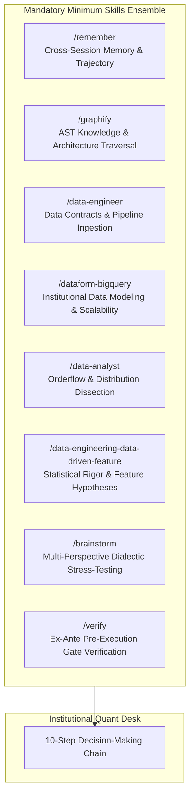
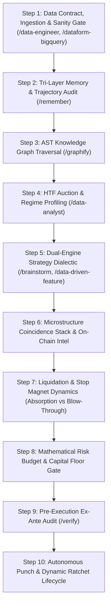
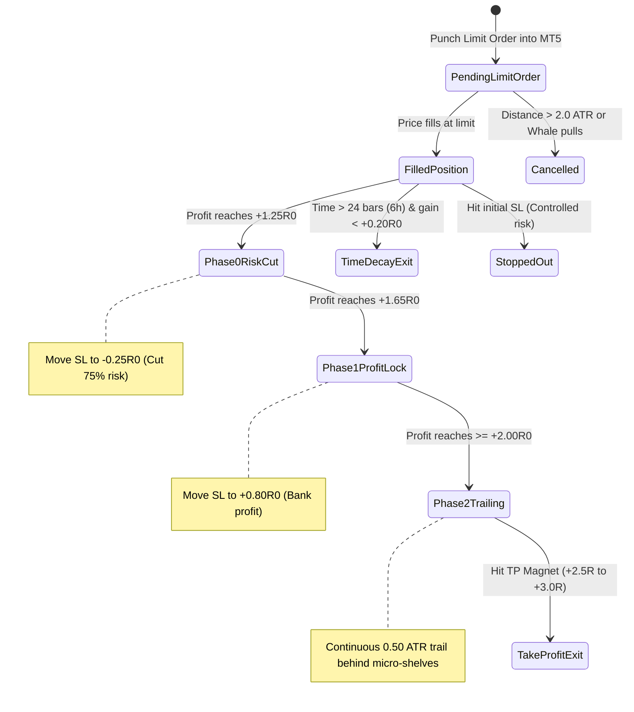
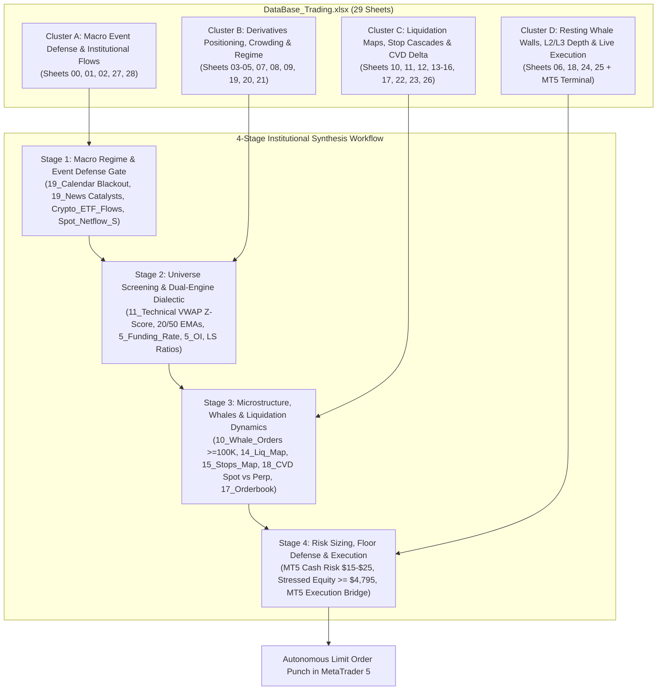

# 🏛️ STANDARDIZED QUANTITATIVE TRADING DECISION CHAIN (SOP)
## Canonical Multi-Pillar Institutional Microstructure Decision Architecture

> **Document Status**: CANONICAL PRODUCTION SPECIFICATION  
> **Target Environment**: MetaTrader 5 (Blueberry Markets, Account #5064568)  
> **Execution Engine**: Antigravity Autonomous Decision Desk  
> **Mandatory Foundation**: 8 Core Multi-Domain Skill Ensembles (Non-Bypassable)

---

## SECTION 1: MANDATORY SKILLS ENSEMBLE FOUNDATION

Under strict hedge fund operational governance, **no trading analysis, hypothesis formation, order staging, or modification may ever occur in an ad-hoc or single-agent vacuum**.

### 🚨 MANDATORY INVIOLATE SUBAGENT SWARM & ARENA.AI DISPATCH GUARANTEE (OPERATOR MANDATE)
> **NEVER OMIT, BYPASS, OR SKIP UNDER ANY CIRCUMSTANCES**:
> 1. **Mandatory Subagent Swarm**: On EVERY 20-minute autonomous wake-up cron and on EVERY decision turn, Antigravity MUST physically invoke the specialized subagents (Orderflow Analyst, Position Manager, Macro Risk Analyst) via invoke_subagent.
> 2. **Mandatory Arena.ai Surgical Red-Team Dispatch**: On EVERY wake-up cycle, a surgical red-team prompt MUST be injected into Arena.ai via Chrome CDP on port 9222.
> 3. **Live Profit Ratchets Do Not Excuse Omission**: When live orders fill and dynamic ratchets (Early-BE, Phase 0, Phase 1) fire on MT5, the coordinator must execute the ratchet IMMEDIATELY to secure capital, but MUST SIMULTANEOUSLY dispatch the subagent swarm and Arena prompt. No operational event ever excuses skipping the dual-track council.
 Every cycle and decision must systematically activate and apply the following foundational skill suite as the **absolute minimum requirement**, dynamically augmenting with additional specialized skills as market conditions dictate:



### The 8 Mandatory Foundation Skills:
1. **`/remember` (Persistent Cross-Session Memory & Trajectory Continuity)**:
   - Eliminates context amnesia. Retrieves past operator directives, settled invariants, post-loss autopsies, avoided traps (e.g., chasing unaligned limits, illiquid FX rollover hours, buying into un-swept stop clusters), and running capital cushion trajectory.
2. **`/graphify` (AST Knowledge Graph & Structural Traversal)**:
   - Queries repository semantic graphs (`graphify-out/graph.json`, 7.4k+ nodes) before modifying code, validating execution schemas, parameter bounds, broker symbols, and contract specifications.
3. **`/data-engineer` (Data Contract Enforcement & Pipeline Integrity)**:
   - Verifies raw tick ingestion, timestamp monotonicity, zero nulls, broker basis normalization (`venue_basis`), and telemetry data freshness. Rejects stale or corrupted data frames fail-closed.
4. **`/dataform-bigquery` (Institutional Data Modeling & Scalability)**:
   - Governs historical time-series consistency across all 43 canonical Parquet datasets and 3.47M 15m bars. Enforces unified data definitions from micro-ticks to multi-year horizons.
5. **`/data-analyst` (Orderflow, Auction & Distribution Dissection)**:
   - Decomposes multidimensional metrics: MT5 spreads in bps, VWAP standard deviations, volume profile POC/VAH/VAL, multi-horizon CVD deltas, and auction imbalance ratios.
6. **`/data-engineering-data-driven-feature` (Empirical Feature Engineering & Statistical Rigor)**:
   - Formulates verifiable quantitative hypotheses, establishes statistical significance (p_win lower bounds, z-score thresholds), and designs causal features with zero lookahead.
7. **`/brainstorm` (Multi-Perspective Dialectic & Persona Stress-Testing)**:
   - Simulates adversarial multi-agent debate (Orderflow Specialist vs Macro Risk Officer vs Forensic Position Auditor). Tests edge cases: *What if the whale pulls? What if the market blows through the cascade?*
8. **`/verify` (Ex-Ante Pre-Execution Gate & Boundary Verification)**:
   - Mathematical proof before dispatch. Verifies cash risk calculations against `mt5.order_calc_profit`, checks hard floor cushion (>= 4,775 USD), verifies passive limit posture, and validates SL/TP placement.
9. **`/risk-engine` (Stressed Multi-Ticket Floor Defense Simulator)**:
   - Computes worst-case stressed equity across all open and staged tickets: $\text{Stressed Equity} = \text{Current Equity} - \sum (\text{Risk}_i \times 1.25 + 2.00) \ge 4,795.00\text{ USD}$ (preserving a mandatory $+20.00\text{ USD}$ operating buffer above the $4,775.00\text{ USD}$ absolute hard floor).
10. **`/execution-sim` (Microstructure Execution & Friction Compensation)**:
    - Models half-spread offset ($\text{Entry} = \text{Shelf} - \text{half\_spread}$ for longs, $\text{Shelf} + \text{half\_spread}$ for shorts), verifies `ORDER_FILLING_IOC` with automatic failover to `RETURN` and `FOK`.
11. **`/onchain-forensics` (Hyperliquid L1 & Hyperdash Institutional Whale Intelligence)**:
    - Parses live decentralized whale positions (`4_Hyperliquid_Analysis`), tracks 2,001 individual whale wallets, monitors institutional Telegram block trade alerts (`16_Hyperdash_telegram_Intel`), and calculates 1h to 7d spot exchange netflows (`2_Spot_Netflow_S`).
12. **`/market-microstructure` (Orderbook Replenishment & Spoof Detection)**:
    - Analyzes L2 replenishment velocity $d(\text{depth})/dt$, calculates book imbalance ratios, and filters out phantom/ephemeral orders using presence fraction ($\ge 0.85$) and minimum persistence ($\ge 180\text{s}$).

---

## SECTION 1.5: THE 32-SHEET CANONICAL MASTER EXCEL TRADING WAREHOUSE & LINE-BY-LINE NARRATIVE PROTOCOL (EXCLUSIVE SOURCE OF TRUTH)

> **MANDATORY INVARIANT & SOLE DATA WAREHOUSE**:  
> `Data/DataBase_Trading.xlsx` (all 32 canonical production worksheets, from `00_MT5_Account_Telemetry` through `19_Calendar`) is the **exclusive, single definitive source of trading information, market microstructure, and decision-making for both Antigravity and Arena.ai**.

### 📖 MANDATORY LINE-BY-LINE STUDY, NARRATIVE SYNTHESIS & TRADE POSITIONING PROTOCOL (OPERATOR INVARIANT)
Under strict hedge fund operational governance, **the desk is forbidden from skimming summary cards or column averages**. On every wake-up and trade decision cycle, the desk must execute a rigorous 3-stage synthesis:

1. **Stage 1 (Line-by-Line Microstructure Study)**:
   - Study *each and every line* across all 32 sheets:
     * *Sheets 00-02*: Study every line of ETF netflows (IBIT, FBTC, ETHA) and 500-asset CEX netflows to verify spot accumulation.
     * *Sheets 03-05*: Examine Long/Short account ratios across Binance, OKX, Bybit to locate retail crowding traps.
     * *Sheet 06*: Review every Hyperliquid L1 whale wallet (0x...), leverage tier, and liquidation price.
     * *Sheets 07-09*: Inspect Open Interest trends and cross-exchange funding carry friction line-by-line.
     * *Sheets 10-17, 22*: Trace continuous dollar-by-dollar liquidation ladders and forced liquidation tape prints.
     * *Sheets 18 & 25*: Read every resting whale order (>= $100K USD) to verify persistence (>= 180s) and volume remaining.
     * *Sheet 19*: Scrutinize 20/50/200 EMAs, Session VWAP, +-1.0/+-2.0 SD bands, Z-score, RSI-14, and Volume Profile POC/VAH/VAL.
     * *Sheet 23*: Examine retail stop loss clusters line-by-line to avoid staging entries inside un-swept stop clusters.
     * *Sheet 26*: Inspect continuous Spot vs Futures taker volume, delta divergence (zc_div > 0.8), and absorption signatures.
     * *Sheets 27 & 28*: Read all upcoming economic calendar releases and breaking news line-by-line.

2. **Stage 2 (Cohesive Market Narrative Construction)**:
   - Synthesize the line-by-line evidence into an empirical multi-timeframe narrative:
     * Who is dominating the orderflow? (Aggressive market sellers absorbing into passive institutional whale walls).
     * Where is trapped retail liquidity located? (Below local swing lows or above daily highs).
     * What is the causal regime? (Model 1 Mean Reversion at |Z| >= 2.0 SD vs Model 2 Trend Pullback to EMA/VWAP shelf).

3. **Stage 3 (Grounded Trade Position Formulation)**:
   - Formulate the exact execution ticket directly from the narrative:
     * **Entry**: Placed passively behind the verified resting whale wall and demand shelf (never crossing the spread).
     * **Stop Loss**: Anchored safely outside [min_price, max_price] of nearest liquidation/stop band with >= 0.35-0.50 ATR buffer.
     * **Take Profit**: Front-running opposing liquidation magnet or Volume Profile shelf by 5-10 bps.
     * **Sizing & Floor Defense**: Sized between 10.00 and 25.00 USD, guaranteeing 4,795.00 USD buffer on fill and 4,775.00 USD hard floor under catastrophic stopout.  
> Neither Antigravity nor external council agents (Arena.ai, Copilot Studio, Ox Alpha) may ever query or cite unverified intermediate files. All market data points—covering macroeconomic indicators, central bank releases, cross-exchange funding rates, Long/Short ratios, level 2/3 orderbook depth, resting whale walls, liquidation ladders, stop order maps, continuous CVD, and Forex Factory calendar/news—are unified into this master workbook.

### The 29 Worksheets: Functional Taxonomy, Primary Metrics & Tactical Decision Purpose

| Sheet # | Worksheet Name | Functional Domain | Primary Metrics & Exact Ingestion Fields | Tactical Decision Purpose (Antigravity & Arena.ai) |
|---|---|---|---|---|
| **00** | `Crypto_ETF_Flows` | **Institutional Inflow & TradFi Proxy** | Overview of spot ETF aggregate flows, AUM, net creations/redemptions, market cap, and volume across BTC/ETH spot ETFs. | High-level TradFi spot demand barometer; sustained multi-day net inflow confirms macro tailwind for pro-trend long pullbacks. |
| **01** | `1_Crypto_ETF_Flows` | **Granular Spot ETF Flow Matrix** | `Rank`, `Ticker` (IBIT, FBTC, etc.), `ETF Name`, `Price`, `Price Change`, `Volume (USD)`, `Volume (Shares)`, `Turnover Rate`, `Shares Outstanding`, `AUM`, `Market Cap`, `Expense Ratio`, `Asset Category`, `Issuer`, `Daily Net Inflow`, `Timestamp UTC`. | Pinpoints individual institutional fund flows (BlackRock, Fidelity). Consecutive positive net inflow days disqualify aggressive counter-trend shorting on BTC and ETH. |
| **02** | `2_Spot_Netflow_S` | **CEX Spot Inflow/Outflow (500 Assets)** | `Rank`, `Symbol`, `Spot Price`, `1h Netflow`, `4h Netflow`, `12h Netflow`, `24h Netflow`, `7d Netflow`, `30d Netflow`, `24h Spot Volume`, `24h Change %`, `Exchange`, `Timestamp UTC`. | Measures real CEX spot accumulation vs distribution. Divergence (positive spot netflow while futures prices dip) proves institutional absorption of retail panic sells. |
| **03** | `3_Exchanges_LS_Ratio_15M` | **15m Positioning & Account Skew** | `Asset`, `Timeframe (15M)`, `Binance LS Ratio`, `Binance Long %`, `Binance Short %`, `OKX LS Ratio`, `OKX Long %`, `OKX Short %`, `Bybit LS Ratio`, `Aggregate LS Ratio`, `Timestamp UTC`. | Immediate retail crowding filter. If retail long accounts exceed 70%, long dip-buying is halted to prevent catching stop sweeps. |
| **04** | `3_Exchanges_LS_Ratio_1H` | **1H Structural Positioning Skew** | `Asset`, `Timeframe (1H)`, `Binance LS Ratio`, `Binance Long %`, `Binance Short %`, `OKX LS Ratio`, `OKX Long %`, `OKX Short %`, `Bybit LS Ratio`, `Aggregate LS Ratio`, `Timestamp UTC`. | Hourly sentiment confirmation. Verifies if hourly price breakouts are supported by retail short covering or fresh institutional buying. |
| **05** | `3_Exchanges_LS_Ratio_4H` | **4H HTF Macro Positioning Skew** | `Asset`, `Timeframe (4H)`, `Binance LS Ratio`, `Binance Long %`, `Binance Short %`, `OKX LS Ratio`, `OKX Long %`, `OKX Short %`, `Bybit LS Ratio`, `Aggregate LS Ratio`, `Timestamp UTC`. | Higher-timeframe positioning consensus. Discloses multi-day trapped retail positions across major derivative exchanges. |
| **06** | `4_Hyperliquid_Analysis` | **DEX Whale Intelligence & Leverage** | `Rank`, `Account/Wallet (0x...)`, `Total Account Value`, `Position Value`, `Unrealized PnL`, `Leverage`, `Long/Short Bias`, `Top Position Symbol`, `Top Position Size`, `Entry Price`, `Mark Price`, `Liq Price`, `Margin Utilization`, `Timestamp UTC`. | Tracks smart-money on-chain perp whales on Hyperliquid L1. Discloses top whale positions, leverage tiers, and potential squeeze liquidation prices. |
| **07** | `5_OI` | **Futures Open Interest Analysis** | `Asset`, `OI Notional (USD)`, `OI Token (Coins)`, `1h OI Change %`, `4h OI Change %`, `24h OI Change %`, `Binance OI`, `Bybit OI`, `OKX OI`, `CME OI`, `Aggregate Trend`, `Timestamp UTC`. | Validates trend conviction across 18 perpetuals. Rising price + rising OI = genuine institutional trend; rising price + falling OI = short-covering rally prone to exhaustion. |
| **08** | `5_Funding_Rate` | **Cross-Exchange Perpetual Funding** | `Asset`, `Symbol`, `Binance FR`, `Bybit FR`, `OKX FR`, `dYdX FR`, `Bitget FR`, `Gate FR`, `Predicted Next FR`, `Annualized FR %`, `Cumulative 7D FR %`, `Funding Bias`, `Timestamp UTC`. | Pinpoints extreme leverage imbalances across 12 venues. Funding > +0.03% warns of long flush vulnerability; negative funding (< -0.02%) sets up explosive short squeezes. |
| **09** | `6_Funding_Fee_Settlement` | **Funding Fee Settlement & Friction** | `Asset`, `Exchange`, `Settlement Interval (8h/4h/1h)`, `Next Funding Time UTC`, `Current Rate`, `Estimated Fee USD (per 10k notional)`, `24h Fee Total`, `Annualized Carrying Cost`, `Crowding Risk Indicator`, `Timestamp UTC`. | Evaluates holding friction for multi-hour swing positions; prevents staging positions immediately ahead of heavy adverse funding fee debits. |
| **10** | `7_Liq_Heapmap` | **Clustered Liquidation Heatmap** | `Asset`, `Timeframe`, `Clustered Liq Price`, `Total Liq Volume (USD)`, `Long Liq Volume (USD)`, `Short Liq Volume (USD)`, `Distance to Current Price %`, `Timestamp UTC`. | Locates dense liquidation clusters across timeframes. Serves as primary target magnets where cascading liquidations will guarantee exit fill liquidity. |
| **11** | `7_Live_Liq` | **Real-Time Liquidation Stream** | `Timestamp`, `Asset/Symbol`, `Exchange`, `Side (Long/Short)`, `Liquidation USD`, `Liquidation Quantity`, `Liquidation Price`, `Mark Price`. | Real-time tape reading of forced liquidations. Detects liquidation climax flushes (e.g. > $5M longs wiped in 60s) signaling capitulation and mean-reversion bottoms. |
| **12** | `8_Exchange_Liquidation_Map_1D` | **24H Exchange Liquidation Surface** | `Asset`, `Timeframe (1D)`, `Price Bucket`, `Long Cumulative Liq USD`, `Short Cumulative Liq USD`, `Net Delta Liq USD`, `Density Score`, `Nearest Magnet Flag`, `Timestamp UTC`. | Intraday offensive/defensive geometry: Stop Loss must sit safely outside nearest sweep band [min_price, max_price] + 0.50 ATR; Take Profit front-runs opposing band by 5-10 bps. |
| **13** | `9_Liquidation_Max_Pain_24H` | **24H Liquidation Max Pain** | `Asset`, `Timeframe (24H)`, `Current Price`, `Max Pain Strike Price`, `Distance to Max Pain %`, `Total Long Risk USD`, `Total Short Risk USD`, `Pain Disparity Ratio`, `Target Bias`, `Timestamp UTC`. | Market-maker gravitational attraction strike where aggregate intraday open contracts experience maximum loss. |
| **14** | `9_Liquidation_Max_Pain_48H` | **48H Distal Liquidation Max Pain** | `Asset`, `Timeframe (48H)`, `Current Price`, `Max Pain Strike Price`, `Distance to Max Pain %`, `Total Long Risk USD`, `Total Short Risk USD`, `Pain Disparity Ratio`, `Target Bias`, `Timestamp UTC`. | Multi-day structural target magnet for runner positions. |
| **15** | `9_Liquidation_Max_Pain_3D` | **3D Liquidation Max Pain** | `Asset`, `Timeframe (3D)`, `Current Price`, `Max Pain Strike Price`, `Distance to Max Pain %`, `Total Long Risk USD`, `Total Short Risk USD`, `Pain Disparity Ratio`, `Target Bias`, `Timestamp UTC`. | Swing-horizon max pain strike anchoring weekly balance-of-power shifts. |
| **16** | `9_Liquidation_Max_Pain_7D` | **7D Macro Liquidation Max Pain** | `Asset`, `Timeframe (7D)`, `Current Price`, `Max Pain Strike Price`, `Distance to Max Pain %`, `Total Long Risk USD`, `Total Short Risk USD`, `Pain Disparity Ratio`, `Target Bias`, `Timestamp UTC`. | Macro weekly max pain target defining the prevailing weekly auction bias. |
| **17** | `8_Exchange_Liquidation_Map_7D` | **7D Cumulative Liquidation Surface** | `Asset`, `Timeframe (7D)`, `Price Bucket`, `Long Cumulative Liq USD`, `Short Cumulative Liq USD`, `Net Delta Liq USD`, `Density Score`, `Nearest Magnet Flag`, `Timestamp UTC`. | High-conviction macro TP magnet selection: targets multi-hundred-million-dollar squeeze pools (e.g. $1B+ short liquidation pools on BTC). |
| **18** | `10_Whale_Orders` | **Resting Whale Orders (> $100K USD)** | `Sr. No.`, `Asset`, `Venue/Exchange`, `Side (BUY/SELL)`, `Price`, `From Price`, `Initial USD`, `Remaining USD`, `Filled USD`, `Duration`, `Status`, `Distance to Spot %`, `Whale Entity Tag`, `Timestamp UTC`. | Inviolable stop bunker anchor: Stop Loss MUST shelter behind persistent resting whale bids (longs) or asks (shorts) with confirmed persistence (persist >= 180s). |
| **19** | `11_Technical` | **Quantitative Indicators & VWAP Bands** | `Asset`, `Close`, `20 EMA`, `50 EMA`, `200 EMA`, `VWAP`, `VWAP +1.0 SD`, `VWAP +2.0 SD`, `VWAP -1.0 SD`, `VWAP -2.0 SD`, `VWAP Z-Score`, `RSI-14`, `ATR-14`, `Volume Profile POC`, `VAH`, `VAL`, `Trend Regime`, `Timestamp UTC`. | Primary statistical regime filter: assigns Model 1 (|Z_VWAP| >= 2.0 SD in MEAN_REVERT) or Model 2 (|Z_VWAP| < 2.0 SD in TREND_UP/DOWN). If UNDEFINED, stand aside unconditionally. |
| **20** | `12_Hyperdash` | **Hyperdash Flow Sentiment & KPIs** | `Metric Identifier`, `Symbol`, `Metric Name`, `Value`, `24h Change`, `Sentiment Bias`, `Signal Strength`, `Timestamp UTC`. | Synthesizes aggregate smart money flow metrics, on-chain sentiment scores, and multi-asset volume velocity. |
| **21** | `13_Hyperliquid` | **Hyperliquid L1 Native Exchange Engine** | `Sr. No.`, `Asset`, `Open Interest USD`, `24h Volume USD`, `Funding Rate`, `Premium/Discount`, `Predicted Funding`, `Long/Short Skew`, `Net Taker Flow`, `Timestamp UTC`. | Real-time L1 DEX orderbook health, basis premium/discount relative to Binance, and decentralized taker flow pressure. |
| **22** | `14_Hyperdash_Liq_Map` | **Continuous Liquidation Price Ladder** | `Asset`, `Mark Price`, `Price Level`, `Side (Long/Short)`, `Leverage Tier`, `Liquidation Notional USD`, `Cumulative Liq USD`, `Distance to Mark %`, `Cluster Rank`, `Status`, `Timestamp UTC`. | Fine-grained continuous dollar-by-dollar liquidation ladder. Accurately maps the boundary [min_price, max_price] of long cascade bands and short squeeze bands. |
| **23** | `15_Hyperdash_Stops_Map` | **Resting Stop Orders Price Ladder** | `Asset`, `Mark Price`, `Stop Price Level`, `Order Side (Buy Stops / Sell Stops)`, `Stop Orders Count`, `Estimated Notional USD`, `Cumulative Stop Volume USD`, `Distance to Mark %`, `Sweep Vulnerability Score`, `Timestamp UTC`. | Maps exact retail resting stop loss clusters. Identifies sweep trap levels; strictly bans placing limit orders inside un-swept stop clusters. |
| **24** | `16_Hyperdash_telegram_Intel` | **Telegram Whale Flow Intelligence** | `Timestamp`, `Asset`, `Alert Type`, `Notional USD`, `Price`, `Source Channel`, `Message Content`, `Directional Signal`, `Conviction Score`. | Rapid-response whale alert channel. Flags institutional block trades, sudden wallet movements, and large off-market derivative prints. |
| **25** | `17_Orderbook` | **L2/L3 Orderbook & Whale Attribution** | `Asset`, `Side (BID/ASK)`, `Price Level`, `Depth Quantity`, `Cumulative Notional USD`, `Wallet/Entity Attribution`, `Imbalance Ratio`, `Persistence Status`, `Timestamp UTC`. | Top-20 depth and whale wall verification. Confirms orderbook asymmetry (Imbalance > +0.25 for longs, < -0.25 for shorts) and enforces the 180s persistence filter. |
| **26** | `18_CVD` | **Multi-Asset Continuous CVD Engine** | `Timestamp UTC`, `Asset`, `Close Price`, `Spot Taker Buy Vol`, `Spot Taker Sell Vol`, `Spot CVD Delta`, `Futures Taker Buy Vol`, `Futures Taker Sell Vol`, `Futures CVD Delta`, `Spot vs Futures CVD Divergence (zc_div)`, `Cumulative CVD 1m, 5m, 15m, 1h, Session`, `CVD Z-Score`. | Core Pillar 2 Confluence: Evaluates aggressive market buying vs selling across spot and perp. Confirms institutional accumulation when Delta Spot > 0 and Delta Futures < 0 with zc_div > 0.8. |
| **27** | `19_News` | **Forex Factory Breaking News Feed** | `Headline`, `URL`, `Timestamp / Time Ago`, `Currency`, `Impact (High/Med/Low)`, `Source / Tag`, `Summary / Description`, `Institutional Relevance`, `Timestamp UTC`. | Real-time institutional newsfeed. Flags breaking central bank comments, geopolitical tensions, and emergency market developments. |
| **28** | `19_Calendar` | **Forex Factory Macroeconomic Calendar**| `Date`, `Time UTC`, `Currency`, `Impact (Red/Orange/Yellow/Grey)`, `Event Name`, `Detail / Description`, `Actual`, `Forecast`, `Previous`, `Deviation / Surprise`, `Trade Blackout Window`, `Timestamp UTC`. | Sovereign Macro Defense Gate: Enforces the mandatory blackout window (+-15m for Crypto, +-35m for TradFi) around high-impact red-folder releases (CPI, FOMC, NFP, GDP, Interest Rates). |

---

## SECTION 2: THE 10-STEP STANDARDIZED TRADING DECISION CHAIN



---

### STEP 1: Data Contract, Ingestion & Sanity Gate (Mandatory Line-by-Line Ingestion & JIT Refresh)
*Active Skills: `@[data-engineer]`, `@[dataform-bigquery]`, `@[performance-engineer]`*

Every analysis begins by establishing absolute data integrity across the telemetry pipeline and macro calendar:

1. **Mandatory Master Database Updation Gate**:
   - The canonical Excel pipeline (`Run_Pipeline.py` / `Run_Parallel_Pipeline.py`) updates all 29 sheets of `Data/DataBase_Trading.xlsx`.
   - Prior to dispatching subagents or evaluating trade setups, Step 1 verifies that `Data/DataBase_Trading.xlsx` has been freshly modified within the current operating window, ensuring all 29 sheets contain live, zero-null market intelligence terminating strictly at `19_Calendar`.

2. **Mandatory Comprehensive Ingestion of ALL 29 Master Excel Worksheets (Strict Non-Skimming Invariant)**:
   - **Universal Read & Re-Read Mandate**: Agents, subagents, operators, and external council models are **strictly forbidden from skimming, sampling, or reading only a partial subset of worksheets**. On EVERY autonomous cycle, wake-up turn, and pre-order decision step, you MUST systematically **read and re-read all 29 canonical worksheets** in `Data/DataBase_Trading.xlsx` from Sheet 00 through Sheet 28:
     * **Cluster A: Macro Event Defense & Institutional Flows (Sheets 00, 01, 02, 27, 28)**:
       - **Sheet 00 (`Crypto_ETF_Flows`) & Sheet 01 (`1_Crypto_ETF_Flows`)**: Ingest institutional spot ETF net inflows/outflows across all 41 ETFs (IBIT, FBTC, ETHA, etc.), AUM, and volume to establish multi-day macro institutional bias.
       - **Sheet 02 (`2_Spot_Netflow_S`)**: Ingest physical spot netflows across 500 assets (1h, 4h, 12h, 24h, 7d net inflows/outflows) to detect physical spot accumulation vs distribution.
       - **Sheet 27 (`19_News`)**: Ingest all breaking institutional news stories and market headlines for geopolitical, energy, or central bank shocks.
       - **Sheet 28 (`19_Calendar`)**: Ingest all macroeconomic releases, inflation prints (CPI, PPI), central bank decisions (FOMC, ECB), and enforce the +-15m crypto (+-35m TradFi) blackout gate.
     * **Cluster B: Derivatives Positioning, Crowding & Regime (Sheets 03-05, 07, 08, 09, 19, 20, 21)**:
       - **Sheets 03, 04, 05 (`3_Exchanges_LS_Ratio_15M`, `1H`, `4H`)**: Ingest Long/Short accounts across Binance, OKX, and Bybit across all 3 timeframes to identify dangerous retail crowding (> 70% long).
       - **Sheet 07 (`5_OI`)**: Ingest open interest token and USD notional changes (1h, 4h, 24h) to confirm trend authenticity vs short-covering.
       - **Sheet 08 (`5_Funding_Rate`) & Sheet 09 (`6_Funding_Fee_Settlement`)**: Ingest funding rates across exchanges, predicted next funding, annualized %, and 7-day cumulative holding costs.
       - **Sheet 19 (`11_Technical`)**: Ingest full 43-column technical indicator matrix across universe assets: Close, 20/50/200 EMAs, VWAP, VWAP Z-Score, ATR-14, RSI-14, Volume Profile POC, VAH, VAL, and assigned Market Regime (`TREND_UP`, `TREND_DOWN`, `RANGE`, `UNDEFINED`).
       - **Sheet 20 (`12_Hyperdash`) & Sheet 21 (`13_Hyperliquid`)**: Ingest decentralized L1 native funding, open interest, and basis premium/discount relative to CEXs.
     * **Cluster C: Liquidation Maps, Stop Cascades & Orderflow Delta (Sheets 10, 11, 12, 13-16, 17, 22, 23, 26)**:
       - **Sheet 10 (`7_Liq_Heapmap`) & Sheet 11 (`7_Live_Liq`)**: Ingest high-density liquidation zones and live real-time liquidation prints to identify exhaustion climaxes.
       - **Sheets 12 & 17 (`8_Exchange_Liquidation_Map_1D` & `7D`)**: Ingest 24h and 7-day cumulative liquidation ladders across venues to locate distal exit liquidity pools.
       - **Sheets 13, 14, 15, 16 (`9_Liquidation_Max_Pain_24H`, `48H`, `3D`, `7D`)**: Ingest theoretical Max Pain strikes and disparity ratios across 4 rolling time horizons.
       - **Sheet 22 (`14_Hyperdash_Liq_Map`)**: Ingest granular dollar-by-dollar liquidation ladders (5,700+ rows) to identify exact boundaries of long cascade and short squeeze bands.
       - **Sheet 23 (`15_Hyperdash_Stops_Map`)**: Ingest retail resting stop-loss ladders (3,800+ rows) to locate un-swept stop sweep traps and enforce the invariant banning limit placement inside un-swept clusters.
       - **Sheet 26 (`18_CVD`)**: Ingest multi-timeframe continuous Cumulative Volume Delta (50,001 rows) across spot and futures to confirm institutional absorption (`Delta Spot > 0`, `Delta Futures < 0`, `zc_div > 0.8`).
     * **Cluster D: Resting Whale Walls, L2/L3 Depth & Live Execution (Sheets 06, 18, 24, 25 + MT5 Terminal)**:
       - **Sheet 06 (`4_Hyperliquid_Analysis`)**: Ingest 2,001 active decentralized whale wallets, unmasked 42-char hex addresses, position sizes, PnL, leverage, and net long/short bias.
       - **Sheet 18 (`10_Whale_Orders`)**: Ingest large resting orders (>= 100K USD) across exchanges, filtering strictly for persistence >= 180s to locate inviolable stop bunkers.
       - **Sheet 24 (`16_Hyperdash_telegram_Intel`)**: Ingest 1,501 institutional whale alerts, block trade notices, and off-market transfers.
       - **Sheet 25 (`17_Orderbook`)**: Ingest granular top-20 L2/L3 orderbook depth across venues, calculating depth imbalance (> +0.25 for longs, < -0.25 for shorts) and verifying wall replenishment.
       - **Live MT5 Account Telemetry (`Data/telemetry/mt5_account_telemetry.json`)**: Ingest live equity, balance, hard floor cushion (+49.89 USD above 4,775.00 USD), operating buffer (+29.89 USD above 4,795.00 USD), live broker spreads in bps, and qualified asset status.

3. **Mandatory Line-by-Line Forex Factory & Macro News Ingestion (Sheets 27 & 28)**:
   - Systematically read `Data/DataBase_Trading.xlsx` Sheet 27 (`19_News`) and Sheet 28 (`19_Calendar`) **line-by-line**:
     * **Macroeconomic Calendar (Sheet 28 - `19_Calendar`)**: Scrutinize scheduled inflation prints (CPI, PPI), central bank rate decisions (FOMC, ECB, BOJ), and employment releases (NFP). Inspect `Currency`, `Impact (Red/Orange/Yellow/Grey)`, `Time UTC`, `Forecast`, `Previous`, and enforce the mandatory +-15m (TradFi +-35m) blackout guard.
     * **Institutional Breaking News (Sheet 27 - `19_News`)**: Track real-time news headlines, energy supply shocks, geopolitical developments, and regulatory announcements.
     * **Macro Trade Hypothesis Formation**: Synthesize macro intelligence into asymmetric trade ideas while ensuring no new limit orders are staged inside an active high-impact blackout window.

4. **Clock & Freshness Audit**: Verify Excel database modification timestamp is within 600 seconds of live UTC. Stale data triggers immediate pipeline refresh.
5. **Monotonicity & Zero-Null Invariant**: Ingest 15m and HTF OHLCV bars, verifying strict time monotonicity and zero NaN/null values in closing prices, volume, and CVD.
6. **Broker Venue Basis Mapping**: Map Binance / Hyperdash crypto levels to MT5 execution symbols using `venue_basis`:
   $$\text{Price}_{\text{MT5}} = \text{Price}_{\text{Binance}} + \text{venue\_basis}$$
7. **Spread Friction Threshold Gate**:
   - Crypto Perpetuals: MT5 Spread must be $\le 25.0\text{ bps}$ (e.g. BTC ~2.5 bps, ETH ~12 bps).
   - TradFi CFDs (Forex/Indices/Commodities): MT5 Spread must be $\le 5.0\text{ bps}$ (Gold ~0.2 bps, SP500 ~0.4 bps, USDJPY ~0.1 bps).
   - Any asset with spread exceeding its ceiling (e.g. DOGE at 261 bps) is disqualified immediately.

---

### STEP 2: Tri-Layer Memory & Trajectory Audit
*Active Skills: `@[memory-system]`, `@[anti-sycophancy]`, `@[quant-analyst]`, `@[odb-microstructure-forensics]`*

No trade is evaluated in a vacuum. The system reviews the persistent narrative and past lessons:
1. **Persistent Memory System Audit (`/memory-system`)**:
   - Review `.agents/memory/MEMORY.md` index, `.agents/memory/feedback-history.md` (past issues, setbacks & permanent resolutions), `.agents/memory/operator-directives.md` (active operational mandates & rights), `.agents/memory/user-preferences.md`, and `.agents/rules/ACTIVE_CONTEXT.md`.
   - Zero context amnesia: Ensure all past feedback and lessons raised by the operator are perpetually enforced.
2. **Mandatory Forensic Autopsy Reference (`LOSING_TRADES_DEEP_FORENSIC_AUTOPSY.md`)**:
   - The desk MUST refer to [`LOSING_TRADES_DEEP_FORENSIC_AUTOPSY.md`](file:///c:/Users/SIGMA/Documents/Trading_2/docs/specs/LOSING_TRADES_DEEP_FORENSIC_AUTOPSY.md) (Brain Artifact: `C:\Users\SIGMA\.gemini\antigravity\brain\b00c810a-61bb-46bf-a147-4c8859c64058\LOSING_TRADES_DEEP_FORENSIC_AUTOPSY.md`) on EVERY evaluation turn to eliminate historical failure patterns.
   - **The Three Inviolable Anti-Regression Invariants**:
     * **Invariant A (Whale Bunker Stop Sizing — Never Choke Stops & Expanded Risk Rights)**: In 38.5% of historical losses, direction was 100% correct, and 4 trades (EURUSD, USWTI, BTC, Gold) hit full Take Profit immediately post-stop. Stops must NEVER be calculated from arbitrary point or ATR fractions inside the market sweep zone. All stops MUST anchor behind verified resting institutional liquidity (persistent L2/L3 whale walls with $\text{persist} \ge 180\text{s}$) plus a $0.50\text{ ATR}$ structural buffer. Per explicit operator directive, the stop loss dollar budget is expanded to **$15.00–$25.00 USD** (0.30%–0.51% equity) or lot size scaled down (0.05 or 0.01) to safely clear the whale bunker without choking!
     * **Invariant B (Higher-Timeframe Trend Hierarchy Gate — Zero Falling Knives)**: In 38.5% of historical losses, the desk bought dips in aggressive HTF bear trends (BTC plunging -2,151 pts further, ETH dropping -$155 further). In a confirmed 1H/4H Bear Trend ($\text{Price} < \text{EMA}_{20} < \text{EMA}_{50} < \text{EMA}_{200}$), Model 1 Long dip-buying is **strictly FORBIDDEN** regardless of 15m oversold oscillator readings. The desk may ONLY stage Model 2 Trend Pullback Shorts at overhead resistance shelves.
     * **Invariant C (Adaptive Early Breakeven at +0.75R0 to +0.80R0 — Protecting Positive MFE)**: 76.9% of historical losing trades (20 of 26) were in positive profit before reversing. Once price reaches $+0.75\text{R0 to }+0.80\text{R0}$ and reclaims the session Volume Profile POC or VWAP, arm an early risk cut to Entry $+ 0.10\text{R0}$ to prevent green trades from turning into full stop-outs during session volatility transitions (e.g. 13:30 UTC NY Cash Open).
3. **Anti-Trap Checklist**: Confirm candidate setup does not match known trap patterns:
   - Never stage limit entries directly above/below un-swept opposing stop clusters.
   - Never catch falling knives against massive unidirectional CVD without absorption evidence.
   - Never place orders during illiquid interbank rollover spread expansion (21:30–22:30 UTC).
4. **Live Capital Floor Cushion**:
   $$\text{Floor Cushion} = \text{Current Equity} - 4,775.00\text{ USD}$$
   Confirm that existing open positions and staged pending orders leave the cushion strictly positive.

---

### STEP 3: AST Knowledge Graph Traversal & Rule Check
*Active Skills: `@[graphify]`*

Query the system architecture to prevent logic regressions:
1. **Canonical Schema Query**: Verify symbol mapping (`Terminal/Asset_Universe.py`), lot steps, minimum volume, and digits via AST lookup.
2. **Strategy Module Integrity**: Verify active logic resides in canonical single modules (`Terminal/OF_Strategy.py`, `Engine/s1_liquidation_cascade.py`), adhering to the Single Strategy File Mandate.
3. **Mathematical Invariant Check**: Ensure ATR calculations, VWAP standard deviation formulas, and volume profile definitions match `.okf/` verified contracts.

---

### STEP 4: Higher-Timeframe Auction & Regime Profiling
*Active Skills: `@[data-analyst]`*

Determine the macro structural environment before looking at intraday triggers:
1. **HTF Trend Hierarchy (1H & 4H)**:
   - **Bullish Regime**: $\text{Price} > \text{EMA}_{20} > \text{EMA}_{50} > \text{EMA}_{200}$ on 1H/4H.
   - **Bearish Regime**: $\text{Price} < \text{EMA}_{20} < \text{EMA}_{50} < \text{EMA}_{200}$ on 1H/4H.
   - **Ranging / Mean-Reverting**: EMAs flat, compressed, or oscillating.
2. **Auction Market Structure**:
   - Identify Prior Day and Prior Week POC, VAH (Value Area High), and VAL (Value Area Low).
   - Evaluate Session VWAP and Multi-Day Anchor VWAPs.
3. **Stand-Aside Protocol**: If the market displays conflicting regimes or choppy liquidity without clear structural edges, the desk **stands aside unconditionally**. Cash is a valid position.

---

### STEP 5: Dual-Engine Strategy Dialectic & Opportunity Screening
*Active Skills: `@[brainstorm]`, `@[data-engineering-data-driven-feature]`*

Screen candidates across the universe into two distinct, non-overlapping quantitative models:

#### Model 1: Extreme Mean Reversion
- **Condition**: Market reaches statistical extremes ($|Z_{\text{VWAP}}| \ge 2.0\text{ SD}$ to $3.5\text{ SD}$).
- **Required Confluence**:
  1. Price tested an extreme structural boundary (outer VWAP band +2.0 SD / -2.0 SD, extreme weekly deviation).
  2. Orderflow shows **Trapped Traders** (`TRAPPED_BUYERS_ABOVE` for Shorts, `TRAPPED_SELLERS_BELOW` for Longs).
  3. Microstructure tape reveals clear momentum exhaustion (CVD delta decelerating, lack of volume follow-through).
- **Execution**: Counter-trend passive limit order targeting mean reversion back toward Volume POC or Session VWAP.

#### Model 2: VWAP & Structural Trend Pullback
- **Condition**: In-range statistical score ($|Z_{\text{VWAP}}| < 2.0\text{ SD}$, typically $0.2\text{ SD}$ to $1.7\text{ SD}$) within a confirmed HTF trend.
- **Required Confluence**:
  1. Primary trend confirmed by HTF EMA hierarchy and directional multi-horizon CVD.
  2. Pullback retraces into a confirmed structural shelf:
     - 20 EMA / 50 EMA shelf.
     - Volume Profile Value Area edge (VAL in uptrend, VAH in downtrend).
     - **Daily VWAP +1.0D / -1.0D Band coincidence with persistent whale orders**.
- **Execution**: Pro-trend passive limit order placed at the shelf, targeting cascade momentum into the next structural magnet.

#### Mandatory Wake-Up Candidate Identification Protocol (Passive Limit Orders)
- **Active Scanning Mandate**: On EVERY wake-up cycle and autonomous turn, the coordinator, all dispatched subagents (`Orderflow Analyst`, `Position Manager`, `Macro Risk Analyst`), and the external council models are **strictly mandated to actively scan the 24 mutual assets and the 93-asset screener to discover, qualify, and formulate explicit passive limit order candidates**.
- **Execution Readiness**: Do not remain passive when valid setups exist. Whenever portfolio capacity permits (up to 4 tickets total across orthogonal asset clusters: Crypto, Metals, Energy, Forex, Indices), actively identify and stage:
  1. **Model 1 Extreme Mean Reversion Limits**: Staged at outer shelves (|Z| >= 2.0 to 3.5 SD in verified `MEAN_REVERT` regimes) with confirmed tape exhaustion and un-swept resting whale shelters.
  2. **Model 2 Trend Pullback Limits**: Staged at 20/50 EMA, VAH/VAL, or Session VWAP shelves in verified `TREND_UP` or `TREND_DOWN` regimes, defended by resting whale bunkers outside opposing sweep bands.
- **Complete Order Specification**: Every identified candidate must be fully parameterized: Symbol, Order Type (`BUY_LIMIT` / `SELL_LIMIT`), Entry Price (shelf-anchored, accounting for half-spread), Stop Loss (safely bunkered behind whale wall with >= 0.35–0.50 ATR clearance), Take Profit (front-running magnet by 5–10 bps), Lot Size (calibrated to $15.00–$25.00 USD risk envelope), and Stressed Floor Cushion check (>= 4,775.00 USD hard floor).

---

### STEP 6: Microstructure Coincidence Stack & On-Chain Intelligence
*Active Skills: `@[data-analyst]`, `@[quant-analyst]`*

Every candidate setup must achieve simultaneous confluence across the multi-pillar microstructure stack:

1. **L2 Orderbook Depth Asymmetry**:
   - Top-20 depth must heavily support the trade direction:
     $$\text{Imbalance} = \frac{\text{Bid Depth} - \text{Ask Depth}}{\text{Bid Depth} + \text{Ask Depth}}$$
   - For Longs: Bid Depth > Ask Depth (Imbalance $> +0.25$).
   - For Shorts: Ask Depth > Bid Depth (Imbalance $< -0.25$).
2. **L3 Attributed Whale Wall Backing & Anti-Spoof Persistence Gate**:
   - Order must be shielded by genuine on-chain/L3 whale orders (`0x...`).
   - **Strict Persistence Contract (Non-Bypassable)**:
     * `persistence_status == "SAMPLED_RECURRENCE_VERIFIED"`
     * `persist_s >= 180.0\text{ seconds}`
     * `presence_frac >= 0.85`
     * `gate_g7_eligible == True`
     * **Reject All Unverified Walls**: Any wall showing `persist_s == 0.0` or `SINGLE_SAMPLE` is classified as potential spoof liquidity and rejected fail-closed.
   - Minimum Notional: $\ge 5,000,000\text{ USD}$ for BTC/ETH; $\ge 1,000,000\text{ USD}$ for TradFi (Gold, Indices, Oil); $\ge 500,000\text{ USD}$ for FX and Altcoins.
3. **Multi-Horizon CVD Directional Taker Flow**:
   - Inspect 1m, 15m, Session, and Weekly cumulative volume delta.
   - Strong alignment: Massive negative CVD (-10M to -100M+ USD) confirms short dominance; massive positive CVD confirms buyer aggression.
4. **Hyperliquid & Hyperdash On-Chain Institutional Whale Forensics (`4_Hyperliquid_Analysis` & `16_Hyperdash_telegram_Intel`)**:
   - Master Excel directly provides comprehensive decentralized whale tracking and institutional alert telemetry via Sheet 06 (`4_Hyperliquid_Analysis`), Sheet 20 (`12_Hyperdash`), Sheet 21 (`13_Hyperliquid`), and Sheet 24 (`16_Hyperdash_telegram_Intel`).
   - **Data Schema & Core Fields**:
     * `4_Hyperliquid_Analysis` (Sheet 06):
       - Tracks 2,001 active decentralized whale wallets with verified 42-character Ethereum hex addresses (`Account/Wallet 0x...`).
       - `Total Account Value`, `Position Value (USD)`, `Unrealized PnL`, `Leverage`, `Long/Short Bias`, `Entry Price`, and `Liquidation Price`.
     * `16_Hyperdash_telegram_Intel` (Sheet 24):
       - Real-time institutional alerts (1,501 continuous records) monitoring whale block orders, off-market OTC transfers, and sudden liquidity migrations.
       - `Timestamp`, `Asset`, `Alert Type`, `Notional USD`, `Price Level`, `Directional Signal`, and `Conviction Score`.
     * `2_Spot_Netflow_S` (Sheet 02):
       - Tracks real-time spot netflow across 500 assets across 1h, 4h, 12h, 24h, and 7d horizons (`1h Netflow`, `4h Netflow`, `24h Netflow`).
     * `12_Hyperdash` & `13_Hyperliquid` (Sheets 20 & 21):
       - L1 native funding rates, open interest, and basis premium/discount relative to centralized exchanges.
   - **Decision Rules for Institutional Whale Flow**:
     * *Long Confirmation*: Hyperliquid top whale aggregate positioning shows net long bias (`Long/Short Ratio > 1.2`), `2_Spot_Netflow_S` confirms positive 4h/24h spot accumulation, and `16_Hyperdash_telegram_Intel` registers high-conviction buy block alerts.
     * *Short Confirmation*: Top whales aggressively build short exposure, `2_Spot_Netflow_S` confirms spot distribution (negative 4h/24h netflow), and telegram intelligence flags large block sell orders.
     * *Whale Invalidation*: If an intended limit order sits opposing a top-tier whale position (> $5M USD) with high leverage, standing aside is mandatory.

---

### STEP 7: Liquidation & Stop Magnet Dynamics (Absorption vs. Blow-Through)
*Active Skills: `@[brainstorm]`, `@[data-analyst]`, `@[market-microstructure]`*

Reconstructed liquidation bands and dense structural stop clusters serve two critical functions:

```
        DEFENSIVE USE (BUNKER)                    OFFENSIVE USE (MAGNET)
┌───────────────────────────────────────┐ ┌───────────────────────────────────────┐
│ Place SL strictly outside outer       │ │ Use opposing liquidation band /       │
│ boundary [min_price, max_price] with  │ │ stop cluster as high-probability      │
│ >= 0.50 ATR + half_spread buffer.     │ │ TARGET MAGNET. Ride cascade momentum! │
│ Defends position against wick flushes.│ │ Front-run target by 5-10 bps.         │
└───────────────────────────────────────┘ └───────────────────────────────────────┘
```

#### 1. Significant Notional Filter (Eliminating Ladder Noise):
To resolve the "continuous ladder impossibility" where every 10 points contains tiny orders:
- **Significant Clusters**: Only clusters meeting institutional notional thresholds count as valid defensive bunkers or offensive TP magnets:
  * **BTC & ETH**: $\ge 5,000,000\text{ USD}$ (Intraday micro-clusters $\ge 1,000,000\text{ USD}$)
  * **TradFi CFDs (Gold, SP500, NAS100, USWTI)**: $\ge 1,000,000\text{ USD}$
  * **Forex & Altcoins**: $\ge 500,000\text{ USD}$
- **Noise Filter**: All clusters $< 50,000\text{ USD}$ are classified as retail noise and ignored for bunker clearance.

#### 2. Canonical Mathematical Bunker Formula (Non-Ambiguous):
Stop Losses must NEVER be measured from `mid_price`. They are strictly calculated from the outer boundary:
$$\text{SL}_{\text{short}} = \max(\text{max\_price}_{\text{nearest\_buy\_stops}}, \text{max\_price}_{\text{short\_squeeze\_band}}, \text{price}_{\text{defending\_ask\_wall}}) + 0.50 \times \text{ATR} + \text{half\_spread}$$
$$\text{SL}_{\text{long}} = \min(\text{min\_price}_{\text{nearest\_sell\_stops}}, \text{min\_price}_{\text{long\_cascade\_band}}, \text{price}_{\text{defending\_bid\_wall}}) - 0.50 \times \text{ATR} - \text{half\_spread}$$

#### 3. Quantified Absorption vs. Trend Blow-Through Forensics:
When price approaches a significant cascade band, differentiate between absorption and continuation using 4 empirical metrics:

| Metric | Absorption / Reversal Protocol | Trend Blow-Through Protocol |
|:---|:---|:---|
| **1. CVD Acceleration** | CVD second derivative $d^2(\text{CVD})/dt^2 < 0$ and $15\text{m}$ delta decelerating $> 30\%$ | CVD accelerates exponentially through the band ($d^2(\text{CVD})/dt^2 > 0$) |
| **2. L2 Book Replenishment** | Opposing depth replenishes $\ge 80\%$ within 2 seconds of the sweep | Orderbook remains hollowed out ($< 30\%$ replenishment); depth vanishes |
| **3. Spot Netflow & Whale Bias** | Spot Netflow (`2_Spot_Netflow_S`) shows counter-trend accumulation > +$500K USD, or Hyperliquid whales (`4_Hyperliquid_Analysis`) heavily defending shelf | Aggressive spot distribution continues in direction of cascade; Hyperliquid whales net short |
| **4. Structural Auction Location** | Band sits at statistical extreme ($|Z| \ge 2.5\text{ SD}$, HTF POC/VAH/VAL shelf) | Band sits in the middle of a fresh HTF breakout channel with open space |

- **If Absorption Confirmed**: Trade Model 1 counter-trend mean reversion with tight bunker SL.
- **If Blow-Through Confirmed**: Trade Model 2 pro-trend continuation, riding momentum into the *next* distal cascade band.

#### 4. TradFi vs Crypto Dual-Engine Confluence Contract (Operator Authorized Invariant):
To eliminate ambiguity across different asset classes:
- **Crypto Perpetuals (BTC, ETH, SOL, BNB, etc.)**:
  * **Pillar 2 (CVD Divergence zc_div)**: Computed using Binance Spot CVD vs Binance USDT-M Futures CVD divergence.
  * **Pillar 4 (Resting Whales & Liquidation Maps)**: Resting whale walls sit in CoinGlass (10_Whale_Orders), Hyperdash L1 orders (12_Hyperdash), and exchange liquidation ladders (14_Hyperdash_Liq_Map).
- **TradFi Index & Commodity CFDs (NAS100.p, SP500.p, GOLD, USWTI)**:
  * **Pillar 2 (TradFi Orderflow Delta)**: Computed directly from MetaTrader 5 interbank tick volume cumulative orderflow delta (Sheet 18_CVD) and CME futures tick momentum.
  * **Pillar 4 (TradFi Structural Bunkers)**: Stops sit behind CME/Interbank volume profile shelves (VAH/VAL/POC), 15m swing pivot extremes, and MT5 market depth.
  * **Take Profit Order Posture**: All Take Profit targets (tp) are pre-staged resting broker limit orders, NEVER aggressive market orders. When price touches the target, it fills passively as a limit order.
  * **Early-BE Ratchet Reclaim**: At +0.75R0 to +0.80R0 unrealized profit once price reclaims the local 15m structural swing shelf or intraday POC -> Move SL to Entry + 0.10R0 (100% Risk-Free lock).

---

### STEP 8: Mathematical Risk Budget & Capital Floor Gate
*Active Skills: `@[quant-analyst]`, `@[risk-engine]`, `@[clean-code]`*

Every staged order must undergo strict broker-specific contract sizing and capital defense auditing:

1. **Broker Contract Math**:
   - Calculate cash risk precisely using broker parameters:
     $$\text{Cash Risk (USD)} = \text{Volume} \times \text{Contract Size} \times |\text{Entry} - \text{SL}| \times \text{Quote Conversion}$$
   - Verify calculation directly via `mt5.order_calc_profit()`.
2. **Expanded Operational Risk Envelope (Explicit Operator Authorization)**:
   - **Operator Directive**: The operator has explicitly granted full authorization to expand the stop loss dollar budget to capture more trades and prevent choked stops.
   - **Unified Risk Envelope across all assets (Crypto, Metals, FX, Energy, Indices)**: Authorized up to **15.00 USD to 25.00 USD** (0.30% to 0.51% of equity).
   - **Mandatory Rationale & Invariant A Enforcement**: Stops must NEVER be choked or compressed inside market sweep zones to satisfy a rigid sub-15 USD cap. Stops MUST anchor safely behind genuine resting institutional whale walls (`persist >= 180s`) with a 0.35–0.50 ATR structural buffer. If placing the stop behind the true bunker requires 18.00 to 25.00 USD risk on minimum lots (e.g. on USDJPY, BTC, Gold, Indices), that risk is fully authorized.
3. **Stressed Floor Defense (Unconditional Invariant)**:
   - Stressed post-loss simulation across all active positions and staged pending orders:
     $$\text{Total Staged Risk} = \sum_{i} \text{Risk}_i$$
     $$\text{Stressed Equity} = \text{Current Equity} - \sum_{i} (\text{Risk}_i \times 1.25 + 2.00) \ge 4,795.00\text{ USD}$$
   - Under no circumstances may an order be staged if Stressed Equity violates the 4,795.00 USD operating buffer (and 4,775.00 USD hard floor). With live equity at 4,834.83 USD, the cushion above the 4,795.00 USD operating buffer is exactly +39.83 USD (and +59.83 USD above the hard floor).
4. **Dynamic Live Position Capacity Formula (Arena.ai Hardened)**:
   - Available Buffer Capacity: Capacity = Live Equity - 4,795.00 USD (Currently: 4,834.83 - 4,795.00 = 39.83 USD).
   - **At 10.00 USD cash risk**: Each slot incurs 10.00 * 1.25 + 2.00 = 14.50 USD stressed risk.
     Max Slots = floor(39.83 / 14.50) = 2 concurrent positions (ONLY when risk <= 10.00 USD).
     (Consumes 29.00 USD stressed risk, preserving a +10.83 USD buffer surplus).
   - **At 15.00 USD cash risk**: Each slot incurs 15.00 * 1.25 + 2.00 = 20.75 USD stressed risk.
     Max Slots = floor(39.83 / 20.75) = 1 concurrent position.
     (Consumes 20.75 USD stressed risk, preserving a +19.08 USD buffer surplus. Second position is strictly blocked).
   - **At 25.00 USD cash risk**: Each slot incurs 25.00 * 1.25 + 2.00 = 33.25 USD stressed risk.
     Max Slots = floor(39.83 / 33.25) = 1 concurrent position.
     (Consumes 33.25 USD stressed risk, preserving a +6.58 USD buffer surplus. Second position is strictly blocked).
   - **Dynamic Unlocking Rules**:
     * 2 simultaneous slots at 15.00 USD risk are unlocked ONLY when live equity expands above 4,836.50 USD (4,795.00 + 2 * 20.75).
     * 3 simultaneous slots at 15.00 USD risk are unlocked ONLY when live equity expands above 4,857.25 USD (4,795.00 + 3 * 20.75).
     * 4 simultaneous slots are unlocked ONLY when live equity expands above 4,878.00 USD. Under current equity, any attempt to stage more than 1 position at 15-25 USD risk is hard-blocked fail-closed.

---

### STEP 9: Pre-Execution Ex-Ante Audit
*Active Skills: `@[verify]`, `@[clean-code]`*

Prior to order transmission, perform the final 5-point sanity audit:
1. **Passive Limit Posture**: Confirm order type is strictly `BUY_LIMIT` or `SELL_LIMIT`. Market orders and spread-crossing taker executions are permanently banned.
2. **Reward-to-Risk (R:R) Gate**:
   $$\text{R:R Ratio} = \frac{|\text{TP} - \text{Entry}|}{|\text{Entry} - \text{SL}|} \ge 2.0\text{R}$$
   (Default target is 2.5R to 3.0R).
3. **Bunker Stop Verification**: SL is positioned safely beyond the outer boundary of the resting whale wall and liquidation band with $\ge 0.50\text{ ATR}$ safety margin.
4. **Target Magnet Front-Run**: TP is set 5 to 10 bps ahead of the opposing structural cluster or liquidation band to guarantee fill liquidity before depletion.
5. **Filling Policy Compatibility**: Test `ORDER_FILLING_IOC`, with automatic failover to `ORDER_FILLING_RETURN` / `ORDER_FILLING_FOK` if rejected by broker bridge.

---

### STEP 10: Autonomous Punch & Dynamic Ratchet Lifecycle
*Active Skills: `@[quant-analyst]`*

Once verified, the order is transmitted autonomously into MetaTrader 5 without operator hesitation:



1. **Autonomous Execution**: Execute via `mt5.order_send()` with unique magic number (`888888`) and descriptive comment.
2. **Dynamic Profit Ratchet Protocol (Frozen $R_0$)**:
   - **Phase Early-BE (Adaptive Microstructure Breakeven — Mandated by Forensic Autopsy)**: At $+0.75R_0$ to $+0.80R_0$ unrealized profit once price reclaims the session Volume Profile POC or VWAP $\to$ Move SL to $\text{Entry} + 0.10R_0$ (eliminates 100% of risk and guarantees zero-loss protection, preventing the 76.9% positive MFE from ever turning into a full stop-out).
   - **Phase 0 (Risk Cut)**: At $+1.25R_0$ unrealized profit $\to$ Move SL to $\text{Entry} + 0.15R_0$ (locks in minor profit + broker commission buffer).
   - **Phase 1 (Profit Lock)**: At $+1.65R_0$ unrealized profit $\to$ Move SL to $\text{Entry} + 0.80R_0$ (locks in guaranteed major profit).
   - **Phase 2 (Continuous Trailing Ratchet)**: At $\ge +2.00R_0$ unrealized profit $\to$ Trail SL behind structural 15m swing shelves or $0.50\text{ ATR}$ trailing stop.
3. **Time-Decay Exit**: If a position has been active for 24 bars (6 hours) and has not generated at least $+0.20R_0$ gain, close at market to redeploy capital.

---

## SECTION 3: 29-SHEET INSTITUTIONAL EXCEL DATA MATRIX DECISION SYNTHESIS PROTOCOL
### Operationalizing the 29 Canonical Quantitative Worksheets in `DataBase_Trading.xlsx`

> **Data Warehouse Status**: 29 CANONICAL PRODUCTION WORKSHEETS | 12.55 MB | ZERO NULLS | TERMINATING AT `19_Calendar`  
> **Master File Location**: `Data/DataBase_Trading.xlsx`  
> **Refresh Latency**: Sequential: ~32 min | Parallel Pipeline: ~35–45s API / ~3.5 min Hybrid  
> **Core Mandate**: Every trading decision, macro hypothesis, and order staging must systematically cross-reference and weight the 4 functional data clusters below before capital commitment.



---

### PART 3.1: THE 4 FUNCTIONAL EXCEL DATA CLUSTERS & SPECIFIC DATA POINTS

#### 1. Cluster A: Macro Event Defense & Institutional Flows (Sheets 00, 01, 02, 27, 28)
- **`19_Calendar` (Sheet 28)**:
  - **Data Points**: `Date`, `Time UTC`, `Currency`, `Impact (Red/Orange/Yellow/Grey)`, `Event Name`, `Actual`, `Forecast`, `Previous`, `Deviation / Surprise`, `Trade Blackout Window`.
  - **Tactical Rule**: High-impact red-folder events (CPI, FOMC, NFP, GDP, Central Bank Rate Decisions) mandate an unconditional +-15m (TradFi +-35m) trading blackout. Zero limit orders may be staged inside active event windows.
- **`19_News` (Sheet 27)**:
  - **Data Points**: `Headline`, `URL`, `Timestamp / Time Ago`, `Currency`, `Impact`, `Summary / Description`, `Institutional Relevance`.
  - **Tactical Rule**: Scrutinizes breaking news releases for sudden structural shifts (tariffs, geopolitical escalations, energy supply shocks) that override technical setups.
- **`Crypto_ETF_Flows` & `1_Crypto_ETF_Flows` (Sheets 00 & 01)**:
  - **Data Points**: `Rank`, `Ticker` (IBIT, FBTC, ETHA, etc.), `Price`, `Price Change`, `Volume (USD)`, `Turnover Rate`, `AUM`, `Market Cap`, `Issuer`, `Daily Net Inflow`.
  - **Tactical Rule**: Aggregate ETF net inflows (USD) establish institutional macro bias. Consecutive days of positive net spot inflow confirm underlying spot accumulation, banning counter-trend shorts on BTC/ETH.
- **`2_Spot_Netflow_S` (Sheet 02)**:
  - **Data Points**: `Rank`, `Symbol`, `Spot Price`, `1h Netflow`, `4h Netflow`, `12h Netflow`, `24h Netflow`, `7d Netflow`, `24h Spot Volume`, `24h Change %`.
  - **Tactical Rule**: Measures physical spot buying across 500 assets. Positive netflow on pullbacks proves smart-money accumulation; negative netflow on rallies confirms distribution.

#### 2. Cluster B: Derivatives Positioning, Crowding & Technical Regime (Sheets 03–05, 07, 08, 09, 19, 20, 21)
- **`11_Technical` (Sheet 19)**:
  - **Data Points**: `Asset`, `Close`, `20 EMA`, `50 EMA`, `200 EMA`, `VWAP`, `VWAP +1.0 SD`, `VWAP +2.0 SD`, `VWAP -1.0 SD`, `VWAP -2.0 SD`, `VWAP Z-Score`, `RSI-14`, `ATR-14`, `Volume Profile POC`, `VAH`, `VAL`, `Trend Regime`.
  - **Tactical Rule**: Primary quantitative regime filter:
    * **Model 1 (Mean Reversion)**: Admissible ONLY when `|VWAP Z-Score| >= 2.0 SD` in `MEAN_REVERT` regime with tape exhaustion.
    * **Model 2 (Trend Pullback)**: Admissible ONLY when `|VWAP Z-Score| < 2.0 SD` (0.2 to 1.7 SD) in confirmed `TREND_UP` or `TREND_DOWN` retracing to 20/50 EMA or VAH/VAL shelves.
    * **Stand Aside**: If `Trend Regime == UNDEFINED`, all trading is halted unconditionally.
- **`3_Exchanges_LS_Ratio_15M`, `1H`, `4H` (Sheets 03, 04, 05)**:
  - **Data Points**: `Asset`, `Timeframe`, `Binance LS Ratio`, `Binance Long %`, `Binance Short %`, `OKX LS Ratio`, `Bybit LS Ratio`, `Aggregate LS Ratio`.
  - **Tactical Rule**: Retail crowding sentiment indicator. If retail long percentage > 70%, longs are disqualified due to extreme stop-cascade vulnerability.
- **`5_OI` (Sheet 07)**:
  - **Data Points**: `Asset`, `OI Notional (USD)`, `OI Token (Coins)`, `1h OI Change %`, `4h OI Change %`, `24h OI Change %`, `Binance OI`, `Bybit OI`, `OKX OI`, `CME OI`, `Aggregate Trend`.
  - **Tactical Rule**: Confirms trend authenticity. Rising price + rising OI = fresh capital trend; rising price + falling OI = short-covering rally prone to reversal.
- **`5_Funding_Rate` & `6_Funding_Fee_Settlement` (Sheets 08 & 09)**:
  - **Data Points**: `Asset`, `Binance FR`, `Bybit FR`, `OKX FR`, `dYdX FR`, `Predicted Next FR`, `Annualized FR %`, `Cumulative 7D FR %`, `Settlement Interval`, `Estimated Fee USD (per 10k notional)`, `Crowding Risk Indicator`.
  - **Tactical Rule**: Extreme positive funding (> +0.03%) flags overleveraged longs vulnerable to long flushes; negative funding (< -0.02%) sets up short squeezes. Evaluates holding costs for swing positions.
- **`12_Hyperdash` & `13_Hyperliquid` (Sheets 20 & 21)**:
  - **Data Points**: `Metric Identifier`, `Metric Name`, `Value`, `Sentiment Bias`, `Signal Strength`, `Open Interest USD`, `Funding Rate`, `Premium/Discount`, `Net Taker Flow`.
  - **Tactical Rule**: Cross-venue decentralized L1 market health and basis premium/discount relative to Binance.

#### 3. Cluster C: Liquidation Maps, Stop Cascades & Orderflow Delta (Sheets 10, 11, 12, 13–16, 17, 22, 23, 26)
- **`18_CVD` (Sheet 26)**:
  - **Data Points**: `Timestamp UTC`, `Asset`, `Close Price`, `Spot Taker Buy Vol`, `Spot Taker Sell Vol`, `Spot CVD Delta`, `Futures Taker Buy Vol`, `Futures Taker Sell Vol`, `Futures CVD Delta`, `Spot vs Futures CVD Divergence (zc_div)`, `Cumulative CVD 1m, 5m, 15m, 1h, Session`, `CVD Z-Score`.
  - **Tactical Rule (Pillar 2 Confluence)**: Evaluates aggressive market buying vs selling across spot and perp. Confirms institutional accumulation when `Delta Spot > 0` and `Delta Futures < 0` with `zc_div > 0.8`.
- **`14_Hyperdash_Liq_Map` (Sheet 22)**:
  - **Data Points**: `Asset`, `Mark Price`, `Price Level`, `Side (Long/Short)`, `Leverage Tier`, `Liquidation Notional USD`, `Cumulative Liq USD`, `Distance to Mark %`, `Cluster Rank`, `Status`.
  - **Tactical Rule**: Fine-grained continuous dollar-by-dollar liquidation ladder. Accurately defines the exact boundary [min_price, max_price] of long cascade bands and short squeeze bands.
- **`15_Hyperdash_Stops_Map` (Sheet 23)**:
  - **Data Points**: `Asset`, `Mark Price`, `Stop Price Level`, `Order Side (Buy Stops / Sell Stops)`, `Stop Orders Count`, `Estimated Notional USD`, `Cumulative Stop Volume USD`, `Distance to Mark %`, `Sweep Vulnerability Score`.
  - **Tactical Rule**: Maps exact retail resting stop loss clusters. Identifies sweep trap levels; strictly bans placing limit orders inside un-swept stop clusters.
- **`7_Liq_Heapmap` & `7_Live_Liq` (Sheets 10 & 11)**:
  - **Data Points**: `Clustered Liq Price`, `Total Liq Volume (USD)`, `Long Liq Volume`, `Short Liq Volume`, `Distance to Current Price %`, `Timestamp`, `Exchange`, `Side`, `Liquidation USD`, `Mark Price`.
  - **Tactical Rule**: Identifies high-density liquidation zones and live liquidation prints. Climax prints (> $5M liquidated in 60s) signal exhaustion and mean-reversion turning points.
- **`8_Exchange_Liquidation_Map_1D` & `7D` (Sheets 12 & 17)**:
  - **Data Points**: `Price Bucket`, `Long Cumulative Liq USD`, `Short Cumulative Liq USD`, `Net Delta Liq USD`, `Density Score`, `Nearest Magnet Flag`.
  - **Tactical Rule**: Defines the operational boundaries: Stop Loss must sit safely outside nearest sweep band + 0.50 ATR; Take Profit front-runs opposing major cascade pool by 5-10 bps.
- **`9_Liquidation_Max_Pain_24H` to `7D` (Sheets 13–16)**:
  - **Data Points**: `Max Pain Strike Price`, `Distance to Max Pain %`, `Total Long Risk USD`, `Total Short Risk USD`, `Pain Disparity Ratio`, `Target Bias`.
  - **Tactical Rule**: Theoretical maximum pain strikes acting as gravitational price magnets across 24h, 48h, 3D, and 7D horizons.

#### 4. Cluster D: Resting Whale Walls, L2/L3 Depth & Live Execution (Sheets 06, 18, 24, 25 + MT5 Terminal)
- **`10_Whale_Orders` (Sheet 18)**:
  - **Data Points**: `Sr. No.`, `Asset`, `Venue/Exchange`, `Side (BUY/SELL)`, `Price`, `From Price`, `Initial USD`, `Remaining USD`, `Filled USD`, `Duration`, `Status`, `Distance to Spot %`, `Whale Entity Tag`.
  - **Tactical Rule**: Inviolable Stop Bunker Anchor: Stop Loss must shelter behind persistent resting whale bids (longs) or asks (shorts) >= $100K USD with confirmed persistence (`persist >= 180s`). Reject ephemeral walls.
- **`17_Orderbook` (Sheet 25)**:
  - **Data Points**: `Asset`, `Side (BID/ASK)`, `Price Level`, `Depth Quantity`, `Cumulative Notional USD`, `Wallet/Entity Attribution`, `Imbalance Ratio`, `Persistence Status`.
  - **Tactical Rule**: Granular L2 and L3 orderbook depth ladder across top venues. Verifies top-of-book depth asymmetry (`Imbalance > +0.25` for longs, `< -0.25` for shorts) and detects order spoofing.
- **`4_Hyperliquid_Analysis` (Sheet 06)**:
  - **Data Points**: `Account/Wallet (0x...)`, `Total Account Value`, `Position Value`, `Unrealized PnL`, `Leverage`, `Long/Short Bias`, `Entry Price`, `Liq Price`.
  - **Tactical Rule**: Tracks positions of decentralized whales on Hyperliquid. Confirms whether smart money is net long or net short.
- **`16_Hyperdash_telegram_Intel` (Sheet 24)**:
  - **Data Points**: `Timestamp`, `Asset`, `Alert Type`, `Notional USD`, `Price`, `Message Content`, `Directional Signal`, `Conviction Score`.
  - **Tactical Rule**: Real-time institutional whale alerts, block trade notices, and off-market transfers.
- **Live MT5 Account Telemetry (`Terminal/`)**:
  - **Data Points**: Account balance, equity, margin utilized, floor cushion above the 4,775.00 USD hard floor, live interbank Bid/Ask quotes, and spread in bps.
  - **Tactical Rule**: Sovereign capital defense gate: enforces spread ceiling (<= 25 bps for crypto, <= 5 bps for TradFi), verifies stressed equity >= 4,795.00 USD, and calculates lot size.

---

### PART 3.2: THE 4-STAGE INSTITUTIONAL SYNTHESIS WORKFLOW

```
┌─────────────────────────────────────────────────────────────────────────────┐
│ STAGE 1: MACRO REGIME & EVENT DEFENSE GATE (CLUSTER A)                      │
│ 1. Check 19_Calendar & 19_News: Is FOMC, CPI, NFP, or Tier-1 release       │
│    within the mandatory blackout window (< 15m for Crypto, < 35m TradFi)?   │
│    -> If YES: Stand aside unconditionally across all universe assets.       │
│ 2. Check Crypto_ETF_Flows & 1_Crypto_ETF_Flows:                             │
│    -> Multi-day positive net institutional inflow confirms macro tailwind;  │
│       prohibits aggressive counter-trend shorting on BTC and ETH.           │
│ 3. Check 2_Spot_Netflow_S:                                                  │
│    -> Positive spot netflow divergence proves physical smart-money          │
│       accumulation during market dips.                                      │
└──────────────────────────────────────┬──────────────────────────────────────┘
                                       ▼
┌─────────────────────────────────────────────────────────────────────────────┐
│ STAGE 2: UNIVERSE SCREENING & DUAL-ENGINE DIALECTIC (CLUSTER B)             │
│ 1. Strict Spread Friction Gate (Live MT5 Terminal):                         │
│    -> Crypto perps must have MT5 Spread <= 25.0 bps (BTC ~2.5, ETH ~12 bps).│
│    -> TradFi CFDs must have MT5 Spread <= 5.0 bps (Gold ~0.2, USWTI ~3 bps).│
│    -> Wide spread assets are disqualified automatically.                    │
│ 2. Statistical Regime Assignment (11_Technical):                            │
│    -> Model 1 (Extreme Mean Reversion): |VWAP Z-Score| >= 2.0 to 3.5 SD in  │
│       confirmed MEAN_REVERT regime with tape exhaustion & trapped traders.  │
│    -> Model 2 (Structural Trend Pullback): |VWAP Z-Score| < 2.0 SD (0.2-1.7)│
│       in confirmed TREND_UP / TREND_DOWN regime retracing to 20/50 EMA shelf│
│    -> If Regime is UNDEFINED: Stand aside unconditionally.                  │
│ 3. Leverage & Crowding Filter (3_Exchanges_LS_Ratio_*, 5_Funding_Rate, 5_OI):│
│    -> Disqualify longs if Long/Short ratio > 70% long or funding > +0.03%.  │
└──────────────────────────────────────┬──────────────────────────────────────┘
                                       ▼
┌─────────────────────────────────────────────────────────────────────────────┐
│ STAGE 3: MICROSTRUCTURE, WHALES & LIQUIDATION DYNAMICS (CLUSTER C & D)       │
│ 1. Orderflow Delta Confluence (18_CVD):                                     │
│    -> Pillar 2 Confluence: Delta Spot > 0 and Delta Futures < 0 with        │
│       zc_div > 0.8 proves aggressive spot buying absorbing perp selling.    │
│ 2. Liquidation & Stop Magnet Dynamics (14_Liq_Map, 15_Stops_Map, 8_Liq_Map):│
│    -> Locate nearest long cascade and short squeeze bands.                  │
│    -> SL MUST sit safely outside nearest sweep band [min_price, max_price]  │
│       plus 0.50 ATR structural buffer.                                      │
│    -> TP front-runs opposing major liquidation magnet by 5-10 bps.          │
│    -> Never place limit entry inside an un-swept resting stop cluster!      │
│ 3. Resting Whale Bunker Shelter (10_Whale_Orders >= $100K & 17_Orderbook):  │
│    -> Limit order sheltered behind verified resting whale wall (persist>=180s)
│       with book depth imbalance > +0.25 (longs) or < -0.25 (shorts).        │
└──────────────────────────────────────┬──────────────────────────────────────┘
                                       ▼
┌─────────────────────────────────────────────────────────────────────────────┐
│ STAGE 4: RISK SIZING, FLOOR DEFENSE & EXECUTION                             │
│ 1. Exact Cash Risk Sizing: Calculate risk via mt5.order_calc_profit().      │
│    -> Authorized Risk Envelope: 15.00 to 25.00 USD (0.30% to 0.51% equity). │
│ 2. Unified Stressed Floor Defense Gate:                                     │
│    -> Stressed Equity = Current Equity - sum(Risk_i * 1.25 + 2.00) >= $4,795 │
│    -> Hard floor: 4,775.00 USD | Operating buffer: 4,795.00 USD.            │
│    -> Maximum 2 concurrent positions at $25.00 risk.                        │
│    -> Maximum 3 concurrent positions at $15.00 risk.                        │
│ 3. Autonomous Execution:                                                    │
│    -> Transmit passive limit order (BUY_LIMIT / SELL_LIMIT) into MT5.       │
│    -> Enforce dynamic ratchet lifecycle: BE at +0.75R0, profit lock at      │
│       +1.65R0 (+0.80R0 banked), and time decay exit at 24 bars (6 hours).   │
└─────────────────────────────────────────────────────────────────────────────┘
```

---

## SECTION 4: INSTITUTIONAL BENCHMARK & ACCOUNTABILITY CONTRACT

1. **Benchmark Comparison**: All desk performance, equity metrics, and Sharpe ratios must be continuously benchmarked against the **BTC Buy and Hold** benchmark normalized to initial capital ($5,000 USD).
2. **Immutable Audit Provenance**: Every trade decision, council debate, and execution log must be recorded in:
   - `docs/trade_plans/LIVE_COLLABORATIVE_ORDER_DESK.md`
   - `.agents/memory/session_chat_history.md`
   - Telemetry snapshots pushed to Git repository (`main` branch) every 60 seconds.
3. **Zero-Litter Discipline**: All scratch scripts and exploratory debug artifacts must be immediately purged upon validation.

---

## SECTION 5: FULL EMBEDDED SKILL HANDBOOKS & EXECUTION PROTOCOLS
> **Self-Contained Operating Handbooks**: To ensure models without local skill repositories (external AIs, sandboxed instances, or remote auditors) execute with 100% fidelity, the complete operational instructions, constraints, and methodologies for all 8 foundational skills are embedded below directly.

```mermaid
flowchart LR
    subgraph SocraticSkills ["Discovery & Synthesis"]
        SK1["Skill 1: /brainstorm<br/>Socratic Gate & Dialectic"]
        SK2["Skill 2: /graphify<br/>AST Semantic Graph Traversal"]
        SK3["Skill 3: /remember<br/>Persistent Trajectory & Anti-Amnesia"]
    end
    subgraph DataSkills ["Engineering & Diagnostics"]
        SK4["Skill 4: /data-analyst<br/>Orderflow & Auction Profiling"]
        SK5["Skill 5: /data-engineer<br/>Data Contracts & Monotonicity"]
        SK6["Skill 6: /dataform-bigquery<br/>Time-Series Modeling & Partitioning"]
        SK7["Skill 7: /data-driven-feature<br/>Statistical Power & Feature Rigor"]
    end
    subgraph ExecutionSkills ["Verification & Risk"]
        SK8["Skill 8: /verify & test-guard<br/>Ex-Ante Pre-Execution Gate"]
    end
    SocraticSkills --> DataSkills --> ExecutionSkills
```



---

### SKILL 1: `/brainstorm` (Socratic Gate & Multi-Perspective Adversarial Trade Debate)
*Source: `.agents/skills/brainstorming/SKILL.md`*

#### 1. Purpose & Core Mandate
The `/brainstorm` protocol enforces structured dialectic reasoning and prevents premature execution, confirmation bias, or single-agent echo chambers. It guarantees that any trade hypothesis is stress-tested against counter-hypotheses before capital is committed.

#### 2. The Socratic Gate (Mandatory Rules)
Before any order proposal is ratified:
1. **The 3 Mandatory Pre-Flight Questions**:
   - **Target Problem / Edge**: What exact structural inefficiency or orderflow imbalance is being exploited? (e.g. resting whale absorption vs exhausted taker cascade).
   - **Adverse Scenarios**: What happens if the resting whale wall pulls, cancels, or is eaten in a violent blow-through? Where is the invalidation point?
   - **Boundary & Capacity Constraints**: Does this order respect the hard floor ($4,775.00 USD), the $10.00–$14.50 USD risk envelope, and the 4-position capacity limit?
2. **Dynamic Questioning Principles**:
   - Never use static or boilerplate affirmations.
   - Every question must connect directly to an empirical risk or execution consequence.
   - Questions must systematically eliminate invalid implementation paths.

#### 3. 3-Persona Adversarial Debate Protocol
Every trade setup must be evaluated through three distinct adversarial viewpoints:
- **Persona A (The Aggressive Orderflow Specialist)**:
  - Advocates for the setup based on micro-level tape data: CVD delta deceleration, footprint absorption, resting L2/L3 whale walls, and basis-mapped stop sweeps.
- **Persona B (The Skeptical Macro & Regime Risk Officer)**:
  - Challenges the setup: Inspects higher-timeframe EMA alignment (Price vs EMA20/EMA50/EMA200), upcoming Tier-1 macro catalysts, interbank FX rollover spread widening (21:30–22:30 UTC), and cross-asset correlation shocks.
- **Persona C (The Forensic Position & Friction Auditor)**:
  - Audits broker friction and execution math: Evaluates spread in bps, calculates tick slippage, tests IOC vs RETURN filling policies, verifies `mt5.order_calc_profit` cash risk, and computes post-loss stressed floor cushion.
- **Ratification Threshold**: A trade is approved ONLY if Persona A's edge withstands the critiques of Persona B and Persona C with verifiable empirical evidence.

---

### SKILL 2: `/graphify` (AST Knowledge Graph & Structural Architecture Traversal)
*Source: `.agents/rules/graphify.md`*

#### 1. Purpose & Knowledge Base Structure
`graphify` provides instant AST-level semantic navigation of the codebase (`graphify-out/graph.json`, comprising 7,400+ nodes and dependencies) without loading entire multi-thousand-line source files into context windows, preventing token exhaustion and hallucination.

#### 2. Core Execution Protocols & Commands
- **`graphify query "<question>"`**:
  - Queries scoped subgraphs for specific symbols, function contracts, risk constants, or execution routes.
  - Example: `graphify query "order_calc_profit"` or `graphify query "bunker stop formula"`.
- **`graphify path "<Node_A>" "<Node_B>"`**:
  - Finds the shortest dependency path between two components (e.g. from `generate_telemetry_snapshot.py` to `OF_Strategy.py`).
- **`graphify explain "<concept>"`**:
  - Extracts focused architectural summaries and dependencies for classes, invariants, and pipelines.
- **Rules of Engagement**:
  - For architecture and code structure queries, always query the AST knowledge graph first.
  - After modifying any core logic or execution modules, run `graphify update .` to keep the semantic graph synchronized.

---

### SKILL 3: `/remember` & `agent-memory` (Persistent Cross-Session Knowledge Management)
*Source: `.agents/skills/agent-memory/SKILL.md`*

#### 1. Purpose & Anti-Amnesia Protocol
Maintains durable, persistent memory across AI coding sessions, multi-account Gemini handoffs, and external council rounds. Eliminates context amnesia, ensures past operator feedback is permanently respected, and prevents regression into previously identified failure modes.

#### 2. Architecture & File Hierarchy
- **Layer 1 (Semantic Graph Memory)**: `.agents/memory/graph/mcp_graph_memory.json`
- **Layer 2 (Roadmap & Milestones)**: `.agents/memory/SESSION_CONTEXT_MAP.md`
- **Layer 3 (Active Mission & Invariants Card)**: `.agents/rules/ACTIVE_CONTEXT.md`
- **Layer 4 (Immutable Session History)**: `.agents/memory/session_chat_history.md`

#### 3. Mandatory Behavioral Invariants
1. **Turn-0 Retrospective**: On every single turn, before analyzing data or modifying code, review previous conversation logs and active context to establish unbroken continuity.
2. **The Anti-Trap Memory Registry**: Never repeat an identified trap:
   - *Trap 1*: Placing limit entries directly above un-swept opposing stop clusters.
   - *Trap 2*: Buying falling knives into aggressive seller CVD cascades without absorption.
   - *Trap 3*: Measuring stop loss buffers from `mid_price` instead of the outer bunker boundary (`min_price` / `max_price`).
   - *Trap 4*: Staging orders backed by ephemeral/spoofed whale walls (`persist_s < 180s`).
   - *Trap 5*: Staging limit entries > 2.0 ATR away from current market price.
3. **Turn-Ending Append**: Append prompt, decisions, and execution outcomes to `session_chat_history.md` at the conclusion of every cycle.

---

### SKILL 4: `/data-analyst` (Advanced Orderflow, Distribution & Auction Dissection)
*Source: `.agents/skills/data-analyst/SKILL.md`*

#### 1. Purpose & Analytical Rigor
Transforms raw market streams into decision-ready econometric and orderflow intelligence. Decomposes multidimensional metrics with mathematical precision, identifies instrumentation caveats, and separates causal signals from statistical noise.

#### 2. Core Methodologies & Analysis Patterns
1. **Multi-Dimensional Metric Slicing**:
   - Always decompose metrics across multiple dimensions: Asset Class (Crypto vs TradFi), Timeframe (1m, 5m, 15m, 1h, 1d), Venue (Binance Futures vs Hyperdash vs Blueberry MT5).
   - Never rely on single aggregate metrics; aggregate stability often masks severe localized divergence.
2. **Spread Analysis in Basis Points**:
   $$\text{Spread (bps)} = \frac{\text{Ask} - \text{Bid}}{\text{Mid}} \times 10,000$$
   - Enforce hard eligibility gates: Crypto $\le 25.0\text{ bps}$, TradFi CFDs $\le 5.0\text{ bps}$.
3. **Auction Profile Dissection**:
   - Identify Point of Control (POC), Value Area High (VAH, 70% volume threshold), and Value Area Low (VAL).
   - Detect Virgin / Naked POCs that act as unvisited liquidity magnets.
4. **Cumulative Volume Delta (CVD) Forensics**:
   - Calculate multi-horizon CVD deltas (Session, Weekly, 24h, 15m).
   - Detect **Absorption**: Price makes a lower low but 15m CVD makes a higher low (passive limit buyers absorbing aggressive sellers).
   - Detect **Continuation / Blow-Through**: Price and CVD decline synchronously with accelerating negative velocity ($d^2(\text{CVD})/dt^2 < 0$), signaling that resting liquidity will be consumed without reversing.
5. **Data Caveat Verification**:
   - Verify instrumentation provenance before trusting any metric. Ensure taker volume excludes exchange wash-trading and that MT5 tick feeds reflect live broker quotes.

---

### SKILL 5: `/data-engineer` (Data Contract Enforcement, Pipeline Ingestion & Monotonicity)
*Source: `.agents/skills/data-engineer/SKILL.md`*

#### 1. Purpose & Pipeline Governance
Guarantees the structural integrity, latency, and reliability of the data pipeline feeding the trading desk. Governs data contracts, timestamp monotonicity, venue basis translation, and fail-closed error handling.

#### 2. Execution Standards & Protocols
1. **Data Contracts & SLA Enforcement**:
   - Telemetry snapshots (`docs/telemetry/live_snapshot_latest.json`) must be regenerated every 60 seconds with strict schema compliance.
   - Latency Gate: Reject snapshots with $\text{Age} > 180\text{ seconds}$.
2. **Monotonicity & Zero-Null Invariant**:
   - All historical and real-time candle series must exhibit strictly increasing timestamps ($t_i > t_{i-1}$).
   - Zero null, NaN, or infinite values permitted across Open, High, Low, Close, Volume, and CVD fields.
3. **Venue Basis Normalization**:
   - Map external Binance / Hyperdash orderbook feeds onto the broker MT5 execution grid:
     $$\text{MT5 Level} = \text{Venue Level} + \text{venue\_basis}$$
   - Prevents misaligned limit placement caused by cross-venue pricing discrepancies.
4. **Fail-Closed Architecture**:
   - If an upstream API (Binance, Hyperliquid, CoinGlass, MT5) returns corrupt payloads or connection errors, the data pipeline raises immediate alerts and freezes new order generation until data consistency is restored.

---

### SKILL 6: `/dataform-bigquery` (Institutional Time-Series Modeling & Scalability)
*Source: Modern BigQuery / Dataform Data Engineering Standards*

#### 1. Purpose & Architecture
Governs massive time-series modeling, table partitioning, clustering, and reproducible ELT transformations across 43 canonical Parquet datasets and 3,467,571 historical 15m bars.

#### 2. Time-Series Partitioning & Query Optimization
1. **Partition Pruning**:
   - In all analytical queries and backtests, always filter by partition columns (`_PARTITIONDATE`, `timestamp_utc`) first to prevent full table scans and eliminate execution latency.
2. **Clustering Strategy**:
   - Cluster datasets by `symbol`, `venue`, and `regime_id` to optimize filter speed for multi-asset scans.
3. **Data Quality Assertions**:
   - Implement automated Dataform-style assertions:
     - `unique_key`: Combination of `(timestamp, symbol)` must be strictly unique.
     - `row_conditions`: High $\ge$ Max(Open, Close), Low $\le$ Min(Open, Close), Volume $\ge 0$.
     - `referential_integrity`: All mapped assets must exist in the canonical 18-asset Binance USDT-M universe.

---

### SKILL 7: `/data-engineering-data-driven-feature` (Empirical Feature Engineering & Statistical Power)
*Source: `.agents/skills/data-engineering-data-driven-feature/SKILL.md`*

#### 1. Purpose & Scientific Method
Drives the systematic creation, testing, and validation of quantitative trading features using statistical experiment design, A/B testing frameworks, and causal econometrics.

#### 2. Two-Phase Development Workflow
- **Phase 1: Hypothesis Formulation & Statistical Power**:
  1. *Exploratory Data Analysis*: Identify empirical anomalies in price distribution, orderbook skew, or liquidation cascades.
  2. *Quantitative Hypothesis Definition*: State the causal mechanism clearly:
     $$\mathcal{H}_1: \text{Long Liquidation Z-Score} > 1.8 \land \text{RSI} < 40 \land \text{Whale Wall Persist} \ge 180\text{s} \implies \mathbb{P}(\text{Win}) \ge 60\%$$
  3. *Statistical Significance & Power Analysis*:
     - Sample size must provide $\ge 80\%$ statistical power ($\beta = 0.20$) at $\alpha = 0.05$.
     - Compute Clopper-Pearson exact binomial confidence bounds for win rates across non-overlapping windows.
     - Apply Benjamini-Hochberg False Discovery Rate (FDR) corrections when testing multiple parameter combinations.
- **Phase 2: Feature Architecture & Zero-Lookahead Invariant**:
  1. *Causal Calculation*: All feature values for bar $t$ must be calculated strictly using information available at or before $t$. Any future data leakage permanently invalidates the model.
  2. *Out-of-Sample Validation*: Validate features across 20 non-overlapping 1-month walk-forward windows (2021–2026) with causal 72h purge buffers.

---

### SKILL 8: `/verify` & `test-guard` (Ex-Ante Pre-Execution Gate Verification)
*Source: `.agents/skills/test-guard/SKILL.md` & Institutional Pre-Execution Governance*

#### 1. Purpose & Review Discipline
Acts as the final, immutable gatekeeper before live order dispatch. Enforces the 9 Universal Rules of Test Guard and conducts ex-ante mathematical proofs of risk, margin, and boundary safety.

#### 2. The 9 Universal Verification Rules
1. **Rule 1: Verify Observable Behavior, Not Mocks**: Test actual broker responses, real MT5 tick quotes, and live order ticket states. Never rely on simulated or mocked assumptions.
2. **Rule 2: Ex-Ante Cash Risk Verification**:
   - Compute cash risk via `mt5.order_calc_profit()` for the exact proposed lot size, entry, and stop loss.
   - Confirm risk is strictly within the authorized envelope ($10.00–$14.50 USD for Tier 1; up to $22.00 USD for Tier 2 TradFi indices).
3. **Rule 3: Stressed Capital Floor Defense Gate**:
   - Verify that in the event of an immediate stop-out on all active positions and staged orders:
     $$\text{Stressed Equity} = \text{Current Equity} - \sum_{i} (\text{Risk}_i \times 1.25) \ge 4,775.00\text{ USD}$$
   - If Stressed Equity $< 4,775.00\text{ USD}$, the order is rejected immediately.
4. **Rule 4: Outer Bunker Boundary Audit**:
   - For Longs: $\text{SL} \le \text{min\_price} - 0.50\text{ ATR} - \text{half\_spread}$.
   - For Shorts: $\text{SL} \ge \text{max\_price} + 0.50\text{ ATR} + \text{half\_spread}$.
   - Measuring stop distance from `mid_price` is strictly prohibited.
5. **Rule 5: Resting Whale Wall Persistence Gate**:
   - The supporting whale wall must show $\text{persist\_s} \ge 180\text{s}$, $\text{presence\_frac} \ge 0.85$, and `gate_g7_eligible: True`. Any wall with $0.0\text{s}$ persistence is rejected as spoofed.
6. **Rule 6: Target Magnet Front-Run Gate**:
   - Take Profit must front-run the opposing liquidation band or structural stop cluster by 5 to 10 bps to ensure fill priority before exhaustion.
7. **Rule 7: Proximity / Runway Gate**:
   - Limit entry price must be within $2.0\text{ ATR}$ of current market price. Orders $> 2.0\text{ ATR}$ away are rejected as unfillable noise.
8. **Rule 8: Passive Order Posture**:
   - Verify order type is strictly `BUY_LIMIT` or `SELL_LIMIT`. Market orders and aggressive spread-crossing are banned.
9. **Rule 9: Broker Filling Compatibility**:
   - Transmit with `ORDER_FILLING_IOC`, with automated sequential fallback to `ORDER_FILLING_RETURN` and `ORDER_FILLING_FOK`.

