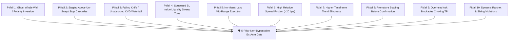

# ⚠️ FORENSIC TRADE AUTOPSY & TOP 10 LETHAL EXECUTION PITFALLS
## Blueberry Markets Autonomous Desk — Institutional Risk & Execution Failure Post-Mortem

> **Document Status**: CANONICAL PRODUCTION RISK SPECIFICATION (MANDATORY STUDY)  
> **Location**: `Data/Manditory/TOP_10_TRADE_EXECUTION_PITFALLS_AND_AUTOPSY.md`  
> **Context**: Post-mortem autopsy of recent losing trade (`SOLUSD.p Ticket #19174858`) and the 10 lethal execution traps that destroy funded evaluation capital.  
> **Inviolable Mission Anchor**: Protect the **4,775.00 USD Hard Floor** and **4,795.00 USD Operating Buffer** while advancing equity toward the **5,500.00 USD Target** by Friday, 23rd October 2026.

---

## 🔬 PART 1: FORENSIC AUTOPSY OF RECENT LOSING TRADE (`SOLUSD.p #19174858`)

```
========================================================================================
TRADE AUTOPSY: SOLUSD.p BUY 0.10 LOT (TICKET #19174858)
========================================================================================
Entry Price:        106.80 USD
Exit Deal:          #17368131 at 2026-10-22 02:27:52 UTC
Exit Price:         105.10 USD (Hit planned Stop Loss)
Nominal PnL:        -$17.00 USD (1.70 pts × 10 SOL = -$17.00 USD; Zero broker slippage)
Account Impact:     Realized Equity dropped from 4,851.83 USD to 4,834.83 USD
Floor Cushion:      Compressed from +76.83 USD to +59.83 USD above 4,775.00 USD Hard Floor
Buffer Cushion:     Compressed from +56.83 USD to +39.83 USD above 4,795.00 USD Buffer
========================================================================================
```

### 🩸 Why Did Ticket #19174858 Fail? (The 5 Fatal Flaws):
1. **The Ghost Wall Illusion (Orderbook Polarity Inversion)**:
   - *The Claim*: Staged assuming a massive "$7.71M institutional whale bid wall" sat at 106.66 USD.
   - *The Forensic Reality*: Deep inspection of Sheet 25 and Hyperdash depth revealed that the $7.71M wall was an **ASK / SELL order ($438K to $7.04M SELL at 106.66–107.00 USD)**, NOT a resting bid! We staged a long order directly beneath an institutional supply ceiling, mistaking resistance for support.
2. **Staged Directly Above an Un-Swept Retail Sell-Stop Cascade**:
   - Directly beneath the 106.80 entry sat a dense $1.43M retail stop cluster at [105.00–106.50 USD]. In auction microstructure, resting stop clusters act as high-probability gravitational magnets. Staging a buy limit above an un-swept stop cluster guarantees getting run over as the cascade triggers.
3. **Catching a Falling Knife Against Accelerating Negative CVD (Zero Absorption)**:
   - At the instant of entry, SOL's 15m CVD delta was negative (-$18.3K to -$763K), session CVD was down -$3.85M, and `zc_div <= 0`. Taker sellers were aggressively executing at market with zero absorption prints from passive buyers.
4. **Stop Loss Squeezed Directly Inside the Sweep Zone (< 0.40 ATR Buffer)**:
   - The SL was placed at 105.10 USD, directly inside the high-density liquidation band ([104.0, 105.0] stop cluster). The true institutional whale bunker was actually down at 103.75 USD ($1.83M to $6.83M). Placing a tight stop at 105.10 left the position completely exposed to standard cascade expansion.
5. **Overhead Liquidity Blockade Choking Take Profit**:
   - The TP was set at 107.95 USD, but an impenetrable $7.047M resting ask wall sat at 106.99 USD. The trade had an effective ceiling at 106.99 (+0.19 pts), yielding an actual realizable R:R of less than 0.15R against 1.70 pts of downside risk!

---

## 💀 PART 2: THE TOP 10 LETHAL TRADE EXECUTION PITFALLS

Here are the 10 lethal traps that cause losing trades on the desk and must be systematically checked and blocked ex-ante before any limit order is ever punched into MetaTrader 5:



---

### 🔴 PITFALL 1: GHOST WHALE WALL / ORDERBOOK POLARITY INVERSION
- **Anatomy**: Mistaking a massive resting ASK/OFFER (sell wall) for a BID (buy wall), or vice versa.
- **The SOL Trap Example**: Thinking $7.71M was a bid at 106.66 when it was actually a sell wall capping the market.
- **Microstructure Mechanism**: Staging a long beneath a sell wall means you are buying into institutional supply. When price bounces into the sell wall, it is aggressively rejected, trapping the long position.
- **Ex-Ante Prevention Rule**:
  * ALWAYS inspect `is_bid` vs `is_ask` in Sheet 18 (`10_Whale_Orders`) and Sheet 25 (`14_Hyperdash_L2_Depth`).
  * For Longs: The whale wall MUST be verified as `is_bid == True` with price `<= entry_price`.
  * For Shorts: The whale wall MUST be verified as `is_ask == True` with price `>= entry_price`.

---

### 🔴 PITFALL 2: STAGING ENTRIES DIRECTLY ABOVE UN-SWEPT RETAIL STOP CASCADES
- **Anatomy**: Placing a limit buy order above an un-swept retail sell-stop cluster, or a limit sell above an un-swept buy-stop cluster.
- **The BTC / SOL Example**: Staging a BTC long at 82,800 USD while an un-swept $14.72M retail sell-stop cluster sits at [82,100, 82,200 USD].
- **Microstructure Mechanism**: Stop clusters are mechanical liquidity vacuums. Market makers and aggressive algorithms intentionally drive price into stop clusters to trigger market orders and capture liquidity. If your limit entry sits above the cluster, the cascade blows straight through your entry and triggers your stop loss before reversing.
- **Ex-Ante Prevention Rule**:
  * Check Sheet 23 (`15_Hyperdash_Stops_Map`) and Sheet 14 (`14_Hyperdash_Liq_Map`).
  * If an un-swept opposing stop cluster exists within 1.5 ATR of current price, **ENTRIES ARE FORBIDDEN**.
  * The entry MUST be staged:
    1. Either strictly AFTER the stop cluster has been 100% flushed and swept, OR
    2. Deep inside/behind the resting institutional whale bunker that terminates the cascade.

---

### 🔴 PITFALL 3: CATCHING FALLING KNIVES AGAINST ACCELERATING NEGATIVE CVD (ZERO ABSORPTION)
- **Anatomy**: Entering a long position while taker market orders are actively dumping with accelerating momentum.
- **The Gold / BTC Example**: Buying Gold at 4,110 USD when tick CVD is -57.0 delta and price is waterfalling; price promptly flushed 15.7 points lower to 4,086 USD.
- **Microstructure Mechanism**: Negative CVD means market participants are paying the spread to sell aggressively at market. Without passive limit buyers absorbing this flow (`Delta Spot > 0` and `Delta Futures < 0`), prices drop like a stone.
- **Ex-Ante Prevention Rule**:
  * P2 Confluence Requirement: Never stage a long while 15m CVD delta is negative and accelerating.
  * Require `zc_div > 0.8` OR a clear deceleration inflection where selling volume dries up and positive delta prints appear on the tape.

---

### 🔴 PITFALL 4: SQUEEZING STOP LOSS INSIDE THE LIQUIDITY SWEEP ZONE (< 0.40–0.50 ATR BUFFER)
- **Anatomy**: Placing the Stop Loss too close to market or inside the expected liquidation volatility band just to achieve an artificial sub-10 USD risk figure.
- **The SOL Example**: Placing SL at 105.10 USD (inside the [104.0, 105.0] stop cluster), leaving only 0.25 ATR buffer.
- **Microstructure Mechanism**: During a sweep event, price wicks through stop clusters by an average of 0.35 to 0.50 ATR beyond the cluster edge before resting whale limit orders halt the move. Stops placed inside this wick zone are guaranteed to get hunted.
- **Ex-Ante Prevention Rule**:
  * Stop Loss MUST be placed at least **0.40 to 0.50 ATR safely behind the outer boundary** (`min_price` for longs) of the liquidation band and behind the resting institutional whale bunker.
  * If placing a safe SL causes dollar risk to exceed 25.00 USD, **DO NOT SQUEEZE THE STOP**; instead, **REDUCE LOT SIZE** (e.g. from 0.02 lot to 0.01 lot) or **STAND ASIDE**.

---

### 🔴 PITFALL 5: TRADING IN "NO-MAN'S-LAND" MID-RANGE (0.5 SD TO 1.5 SD WITHOUT CONFLUENCE)
- **Anatomy**: Initiating trades in the choppy, indecisive middle of the trading range where neither mean reversion nor trend expansion has statistical edge.
- **The SOL Example**: Entering at VWAP Z = -0.77 SD.
- **Microstructure Mechanism**: The middle of the range (between -1.5 SD and +1.5 SD) is dominated by retail churn, algorithmic noise, and unpredictable chop. Edge only exists at structural extremes (|Z| >= 2.0 to 3.5 SD for Model 1) or at verified structural pullbacks (EMA20/50/VWAP shelves in confirmed trends for Model 2).
- **Ex-Ante Prevention Rule**:
  * Model 1 Mean Reversion: Price MUST be at extreme stretch: `|VWAP Z-score| >= 2.0 SD` with RSI oversold (< 30 for longs, > 70 for shorts).
  * Model 2 Trend Pullback: Admissible only when regime is confirmed `TREND_UP` or `TREND_DOWN`, entering on a clean pullback to EMA20/EMA50/VWAP backed by resting whale walls.
  * If regime is `UNDEFINED` or price is in mid-range: **STAND ASIDE UNCONDITIONALLY**.

---

### 🔴 PITFALL 6: HIGH RELATIVE SPREAD FRICTION (> 20 BPS DRAG)
- **Anatomy**: Trading illiquid altcoins or exotic assets with wide spreads that immediately handicap expected value.
- **The Spread Comparison**:
  * Gold (`XAUUSD.pi`): Spread = 0.08 pts = **0.20 bps** (Ultra-tight, minimal friction)
  * Bitcoin (`BTCUSD.pi`): Spread = 16.0 pts = **1.93 bps** (Extremely tight)
  * Nasdaq (`NAS100.p`): Spread = 1.22 pts = **0.41 bps** (Institutional quality)
  * Solana (`SOLUSD.p`): Spread = 0.23 pts = **21.86 bps** (>100x higher friction than Gold!)
  * Dogecoin (`DOGEUSD.p`): Spread = **262 bps** (Instant fatal loss on entry!)
- **Microstructure Mechanism**: A 21.8 bps spread means you start every trade at a significant deficit. To reach a 2.0R target, the underlying asset must move substantially further to cover both entry and exit frictions.
- **Ex-Ante Prevention Rule**:
  * Hard Spread Gates strictly enforced from live MT5 tick data:
    - Crypto Perpetuals: Spread MUST be `<= 25.0 bps` (Only BTC, ETH, BNB, BCH, and top SOL qualify).
    - TradFi CFDs (Gold, Indices, FX): Spread MUST be `<= 5.0 bps` (Gold at 0.20 bps, NAS100 at 0.41 bps, EURUSD at 0.09 bps).
  * All assets exceeding thresholds are automatically disqualified.

---

### 🔴 PITFALL 7: HIGHER TIMEFRAME (HTF) TREND BLINDNESS
- **Anatomy**: Taking counter-trend dip buys when the 1H and 4H charts are in full downward expansion.
- **The Alignment Trap**: Price < EMA20 < EMA50 < EMA200 on 1H/4H, yet staging longs on minor 5m bounces.
- **Microstructure Mechanism**: In a macro downtrend, every minor bounce is an opportunity for institutions to offload inventory and initiate new short positions. Counter-trend longs fight against institutional orderflow.
- **Ex-Ante Prevention Rule**:
  * Check Sheet 19 (`11_Technical`) across multiple timeframes.
  * If HTF is strongly bearish (`Price < EMA20 < EMA50`), Model 1 dip-buying longs are permitted ONLY at major historical multi-day whale bunker fortresses (e.g. Gold at 4,080.00 USD, BTC at 82,190 USD) with confirmed tape exhaustion. Otherwise, priority shifts to staging Model 2 Trend Pullback Shorts.

---

### 🔴 PITFALL 8: PREMATURE STAGING BEFORE EMPIRICAL CONFIRMATION (FRONT-RUNNING GATES)
- **Anatomy**: Staging limit orders into the market before all pre-conditions are verified, hoping that the conditions will be met by the time price gets there.
- **The Trap**: Staging a buy limit before the stop sweep completes or before CVD decelerates.
- **Microstructure Mechanism**: Limit orders placed prematurely sit in the broker's order book. If market conditions deteriorate (e.g. the supporting whale wall cancels, or a high-impact news event breaks), the resting order gets filled in a toxic environment before the desk can cancel it.
- **Ex-Ante Prevention Rule**:
  * Maintain the concrete Potential Candidate Radar with checkable pre-conditions `[ ]`.
  * The order MUST remain in the RADAR state until ALL pre-conditions are checked `[x]`.
  * Only when every pre-condition is confirmed true on live data is the order punched into MT5.

---

### 🔴 PITFALL 9: OVERHEAD LIQUIDITY BLOCKADES CHOKING TAKE PROFIT (< 1.5R REALIZABLE R:R)
- **Anatomy**: Setting a theoretical take-profit target that sits directly behind a massive resting institutional ask/sell wall.
- **The SOL Example**: Setting TP at 107.95 USD while a $7.047M ask wall sits at 106.99 USD.
- **Microstructure Mechanism**: When price rallies, it encounters the $7.047M sell wall. Unless buyers possess overwhelming market-buy volume to chew through 7 million USD of resting sell orders, price will halt and reverse at 106.99, never reaching 107.95.
- **Ex-Ante Prevention Rule**:
  * Check Sheet 25 (`14_Hyperdash_L2_Depth`) for resting Ask Walls (for longs) and Bid Walls (for shorts) between Entry and TP.
  * Take Profit MUST be set to front-run any major resting liquidity wall (set TP 5 to 10 bps IN FRONT OF the wall, not behind it).
  * If front-running the wall reduces R:R below 1.5R, **THE TRADE IS DISQUALIFIED**.

---

### 🔴 PITFALL 10: DYNAMIC RATCHET & SIZING VIOLATIONS (CHOKING PROFITS & OVER-LEVERAGING)
- **Anatomy**: Moving stops to breakeven prematurely into normal retest noise (< +0.75R), or sizing tickets too large so that a single stopout damages the operating buffer (+39.83 USD).
- **The Mathematical Rule**:
  * Current Equity: 4,834.83 USD | Hard Floor: 4,775.00 USD | Buffer: 4,795.00 USD.
  * Cushion to Floor: +59.83 USD | Cushion to Buffer: +39.83 USD.
  * Worst-Case Stressed Loss: `Nominal_Risk * 1.25 + 2.00 USD`.
- **Ex-Ante Prevention Rule**:
  * Single Slot Maximum: **15.00 USD nominal risk** (Stressed loss: 20.75 USD, leaves +19.08 USD buffer cushion).
  * Dual Concurrent Slots: **10.00 USD nominal risk each** (Combined stressed loss: 29.00 USD, leaves +10.83 USD buffer cushion).
  * High-Conviction Solo Max: **25.00 USD nominal risk** (Leaves +6.58 USD buffer cushion and +26.58 USD hard floor cushion).
  * Ratchet Discipline (Frozen R0 Anchor):
    - +0.75R to +0.80R: Move SL to Entry + 0.10*R0 (Early-BE: risk drops to 0 USD).
    - +1.25R: Move SL to Entry + 0.15*R0 (Phase 0).
    - +1.65R: Move SL to Entry + 0.80*R0 (Phase 1 Profit Lock).
    - Never move stop to BE before +0.75R expansion to prevent getting wicked out by spread noise.

---

### 🔴 PITFALL 11: MARKETABLE-LIMIT MASQUERADE (SPREAD CROSSING IN DISGUISE)
- **Anatomy**: Placing a "limit" order at or through the current market price, turning a passive limit into an aggressive market order that pays the full spread and taker fees.
- **Microstructure Gate**: At transmission, MT5 order validation MUST enforce:
  * `BUY_LIMIT <= live_bid` (Strictly passive order on the bid side).
  * `SELL_LIMIT >= live_ask` (Strictly passive order on the ask side).
  * Quote Age: `<= 2.0 seconds`. Any quote older than 2s freezes order transmission.
  * Instant Rejection: Reject any order whose limit price crosses the spread.

---

### 🔴 PITFALL 12: QUEUE-POSITION ILLUSION & STALE FILL TRAPS
- **Anatomy**: Assuming that placing a limit order at a whale wall guarantees execution when price touches that level.
- **Microstructure Gate**:
  * In deep orderbooks, millions of dollars of limit orders may sit in front of yours at the exact same tick.
  * If price touches the level but does not trade through the queue, your order is either left unfilled (missed trade) or only partially filled just as the wall is breaking (adverse selection).
  * Must evaluate queue-ahead notional and require setup expiry: if the order does not fill within 12 bars (3 hours), cancel and reassess.

---

### 🔴 PITFALL 13: PARTIAL-FILL ADVERSE SELECTION
- **Anatomy**: An order gets 20% filled right before a catastrophic liquidity cascade breaks through the support level.
- **Microstructure Gate**:
  * Immediately recompute risk upon every fill event.
  * Cancel the residual pending volume if the supporting whale wall disappears or if fill remains `< 80%` and 5-second adverse markout exceeds `0.10 ATR`. Never let an unbacked residual order fill during a violent breakdown.

---

### 🔴 PITFALL 14: DYNAMIC SPREAD & VOLATILITY LATENCY SPIKES
- **Anatomy**: Entering during candle closes, session transitions, or micro-news shocks when spreads widen by 3x–10x.
- **Microstructure Gate**:
  * Require instantaneous spread AND 60-second p95 spread below the canonical gate (<= 25 bps for Crypto, <= 5 bps for TradFi).
  * Enforce dynamic volatility ratio: `spread_now <= 1.5 * five_minute_median_spread`.
  * Total round-trip execution cost (spread + fees) must be `< 10% of cash R0`. Freeze trading around session opens, 15m/1h candle closes, and rollover windows.

---

### 🔴 PITFALL 15: SPOOFING, ICEBERGS & BASIS TRANSLATION ERRORS
- **Anatomy**: Relying on static snapshot persistence of a whale wall without validating presence fraction or exchange basis differences.
- **Microstructure Gate**:
  * Static persistence alone is insufficient. A valid wall requires:
    1. Wall age: `<= 5 seconds` from live L2 feed.
    2. Persist duration: `>= 180 seconds`.
    3. Presence fraction: `>= 0.85` (present in at least 85% of orderbook snapshots over the 180s window).
    4. Sample count: `>= 3 consecutive samples`.
    5. Cancellation status: `canceled == False`.
    6. Basis translation: MT5 broker CFD price must be explicitly mapped to Binance/Hyperliquid spot/perp price using live basis spread.

---

### 🔴 PITFALL 16: PORTFOLIO CORRELATION & GAP CVaR NON-GUARANTEE
- **Anatomy**: Staging simultaneous positions across BTC, ETH, and SOL, believing they are independent trades, only to suffer a correlated 3-asset flash loss.
- **Microstructure Gate**:
  * Assets within the same risk cluster (BTC, ETH, SOL in Crypto; NAS100, SP500, DJ30 in Indices) are treated as ONE single correlated book.
  * Stress test must apply: `JointStress = sum(max(1.25 * Risk_i + Fees, GapCVaR_99.99)) + CorrelationAddon`.
  * At current equity ($4,834.83) and operating buffer ($4,795.00), the available buffer cushion is **$39.83 USD**.
  * **Absolute Hard Limit**: Under current cushion, **MAXIMUM 1 LIVE POSITION AT A TIME** (Stressed risk = $20.75 for a $15 trade; two positions would stress to $41.50, violating the $39.83 buffer). Dual slots are unlocked ONLY when equity exceeds $4,845.00 USD.

---

### 🔴 PITFALL 17: WORKBOOK SCHEMA RACE & MISSING FIELD FABRICATION
- **Anatomy**: Strategies making decisions based on fabricated or non-existent columns in Excel sheets (e.g. attempting to calculate `zc_div` when spot and futures CVD are not split, or looking for VAH/VAL in sheets that don't output them).
- **Microstructure Gate**:
  * Strict Data-Contract Gate: Every referenced column MUST physically exist in `DataBase_Trading.xlsx`.
  * If a sheet lacks price, side, or distance metrics (e.g. `7_Liq_Heapmap` or unsplit `18_CVD`), that sheet CANNOT be used to position SL/TP or gate entries until the schema is extended.
  * Workbook atomic commit: Data must be written to `.tmp.xlsx`, fsynced, CRC-verified, and atomically replaced to prevent zip corruption.

---

## 📋 SUMMARY: THE 17-POINT EX-ANTE PRE-PUNCH CHECKLIST

Before ANY limit order is staged or punched into MetaTrader 5, the coordinator and subagents MUST physically verify that all 17 institutional pitfalls are absent:

| # | Pitfall Check | Required Quantitative Gate | Verified? |
|---|---|---|---|
| 1 | **Whale Wall Polarity** | Confirmed genuine resting BID for longs (`is_bid == True`), ASK for shorts | [ ] |
| 2 | **Stop Cascade Clearance** | Zero un-swept opposing retail stop clusters between market and entry | [ ] |
| 3 | **CVD Absorption** | Tape confirms absorption / deceleration; selling waterfall halted | [ ] |
| 4 | **Safe SL Buffer** | SL placed `>= 0.50 ATR` plus half-spread beyond outer sweep boundary | [ ] |
| 5 | **Auction Location** | Model 1 extreme (|Z| >= 2.0 SD) OR Model 2 HTF pullback (No mid-range noise) | [ ] |
| 6 | **Spread Gate** | Spread <= 25 bps (Crypto) / <= 5 bps (TradFi); round-trip cost < 10% R0 | [ ] |
| 7 | **HTF Trend Alignment** | Trade respects HTF market structure or enters at macro multi-day bunker | [ ] |
| 8 | **Pre-Condition Trigger** | All candidate radar pre-conditions checked `[x]` on live empirical data | [ ] |
| 9 | **Clear TP Runway** | TP front-runs overhead liquidity walls; realizable R:R >= 2.0R (default 2.5R) | [ ] |
| 10 | **Stressed Solvency** | Stressed loss <= $39.83 buffer cushion; **MAX 1 LIVE POSITION** at current equity | [ ] |
| 11 | **Non-Marketable Limit** | `BUY_LIMIT <= live_bid`, `SELL_LIMIT >= live_ask`; quote age <= 2.0s | [ ] |
| 12 | **Queue & Expiry Gate** | Queue-ahead evaluated; order expires after 12 bars (3h) if unfilled | [ ] |
| 13 | **Partial-Fill Sentry** | Immediate risk recomputation; cancel residual if fill < 80% & adverse markout > 0.10 ATR | [ ] |
| 14 | **Dynamic Spread Ratio** | `spread_now <= 1.5 * median_5m`; zero trading during rollover/expansion | [ ] |
| 15 | **Wall Presence Fraction** | Presence fraction >= 0.85 over 180s, sample count >= 3, `canceled == False` | [ ] |
| 16 | **Cluster Correlation** | Correlated assets stressed jointly; zero simultaneous same-cluster slots | [ ] |
| 17 | **Schema Data Contract** | All referenced columns exist in Excel; 0 formula errors; atomic commit verified | [ ] |
