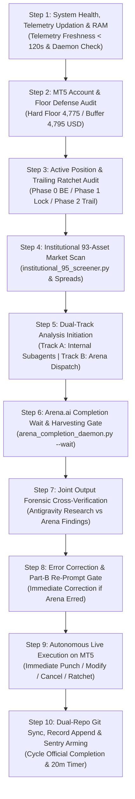

# 📋 AUTONOMOUS WAKE-UP CHECKLIST & JOINT-COMPLETION LIFECYCLE

> **Canonical Production Checklist**: Non-bypassable 10-Step Autonomous Desk Wake-Up Sequence.  
> **Target Environment**: MetaTrader 5 (Account #5064568) | Antigravity Autonomous Decision Desk  
> **Mandatory Foundation**: `STANDARDIZED_TRADING_DECISION_CHAIN.md` (10-Step SOP) + 8 Multi-Domain Skill Ensembles.  
> **Strict Operational Invariant**: A cycle is NEVER completed upon prompt dispatch. A cycle is ONLY complete once BOTH Antigravity and Arena.ai have completed analysis, outputs are harvested and cross-verified, and all necessary live MT5 actions (order punch, ratchet adjustment, order cancellation) are executed.

---

## 🔄 THE 10-STEP JOINT-COMPLETION WAKE-UP SPRINT

Every autonomous wake-up cycle (whether triggered by the 20-minute sentry timer, a candle close, or a reactive daemon wakeup) must sequentially execute the following 10 steps without skipping:

---

### Step 1: System Health, Telemetry Data Updation Check & RAM Optimization
- [ ] **Arkham CDP Health & On-Chain Stream Refresh**:
  - Connect to Chrome CDP on port `9222`, locate top-level tab `Arkham | The Source of Truth On-Chain` (`arkm.com`), and send `Page.reload`.
  - Confirm page reloads cleanly and title is verified. Guarantees latest on-chain whale flow (>= $50k) is live and streaming into telemetry.
- [ ] **Telemetry Data Freshness & Updation Verification**:
  - Inspect `docs/telemetry/live_snapshot_latest.json` timestamp (`as_of_epoch` and `as_of_utc`).
  - Verify telemetry was generated within the last 120 seconds (maximum age <= 120s).
  - Verify `autonomous_telemetry_git_daemon.py` is actively committing and pushing every 60s to `origin/main` and `origin/arena/...`.
  - If stale (> 120s) or daemon dead: immediately execute `python Terminal/Data_Factory/generate_telemetry_snapshot.py` to produce a fresh snapshot, and relaunch `autonomous_telemetry_git_daemon.py`.
- [ ] Run `powershell -ExecutionPolicy Bypass -File .agents/scripts/free_ram.ps1` to clear standby memory, prune zombie processes, and optimize CPU latency.
- [ ] Verify that all 6 persistent background tasks are running in Antigravity:
  1. AST Watcher (`run_graphify_watcher.py`)
  2. Telemetry Git Sync Daemon (`autonomous_telemetry_git_daemon.py`, pushes every 60s)
  3. Web2API Council Daemon (`gemini_web2api.py` on port 8081)
  4. Autonomous Ratchet Daemon (`autonomous_ratchet_daemon.py`)
  5. Heretic Engine Daemon (`heretic_daemon.py` on port 8083)
  6. Arena Completion Daemon (`arena_completion_daemon.py --daemon`)

---

### Step 2: MT5 Account, Capital Floor Defense & Forensic Autopsy Audit
- [ ] Query live MT5 account state directly via `mt5.account_info()`:
  - Balance, Equity, Margin, Free Margin.
- [ ] Calculate live cushion above the **4,775.00 USD Hard Floor** and **4,795.00 USD Operating Buffer**.
- [ ] Verify joint-fill capacity: max 4 concurrent filled positions across orthogonal asset clusters.
- [ ] **Persistent Memory System Audit (`/memory-system`)**:
  - Review `.agents/memory/MEMORY.md` index, `.agents/memory/feedback-history.md` (all 10 past operator issues & permanent resolutions), and `.agents/memory/operator-directives.md`.
  - Zero context amnesia: Maintain 100% adherence to all past operator corrections across turns.
- [ ] **Mandatory Forensic Autopsy & Anti-Regression Audit**:
  - Review [`LOSING_TRADES_DEEP_FORENSIC_AUTOPSY.md`](file:///c:/Users/SIGMA/Documents/Trading_2/docs/specs/LOSING_TRADES_DEEP_FORENSIC_AUTOPSY.md) (Brain Artifact: `C:\Users\SIGMA\.gemini\antigravity\brain\b00c810a-61bb-46bf-a147-4c8859c64058\LOSING_TRADES_DEEP_FORENSIC_AUTOPSY.md`).
  - **Enforce Invariant A (Never Choke Stops & Expanded Risk Rights)**: All candidate stops must anchor strictly behind verified resting whale walls (persist >= 180s) + 0.35–0.50 ATR structural buffer. Per operator authorization, stop loss dollar risk is expanded to $15.00–$25.00 USD to safely accommodate wide institutional whale bunkers. Never choke stops.
  - **Enforce Invariant B (HTF Trend Hierarchy Gate)**: If Price < EMA20 < EMA50 on 1H/4H (Bear Trend), Model 1 Long dip-buying is **strictly FORBIDDEN**. Only stage Model 2 Trend Pullback Shorts.
  - **Enforce Invariant C (Early BE Protection)**: Arm Phase Early-BE at +0.75R0 to +0.80R0 upon reclaiming POC/VWAP to protect the 76.9% positive MFE from session reversals.

---

### Step 3: Active Position & Trailing Ratchet Audit
- [ ] Query `mt5.positions_get()` and `mt5.orders_get()`.
- [ ] For each open position, enforce the **Frozen Initial R0 Piecewise Ratchet**:
  - **Phase Early-BE (Adaptive Microstructure Breakeven)**: When price reaches `Entry + 0.75 * R0` to `0.80 * R0` and reclaims POC/VWAP, move SL to `Entry + 0.10 * R0` (zero-risk lock).
  - **Phase 0 (Break-Even Lock)**: When price reaches `Entry + 1.25 * R0`, move SL to `Entry + 0.15 * R0` (cut risk to 0).
  - **Phase 1 (Profit Lock)**: When price reaches `Entry + 1.65 * R0`, lock in `Entry + 0.80 * R0` of profit.
  - **Phase 2 (Running Trail)**: When price exceeds `+2.00 * R0`, trail behind peak by `0.75 * R0` or recent swing shelf.
- [ ] Audit pending limit orders: cancel or modify any order whose underlying whale wall has pulled or expired (> 30 minutes).

---

### Step 4: Institutional 93-Asset Market Scan & Mandatory Limit Order Candidate Identification
- [ ] Execute `python Terminal/institutional_95_screener.py` to scan all 93 tradeable MT5 symbols in < 1 second.
- [ ] Filter by strict spread friction: `<= 5.0 bps` for TradFi CFDs (Forex, Indices, Commodities), `<= 25.0 bps` for Crypto.
- [ ] Identify top Model 1 (Extreme Mean Reversion, |Z| >= 2.0 to 3.5 SD in `MEAN_REVERT`) and Model 2 (Trend Pullback, |Z| 0.2 to 1.8 SD in `TREND_UP` or `TREND_DOWN`) candidates.
- [ ] **MANDATORY CANDIDATE IDENTIFICATION FOR PASSIVE LIMIT ORDERS**:
  - In EVERY wake-up cycle, actively screen the 24 mutual assets and 93-asset screener to discover, qualify, and formulate explicit passive limit order proposals (both Model 1 Extreme Mean Reversion and Model 2 Trend Pullbacks).
  - Verify that each proposed limit order satisfies:
    1. Clean Entry staged inside a verified structural shelf (EMA 20/50, VAH/VAL/POC) accounting for half-spread.
    2. SL safely anchored behind a genuine resting whale bunker (>= 500k USD notional, >= 180s persistence) or held auction level with >= 0.35–0.50 ATR clearance outside opposing sweep bands.
    3. TP front-running opposing liquidation cascade magnets by 5–10 bps.
    4. Net payoff >= 2.0R within the operator-approved expanded risk envelope ($15.00–$25.00 USD).
    5. Preserves the 4,775.00 USD hard floor and 4,795.00 USD buffer under stressed post-loss simulation.

---

### Step 5: Dual-Track Analysis Initiation (Internal Research + Arena Dispatch)
- [ ] **Track A (MANDATORY Subagent Dispatch & SOP Traversal)**:
  - Activate the 8 core skill ensembles: `/remember`, `/graphify`, `/data-engineer`, `/dataform-bigquery`, `/data-analyst`, `/data-engineering-data-driven-feature`, `/brainstorm`, `/verify`.
  - **MANDATORY**: Dispatch all 3 internal specialists (`Orderflow Analyst`, `Position Manager`, `Macro Risk Analyst`) via `invoke_subagent` on EVERY wake-up turn without exception.
  - **Mandatory Line-by-Line Ingestion**: Explicitly instruct all 3 subagents to read `docs/telemetry/live_snapshot_latest.json` line-by-line to maintain running account/order narrative continuity, and read `Data/forex_factory_summary.json` & `Data/forex_factory_live.json` line-by-line to extract Central Bank rate differentials, upcoming speeches, breaking geopolitical/energy headlines, and generate fresh macro trade ideas.
  - **MANDATORY PASSIVE LIMIT ORDER HUNTING**: Mandate each subagent to actively identify, evaluate, and qualify new passive limit order candidates across orthogonal clusters (Cryptos, Metals, Energy, Forex, Indices) whenever open capacity exists (max 4 tickets total).
  - Instruct agents to evaluate market structure, orderbook depth, CVD flow, expanded risk envelope ($15.00 to $25.00 USD), and macro environment.
- [ ] **Track B (MANDATORY Council Prompt Construction & Arena.ai Injection)**:
  - **MANDATORY**: On EVERY wake-up turn, generate and inject the comprehensive prompt into Arena.ai Tab 1 via `python Terminal/dispatch_comprehensive_wake_up_prompt.py --arena-only`.
  - Embed direct raw links to `STANDARDIZED_TRADING_DECISION_CHAIN.md`, `LOSING_TRADES_DEEP_FORENSIC_AUTOPSY.md`, fresh live snapshot data, Forex Factory macro intelligence, and live MT5 positions/orders.
  - **Mandatory Candidate Identification Mandate**: Explicitly mandate Arena.ai to actively search, screen, and propose concrete passive limit order setups across the 24 mutual assets, checking capacity headroom.
  - Enforce the 10-step SOP traversal, line-by-line ingestion of telemetry and Forex Factory, and tournament bracket evaluation in Arena.

---

### Step 6: Arena.ai Completion Wait & Harvesting Gate (CYCLE IN-PROGRESS)
> ⚠️ **CRITICAL OPERATOR MANDATE**: The cycle is NOT finished when prompt dispatch completes! Arena.ai is actively working in the background. Antigravity must wait for Arena.ai to finish before closing the loop.
- [ ] Launch `python Terminal/arena_completion_daemon.py --wait` (or monitor CDP status) to await completion of Arena.ai generation.
- [ ] Verify that `docs/trade_plans/ARENA_LATEST_RAW.md` has been successfully harvested and contains a complete, non-truncated response.
- [ ] Confirm both Antigravity's internal subagents AND Arena.ai have completed their respective analysis phases.

---

### Step 7: Joint Output Forensic Cross-Verification & Dialectic Synthesis
- [ ] Deep side-by-side comparison of **Antigravity Internal Subagent Findings** vs **Arena.ai Recommendations**:
  - Compare identified trade candidates across both tracks.
  - Audit proposed Entry levels against live MT5 spreads and resting orderbook depth.
  - Audit SL Liquidity Bunkers: ensure SL sits safely outside `[min_price, max_price]` with `>= 0.35–0.50 ATR` buffer.
  - Audit TP Liquidity Magnets: ensure TP front-runs opposing liquidation/stop clusters by `5–10 bps`.
  - Audit exact cash risk via `mt5.order_calc_profit` (strictly $10.00 to $14.50 USD).

---

### Step 8: Error Correction & Part-B Re-Prompt Gate
- [ ] Check Arena.ai's reasoning for mathematical or boundary errors:
  - Did Arena demand phantom on-chain walls for TradFi?
  - Did Arena place SL inside a liquidation band?
  - Did Arena propose crossing the spread?
- [ ] If ANY error is detected, immediately dispatch a corrective prompt (`python Terminal/dispatch_comprehensive_wake_up_prompt.py --reprompt-file ...`) and wait via `arena_completion_daemon.py --wait`.
- [ ] If no error is detected, proceed directly to execution.

---

### Step 9: Autonomous Live Execution on MT5 (Immediate Action)
- [ ] **Ratified Trade Execution**: If a candidate passes both Antigravity and Arena.ai verification and meets the 5-pillar confluence:
  - IMMEDIATELY punch the passive limit order into MetaTrader 5 without asking.
  - Zero hesitation, zero latency.
- [ ] **Active Position Actions**: Execute any trailing ratchet adjustments or profit locks on MT5.
- [ ] **Pending Order Actions**: Amend or delete any pending limit orders whose thesis degraded.

---

### Step 10: Dual-Repo Git Sync, Record Append & Sentry Arming (CYCLE OFFICIAL COMPLETION)
> 🏁 **CYCLE COMPLETION POINT**: Only after Step 9 live actions are executed is the cycle officially marked complete.
- [ ] Synchronize git commits across `main` and `arena` branches via `autonomous_telemetry_git_daemon.py`.
- [ ] Update `.agents/rules/ACTIVE_CONTEXT.md` with latest balances, cushion, open tickets, and actions taken.
- [ ] Append complete turn record (including both Antigravity research and Arena analysis) to `.agents/memory/session_chat_history.md`.
- [ ] Re-arm the 20-minute cycle sentry timer via `schedule` with mandatory prompt template:
  `Prompt: "MANDATORY WAKE-UP AUDIT: Strictly follow and enforce @[c:\Users\SIGMA\Documents\Trading_2\docs\Mandatory_Rules\STANDARDIZED_TRADING_DECISION_CHAIN.md], @[c:\Users\SIGMA\Documents\Trading_2\docs\Mandatory_Rules\AUTONOMOUS_WAKEUP_CHECKLIST.md] & @[c:\Users\SIGMA\.gemini\antigravity\brain\b00c810a-61bb-46bf-a147-4c8859c64058\LOSING_TRADES_DEEP_FORENSIC_AUTOPSY.md] - execute all 10 steps sequentially: Step 1 System Health, Arkham Tab CDP Reload & Telemetry Freshness Check, Step 2 MT5 Account, Floor Defense, Forensic Autopsy & Expanded Risk ($15-$25 USD) Audit, Step 3 Position & Ratchet Audit, Step 4 93-Asset Scan & Mandatory Passive Limit Candidate Identification, Step 5 MANDATORY DUAL-TRACK DISPATCH (MANDATORY: Dispatch all 3 subagents: Orderflow Analyst, Position Manager, Macro Risk Analyst with mandate to identify potential limit order candidates + MANDATORY: Generate & Inject Prompt into Arena.ai Tab 1 following STANDARDIZED_TRADING_DECISION_CHAIN.md), Step 6 Arena Completion Wait & Harvest, Step 7 Joint Cross-Verification, Step 8 Error Correction, Step 9 Autonomous MT5 Live Punch/Ratchet, Step 10 Telemetry Git Sync & Sentry Arming."`
- [ ] Enter silent standby awaiting next cycle.
