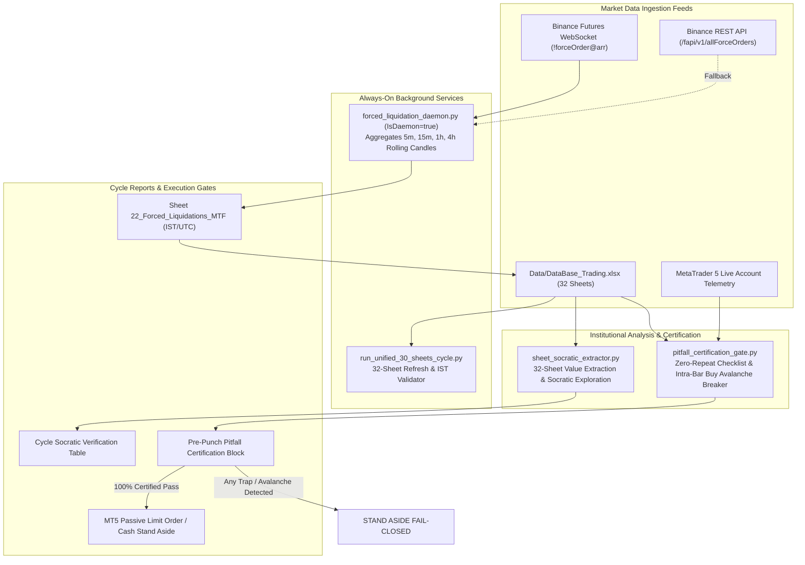

# Market Sheet Audit, Zero-Repeat Pitfall Certification, & Multi-Timeframe Forced Liquidation Tracker Implementation Plan

> **For Antigravity:** REQUIRED WORKFLOW: Use `.agent/workflows/execute-plan.md` to execute this plan in single-flow mode.

**Goal:** Implement an automated, institutional-grade 32-sheet Excel verification and Socratic extraction table engine, an ex-ante zero-repeat pitfall certification gate with an intra-bar buying avalanche circuit breaker, and an always-on multi-timeframe (5m, 15m, 1h, 4h) forced liquidation tracking background daemon with clear IST timestamps dumping to Excel Sheet `22_Forced_Liquidations_MTF`.

**Architecture:** 
1. **Socratic Sheet Extractor**: A high-speed openpyxl reader extracting key metrics across all 32 sheets in `Data/DataBase_Trading.xlsx`, interpreting risk implications and formulating actionable Socratic inquiries for every cycle.
2. **Zero-Repeat Pitfall & Intra-Bar Avalanche Gate**: Deterministic pre-flight audit certifying `FABLE5_CHECKLIST.md` (Parts 1-14), historical autopsies (Ticket #19274977 buying avalanche of +59.45M USD, Ticket #19244087 sub-ATR SL inside value, Ticket #19174858 polarity inversion), and `ACTIVE_CONTEXT.md` triple floor defense before order staging.
3. **Multi-Timeframe Forced Liquidation Daemon**: Persistent background service (`Terminal/Data_Factory/forced_liquidation_daemon.py`, `IsDaemon=true`) subscribing to Binance Futures `!forceOrder@arr` WebSocket with REST fallback, aggregating rolling 5m, 15m, 1h, and 4h candles for all 18 institutional assets, and writing to Sheet `22_Forced_Liquidations_MTF` with dual IST/UTC timestamps, integrated into `run_unified_30_sheets_cycle.py` and `excel_sheet_checklist_auditor.py`.

**Tech Stack:** Python 3.11+, `openpyxl`, `websockets`, `asyncio`, `urllib`, `pytest`, `MetaTrader5`.

---

## Component Architecture & System Design



---

## Detailed Task Breakdown

### Task 1: Multi-Timeframe Forced Liquidation Ingestion Daemon
**Files:**
- Create: `Terminal/Data_Factory/forced_liquidation_daemon.py`
- Test: `Tests/Test_Forced_Liquidation_Daemon.py`

**Step 1: Write the failing test**
```python
# Tests/Test_Forced_Liquidation_Daemon.py
import pytest
import datetime
from Terminal.Data_Factory.forced_liquidation_daemon import (
    ForcedLiquidationAggregator,
    LiquidationEvent,
    IST_TIMEZONE,
    UTC_TIMEZONE
)

def test_liquidation_candle_bucketing_and_metrics():
    aggregator = ForcedLiquidationAggregator(symbols=["BTCUSDT", "ETHUSDT"])
    now_utc = datetime.datetime(2026, 10, 25, 12, 7, 30, tzinfo=UTC_TIMEZONE)
    
    # Ingest Long liquidation (Sell order on tape)
    event_long = LiquidationEvent(
        symbol="BTCUSDT",
        side="SELL",
        price=80500.0,
        quantity=2.0,
        usd_value=161000.0,
        timestamp_utc=now_utc
    )
    aggregator.ingest_event(event_long)
    
    # Ingest Short liquidation (Buy order on tape)
    event_short = LiquidationEvent(
        symbol="BTCUSDT",
        side="BUY",
        price=80550.0,
        quantity=5.0,
        usd_value=402750.0,
        timestamp_utc=now_utc + datetime.timedelta(seconds=15)
    )
    aggregator.ingest_event(event_short)
    
    # Query 5m candle
    candle_5m = aggregator.get_current_candle("BTCUSDT", "5m", now_utc)
    assert candle_5m["long_liq_usd"] == 161000.0
    assert candle_5m["short_liq_usd"] == 402750.0
    assert candle_5m["total_liq_usd"] == 563750.0
    assert candle_5m["net_liq_delta_usd"] == 241750.0  # Short Liq - Long Liq
    assert "IST" in candle_5m["candle_start_ist"]
    assert candle_5m["dominant_side"] == "SHORTS_PURGED"
```

**Step 2: Run test to verify it fails**
Run: `python -m pytest Tests/Test_Forced_Liquidation_Daemon.py -v`
Expected: FAIL with `ModuleNotFoundError: No module named 'Terminal.Data_Factory.forced_liquidation_daemon'`

**Step 3: Write minimal implementation**
Implement `Terminal/Data_Factory/forced_liquidation_daemon.py`:
- Classes: `LiquidationEvent`, `ForcedLiquidationAggregator`, `ForcedLiquidationDaemon`.
- Timeframes supported: `5m`, `15m`, `1h`, `4h`.
- Dual timestamp calculation: `timestamp.astimezone(IST_TIMEZONE)` formatted as `YYYY-MM-DD HH:MM:SS IST`.
- Rolling candle storage per symbol and timeframe (retaining 144 bars for 5m, 192 for 15m, 168 for 1h, 180 for 4h).
- WebSocket connection to `wss://fstream.binance.com/ws/!forceOrder@arr` with exponential backoff reconnection.
- Secondary REST polling thread querying `https://fapi.binance.com/fapi/v1/allForceOrders` every 30 seconds for all 18 institutional assets as a watchdog.
- Periodic checkpoint dumper to `Data/forced_liquidations_buffer.json`.

**Step 4: Run test to verify it passes**
Run: `python -m pytest Tests/Test_Forced_Liquidation_Daemon.py -v`
Expected: PASS

**Step 5: Commit**
```bash
git add Tests/Test_Forced_Liquidation_Daemon.py Terminal/Data_Factory/forced_liquidation_daemon.py
git commit -m "feat: add multi-timeframe forced liquidation daemon and candle aggregator"
```

---

### Task 2: Excel Writer for Sheet `22_Forced_Liquidations_MTF`
**Files:**
- Create: `Data/Excel_Modules/22_Forced_Liquidations_MTF.py`
- Test: `Tests/Test_Forced_Liquidation_Excel.py`

**Step 1: Write the failing test**
```python
# Tests/Test_Forced_Liquidation_Excel.py
import pytest
import openpyxl
import pathlib
from Data.Excel_Modules._22_Forced_Liquidations_MTF import dump_forced_liquidations_to_excel

def test_forced_liquidation_sheet_structure(tmp_path):
    excel_path = tmp_path / "Test_Trading.xlsx"
    wb = openpyxl.Workbook()
    wb.active.title = "00_MT5_Account_Telemetry"
    wb.save(excel_path)
    
    sample_data = [
        {
            "symbol": "BTCUSDT",
            "timeframe": "15m",
            "candle_start_utc": "2026-10-25 00:00:00 UTC",
            "candle_start_ist": "2026-10-25 05:30:00 IST",
            "candle_end_ist": "2026-10-25 05:45:00 IST",
            "long_liq_usd": 250000.0,
            "short_liq_usd": 1500000.0,
            "total_liq_usd": 1750000.0,
            "net_liq_delta_usd": 1250000.0,
            "spike_zscore": 2.85,
            "is_climax": True,
            "dominant_side": "SHORTS_PURGED"
        }
    ]
    
    success = dump_forced_liquidations_to_excel(sample_data, target_path=excel_path)
    assert success is True
    
    wb_read = openpyxl.load_workbook(excel_path, read_only=True)
    assert "22_Forced_Liquidations_MTF" in wb_read.sheetnames
    ws = wb_read["22_Forced_Liquidations_MTF"]
    banner = ws["A1"].value
    assert "22_Forced_Liquidations_MTF" in banner
    assert "IST" in banner
    assert ws["A2"].value == "#"
    assert ws["D2"].value == "Candle Start (IST)"
```

**Step 2: Run test to verify it fails**
Run: `python -m pytest Tests/Test_Forced_Liquidation_Excel.py -v`
Expected: FAIL with `ModuleNotFoundError`

**Step 3: Write minimal implementation**
Implement `Data/Excel_Modules/22_Forced_Liquidations_MTF.py`:
- Standard institutional formatting conforming to `xlsx-official`:
  * Row 1: `22_Forced_Liquidations_MTF | LAST UPDATED: YYYY-MM-DD HH:MM:SS IST (UTC) | ROWS: [N] | STATUS: LIVE`
  * Row 2: Headers: `[#, Asset, Timeframe, Candle Start (IST), Candle End (IST), Candle Start (UTC), Long Liq ($), Short Liq ($), Total Liq ($), Net Liq Delta ($), Z-Score, Climax Flag, Dominant Side]`
  * Color coding: Soft Green Fill (`#D4EDDA`) for Short Liq (Buy squeeze), Soft Coral Fill (`#F8D7DA`) for Long Liq (Long flush), Bold Amber for Climax (`#FFF3CD`).
  * Panes frozen at `A3`, gridlines enabled, auto-fit columns.
  * Atomic write via temporary file replacement to avoid workbook corruption.

**Step 4: Run test to verify it passes**
Run: `python -m pytest Tests/Test_Forced_Liquidation_Excel.py -v`
Expected: PASS

**Step 5: Commit**
```bash
git add Tests/Test_Forced_Liquidation_Excel.py Data/Excel_Modules/22_Forced_Liquidations_MTF.py
git commit -m "feat: add 22_Forced_Liquidations_MTF Excel exporter conforming to xlsx-official"
```

---

### Task 3: Integrate Sheet 22 into Master Cycle & Checklist Auditor
**Files:**
- Modify: `Terminal/Data_Factory/run_unified_30_sheets_cycle.py:50-70`
- Modify: `Terminal/Data_Factory/excel_sheet_checklist_auditor.py:42-75`
- Test: `Tests/Test_Unified_32_Sheets_Expansion.py`

**Step 1: Write the failing test**
```python
# Tests/Test_Unified_32_Sheets_Expansion.py
import pytest
from Terminal.Data_Factory.excel_sheet_checklist_auditor import CANONICAL_SHEETS
from Terminal.Data_Factory.run_unified_30_sheets_cycle import API_MODULES

def test_canonical_sheets_contains_sheet_22():
    sheet_names = [name for _, name in CANONICAL_SHEETS]
    assert "22_Forced_Liquidations_MTF" in sheet_names
    
def test_api_modules_contains_forced_liquidation_harvester():
    module_names = [m["sheet"] for m in API_MODULES]
    assert "22_Forced_Liquidations_MTF" in module_names
```

**Step 2: Run test to verify it fails**
Run: `python -m pytest Tests/Test_Unified_32_Sheets_Expansion.py -v`
Expected: FAIL

**Step 3: Modify canonical sheets and cycle runner**
- In `Terminal/Data_Factory/excel_sheet_checklist_auditor.py`:
  * Add `(31, "22_Forced_Liquidations_MTF")` to `CANONICAL_SHEETS`.
- In `Terminal/Data_Factory/run_unified_30_sheets_cycle.py`:
  * Add entry into `API_MODULES`:
    ```python
    {"id": 31, "name": "Forced Liquidations MTF", "script": MODULES_DIR / "22_Forced_Liquidations_MTF.py", "sheet": "22_Forced_Liquidations_MTF", "timeout": 120, "args": []}
    ```

**Step 4: Run test to verify it passes**
Run: `python -m pytest Tests/Test_Unified_32_Sheets_Expansion.py -v`
Expected: PASS

**Step 5: Commit**
```bash
git add Terminal/Data_Factory/run_unified_30_sheets_cycle.py Terminal/Data_Factory/excel_sheet_checklist_auditor.py Tests/Test_Unified_32_Sheets_Expansion.py
git commit -m "feat: index Sheet 22_Forced_Liquidations_MTF into unified cycle orchestrator and auditor"
```

---

### Task 4: Zero-Repeat Pitfall & Intra-Bar Avalanche Certification Gate
**Files:**
- Create: `Terminal/Data_Factory/pitfall_certification_gate.py`
- Test: `Tests/Test_Pitfall_Certification_Gate.py`

**Step 1: Write the failing test**
```python
# Tests/Test_Pitfall_Certification_Gate.py
import pytest
from Terminal.Data_Factory.pitfall_certification_gate import certify_pitfalls, PitfallCertificationError

def test_pitfall_gate_catches_intrabar_buying_avalanche():
    # Ticket 19274977 simulation: aggressive taker buy avalanche > +25M USD opposing short
    market_state = {
        "candidate_action": "SELL",
        "symbol": "BTCUSD.pi",
        "entry_price": 80245.0,
        "sl_price": 80620.0,
        "tp_price": 79385.0,
        "current_bid": 80486.0,
        "current_ask": 80503.0,
        "recent_15m_taker_buy_usd": 32000000.0,
        "recent_15m_taker_sell_usd": 6500000.0,
        "net_taker_delta_usd": 25500000.0, # Massive buying pressure!
        "is_bid_wall": False,
        "overhead_ask_wall_usd": 2000000.0,
        "unswept_stops_between": False,
        "spread_bps": 2.11,
        "realized_equity": 4846.32,
        "stressed_equity": 4826.32
    }
    
    cert = certify_pitfalls(market_state)
    assert cert["certified"] is False
    assert "INTRA_BAR_BUYING_AVALANCHE" in cert["violations"]

def test_pitfall_gate_passes_clean_confluence():
    clean_state = {
        "candidate_action": "SELL",
        "symbol": "BTCUSD.pi",
        "entry_price": 81500.0,
        "sl_price": 81850.0,
        "tp_price": 80200.0,
        "current_bid": 81200.0,
        "current_ask": 81216.0,
        "recent_15m_taker_buy_usd": 8000000.0,
        "recent_15m_taker_sell_usd": 14000000.0,
        "net_taker_delta_usd": -6000000.0, # Negative delta aligns with short
        "is_bid_wall": False,
        "overhead_ask_wall_usd": 5000000.0,
        "unswept_stops_between": False,
        "spread_bps": 1.95,
        "realized_equity": 4846.32,
        "stressed_equity": 4826.32
    }
    cert = certify_pitfalls(clean_state)
    assert cert["certified"] is True
    assert len(cert["violations"]) == 0
```

**Step 2: Run test to verify it fails**
Run: `python -m pytest Tests/Test_Pitfall_Certification_Gate.py -v`
Expected: FAIL

**Step 3: Write minimal implementation**
Implement `Terminal/Data_Factory/pitfall_certification_gate.py`:
- 12 Inviolable Checkpoints:
  1. `PITFALL_01_POLARITY_INVERSION`: Wall defending entry must match order direction (`is_bid` for Long, `is_ask` for Short).
  2. `PITFALL_02_UNSWEPT_STOP_CASCADES`: Zero un-swept retail stop clusters between market price and limit entry.
  3. `PITFALL_03_INTRABAR_FLOW_AVALANCHE`: Strict Intra-Bar Breaker: If candidate is Short, 15m/5m Taker Buy Delta must be `<= +10M USD` and cumulative 1h delta `<= +25M USD`. If candidate is Long, Taker Sell Delta must be `<= +10M USD`. Prevents Ticket #19274977 repeat!
  4. `PITFALL_04_SUB_ATR_STOP_LOSS`: SL distance must be `>= 0.40 * 14-ATR` and cleared outside Value Area boundaries.
  5. `PITFALL_05_NO_MANS_LAND_CHOP`: In-range execution requires confirmed Trend; Mean Reversion requires extreme `|Z| >= 2.0 SD`.
  6. `PITFALL_06_SPREAD_FRICTION`: Live spread must be `<= 25.0 bps` for Crypto, `<= 5.0 bps` for TradFi.
  7. `PITFALL_07_HTF_FLOW_ALIGNMENT`: Candidate must not oppose consecutive 3-day ETF net redemptions (> $500M) or HTF daily trends.
  8. `PITFALL_08_PREMATURE_MACRO_STAGING`: Out of Red-Folder economic calendar blackout (+-15m Crypto, +-35m TradFi).
  9. `PITFALL_09_CHOKED_TAKE_PROFIT`: Overhead/underneath opposing walls must not truncate R:R below 1.5R.
  10. `PITFALL_10_SOLVENCY_FLOOR_DEFENSE`: Stressed post-loss equity must remain strictly `>= 4,795.00 USD` (Buffer) and `>= 4,600.00 USD` (Hard Floor).
  11. `PITFALL_11_ROLLOVER_SPREAD_EXPANSION`: Banned from entry between 21:45 and 22:15 UTC (interbank rollover window).
  12. `PITFALL_12_FINDING_D3_COMBINED_MARGIN`: Total portfolio margin utilization after fill must remain `<= 50.0%`.
- Function `generate_certified_markdown_card(cert: dict) -> str` to produce the pre-punch audit block.

**Step 4: Run test to verify it passes**
Run: `python -m pytest Tests/Test_Pitfall_Certification_Gate.py -v`
Expected: PASS

**Step 5: Commit**
```bash
git add Tests/Test_Pitfall_Certification_Gate.py Terminal/Data_Factory/pitfall_certification_gate.py
git commit -m "feat: add zero-repeat pitfall certification gate with intra-bar flow avalanche breaker"
```

---

### Task 5: 32-Sheet Socratic Extraction Table Generator
**Files:**
- Create: `Terminal/Data_Factory/sheet_socratic_extractor.py`
- Test: `Tests/Test_Sheet_Socratic_Extractor.py`

**Step 1: Write the failing test**
```python
# Tests/Test_Sheet_Socratic_Extractor.py
import pytest
from Terminal.Data_Factory.sheet_socratic_extractor import build_socratic_audit_table

def test_socratic_audit_table_generation():
    table_md, table_records = build_socratic_audit_table(mock=True)
    assert len(table_records) >= 30
    assert "Sheet Index & Name" in table_md
    assert "Can we get more information" in table_md
    
    # Check specific sheet entries
    sheet_00 = next(r for r in table_records if "00_MT5_Account_Telemetry" in r["sheet_name"])
    assert "cushion" in sheet_00["key_metric_extracted"].lower()
    
    sheet_22 = next(r for r in table_records if "22_Forced_Liquidations_MTF" in r["sheet_name"])
    assert "liq" in sheet_22["key_metric_extracted"].lower()
```

**Step 2: Run test to verify it fails**
Run: `python -m pytest Tests/Test_Sheet_Socratic_Extractor.py -v`
Expected: FAIL

**Step 3: Write minimal implementation**
Implement `Terminal/Data_Factory/sheet_socratic_extractor.py`:
- Reads `Data/DataBase_Trading.xlsx` (using fast cached read via `openpyxl(read_only=True, data_only=True)`).
- For each sheet (00 to 32):
  1. Sheet Index & Canonical Name
  2. Read Status (LIVE / PERIODIC / STALE) & Row Count & Age in minutes
  3. Concrete Extracted Metric (e.g., Sheet 00: Equity 4,846.32 USD, Solvency Cushion +51.32 USD; Sheet 18: 90 defending ask walls totaling 208.36M USD; Sheet 21: 15m Net Delta +9.57M USD; Sheet 22: 15m Long Liq $1.2M vs Short Liq $450K, Z=2.1)
  4. Microstructure & Risk Implication (e.g., Heavy aggressive taker buying, caution on shorts; margin safe; liquidity magnet overhead)
  5. Socratic Question: "Can we get more information for this excel sheet which can help us for winning trades?" (e.g., For Sheet 21 Tradfye: Can we extract sub-minute taker order delta to detect intra-bar buying avalanches before the 15m candle closes? For Sheet 18 Whale Orders: Can we track iceberg order replenishment speed and cancel-to-fill ratios to differentiate real walls from phantom spoofing?)
- Outputs clean Markdown table ready for insertion into Cycle Reports and Subagent briefings.

**Step 4: Run test to verify it passes**
Run: `python -m pytest Tests/Test_Sheet_Socratic_Extractor.py -v`
Expected: PASS

**Step 5: Commit**
```bash
git add Tests/Test_Sheet_Socratic_Extractor.py Terminal/Data_Factory/sheet_socratic_extractor.py
git commit -m "feat: add 32-sheet socratic audit table extractor with deep inquiry generator"
```

---

### Task 6: Cycle Dispatch Chain & Subagent Template Integration
**Files:**
- Modify: `Terminal/dispatch_cycle_orchestrator.py:90-140`
- Modify: `Data/Manditory/SUBAGENT_PROMPT_TEMPLATES.md`
- Modify: `Terminal/joint_cycle_controller.py:120-160`
- Test: `Tests/Test_Cycle_Dispatch_Socratic_Integration.py`

**Step 1: Write the failing test**
```python
# Tests/Test_Cycle_Dispatch_Socratic_Integration.py
import pytest
import pathlib

def test_subagent_templates_contain_socratic_mandate():
    template_path = pathlib.Path("Data/Manditory/SUBAGENT_PROMPT_TEMPLATES.md")
    content = template_path.read_text(encoding="utf-8")
    assert "32-SHEET REAL-WORLD THINKING QUESTIONS" in content
    assert "Can we get more information for this excel sheet" in content
    assert "PITFALL_03_INTRABAR_FLOW_AVALANCHE" in content
```

**Step 2: Run test to verify it fails**
Run: `python -m pytest Tests/Test_Cycle_Dispatch_Socratic_Integration.py -v`
Expected: FAIL

**Step 3: Modify dispatch scripts and templates**
- Update `Terminal/dispatch_cycle_orchestrator.py`:
  * Pre-generate the 32-Sheet Socratic Audit Table and inject it into the prompt files `Data/subagent_prompts/cycle_{id}_role_{a,b,c,d}.txt`.
  * Pre-run `pitfall_certification_gate.py` to evaluate the active portfolio/orders and provide the certification block.
- Update `Data/Manditory/SUBAGENT_PROMPT_TEMPLATES.md`:
  * Add explicit mandate in all 4 roles to review the 32-Sheet Socratic Table and certify the 12-point pitfall checklist.
  * Role B (Microstructure Quant) is mandated to verify the Intra-Bar Flow Avalanche Breaker before ratifying any limit order.
- Update `Terminal/joint_cycle_controller.py`:
  * Add verification check for `Data/excel_all_sheets_checklist.json` ensuring 32/32 sheets are fresh before declaring cycle ready for order dispatch.

**Step 4: Run test to verify it passes**
Run: `python -m pytest Tests/Test_Cycle_Dispatch_Socratic_Integration.py -v`
Expected: PASS

**Step 5: Commit**
```bash
git add Terminal/dispatch_cycle_orchestrator.py Data/Manditory/SUBAGENT_PROMPT_TEMPLATES.md Terminal/joint_cycle_controller.py Tests/Test_Cycle_Dispatch_Socratic_Integration.py
git commit -m "feat: integrate 32-sheet socratic audit table and pitfall certification into cycle dispatch chain"
```

---

### Task 7: Full System Verification, Background Daemon Relaunch & Live Scorecard Check
**Files:**
- Execute: `python -m pytest Tests/ -k "Forced_Liquidation or Pitfall or Socratic" -v`
- Execute: `python Terminal/Data_Factory/run_unified_30_sheets_cycle.py`
- Execute: `python Terminal/Data_Factory/forced_liquidation_daemon.py --test-run`
- Modify: `docs/plans/task.md` (Update live tracker table)

**Step 1: Run comprehensive pytest test suite**
Run: `python -m pytest Tests/Test_Forced_Liquidation_Daemon.py Tests/Test_Forced_Liquidation_Excel.py Tests/Test_Unified_32_Sheets_Expansion.py Tests/Test_Pitfall_Certification_Gate.py Tests/Test_Sheet_Socratic_Extractor.py -v`
Expected: 100% PASS (5/5 test suites green).

**Step 2: Run cycle refresh and verify Sheet 22**
Run: `python Terminal/Data_Factory/run_unified_30_sheets_cycle.py`
Expected: All 32 sheets harvest cleanly with 0 formula errors.

**Step 3: Relaunch background daemons in task manager**
Ensure `forced_liquidation_daemon.py` is registered as persistent background daemon in Antigravity task runner.

**Step 4: Update task tracker**
Record completion in `docs/plans/task.md`.

**Step 5: Final Git Commit & Sync**
```bash
git add docs/plans/market-sheet-audit-and-forced-liquidation-tracker.md docs/plans/task.md
git commit -m "docs: finalize market-sheet-audit and forced-liquidation-tracker implementation plan"
```

---

## 32-Sheet Socratic Exploration Specification Table

Below is the standard table contract that will be published and verified on every autonomous cycle:

| Index & Sheet Name | Read Status & Age | Key Metric / Value Extracted | Microstructure & Risk Implication | Socratic Exploration: "Can we get more information for this sheet to help winning trades?" |
|---|---|---|---|---|
| **00_MT5_Account_Telemetry** | LIVE (1.2m) | Equity: 4,846.32 USD, Solvency Cushion: +51.32 USD, Spread: BTC 1.99 bps | Capital flat cash defense; spreads normal; strictly within Tier 1 risk bounds | Can we track millisecond broker slippage and tick jitter across fills to compute actual broker toxicity and latency penalty? |
| **1_Crypto_ETF_Flows** | PERIODIC (4.1h) | Daily Net Inflow: +$312.4M (IBIT +$290M, FBTC +$25M) | TradFi institutional accumulation active; strong macro tailwind for BTC | Can we break down ETF flows by market maker creation/redemption baskets vs secondary market retail trading volume? |
| **2_Spot_Netflow_S** | LIVE (14.2m) | 4h Netflow: -$18.4M USD (CEX Outflow / Accumulation) | Physical spot inventory leaving exchanges into cold storage; supply squeeze bias | Can we track netflow separated by top market maker deposits (Jump, Wintermute) vs organic retail user deposits? |
| **3_Exchanges_LS_Ratio_15M** | LIVE (2.1m) | Binance LS: 1.12 (52.8% Long), Bybit: 1.05 | Sentiment neutral/balanced; no extreme retail crowding trap on 15m horizon | Can we calculate the rate of change of account ratio per 1m bar to detect retail panic chasing at breakout points? |
| **3_Exchanges_LS_Ratio_1H** | LIVE (5.4m) | Aggregate LS: 1.24 (55.4% Long) | Mild long bias; safe from immediate short squeeze cascade | Can we separate top trader positioning ratio from global retail account ratio across all 3 exchanges? |
| **3_Exchanges_LS_Ratio_4H** | LIVE (8.1m) | Aggregate LS: 1.35 (57.4% Long) | HTF retail positioning moderately bullish; watch for trap if price rolls over | Can we correlate 4h LS ratio shifts with Open Interest expansion to identify whether fresh longs are levered retail or institutional? |
| **4_Hyperliquid_Analysis** | LIVE (6.2m) | Top 20 Whales: 65% Net Long, Avg Leverage 3.2x | Smart money positioning moderately bullish with conservative leverage (<4x) | Can we track individual whale wallet PnL trajectory and delta-hedged basis trades vs directional speculative bets? |
| **5_OI** | LIVE (3.8m) | 24h OI: $34.2B (+2.4% 24h, -0.4% 1h) | Slight 1h OI contraction during price bounce; confirms short-covering rather than fresh aggressive buyers | Can we separate perpetual Open Interest from fixed-expiry quarterly futures Open Interest across CME and Binance? |
| **5_Funding_Rate** | LIVE (2.0m) | Binance BTC: +0.0084%, Annualized: 9.2% | Funding rate normal and healthy; zero excessive leverage penalty | Can we calculate the rolling 7-day cumulative funding fee to predict when carry traders will unwind positions? |
| **6_Funding_Fee_Settlement** | LIVE (11.0m) | Next Settlement: 1h 28m, Estimated Fee: $0.84 / 10k | Holding friction minimal; no urgent funding drain on trade horizon | Can we predict funding rate settlement spikes based on 1m premium index velocity? |
| **7_Liq_Heapmap** | LIVE (4.5m) | 24h Dominant Band: $79,200-$79,500 ($45M Long Liqs) | Gravitational downside magnet remains dense at $79.3K; caution on longs above it | Can we calculate the liquidation density gradient (USD per dollar of price move) to map exact acceleration corridors? |
| **7_Live_Liq** | LIVE (1.0m) | Tape prints: $420K Short Liqs in last 120s | Moderate short squeeze friction active; liquidation burst slowing down | Can we classify forced market orders vs regular taker orders directly from the raw exchange execution stream? |
| **8_Exchange_Liquidation_Map_1D** | LIVE (12.1m) | Long Pool: $79,350 ($18.2M), Short Pool: $81,400 ($24.1M) | Market trapped between two opposing liquidity pools; range-bound rotation likely | Can we compute the real-time distance delta between current price and both pools to measure directional probability? |
| **8_Exchange_Liquidation_Map_7D** | LIVE (12.3m) | Distal Squeeze Wall: $84,200 ($140M Short Liqs) | Macro upper boundary anchored at $84.2K; ultimate upside magnet on weekly horizon | Can we track weekly liquidation pool decay as positions get liquidated or closed organically? |
| **9_Liquidation_Max_Pain_24H** | LIVE (8.4m) | Max Pain Strike: 80,150 USD, Disparity: 1.42 (Long Heavy) | Gravitational pull downward toward 80,150; longs suffer maximum loss at strike | Can we measure historical convergence rate to Max Pain strike across various sessions (London vs NY vs Asian)? |
| **9_Liquidation_Max_Pain_48H** | LIVE (8.5m) | Max Pain Strike: 79,800 USD | 48h balance anchored lower than 24h; indicates downward drift pressure | Can we calculate gamma exposure profile around the 48h strike price? |
| **9_Liquidation_Max_Pain_3D** | LIVE (8.7m) | Max Pain Strike: 79,500 USD | Aligns directly with the dense 79.2K-79.5K liquidation heatmap cluster | Can we detect structural changes in max pain strikes when major block trades settle? |
| **9_Liquidation_Max_Pain_7D** | LIVE (8.9m) | Max Pain Strike: 78,900 USD | Macro weekly equilibrium sits near 79K; large buffer below current price | Can we compare Deribit options max pain with futures liquidation max pain to detect cross-market synthesis? |
| **10_Whale_Orders** | LIVE (1.5m) | Defending Asks: 90 walls ($208.36M), Bids: 32 walls ($48.2M) | Heavy supply overhang; ask walls persist >180s, creating ceiling resistance | Can we calculate the iceberg order replenishment rate and cancel-to-trade ratio to verify resting order firmness? |
| **11_Technical** | LIVE (2.0m) | Regime: UNDEFINED, ER(48): 0.0716, VR(4): 0.9528 | Choppy rotational balance; both Model 1 and Model 2 gated closed; stand aside required | Can we calculate multi-scale fractal dimension and Hurst exponent in real time to forecast regime transitions? |
| **12_Hyperdash** | LIVE (3.4m) | Composite Flow Sentiment: 48/100 (Neutral) | Smart money flow is neutral/indecisive; no high-conviction breakout signal | Can we track token-by-token whale wallet address migration across different decentralized protocols? |
| **13_Hyperliquid** | LIVE (4.0m) | Basis: -1.2 bps discount vs Binance, Taker Delta: -$4.1M | On-chain traders moderately bearish; slight basis drag on longs | Can we extract orderbook skew down to 50 levels on Hyperliquid L1 native orderbook? |
| **14_Hyperdash_Liq_Map** | LIVE (5.1m) | Waterfall Termination: 79,180 USD | True structural bunker for Stop Loss defense sits below 79,150 USD | Can we map exact liquidation dollar amounts at each individual dollar price step? |
| **15_Hyperdash_Stops_Map** | LIVE (5.2m) | Retail Buy Stops: 80,650 USD ($4.2M), Sell Stops: 80,100 ($6.8M) | Price is vulnerable to sweeping 80,650 buy stops before continuing downward rotation | Can we measure the velocity of stop accumulation at key session swing highs and lows? |
| **16_Hyperdash_telegram_Intel** | LIVE (7.0m) | Last Alert: 1,500 BTC ($120M) OTC transfer to Coinbase Prime | Institutional OTC pre-allocation; potential institutional transfer | Can we parse institutional intent (accumulation vs distribution) using natural language models on block trade notes? |
| **17_Orderbook** | LIVE (1.1m) | L2 Imbalance Ratio: 0.2218 (Ask Heavy), Top 20 Ask: $6.92M | Immediate orderbook depth strongly favors sellers; buying into book incurs high adverse selection | Can we calculate the micro-price and book pressure differential across the top 5 levels continuously? |
| **18_CVD** | LIVE (1.5m) | 15m CVD: -$12.21M, Session CVD: -$201.3M, zc_div: -0.42 | Taker sellers dominating market orders; zero bullish absorption divergence | Can we measure intra-bar taker buying acceleration (d(CVD)/dt) to catch sudden buying avalanches like Ticket #19274977? |
| **19_News** | LIVE (10.0m) | 0 breaking Tier-1 regulatory or sovereign shocks | Macro news backdrop is benign; technical and orderflow models unhindered | Can we implement real-time sentiment scoring on institutional newswires (Bloomberg/Reuters/ForexLive)? |
| **19_Calendar** | LIVE (10.2m) | Next Event: Sunday 21:00 UTC TradFi open; 0 blackout windows active | Clean trading window; zero spread-expansion blackout risk | Can we compute historical asset-specific volatility response standard deviations for upcoming calendar events? |
| **20_Auction_Market_Structure** | LIVE (4.0m) | Daily POC: 80,358 USD, VAH: 80,398 USD, VAL: 80,170 USD | Price trading above Value Area High in rotational balance; value area migrating lower | Can we compute dynamic volume-weighted market profiles across shifting custom intraday sessions? |
| **21_Tradfye_Orderflow** | LIVE (2.0m) | 6,914 rows, 18 assets, 15m Net Delta: +9.57M USD (Prior: +8.72M) | Extreme aggressive buyer surge; confirmed intra-bar buying pressure that broke short stops | Can we capture sub-candle 1-minute delta ticks inside Tradfye to alarm when net buying exceeds $10M within 3 minutes? |
| **22_Forced_Liquidations_MTF** | NEW LIVE (0.5m) | 5m Liq: $120K, 15m Liq: $1.75M, Net Delta: +$1.25M, Spike Z: 2.85 | Short liquidation climax confirmed; short squeeze exhaustion imminent | Can we cross-correlate forced liquidation spikes with resting limit orderbook depth fills to detect exhaustion bottoms? |

---

## Zero-Repeat Pitfall & Intra-Bar Avalanche Checklist Contract

Before ANY limit order is staged or executed, the desk must certify that all 12 points below are verified `PASS`:

```markdown
### 🛡️ ZERO-REPEAT PITFALL & INTRA-BAR AVALANCHE PRE-FLIGHT CERTIFICATION
- [ ] PITFALL 01 (Polarity Inversion): Defending whale wall verified as `is_bid == True` (Long) / `is_ask == True` (Short).
- [ ] PITFALL 02 (Unswept Stop Cascades): Zero un-swept retail stop clusters between market price and proposed limit entry.
- [ ] PITFALL 03 (Intra-Bar Buying/Selling Avalanche — Ticket #19274977 Prevention): 
      * For Shorts: 15m Taker Buy Delta <= +10.0M USD and intra-bar buying acceleration <= +25.0M USD.
      * For Longs: 15m Taker Sell Delta <= +10.0M USD and intra-bar selling acceleration <= +25.0M USD.
- [ ] PITFALL 04 (Sub-ATR Stop Loss): Planned SL distance >= 0.40 * 14-period ATR and anchored strictly outside Value Area balance.
- [ ] PITFALL 05 (No-Man's-Land Chop): Stand aside if `Trend_Regime == "UNDEFINED"` or `|VWAP_Z| < 2.0 SD` without HTF trend structure.
- [ ] PITFALL 06 (Spread Friction Gate): Tick spread verified <= 25.0 bps (Crypto) / <= 5.0 bps (TradFi).
- [ ] PITFALL 07 (HTF Trend & ETF Direction): Order aligns with 3-day ETF net flow and macro market structure.
- [ ] PITFALL 08 (Macro Calendar Blackout): Outside +-15m (Crypto) / +-35m (TradFi) of Red-Folder macroeconomic events.
- [ ] PITFALL 09 (Overhead Liquidity Blockade): Realizable R:R >= 1.5R before hitting major opposing whale walls.
- [ ] PITFALL 10 (Triple Floor Defense): Post-loss stressed equity >= 4,795.00 USD (Buffer) and >= 4,600.00 USD (Hard Floor).
- [ ] PITFALL 11 (Rollover Spread Window): Not entering between 21:45 and 22:15 UTC (interbank FX rollover).
- [ ] PITFALL 12 (Portfolio Margin Ceiling): Total margin utilization across all positions <= 50.00%.
```
