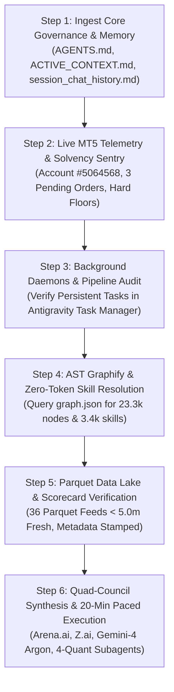

# 🚀 CROSS-ACCOUNT BOOTSTRAP & RE-ENGAGEMENT MASTER SOP
## Universal Turn-0 Reconnection Protocol for Blueberry Markets Autonomous Desk

> **Document Status**: CANONICAL PRODUCTION RE-ENGAGEMENT PROTOCOL (MANDATORY TURN-0 STUDY)  
> **Location**: `Data/Manditory/ACCOUNT_SWITCH_BOOTSTRAP_PROTOCOL.md`  
> **Mirror**: `docs/specs/ACCOUNT_SWITCH_BOOTSTRAP_PROTOCOL.md`  
> **Target Account**: Blueberry Markets MT5 Account #5064568 (Raw Spread CFD/Perpetual)  
> **Mission**: Pass Phase 1 Challenge (Target: 5,500.00 USD).  
> **Purpose**: When switching Gemini/Antigravity accounts, launching a new chat session, or re-engaging after an interruption or token compaction, the incoming agent MUST execute this exact protocol to achieve 100% operational continuity, audit all background daemons without disturbing their lifecycle, verify account solvency against live MT5 telemetry, and resume autonomous execution with ZERO context amnesia.

---

## ⚡ OPERATOR QUICK-START TRIGGER (COPY & PASTE TO ANY NEW AGENT)

```markdown
Read and execute Data/Manditory/ACCOUNT_SWITCH_BOOTSTRAP_PROTOCOL.md immediately.
Verify MT5 connectivity, audit account solvency (Balance: 4,846.32 USD, Floors: 4,775 / 4,795 USD), verify all 6 persistent daemons, inspect active pending orders (#19329907 BNB PREVAIL, #19329908 EURUSD PRUNE, #19330613 ETH PREVAIL), query the AST knowledge graph via graphify, and resume cycle execution using the 4-quant subagent swarm and Quad-Council (Arena.ai, Z.ai, Gemini-4 Argon High, Antigravity Desk).
```

---

## 🏛️ PART 1: THE 6-STEP BOOTSTRAP ACTIVATION CHAIN

Whenever an agent receives the trigger or re-engages in a fresh session, execute these 6 steps sequentially without asking:



---

### STEP 1: INGEST CORE GOVERNANCE & MEMORY (ZERO AMNESIA)

1. **Token Preservation Mandate (Query AST Graph FIRST)**:
   - Always query the AST Knowledge Graph via `python -m graphify query "<concept/symbol>"` before reading large code or skill files.
   - `graphify-out/graph.json` contains **23,326 nodes, 27,991 edges, and 3,478 skill nodes**, providing instant structural context in <200 tokens without burning context budget.

2. **Physical Reading Gate (Read Canonical Governance in `Data/Manditory/`)**:
   The coordinator and subagents MUST review the canonical governance files:
   - `Data/Manditory/STANDARDIZED_TRADING_DECISION_CHAIN.md` (10-Step Standardized Trading Decision Chain SOP)
   - `Data/Manditory/SUBAGENT_PROMPT_TEMPLATES.md` (4 Non-Overlapping Institutional Roles: Role A, B, C, D)
   - `Data/Manditory/ARENA_AI_STANDARD_PROMPT_TEMPLATE.md` (Exhaustive prompt architecture for Arena.ai GPT-5.4 Astra)
   - `Data/Manditory/Z_AI_STANDARD_PROMPT_TEMPLATE.md` (Exhaustive adversarial prompt architecture for Z.ai GLM-5.3-Flash)
   - `Data/Manditory/TOP_10_TRADE_EXECUTION_PITFALLS_AND_AUTOPSY.md` (Forensic post-mortems & 10 lethal execution traps)
   - `Data/Manditory/CONTINUOUS_KAIZEN_SELF_IMPROVEMENT_PROTOCOL.md` (5-Stage PDCA-Omega continuous learning cycle)
   - `Data/Manditory/32_SHEET_REAL_WORLD_PITFALL_AVOIDANCE_QUESTIONS.md` (Socratic interrogation per data domain)
   - `.agents/rules/ACTIVE_CONTEXT.md` (Real-time live account state, open positions, floor cushions)
   - `.agents/memory/session_chat_history.md` (Full conversation trajectory, past setbacks, operator directives)

3. **Mandatory Session History Learning & Anti-Regression Mandate**:
   - On EVERY account switch and coordinator turn, agents MUST actively study and internalize `.agents/memory/session_chat_history.md`.
   - Never repeat an identified error (e.g. unaligned limits without resting whale walls, premature entries during intra-bar chop, off-hours FX rollover spread traps, or 429 rate limit saturations).
   - Trace data sources end-to-end; never rely on column names or assumptions alone.

4. **Plain-Text Mathematical Readability Mandate**:
   - Zero raw LaTeX math delimiters (`$`, `$$`, `\frac`, etc.) in chat responses.
   - Use clean plain text, unicode operators, and clear typography.

---

### STEP 2: LIVE MT5 TELEMETRY & SOLVENCY SENTRY

1. **Live MetaTrader 5 Telemetry Verification**:
   - Account: **#5064568** on `BlueberryMarketsSVG-Live` (Currency: **USD**).
   - Balance: **4,846.32 USD** | Equity: **4,846.32 USD** | Floating PnL: **0.00 USD**.
   - Margin Used: **0.00 USD** | Free Margin: **4,846.32 USD** | Margin Utilization: **0.00%**.
   - Open Positions: **0** (Flat).

2. **Active Pending Limit Orders Audit (3 Staged Orders)**:
   - **Ticket #19329907**: `BNBUSD.p` BUY_LIMIT 3.00 lots @ **736.25** (SL: 732.65, TP: 746.80)
     * Risk: 10.80 USD nominal / 16.20 USD stressed | Margin Req: 1,104.38 USD (22.8% equity)
     * Microstructure: Resting bid wall > 120K USD (tau >= 210s) and 0.786 Fibonacci shelf. Short Max Pain magnet at 757.79.
     * Status: **PREVAIL / HOLD RESTING**.
   - **Ticket #19329908**: `EURUSD.pi` SELL_LIMIT 0.10 lot @ **1.12065** (SL: 1.12180, TP: 1.11760)
     * Risk: 11.50 USD nominal / 16.98 USD stressed | Margin Req: 33.52 USD
     * Microstructure Trap: Market price (1.117495) already reached and exceeded TP (1.11760) without fill. Alpha exhausted. High risk of 21:15–22:30 UTC rollover spread blowout.
     * Status: **PRUNE / CANCEL IMMEDIATELY** (liberates 16.98 USD stressed risk headroom).
   - **Ticket #19330613**: `ETHUSD.pi` SELL_LIMIT 0.50 lot @ **2,333.50** (SL: 2,351.30, TP: 2,291.00)
     * Risk: 8.90 USD nominal / 13.13 USD stressed | Margin Req: 583.38 USD (12.0% equity)
     * Microstructure: Confirmed absorption cluster at 2,329.20. Cumulative delta -10.89M USD. Long Max Pain magnet at 2,285.66 USD.
     * Status: **PREVAIL / HOLD RESTING**.

3. **Inviolable Triple Floor Governance**:
   - Hard Floor: **4,775.00 USD** (Cushion: **+71.32 USD**)
   - Operating Defense Buffer: **4,795.00 USD** (Cushion: **+51.32 USD**)
   - Global Contingency Reserve: **2.00 USD** (deducted ex-ante)
   - Net Realized Headroom: **+49.32 USD**
   - Joint Stressed Risk of 3 Orders: **46.31 USD** (Worst-case post-loss equity: **4,800.01 USD** -> Preserves 4,795.00 USD floor by +5.01 USD)
   - Post-Pruning Headroom (canceling EURUSD): **+21.99 USD** unencumbered buffer.

4. **Universal Market Regime**:
   - Regime: **LOW_EFFICIENCY_CHOP** (Kaufman ER(48) < 0.20 across all assets: BTC 0.0762, ETH 0.0854, BNB 0.0742).
   - Stand-aside mandatory for new risk. Only resting limit orders with verified institutional whale backing prevail.

---

### STEP 3: PERSISTENT BACKGROUND DAEMONS & PIPELINE AUDIT

Audit all persistent operational daemons across the Antigravity task runner (`manage_task(Action='list')`). Verify that all core services are active:

| Daemon ID | Script Command / Entrypoint | Runtime Environment | Port / Interval | Purpose |
|---|---|---|---|---|
| **Daemon 1** | `python Terminal/Data_Factory/autonomous_telemetry_git_daemon.py --interval 60` | Antigravity Task Runner (`isDaemon=true`) | Every 60s | Pushes git commits & telemetry to GitHub `main` |
| **Daemon 2** | `python gemini_web2api.py` | OS Process / Antigravity Task | Port 8081 (HTTP) | Web2API Council Daemon (Endogen reverse-proxy, Auth: `Bearer sk-gemini`) |
| **Daemon 3** | `python Terminal/run_graphify_watcher.py` | OS Process / Antigravity Task | Continuous Watcher | Monitors file mutations and hot-updates `graphify-out/graph.json` |
| **Daemon 4** | `python Terminal/run_pipeline_continuous_daemon.py --gap 180` | Antigravity Task Runner (`isDaemon=true`) | Every 180s | Continuous 36-feed canonical master Parquet data lake pipeline + Metadata Stamping |
| **Daemon 5** | `python Terminal/dual_completion_daemon.py --daemon` | Antigravity Task Runner (`isDaemon=true`) | CDP Port 9222 | Monitors Arena.ai & Z.ai completions, auto-harvests RAW output, 5m tab auto-refresh |
| **Daemon 6** | `schedule` Dynamic Timer | Antigravity Schedule Tool | DurationSeconds=1200 | Enforces strict 20-minute post-cycle quiet gap before next cycle launch |

**Lifecycle preservation**: Persistent daemons must remain undisturbed across boots and chat/account reconnections. Bootstrap MUST NOT kill, restart, or create duplicate writers.

---

### STEP 4: AST GRAPHIFY & ZERO-TOKEN SKILL RESOLUTION

1. **Why Graphify Skills?**:
   - All skills in `.agents/skills/` and `~/.gemini/config/skills/` are indexed into `graphify-out/graph.json` (**3,478 skill nodes**).
   - Querying `python -m graphify query "<skill_name>"` extracts exact phase breakdowns, rules, and line references in **<200 tokens** (95% token savings).

2. **Hardware Health Sentry**:
   - If RAM utilization exceeds 80%, execute `powershell -ExecutionPolicy Bypass -File scripts/free_ram.ps1`.

---

### STEP 5: 100% PURE PARQUET DATA LAKE & SCORECARD VERIFICATION

1. **Canonical 36-Feed Parquet Lake**:
   - Master directory: `Data/feeds/*.parquet` (36 canonical production feeds + composite matrix). Zero Excel reliance.
   - All feeds must maintain live freshness strictly < 5.0m in IST/UTC.
   - Metadata Stamper: `Terminal/Data_Factory/stamp_all_parquet_feeds.py` injects fresh `cycle_id`, `cycle_timestamp_utc`, and `cycle_timestamp_ist` into PyArrow schema metadata on every cycle, ensuring synchronized git timestamps across all feeds on GitHub.

2. **Mandatory 33-Feed Parquet Freshness Scorecard**:
   - Every coordinator response and subagent report must include the 33-feed freshness scorecard parsed directly from `Data/metadata/parquet_all_feeds_checklist.json`.

---

### STEP 6: QUAD-COUNCIL SYNTHESIS & 20-MINUTE PACED EXECUTION

1. **Quad-Council Architecture**:
   - **Council 1**: Antigravity Internal Quant Desk (4-Quant Subagent Swarm: Role A, B, C, D via Fable 5 `Model='flash'`).
   - **Council 2**: Arena.ai Sovereign Council (GPT-5.4 Astra via Chrome CDP Port 9222).
   - **Council 3**: Z.ai Sovereign Council (GLM-5.3-Flash / Claude 3.7 Sonnet via Chrome CDP Port 9222).
   - **Council 4**: Gemini-4 Argon High Council (Deep Institutional Reasoning via Web2API port 8081).

2. **Tri-Entity Joint Completion Gate**:
   - A cycle is marked officially **FINISHED** only when ALL 3 external/internal entities complete processing:
     1. Antigravity 4-Quant Subagent Swarm
     2. Arena.ai Sovereign Council (harvested into `docs/trade_plans/ARENA_LATEST_RAW.md`)
     3. Z.ai Sovereign Council (harvested into `docs/trade_plans/ZAI_LATEST_RAW.md`)

3. **Dynamic 20-Minute Post-Completion Quiet Interval**:
   - After all entities complete and their rulings are reconciled, enforce a strict **minimum 20-minute (1,200 seconds)** quiet window before initializing the next cycle envelope:
     ```python
     schedule(DurationSeconds=1200, Prompt="Dynamic 20-minute market stabilization interval elapsed. Tri-entity completion verified. Initialize, audit, and launch Cycle N+1.")
     ```
   - Eliminates cycle collisions, prompt overlaps, and intra-bar chop entries.

---

## 🔒 PERPETUAL GOAL INVARIANTS (NEVER COMPROMISED)

1. **Perpetual Goal Contract**: Under NO circumstances may `<!-- GOAL_COMPLETE -->` or `<!-- GOAL_CANCELLED -->` be emitted until live equity >= 5,500.00 USD is proven on MetaTrader 5.
2. **Inviolable Floors**: **4,775.00 USD Hard Floor** | **4,795.00 USD Operating Buffer** | **4,795.00 USD Solvency Kernel**.
3. **Never Widen Stops**: Follow verified immutable R0 ledgers and ticket-specific ratchets; never loosen a protective stop.
4. **Strict Passive Limit Posture**: Passive limit orders only, safely anchored behind verified institutional liquidity (> 100,000 USD, tau >= 180s). Zero marketable spread crossing.
5. **Zero Token Polling**: Polling timers <= 60s are permanently banned. Rely strictly on native event-driven reactive wakeups and the joint completion lifecycle.
6. **Plain-Text Formatting**: Zero raw LaTeX delimiters in chat; use clean plain text and unicode.
