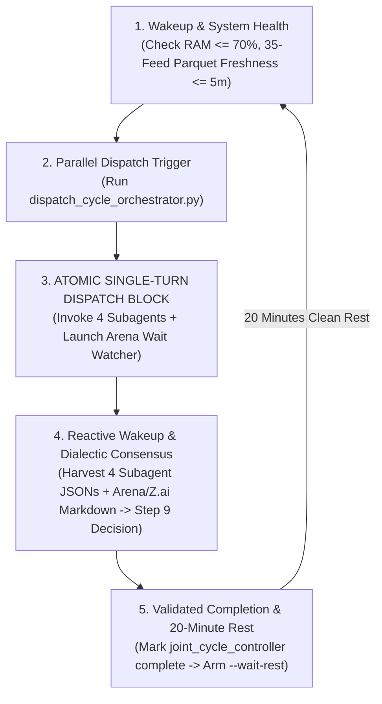

# 🔄 CANONICAL CYCLE LIFECYCLE & PARALLEL DISPATCH PROTOCOL
## Antigravity Desk, Arena.ai (GPT Astra) & Z.ai (GLM-5.3-Flash) Co-Equal Trading Engine

> **Single Source of Truth**: This document defines the exact, non-negotiable execution lifecycle for EVERY trading cycle on the Blueberry Markets MT5 autonomous quant desk (Account #5064568).
> **Mandatory Rule for Fast / Flash Models**: You MUST execute cycle activities in the exact atomic blocks described below. Under NO circumstances may you yield control or end a turn without having dispatched ALL entities.

---

## 🏛️ THE 3-ENTITY CO-EQUAL COUNCIL TOPOLOGY

Every trading cycle requires simultaneous quantitative research from **THREE independent entities**:
1. **Antigravity Internal 4-Quant Swarm (Fable 5)**:
   - `Role A`: Statistical Regime, Diffusion, and Dual-Engine Dialectic Quant
   - `Role B`: Fill, Microstructure, and Order Geometry Quant
   - `Role C`: Solvency, Portfolio, and Broker Math Sentry
   - `Role D`: Market Clock, Auction, Events, and Provenance Auditor
2. **Arena.ai Frontier Council (GPT Astra)**: Evaluates 156 assets via Chrome CDP (port 9222).
3. **Z.ai Sovereign Council (GLM-5.3-Flash)**: Evaluates 156 assets via Chrome CDP (port 9222).

A cycle is officially **FINISHED** only when ALL 3 entities have completed their evaluations and their reports are harvested.

---

## ⚡ THE 5-STEP ATOMIC CYCLE LIFECYCLE



---

### STEP 1: WAKEUP, SYSTEM HEALTH & INVENTORY AUDIT
1. **RAM Optimization**: Execute `powershell -ExecutionPolicy Bypass -File scripts/free_ram.ps1` if RAM > 70%.
2. **Account Telemetry**: Run `python Terminal/generate_mt5_telemetry.py` to get fresh MT5 balance, equity, and positions.
3. **Parquet Data Lake Freshness**: Verify that `Data/feeds/*.parquet` has 35/35 feeds with zero nulls and timestamps <= 5.0m fresh in IST (`python Terminal/parquet_checklist_auditor.py`).

---

### STEP 2: MASTER CYCLE ORCHESTRATOR DISPATCH
Run the master orchestrator command:
```bash
python Terminal/dispatch_cycle_orchestrator.py --cycle "Cycle X"
```
What this script automatically does:
- Initializes Cycle X in `Data/cycle_state.json` (`cycle_status: IN_PROGRESS`).
- Generates the unified prompt for Arena.ai, Z.ai, and Gemini Web2API with live MT5 telemetry and Section 2.5 inquest.
- Dispatches prompts simultaneously to Arena.ai and Z.ai via Chrome CDP (port 9222).
- Renders 4 standalone subagent prompt files:
  * `Data/subagent_prompts/cycle_{id}_role_a.txt`
  * `Data/subagent_prompts/cycle_{id}_role_b.txt`
  * `Data/subagent_prompts/cycle_{id}_role_c.txt`
  * `Data/subagent_prompts/cycle_{id}_role_d.txt`

---

### STEP 3: 🚨 ATOMIC SINGLE-TURN TOOL INVOCATION BLOCK (NON-NEGOTIABLE)
> **CRITICAL INVARIANT**: The Antigravity coordinator MUST execute ALL 5 tool calls in the **EXACT SAME TURN** immediately after Step 2 completes:

```python
# Tool Call 1:
invoke_subagent(
    Role='Statistical Regime Quant',
    TypeName='self',
    Prompt=read_file('Data/subagent_prompts/cycle_{id}_role_a.txt')
)

# Tool Call 2:
invoke_subagent(
    Role='Microstructure Quant',
    TypeName='self',
    Prompt=read_file('Data/subagent_prompts/cycle_{id}_role_b.txt')
)

# Tool Call 3:
invoke_subagent(
    Role='Solvency Sentry',
    TypeName='self',
    Prompt=read_file('Data/subagent_prompts/cycle_{id}_role_c.txt')
)

# Tool Call 4:
invoke_subagent(
    Role='Clock Provenance Auditor',
    TypeName='self',
    Prompt=read_file('Data/subagent_prompts/cycle_{id}_role_d.txt')
)

# Tool Call 5:
run_command(
    CommandLine='python Terminal/arena_completion_daemon.py --wait',
    WaitMsBeforeAsync=500,
    toolSummary='Wait for Arena and Z.ai completion'
)
```

**FAIL-SAFE WARNING**: NEVER launch `arena_completion_daemon.py --wait` without simultaneously calling `invoke_subagent` for all 4 roles in that same turn. Doing so causes the agent to sleep waiting for Arena while leaving the subagents un-dispatched!

---

### STEP 4: REACTIVE WAKEUP, DIALECTIC CONSENSUS & STEP 9 DECISION
1. **Reactive Wakeup**: When external councils complete generation, `arena_completion_daemon.py --wait` exits with code 0, waking Antigravity up immediately.
2. **Subagent Harvest**: Inspect and verify reports from all 4 subagents:
   - `Data/subagent_role_a_cycle_{id}.json` (Regime & Diffusion)
   - `Data/subagent_role_b_cycle_{id}.json` (Microstructure & Invalidation Shelf)
   - `Data/subagent_role_c_cycle_{id}.json` (Solvency & Capital Cushion)
   - `Data/subagent_role_d_cycle_{id}.json` (Clock & Provenance)
3. **Dialectic Debate**: Cross-examine findings against Arena.ai (`docs/trade_plans/ARENA_LATEST_RAW.md`) and Z.ai (`docs/trade_plans/ZAI_LATEST_RAW.md`).
4. **Step 9 Live Execution Gate**:
   - If ALL gates pass (Regime confirmed, L2 whale wall persisted >= 180s, SL outside sweep band, Solvency Kernel >= 4,795 USD, LCB EV > 0): punch limit order into MT5.
   - If ANY hard gate fails: ratify mathematical **STAND ASIDE** with explicit candidate radar pre-conditions.

---

### STEP 5: VALIDATED COMPLETION & DYNAMIC 20-MINUTE REST PACING
Once the trade decision is executed or Stand Aside is ratified:
1. **Mark Subagents Complete in Controller**:
   ```bash
   python Terminal/joint_cycle_controller.py --complete antigravity_subagents
   ```
   `joint_cycle_controller.py` detects that ALL 3 entities are COMPLETED, sets `cycle_status: COMPLETED`, and arms `next_cycle_scheduled_utc = max_dt + 1200s` (clean 20-minute relative separation).
2. **Clean Up Subagent Threads**:
   Execute `manage_subagents(Action='kill_all')` to prevent Windows socket exhaustion under Cloudflare WARP.
3. **Optimize Memory**:
   Execute `powershell -ExecutionPolicy Bypass -File scripts/free_ram.ps1` to reclaim physical RAM below 65%.
4. **Arm 20-Minute Rest Watcher**:
   ```python
   run_command(
       CommandLine='python Terminal/joint_cycle_controller.py --wait-rest',
       WaitMsBeforeAsync=500,
       toolSummary='Dynamic 20m rest interval before Cycle X+1'
   )
   ```
   *Behavior*: `wait-rest` loops and sleeps until the exact 20 minutes have elapsed (or wakes up early if an MT5 position closes via TP/SL). Upon completion, it exits with code 0, reactively waking Antigravity up to begin Cycle X+1!
5. **Safety Net**: The standing sentinel cron (`0,30 * * * *`) runs in parallel, verifying that no task has stalled and that cycle state remains healthy.
