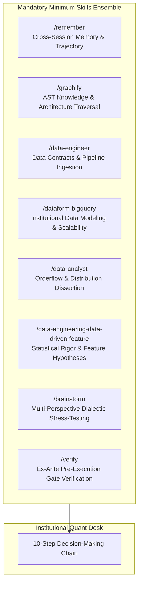
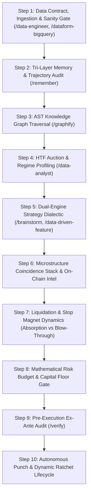

# 🏛️ STANDARDIZED QUANTITATIVE TRADING DECISION CHAIN (SOP)
## Canonical Multi-Pillar Institutional Microstructure Decision Architecture

> **Document Status**: CANONICAL PRODUCTION SPECIFICATION  
> **Target Environment**: MetaTrader 5 (Blueberry Markets, Account #5064568)  
> **Execution Engine**: Antigravity Autonomous Decision Desk  
> **Mandatory Foundation**: 8 Core Multi-Domain Skill Ensembles (Non-Bypassable)

---

## SECTION 1: MANDATORY SKILLS ENSEMBLE FOUNDATION

Under strict hedge fund operational governance, **no trading analysis, hypothesis formation, order staging, or modification may ever occur in an ad-hoc or single-agent vacuum**. Every cycle and decision must systematically activate and apply the following foundational skill suite as the **absolute minimum requirement**, dynamically augmenting with additional specialized skills as market conditions dictate:



### The 8 Mandatory Foundation Skills:
1. **`/remember` (Persistent Cross-Session Memory & Trajectory Continuity)**:
   - Eliminates context amnesia. Retrieves past operator directives, settled invariants, post-loss autopsies, avoided traps (e.g., chasing unaligned limits, illiquid FX rollover hours, buying into un-swept stop clusters), and running capital cushion trajectory.
2. **`/graphify` (AST Knowledge Graph & Structural Traversal)**:
   - Queries repository semantic graphs (`graphify-out/graph.json`, 7.4k+ nodes) before modifying code, validating execution schemas, parameter bounds, broker symbols, and contract specifications.
3. **`/data-engineer` (Data Contract Enforcement & Pipeline Integrity)**:
   - Verifies raw tick ingestion, timestamp monotonicity, zero nulls, broker basis normalization (`venue_basis`), and telemetry data freshness. Rejects stale or corrupted data frames fail-closed.
4. **`/dataform-bigquery` (Institutional Data Modeling & Scalability)**:
   - Governs historical time-series consistency across all 43 canonical Parquet datasets and 3.47M 15m bars. Enforces unified data definitions from micro-ticks to multi-year horizons.
5. **`/data-analyst` (Orderflow, Auction & Distribution Dissection)**:
   - Decomposes multidimensional metrics: MT5 spreads in bps, VWAP standard deviations, volume profile POC/VAH/VAL, multi-horizon CVD deltas, and auction imbalance ratios.
6. **`/data-engineering-data-driven-feature` (Empirical Feature Engineering & Statistical Rigor)**:
   - Formulates verifiable quantitative hypotheses, establishes statistical significance (p_win lower bounds, z-score thresholds), and designs causal features with zero lookahead.
7. **`/brainstorm` (Multi-Perspective Dialectic & Persona Stress-Testing)**:
   - Simulates adversarial multi-agent debate (Orderflow Specialist vs Macro Risk Officer vs Forensic Position Auditor). Tests edge cases: *What if the whale pulls? What if the market blows through the cascade?*
8. **`/verify` (Ex-Ante Pre-Execution Gate & Boundary Verification)**:
   - Mathematical proof before dispatch. Verifies cash risk calculations against `mt5.order_calc_profit`, checks hard floor cushion (>= 4,775 USD), verifies passive limit posture, and validates SL/TP placement.

---

## SECTION 2: THE 10-STEP STANDARDIZED TRADING DECISION CHAIN



---

### STEP 1: Data Contract, Ingestion & Sanity Gate
*Active Skills: `@[data-engineer]`, `@[dataform-bigquery]`*

Every analysis begins by establishing absolute data integrity across the telemetry pipeline (`docs/telemetry/live_snapshot_latest.json`):
1. **Clock & Freshness Audit**: Verify telemetry timestamp is within 180 seconds of live UTC. Stale telemetry triggers immediate live tick refresh.
2. **Monotonicity & Zero-Null Invariant**: Ingest 15m and HTF OHLCV bars, verifying strict time monotonicity and zero NaN/null values in closing prices, volume, and CVD.
3. **Broker Venue Basis Mapping**: Map Binance / Hyperdash crypto levels to MT5 execution symbols using `venue_basis`:
   $$\text{Price}_{\text{MT5}} = \text{Price}_{\text{Binance}} + \text{venue\_basis}$$
4. **Spread Friction Threshold Gate**:
   - Crypto Perpetuals: MT5 Spread must be $\le 25.0\text{ bps}$ (e.g. BTC ~2.5 bps, ETH ~12 bps).
   - TradFi CFDs (Forex/Indices/Commodities): MT5 Spread must be $\le 5.0\text{ bps}$ (Gold ~0.2 bps, SP500 ~0.4 bps, USDJPY ~0.1 bps).
   - Any asset with spread exceeding its ceiling (e.g. DOGE at 261 bps) is disqualified immediately.

---

### STEP 2: Tri-Layer Memory & Trajectory Audit
*Active Skills: `@[memory-system]`, `@[anti-sycophancy]`*

No trade is evaluated in a vacuum. The system reviews the persistent narrative and past lessons:
1. **Historical Memory Audit**: Review `.agents/memory/session_chat_history.md` and `.agents/rules/ACTIVE_CONTEXT.md` for active directives and operator feedback.
2. **Anti-Trap Checklist**: Confirm candidate setup does not match known trap patterns:
   - Never stage limit entries directly above/below un-swept opposing stop clusters.
   - Never catch falling knives against massive unidirectional CVD without absorption evidence.
   - Never place orders during illiquid interbank rollover spread expansion (21:30–22:30 UTC).
3. **Live Capital Floor Cushion**:
   $$\text{Floor Cushion} = \text{Current Equity} - 4,775.00\text{ USD}$$
   Confirm that existing open positions and staged pending orders leave the cushion strictly positive.

---

### STEP 3: AST Knowledge Graph Traversal & Rule Check
*Active Skills: `@[graphify]`*

Query the system architecture to prevent logic regressions:
1. **Canonical Schema Query**: Verify symbol mapping (`Terminal/Asset_Universe.py`), lot steps, minimum volume, and digits via AST lookup.
2. **Strategy Module Integrity**: Verify active logic resides in canonical single modules (`Terminal/OF_Strategy.py`, `Engine/s1_liquidation_cascade.py`), adhering to the Single Strategy File Mandate.
3. **Mathematical Invariant Check**: Ensure ATR calculations, VWAP standard deviation formulas, and volume profile definitions match `.okf/` verified contracts.

---

### STEP 4: Higher-Timeframe Auction & Regime Profiling
*Active Skills: `@[data-analyst]`*

Determine the macro structural environment before looking at intraday triggers:
1. **HTF Trend Hierarchy (1H & 4H)**:
   - **Bullish Regime**: $\text{Price} > \text{EMA}_{20} > \text{EMA}_{50} > \text{EMA}_{200}$ on 1H/4H.
   - **Bearish Regime**: $\text{Price} < \text{EMA}_{20} < \text{EMA}_{50} < \text{EMA}_{200}$ on 1H/4H.
   - **Ranging / Mean-Reverting**: EMAs flat, compressed, or oscillating.
2. **Auction Market Structure**:
   - Identify Prior Day and Prior Week POC, VAH (Value Area High), and VAL (Value Area Low).
   - Evaluate Session VWAP and Multi-Day Anchor VWAPs.
3. **Stand-Aside Protocol**: If the market displays conflicting regimes or choppy liquidity without clear structural edges, the desk **stands aside unconditionally**. Cash is a valid position.

---

### STEP 5: Dual-Engine Strategy Dialectic & Opportunity Screening
*Active Skills: `@[brainstorm]`, `@[data-engineering-data-driven-feature]`*

Screen candidates across the universe into two distinct, non-overlapping quantitative models:

#### Model 1: Extreme Mean Reversion
- **Condition**: Market reaches statistical extremes ($|Z_{\text{VWAP}}| \ge 2.0\text{ SD}$ to $3.5\text{ SD}$).
- **Required Confluence**:
  1. Price tested an extreme structural boundary (outer VWAP band +2.0 SD / -2.0 SD, extreme weekly deviation).
  2. Orderflow shows **Trapped Traders** (`TRAPPED_BUYERS_ABOVE` for Shorts, `TRAPPED_SELLERS_BELOW` for Longs).
  3. Microstructure tape reveals clear momentum exhaustion (CVD delta decelerating, lack of volume follow-through).
- **Execution**: Counter-trend passive limit order targeting mean reversion back toward Volume POC or Session VWAP.

#### Model 2: VWAP & Structural Trend Pullback
- **Condition**: In-range statistical score ($|Z_{\text{VWAP}}| < 2.0\text{ SD}$, typically $0.2\text{ SD}$ to $1.7\text{ SD}$) within a confirmed HTF trend.
- **Required Confluence**:
  1. Primary trend confirmed by HTF EMA hierarchy and directional multi-horizon CVD.
  2. Pullback retraces into a confirmed structural shelf:
     - 20 EMA / 50 EMA shelf.
     - Volume Profile Value Area edge (VAL in uptrend, VAH in downtrend).
     - **Daily VWAP +1.0D / -1.0D Band coincidence with persistent whale orders**.
- **Execution**: Pro-trend passive limit order placed at the shelf, targeting cascade momentum into the next structural magnet.

---

### STEP 6: Microstructure Coincidence Stack & On-Chain Intelligence
*Active Skills: `@[data-analyst]`, `@[quant-analyst]`*

Every candidate setup must achieve simultaneous confluence across the multi-pillar microstructure stack:

1. **L2 Orderbook Depth Asymmetry**:
   - Top-20 depth must heavily support the trade direction:
     $$\text{Imbalance} = \frac{\text{Bid Depth} - \text{Ask Depth}}{\text{Bid Depth} + \text{Ask Depth}}$$
   - For Longs: Bid Depth > Ask Depth (Imbalance $> +0.25$).
   - For Shorts: Ask Depth > Bid Depth (Imbalance $< -0.25$).
2. **L3 Attributed Whale Wall Backing**:
   - Order must be shielded by genuine on-chain/L3 whale orders (`0x...`).
   - **Persistence Requirement**: Whale wall must have verified persistence $\ge 180\text{ seconds}$ (Class `GENUINE`, Gate G7 eligible).
   - Minimum Notional: $\ge 5,000,000\text{ USD}$ for BTC/ETH; $\ge 1,000,000\text{ USD}$ for large altcoins/TradFi.
3. **Multi-Horizon CVD Directional Taker Flow**:
   - Inspect 1m, 15m, Session, and Weekly cumulative volume delta.
   - Strong alignment: Massive negative CVD (-10M to -100M+ USD) confirms short dominance; massive positive CVD confirms buyer aggression.
4. **Arkham Intelligence On-Chain Institutional Forensics**:
   - Monitor live institutional wallet flows:
     * **Net Inflow to Exchanges**: Institutional sell pressure / distribution $\to$ Bearish confirmation.
     * **Net Outflow from Exchanges**: Institutional accumulation / cold storage transfer $\to$ Bullish confirmation.
     * **Whale Transfers**: Large stablecoin mints/inflows or whale deposits flag impending volatility spikes.

---

### STEP 7: Liquidation & Stop Magnet Dynamics (Absorption vs. Blow-Through)
*Active Skills: `@[brainstorm]`, `@[data-analyst]`*

Reconstructed liquidation bands and dense structural stop clusters serve two critical functions:

```
        DEFENSIVE USE                             OFFENSIVE USE
┌───────────────────────────┐             ┌───────────────────────────┐
│ Place SL safely outside   │             │ Use opposing liquidation  │
│ [min_price, max_price]    │             │ band / stop cluster as    │
│ with >= 0.35-0.50 ATR     │             │ high-probability TARGET   │
│ buffer. Bunker protects   │             │ MAGNET. Ride the cascade! │
│ the position from wicks.  │             │ Front-run by 5-10 bps.    │
└───────────────────────────┘             └───────────────────────────┘
```

#### Absorption vs. Trend Blow-Through Forensics:
When price approaches a major liquidation band or stop cluster, **never blindly assume an automatic mean-reversion reversal**. The market often violently consumes all resting liquidity and continues running. The desk differentiates between absorption and blow-through using 4 forensic criteria:

| Forensic Factor | Reversal / Absorption Signal | Trend Blow-Through Signal |
|:---|:---|:---|
| **1. CVD Delta Velocity** | CVD decelerates, diverges, or reverses sharply as the band is tapped | CVD accelerates exponentially through the level (aggressive market orders keep hammering) |
| **2. L2 Book Replenishment** | Opposing limit orders replenish instantaneously after execution (whale absorption) | Orderbook is hollowed out; depth vanishes and spreads widen |
| **3. Arkham On-Chain Net Flow** | Large wallet transfers counter-trade the move (smart money taking the other side) | Institutional wallets continue pouring liquidity in the direction of the cascade |
| **4. Structural Location** | Band sits at an extreme multi-day auction boundary (+2.5 SD, major HTF support) | Band sits in the middle of a fresh HTF breakout with open space beyond |

- **If Absorption Confirmed**: Eligible for counter-trend fade (Model 1) with tight bunker stop.
- **If Blow-Through Confirmed**: Strictly trade in the direction of the breakout (Model 2), riding momentum into the *next* distal cascade band.

---

### STEP 8: Mathematical Risk Budget & Capital Floor Gate
*Active Skills: `@[quant-analyst]`, `@[clean-code]`*

Every staged order must undergo strict broker-specific contract sizing and capital defense auditing:

1. **Broker Contract Math**:
   - Calculate cash risk precisely using broker parameters:
     $$\text{Cash Risk (USD)} = \text{Volume} \times \text{Contract Size} \times |\text{Entry} - \text{SL}| \times \text{Quote Conversion}$$
   - Verify calculation directly via `mt5.order_calc_profit()`.
2. **Tiered Adaptive Risk Envelope**:
   - **Tier 1 (Crypto, Gold, FX)**: Base Risk **10.00 USD to 14.50 USD** (0.20% to 0.30% of 4,859 USD equity).
   - **Tier 2 (High-ATR TradFi Indices - SP500, NAS100)**: Authorized up to **16.00 USD to 22.00 USD** when a pristine 3.0R+ setup requires wider ATR stop buffering.
3. **Stressed Post-Loss Floor Defense (Unconditional Invariant)**:
   - Sum total staged risk across all pending orders and active positions:
     $$\text{Total Staged Risk} = \sum_{i} \text{Risk}_i$$
     $$\text{Stressed Equity} = \text{Current Equity} - \text{Total Staged Risk} \ge 4,775.00\text{ USD}$$
   - Under no circumstances may an order be staged if Stressed Equity violates the 4,775.00 USD hard floor.
4. **Max Concurrent Capacity**: Strictly limited to a maximum of **2 active running positions** across the entire desk.

---

### STEP 9: Pre-Execution Ex-Ante Audit
*Active Skills: `@[verify]`, `@[clean-code]`*

Prior to order transmission, perform the final 5-point sanity audit:
1. **Passive Limit Posture**: Confirm order type is strictly `BUY_LIMIT` or `SELL_LIMIT`. Market orders and spread-crossing taker executions are permanently banned.
2. **Reward-to-Risk (R:R) Gate**:
   $$\text{R:R Ratio} = \frac{|\text{TP} - \text{Entry}|}{|\text{Entry} - \text{SL}|} \ge 2.0\text{R}$$
   (Default target is 2.5R to 3.0R).
3. **Bunker Stop Verification**: SL is positioned safely beyond the outer boundary of the resting whale wall and liquidation band with $\ge 0.35\text{ ATR}$ safety margin.
4. **Target Magnet Front-Run**: TP is set 5 to 10 bps ahead of the opposing structural cluster or liquidation band to guarantee fill liquidity before depletion.
5. **Filling Policy Compatibility**: Test `ORDER_FILLING_IOC`, with automatic failover to `ORDER_FILLING_RETURN` / `ORDER_FILLING_FOK` if rejected by broker bridge.

---

### STEP 10: Autonomous Punch & Dynamic Ratchet Lifecycle
*Active Skills: `@[quant-analyst]`*

Once verified, the order is transmitted autonomously into MetaTrader 5 without operator hesitation:

```mermaid
stateDiagram-v2
    [*] --> PendingLimitOrder: Punch Limit Order into MT5
    PendingLimitOrder --> FilledPosition: Price fills at limit
    PendingLimitOrder --> Cancelled: Distance > 2.0 ATR or Whale pulls
    
    FilledPosition --> Phase0RiskCut: Profit reaches +1.25R0
    note right of Phase0RiskCut: Move SL to -0.25R0 (Cut 75% risk)
    
    Phase0RiskCut --> Phase1ProfitLock: Profit reaches +1.65R0
    note right of Phase1ProfitLock: Move SL to +0.80R0 (Bank profit)
    
    Phase1ProfitLock --> Phase2Trailing: Profit reaches >= +2.00R0
    note right of Phase2Trailing: Continuous 0.50 ATR trail behind micro-shelves
    
    Phase2Trailing --> TakeProfitExit: Hit TP Magnet (+2.5R to +3.0R)
    FilledPosition --> TimeDecayExit: Time > 24 bars (6h) & gain < +0.20R0
    FilledPosition --> StoppedOut: Hit initial SL (Controlled risk)
```



1. **Autonomous Execution**: Execute via `mt5.order_send()` with unique magic number (`888888`) and descriptive comment.
2. **Dynamic Profit Ratchet Protocol (Frozen $R_0$)**:
   - **Phase 0 (Risk Cut)**: At $+1.25R_0$ unrealized profit $\to$ Move SL to $\text{Entry} - 0.25R_0$ (eliminates 75% of initial risk).
   - **Phase 1 (Profit Lock)**: At $+1.65R_0$ unrealized profit $\to$ Move SL to $\text{Entry} + 0.80R_0$ (locks in guaranteed profit).
   - **Phase 2 (Continuous Trailing Ratchet)**: At $\ge +2.00R_0$ unrealized profit $\to$ Trail SL behind structural 15m swing shelves or $0.50\text{ ATR}$ trailing stop.
3. **Time-Decay Exit**: If a position has been active for 24 bars (6 hours) and has not generated at least $+0.20R_0$ gain, close at market to redeploy capital.

---

## SECTION 3: INSTITUTIONAL BENCHMARK & ACCOUNTABILITY CONTRACT

1. **Benchmark Comparison**: All desk performance, equity metrics, and Sharpe ratios must be continuously benchmarked against the **BTC Buy and Hold** benchmark normalized to initial capital ($5,000\text{ USD}$).
2. **Immutable Audit Provenance**: Every trade decision, council debate, and execution log must be recorded in:
   - `docs/trade_plans/LIVE_COLLABORATIVE_ORDER_DESK.md`
   - `.agents/memory/session_chat_history.md`
   - Telemetry snapshots pushed to Git repository (`main` branch) every 60 seconds.
3. **Zero-Litter Discipline**: All scratch scripts and exploratory debug artifacts must be immediately purged upon validation.
