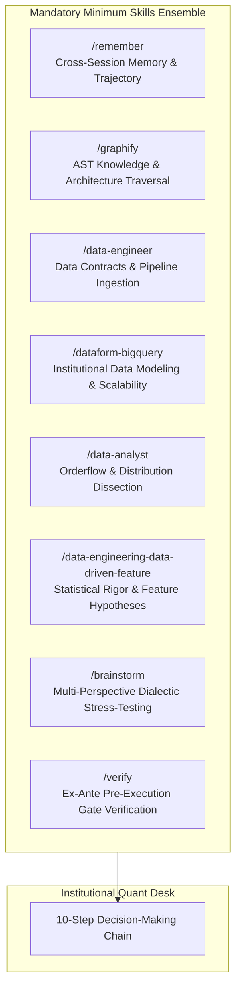
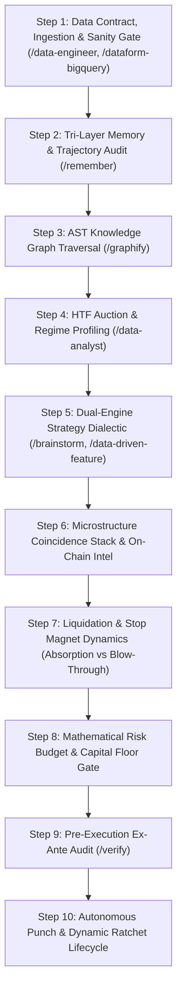
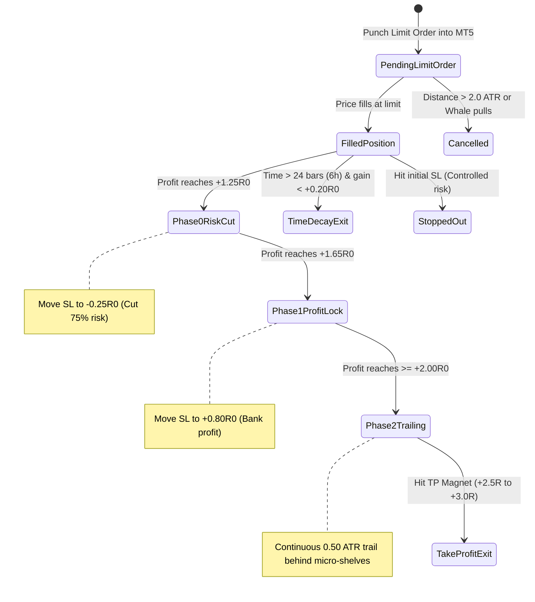

# 🏛️ STANDARDIZED QUANTITATIVE TRADING DECISION CHAIN (SOP)
## Canonical Multi-Pillar Institutional Microstructure Decision Architecture

> **Document Status**: CANONICAL PRODUCTION SPECIFICATION  
> **Target Environment**: MetaTrader 5 (Blueberry Markets, Account #5064568)  
> **Execution Engine**: Antigravity Autonomous Decision Desk  
> **Mandatory Foundation**: 8 Core Multi-Domain Skill Ensembles (Non-Bypassable)

---

## SECTION 1: MANDATORY SKILLS ENSEMBLE FOUNDATION

Under strict hedge fund operational governance, **no trading analysis, hypothesis formation, order staging, or modification may ever occur in an ad-hoc or single-agent vacuum**. Every cycle and decision must systematically activate and apply the following foundational skill suite as the **absolute minimum requirement**, dynamically augmenting with additional specialized skills as market conditions dictate:



### The 8 Mandatory Foundation Skills:
1. **`/remember` (Persistent Cross-Session Memory & Trajectory Continuity)**:
   - Eliminates context amnesia. Retrieves past operator directives, settled invariants, post-loss autopsies, avoided traps (e.g., chasing unaligned limits, illiquid FX rollover hours, buying into un-swept stop clusters), and running capital cushion trajectory.
2. **`/graphify` (AST Knowledge Graph & Structural Traversal)**:
   - Queries repository semantic graphs (`graphify-out/graph.json`, 7.4k+ nodes) before modifying code, validating execution schemas, parameter bounds, broker symbols, and contract specifications.
3. **`/data-engineer` (Data Contract Enforcement & Pipeline Integrity)**:
   - Verifies raw tick ingestion, timestamp monotonicity, zero nulls, broker basis normalization (`venue_basis`), and telemetry data freshness. Rejects stale or corrupted data frames fail-closed.
4. **`/dataform-bigquery` (Institutional Data Modeling & Scalability)**:
   - Governs historical time-series consistency across all 43 canonical Parquet datasets and 3.47M 15m bars. Enforces unified data definitions from micro-ticks to multi-year horizons.
5. **`/data-analyst` (Orderflow, Auction & Distribution Dissection)**:
   - Decomposes multidimensional metrics: MT5 spreads in bps, VWAP standard deviations, volume profile POC/VAH/VAL, multi-horizon CVD deltas, and auction imbalance ratios.
6. **`/data-engineering-data-driven-feature` (Empirical Feature Engineering & Statistical Rigor)**:
   - Formulates verifiable quantitative hypotheses, establishes statistical significance (p_win lower bounds, z-score thresholds), and designs causal features with zero lookahead.
7. **`/brainstorm` (Multi-Perspective Dialectic & Persona Stress-Testing)**:
   - Simulates adversarial multi-agent debate (Orderflow Specialist vs Macro Risk Officer vs Forensic Position Auditor). Tests edge cases: *What if the whale pulls? What if the market blows through the cascade?*
8. **`/verify` (Ex-Ante Pre-Execution Gate & Boundary Verification)**:
   - Mathematical proof before dispatch. Verifies cash risk calculations against `mt5.order_calc_profit`, checks hard floor cushion (>= 4,775 USD), verifies passive limit posture, and validates SL/TP placement.
9. **`/risk-engine` (Stressed Multi-Ticket Floor Defense Simulator)**:
   - Computes worst-case stressed equity across all open and staged tickets: $\text{Stressed Equity} = \text{Equity} - \sum (\text{Risk}_i \times 1.25) \ge 4,775.00\text{ USD}$.
10. **`/execution-sim` (Microstructure Execution & Friction Compensation)**:
    - Models half-spread offset ($\text{Entry} = \text{Shelf} - \text{half\_spread}$ for longs, $\text{Shelf} + \text{half\_spread}$ for shorts), verifies `ORDER_FILLING_IOC` with automatic failover to `RETURN` and `FOK`.
11. **`/onchain-forensics` (Arkham Institutional Deanonymization)**:
    - Parses live `onchain_arkham_intelligence`, calculates net flow velocity ($\text{Outflow} - \text{Inflow}$), flags institutional CEX deposits, and attributes wallet flows to specific assets.
12. **`/market-microstructure` (Orderbook Replenishment & Spoof Detection)**:
    - Analyzes L2 replenishment velocity $d(\text{depth})/dt$, calculates book imbalance ratios, and filters out phantom/ephemeral orders using presence fraction ($\ge 0.85$) and minimum persistence ($\ge 180\text{s}$).

---

## SECTION 2: THE 10-STEP STANDARDIZED TRADING DECISION CHAIN



---

### STEP 1: Data Contract, Ingestion & Sanity Gate
*Active Skills: `@[data-engineer]`, `@[dataform-bigquery]`*

Every analysis begins by establishing absolute data integrity across the telemetry pipeline (`docs/telemetry/live_snapshot_latest.json`):
1. **Clock & Freshness Audit**: Verify telemetry timestamp is within 180 seconds of live UTC. Stale telemetry triggers immediate live tick refresh.
2. **Monotonicity & Zero-Null Invariant**: Ingest 15m and HTF OHLCV bars, verifying strict time monotonicity and zero NaN/null values in closing prices, volume, and CVD.
3. **Broker Venue Basis Mapping**: Map Binance / Hyperdash crypto levels to MT5 execution symbols using `venue_basis`:
   $$\text{Price}_{\text{MT5}} = \text{Price}_{\text{Binance}} + \text{venue\_basis}$$
4. **Spread Friction Threshold Gate**:
   - Crypto Perpetuals: MT5 Spread must be $\le 25.0\text{ bps}$ (e.g. BTC ~2.5 bps, ETH ~12 bps).
   - TradFi CFDs (Forex/Indices/Commodities): MT5 Spread must be $\le 5.0\text{ bps}$ (Gold ~0.2 bps, SP500 ~0.4 bps, USDJPY ~0.1 bps).
   - Any asset with spread exceeding its ceiling (e.g. DOGE at 261 bps) is disqualified immediately.

---

### STEP 2: Tri-Layer Memory & Trajectory Audit
*Active Skills: `@[memory-system]`, `@[anti-sycophancy]`*

No trade is evaluated in a vacuum. The system reviews the persistent narrative and past lessons:
1. **Historical Memory Audit**: Review `.agents/memory/session_chat_history.md` and `.agents/rules/ACTIVE_CONTEXT.md` for active directives and operator feedback.
2. **Anti-Trap Checklist**: Confirm candidate setup does not match known trap patterns:
   - Never stage limit entries directly above/below un-swept opposing stop clusters.
   - Never catch falling knives against massive unidirectional CVD without absorption evidence.
   - Never place orders during illiquid interbank rollover spread expansion (21:30–22:30 UTC).
3. **Live Capital Floor Cushion**:
   $$\text{Floor Cushion} = \text{Current Equity} - 4,775.00\text{ USD}$$
   Confirm that existing open positions and staged pending orders leave the cushion strictly positive.

---

### STEP 3: AST Knowledge Graph Traversal & Rule Check
*Active Skills: `@[graphify]`*

Query the system architecture to prevent logic regressions:
1. **Canonical Schema Query**: Verify symbol mapping (`Terminal/Asset_Universe.py`), lot steps, minimum volume, and digits via AST lookup.
2. **Strategy Module Integrity**: Verify active logic resides in canonical single modules (`Terminal/OF_Strategy.py`, `Engine/s1_liquidation_cascade.py`), adhering to the Single Strategy File Mandate.
3. **Mathematical Invariant Check**: Ensure ATR calculations, VWAP standard deviation formulas, and volume profile definitions match `.okf/` verified contracts.

---

### STEP 4: Higher-Timeframe Auction & Regime Profiling
*Active Skills: `@[data-analyst]`*

Determine the macro structural environment before looking at intraday triggers:
1. **HTF Trend Hierarchy (1H & 4H)**:
   - **Bullish Regime**: $\text{Price} > \text{EMA}_{20} > \text{EMA}_{50} > \text{EMA}_{200}$ on 1H/4H.
   - **Bearish Regime**: $\text{Price} < \text{EMA}_{20} < \text{EMA}_{50} < \text{EMA}_{200}$ on 1H/4H.
   - **Ranging / Mean-Reverting**: EMAs flat, compressed, or oscillating.
2. **Auction Market Structure**:
   - Identify Prior Day and Prior Week POC, VAH (Value Area High), and VAL (Value Area Low).
   - Evaluate Session VWAP and Multi-Day Anchor VWAPs.
3. **Stand-Aside Protocol**: If the market displays conflicting regimes or choppy liquidity without clear structural edges, the desk **stands aside unconditionally**. Cash is a valid position.

---

### STEP 5: Dual-Engine Strategy Dialectic & Opportunity Screening
*Active Skills: `@[brainstorm]`, `@[data-engineering-data-driven-feature]`*

Screen candidates across the universe into two distinct, non-overlapping quantitative models:

#### Model 1: Extreme Mean Reversion
- **Condition**: Market reaches statistical extremes ($|Z_{\text{VWAP}}| \ge 2.0\text{ SD}$ to $3.5\text{ SD}$).
- **Required Confluence**:
  1. Price tested an extreme structural boundary (outer VWAP band +2.0 SD / -2.0 SD, extreme weekly deviation).
  2. Orderflow shows **Trapped Traders** (`TRAPPED_BUYERS_ABOVE` for Shorts, `TRAPPED_SELLERS_BELOW` for Longs).
  3. Microstructure tape reveals clear momentum exhaustion (CVD delta decelerating, lack of volume follow-through).
- **Execution**: Counter-trend passive limit order targeting mean reversion back toward Volume POC or Session VWAP.

#### Model 2: VWAP & Structural Trend Pullback
- **Condition**: In-range statistical score ($|Z_{\text{VWAP}}| < 2.0\text{ SD}$, typically $0.2\text{ SD}$ to $1.7\text{ SD}$) within a confirmed HTF trend.
- **Required Confluence**:
  1. Primary trend confirmed by HTF EMA hierarchy and directional multi-horizon CVD.
  2. Pullback retraces into a confirmed structural shelf:
     - 20 EMA / 50 EMA shelf.
     - Volume Profile Value Area edge (VAL in uptrend, VAH in downtrend).
     - **Daily VWAP +1.0D / -1.0D Band coincidence with persistent whale orders**.
- **Execution**: Pro-trend passive limit order placed at the shelf, targeting cascade momentum into the next structural magnet.

---

### STEP 6: Microstructure Coincidence Stack & On-Chain Intelligence
*Active Skills: `@[data-analyst]`, `@[quant-analyst]`*

Every candidate setup must achieve simultaneous confluence across the multi-pillar microstructure stack:

1. **L2 Orderbook Depth Asymmetry**:
   - Top-20 depth must heavily support the trade direction:
     $$\text{Imbalance} = \frac{\text{Bid Depth} - \text{Ask Depth}}{\text{Bid Depth} + \text{Ask Depth}}$$
   - For Longs: Bid Depth > Ask Depth (Imbalance $> +0.25$).
   - For Shorts: Ask Depth > Bid Depth (Imbalance $< -0.25$).
2. **L3 Attributed Whale Wall Backing & Anti-Spoof Persistence Gate**:
   - Order must be shielded by genuine on-chain/L3 whale orders (`0x...`).
   - **Strict Persistence Contract (Non-Bypassable)**:
     * `persistence_status == "SAMPLED_RECURRENCE_VERIFIED"`
     * `persist_s >= 180.0\text{ seconds}`
     * `presence_frac >= 0.85`
     * `gate_g7_eligible == True`
     * **Reject All Unverified Walls**: Any wall showing `persist_s == 0.0` or `SINGLE_SAMPLE` is classified as potential spoof liquidity and rejected fail-closed.
   - Minimum Notional: $\ge 5,000,000\text{ USD}$ for BTC/ETH; $\ge 1,000,000\text{ USD}$ for TradFi (Gold, Indices, Oil); $\ge 500,000\text{ USD}$ for FX and Altcoins.
3. **Multi-Horizon CVD Directional Taker Flow**:
   - Inspect 1m, 15m, Session, and Weekly cumulative volume delta.
   - Strong alignment: Massive negative CVD (-10M to -100M+ USD) confirms short dominance; massive positive CVD confirms buyer aggression.
4. **Arkham Intelligence On-Chain Institutional Forensics (`onchain_arkham_intelligence`)**:
   - Telemetry directly embeds the live Arkham on-chain feed harvested via Chrome CDP into `docs/telemetry/live_snapshot_latest.json`, granting all downstream agents (Arena, Copilot Studio, Ox Alpha) full on-chain visibility via Git without requiring browser access.
   - **Data Schema & Core Fields**:
     * `market_flow_sentiment`: Global macro flow tag (`NET_ACCUMULATION (BULLISH_FLOW)`, `NET_DISTRIBUTION (BEARISH_FLOW)`, or `NEUTRAL_BALANCED_FLOW`).
     * `aggregate_metrics`:
       - `total_transfers_monitored`: Sample transfer volume.
       - `exchange_inflow_events` & `total_inflow_volume_usd`: Institutional deposits to CEXs (Binance, OKX, Bybit, Coinbase, Kraken, etc.). Direct proxy for impending sell pressure / dumping.
       - `exchange_outflow_events` & `total_outflow_volume_usd`: Institutional withdrawals from CEXs to cold storage / self-custody. Direct proxy for spot accumulation.
       - `net_flow_usd`: Calculated as `total_outflow_volume_usd - total_inflow_volume_usd`. Positive = Net Accumulation; Negative = Net Distribution.
       - `market_maker_events`: Flow to/from top liquidity providers (Wintermute, Jump, GSR, Cumberland, FalconX, DWF Labs).
     * `asset_breakdown`: Per-asset flow mapping for `BTC`, `ETH`, `SOL`, `USDT`, and `USDC` (`inflow_usd`, `outflow_usd`, `tx_count`, and `sentiment`). Also mapped into `assets_matrix_24[symbol].arkham_onchain`.
     * `trending_institutional_entities`: Live balances, 24h change, largest asset, and active wallet counts for tracked institutions (e.g. MicroStrategy, Kraken, MEXC, Drift Protocol, Vitalik Buterin, Purpose Bitcoin ETF).
     * `whale_alerts`: Real-time transaction alerts for individual on-chain transfers $\ge 50,000\text{ USD}$ with counterparty deanonymization (`from_entity`, `to_entity`, `token`, `usd_value`, `tx_hash`).
   - **Decision Rules for Arkham On-Chain Flow**:
     * *Long Confirmation*: `market_flow_sentiment == NET_ACCUMULATION` AND `asset_breakdown[asset].outflow_usd > inflow_usd`. Confirms smart money spot absorption.
     * *Short Confirmation*: `market_flow_sentiment == NET_DISTRIBUTION` AND `asset_breakdown[asset].inflow_usd > outflow_usd`. Confirms institutional exchange deposits / inventory dumping.
     * *Stablecoin Mint / Whale Inflow Alert*: Significant USDT/USDC deposits from Treasury/Whales to CEXs flag imminent liquidity surges. Do not stage limit orders against the incoming flow.

---

### STEP 7: Liquidation & Stop Magnet Dynamics (Absorption vs. Blow-Through)
*Active Skills: `@[brainstorm]`, `@[data-analyst]`, `@[market-microstructure]`*

Reconstructed liquidation bands and dense structural stop clusters serve two critical functions:

```
        DEFENSIVE USE (BUNKER)                    OFFENSIVE USE (MAGNET)
┌───────────────────────────────────────┐ ┌───────────────────────────────────────┐
│ Place SL strictly outside outer       │ │ Use opposing liquidation band /       │
│ boundary [min_price, max_price] with  │ │ stop cluster as high-probability      │
│ >= 0.50 ATR + half_spread buffer.     │ │ TARGET MAGNET. Ride cascade momentum! │
│ Defends position against wick flushes.│ │ Front-run target by 5-10 bps.         │
└───────────────────────────────────────┘ └───────────────────────────────────────┘
```

#### 1. Significant Notional Filter (Eliminating Ladder Noise):
To resolve the "continuous ladder impossibility" where every 10 points contains tiny orders:
- **Significant Clusters**: Only clusters meeting institutional notional thresholds count as valid defensive bunkers or offensive TP magnets:
  * **BTC & ETH**: $\ge 5,000,000\text{ USD}$ (Intraday micro-clusters $\ge 1,000,000\text{ USD}$)
  * **TradFi CFDs (Gold, SP500, NAS100, USWTI)**: $\ge 1,000,000\text{ USD}$
  * **Forex & Altcoins**: $\ge 500,000\text{ USD}$
- **Noise Filter**: All clusters $< 50,000\text{ USD}$ are classified as retail noise and ignored for bunker clearance.

#### 2. Canonical Mathematical Bunker Formula (Non-Ambiguous):
Stop Losses must NEVER be measured from `mid_price`. They are strictly calculated from the outer boundary:
$$\text{SL}_{\text{short}} = \max(\text{max\_price}_{\text{nearest\_buy\_stops}}, \text{max\_price}_{\text{short\_squeeze\_band}}, \text{price}_{\text{defending\_ask\_wall}}) + 0.50 \times \text{ATR} + \text{half\_spread}$$
$$\text{SL}_{\text{long}} = \min(\text{min\_price}_{\text{nearest\_sell\_stops}}, \text{min\_price}_{\text{long\_cascade\_band}}, \text{price}_{\text{defending\_bid\_wall}}) - 0.50 \times \text{ATR} - \text{half\_spread}$$

#### 3. Quantified Absorption vs. Trend Blow-Through Forensics:
When price approaches a significant cascade band, differentiate between absorption and continuation using 4 empirical metrics:

| Metric | Absorption / Reversal Protocol | Trend Blow-Through Protocol |
|:---|:---|:---|
| **1. CVD Acceleration** | CVD second derivative $d^2(\text{CVD})/dt^2 < 0$ and $15\text{m}$ delta decelerating $> 30\%$ | CVD accelerates exponentially through the band ($d^2(\text{CVD})/dt^2 > 0$) |
| **2. L2 Book Replenishment** | Opposing depth replenishes $\ge 80\%$ within 2 seconds of the sweep | Orderbook remains hollowed out ($< 30\%$ replenishment); depth vanishes |
| **3. Arkham Net Flow** | Net on-chain flow shows counter-trend divergence $> 500,000\text{ USD}$ in trailing 1h | Institutional wallet flow continues aggressively in direction of cascade |
| **4. Structural Auction Location** | Band sits at statistical extreme ($|Z| \ge 2.5\text{ SD}$, HTF POC/VAH/VAL shelf) | Band sits in the middle of a fresh HTF breakout channel with open space |

- **If Absorption Confirmed**: Trade Model 1 counter-trend mean reversion with tight bunker SL.
- **If Blow-Through Confirmed**: Trade Model 2 pro-trend continuation, riding momentum into the *next* distal cascade band.

---

### STEP 8: Mathematical Risk Budget & Capital Floor Gate
*Active Skills: `@[quant-analyst]`, `@[risk-engine]`, `@[clean-code]`*

Every staged order must undergo strict broker-specific contract sizing and capital defense auditing:

1. **Broker Contract Math**:
   - Calculate cash risk precisely using broker parameters:
     $$\text{Cash Risk (USD)} = \text{Volume} \times \text{Contract Size} \times |\text{Entry} - \text{SL}| \times \text{Quote Conversion}$$
   - Verify calculation directly via `mt5.order_calc_profit()`.
2. **Tiered Adaptive Risk Envelope**:
   - **Tier 1 (Crypto, Gold, FX)**: Base Risk **10.00 USD to 14.50 USD** (0.20% to 0.30% of 4,859 USD equity).
   - **Tier 2 (High-ATR TradFi Indices - SP500, NAS100)**: Authorized up to **16.00 USD to 22.00 USD** when a pristine 3.0R+ setup requires wider ATR stop buffering.
3. **Stressed Multi-Ticket Floor Defense (Unconditional Invariant)**:
   - Stressed post-loss simulation across all active positions and staged pending orders:
     $$\text{Total Staged Risk} = \sum_{i} \text{Risk}_i$$
     $$\text{Stressed Equity} = \text{Current Equity} - \sum_{i} (\text{Risk}_i \times 1.25) \ge 4,775.00\text{ USD}$$
   - Under no circumstances may an order be staged if Stressed Equity violates the 4,775.00 USD hard floor.
4. **Unified Dynamic Position Capacity**:
   - Up to **4 concurrent positions** across orthogonal asset clusters, provided joint stressed risk maintains a minimum $+20.00\text{ USD}$ operating buffer above the 4,775.00 USD hard floor.

---

### STEP 9: Pre-Execution Ex-Ante Audit
*Active Skills: `@[verify]`, `@[clean-code]`*

Prior to order transmission, perform the final 5-point sanity audit:
1. **Passive Limit Posture**: Confirm order type is strictly `BUY_LIMIT` or `SELL_LIMIT`. Market orders and spread-crossing taker executions are permanently banned.
2. **Reward-to-Risk (R:R) Gate**:
   $$\text{R:R Ratio} = \frac{|\text{TP} - \text{Entry}|}{|\text{Entry} - \text{SL}|} \ge 2.0\text{R}$$
   (Default target is 2.5R to 3.0R).
3. **Bunker Stop Verification**: SL is positioned safely beyond the outer boundary of the resting whale wall and liquidation band with $\ge 0.35\text{ ATR}$ safety margin.
4. **Target Magnet Front-Run**: TP is set 5 to 10 bps ahead of the opposing structural cluster or liquidation band to guarantee fill liquidity before depletion.
5. **Filling Policy Compatibility**: Test `ORDER_FILLING_IOC`, with automatic failover to `ORDER_FILLING_RETURN` / `ORDER_FILLING_FOK` if rejected by broker bridge.

---

### STEP 10: Autonomous Punch & Dynamic Ratchet Lifecycle
*Active Skills: `@[quant-analyst]`*

Once verified, the order is transmitted autonomously into MetaTrader 5 without operator hesitation:



1. **Autonomous Execution**: Execute via `mt5.order_send()` with unique magic number (`888888`) and descriptive comment.
2. **Dynamic Profit Ratchet Protocol (Frozen $R_0$)**:
   - **Phase 0 (Risk Cut)**: At $+1.25R_0$ unrealized profit $\to$ Move SL to $\text{Entry} - 0.25R_0$ (eliminates 75% of initial risk).
   - **Phase 1 (Profit Lock)**: At $+1.65R_0$ unrealized profit $\to$ Move SL to $\text{Entry} + 0.80R_0$ (locks in guaranteed profit).
   - **Phase 2 (Continuous Trailing Ratchet)**: At $\ge +2.00R_0$ unrealized profit $\to$ Trail SL behind structural 15m swing shelves or $0.50\text{ ATR}$ trailing stop.
3. **Time-Decay Exit**: If a position has been active for 24 bars (6 hours) and has not generated at least $+0.20R_0$ gain, close at market to redeploy capital.

---

## SECTION 3: INSTITUTIONAL BENCHMARK & ACCOUNTABILITY CONTRACT

1. **Benchmark Comparison**: All desk performance, equity metrics, and Sharpe ratios must be continuously benchmarked against the **BTC Buy and Hold** benchmark normalized to initial capital ($5,000 USD).
2. **Immutable Audit Provenance**: Every trade decision, council debate, and execution log must be recorded in:
   - `docs/trade_plans/LIVE_COLLABORATIVE_ORDER_DESK.md`
   - `.agents/memory/session_chat_history.md`
   - Telemetry snapshots pushed to Git repository (`main` branch and `arena/7a89a384-trading-2`) every 60 seconds.
3. **Zero-Litter Discipline**: All scratch scripts and exploratory debug artifacts must be immediately purged upon validation.

---

## SECTION 4: FULL EMBEDDED SKILL HANDBOOKS & EXECUTION PROTOCOLS
> **Self-Contained Operating Handbooks**: To ensure models without local skill repositories (external AIs, sandboxed instances, or remote auditors) execute with 100% fidelity, the complete operational instructions, constraints, and methodologies for all 8 foundational skills are embedded below directly.

```mermaid
flowchart LR
    subgraph SocraticSkills ["Discovery & Synthesis"]
        SK1["Skill 1: /brainstorm<br/>Socratic Gate & Dialectic"]
        SK2["Skill 2: /graphify<br/>AST Semantic Graph Traversal"]
        SK3["Skill 3: /remember<br/>Persistent Trajectory & Anti-Amnesia"]
    end
    subgraph DataSkills ["Engineering & Diagnostics"]
        SK4["Skill 4: /data-analyst<br/>Orderflow & Auction Profiling"]
        SK5["Skill 5: /data-engineer<br/>Data Contracts & Monotonicity"]
        SK6["Skill 6: /dataform-bigquery<br/>Time-Series Modeling & Partitioning"]
        SK7["Skill 7: /data-driven-feature<br/>Statistical Power & Feature Rigor"]
    end
    subgraph ExecutionSkills ["Verification & Risk"]
        SK8["Skill 8: /verify & test-guard<br/>Ex-Ante Pre-Execution Gate"]
    end
    SocraticSkills --> DataSkills --> ExecutionSkills
```



---

### SKILL 1: `/brainstorm` (Socratic Gate & Multi-Perspective Adversarial Trade Debate)
*Source: `.agents/skills/brainstorming/SKILL.md`*

#### 1. Purpose & Core Mandate
The `/brainstorm` protocol enforces structured dialectic reasoning and prevents premature execution, confirmation bias, or single-agent echo chambers. It guarantees that any trade hypothesis is stress-tested against counter-hypotheses before capital is committed.

#### 2. The Socratic Gate (Mandatory Rules)
Before any order proposal is ratified:
1. **The 3 Mandatory Pre-Flight Questions**:
   - **Target Problem / Edge**: What exact structural inefficiency or orderflow imbalance is being exploited? (e.g. resting whale absorption vs exhausted taker cascade).
   - **Adverse Scenarios**: What happens if the resting whale wall pulls, cancels, or is eaten in a violent blow-through? Where is the invalidation point?
   - **Boundary & Capacity Constraints**: Does this order respect the hard floor ($4,775.00 USD), the $10.00–$14.50 USD risk envelope, and the 4-position capacity limit?
2. **Dynamic Questioning Principles**:
   - Never use static or boilerplate affirmations.
   - Every question must connect directly to an empirical risk or execution consequence.
   - Questions must systematically eliminate invalid implementation paths.

#### 3. 3-Persona Adversarial Debate Protocol
Every trade setup must be evaluated through three distinct adversarial viewpoints:
- **Persona A (The Aggressive Orderflow Specialist)**:
  - Advocates for the setup based on micro-level tape data: CVD delta deceleration, footprint absorption, resting L2/L3 whale walls, and basis-mapped stop sweeps.
- **Persona B (The Skeptical Macro & Regime Risk Officer)**:
  - Challenges the setup: Inspects higher-timeframe EMA alignment (Price vs EMA20/EMA50/EMA200), upcoming Tier-1 macro catalysts, interbank FX rollover spread widening (21:30–22:30 UTC), and cross-asset correlation shocks.
- **Persona C (The Forensic Position & Friction Auditor)**:
  - Audits broker friction and execution math: Evaluates spread in bps, calculates tick slippage, tests IOC vs RETURN filling policies, verifies `mt5.order_calc_profit` cash risk, and computes post-loss stressed floor cushion.
- **Ratification Threshold**: A trade is approved ONLY if Persona A's edge withstands the critiques of Persona B and Persona C with verifiable empirical evidence.

---

### SKILL 2: `/graphify` (AST Knowledge Graph & Structural Architecture Traversal)
*Source: `.agents/rules/graphify.md`*

#### 1. Purpose & Knowledge Base Structure
`graphify` provides instant AST-level semantic navigation of the codebase (`graphify-out/graph.json`, comprising 7,400+ nodes and dependencies) without loading entire multi-thousand-line source files into context windows, preventing token exhaustion and hallucination.

#### 2. Core Execution Protocols & Commands
- **`graphify query "<question>"`**:
  - Queries scoped subgraphs for specific symbols, function contracts, risk constants, or execution routes.
  - Example: `graphify query "order_calc_profit"` or `graphify query "bunker stop formula"`.
- **`graphify path "<Node_A>" "<Node_B>"`**:
  - Finds the shortest dependency path between two components (e.g. from `generate_telemetry_snapshot.py` to `OF_Strategy.py`).
- **`graphify explain "<concept>"`**:
  - Extracts focused architectural summaries and dependencies for classes, invariants, and pipelines.
- **Rules of Engagement**:
  - For architecture and code structure queries, always query the AST knowledge graph first.
  - After modifying any core logic or execution modules, run `graphify update .` to keep the semantic graph synchronized.

---

### SKILL 3: `/remember` & `agent-memory` (Persistent Cross-Session Knowledge Management)
*Source: `.agents/skills/agent-memory/SKILL.md`*

#### 1. Purpose & Anti-Amnesia Protocol
Maintains durable, persistent memory across AI coding sessions, multi-account Gemini handoffs, and external council rounds. Eliminates context amnesia, ensures past operator feedback is permanently respected, and prevents regression into previously identified failure modes.

#### 2. Architecture & File Hierarchy
- **Layer 1 (Semantic Graph Memory)**: `.agents/memory/graph/mcp_graph_memory.json`
- **Layer 2 (Roadmap & Milestones)**: `.agents/memory/SESSION_CONTEXT_MAP.md`
- **Layer 3 (Active Mission & Invariants Card)**: `.agents/rules/ACTIVE_CONTEXT.md`
- **Layer 4 (Immutable Session History)**: `.agents/memory/session_chat_history.md`

#### 3. Mandatory Behavioral Invariants
1. **Turn-0 Retrospective**: On every single turn, before analyzing data or modifying code, review previous conversation logs and active context to establish unbroken continuity.
2. **The Anti-Trap Memory Registry**: Never repeat an identified trap:
   - *Trap 1*: Placing limit entries directly above un-swept opposing stop clusters.
   - *Trap 2*: Buying falling knives into aggressive seller CVD cascades without absorption.
   - *Trap 3*: Measuring stop loss buffers from `mid_price` instead of the outer bunker boundary (`min_price` / `max_price`).
   - *Trap 4*: Staging orders backed by ephemeral/spoofed whale walls (`persist_s < 180s`).
   - *Trap 5*: Staging limit entries > 2.0 ATR away from current market price.
3. **Turn-Ending Append**: Append prompt, decisions, and execution outcomes to `session_chat_history.md` at the conclusion of every cycle.

---

### SKILL 4: `/data-analyst` (Advanced Orderflow, Distribution & Auction Dissection)
*Source: `.agents/skills/data-analyst/SKILL.md`*

#### 1. Purpose & Analytical Rigor
Transforms raw market streams into decision-ready econometric and orderflow intelligence. Decomposes multidimensional metrics with mathematical precision, identifies instrumentation caveats, and separates causal signals from statistical noise.

#### 2. Core Methodologies & Analysis Patterns
1. **Multi-Dimensional Metric Slicing**:
   - Always decompose metrics across multiple dimensions: Asset Class (Crypto vs TradFi), Timeframe (1m, 5m, 15m, 1h, 1d), Venue (Binance Futures vs Hyperdash vs Blueberry MT5).
   - Never rely on single aggregate metrics; aggregate stability often masks severe localized divergence.
2. **Spread Analysis in Basis Points**:
   $$\text{Spread (bps)} = \frac{\text{Ask} - \text{Bid}}{\text{Mid}} \times 10,000$$
   - Enforce hard eligibility gates: Crypto $\le 25.0\text{ bps}$, TradFi CFDs $\le 5.0\text{ bps}$.
3. **Auction Profile Dissection**:
   - Identify Point of Control (POC), Value Area High (VAH, 70% volume threshold), and Value Area Low (VAL).
   - Detect Virgin / Naked POCs that act as unvisited liquidity magnets.
4. **Cumulative Volume Delta (CVD) Forensics**:
   - Calculate multi-horizon CVD deltas (Session, Weekly, 24h, 15m).
   - Detect **Absorption**: Price makes a lower low but 15m CVD makes a higher low (passive limit buyers absorbing aggressive sellers).
   - Detect **Continuation / Blow-Through**: Price and CVD decline synchronously with accelerating negative velocity ($d^2(\text{CVD})/dt^2 < 0$), signaling that resting liquidity will be consumed without reversing.
5. **Data Caveat Verification**:
   - Verify instrumentation provenance before trusting any metric. Ensure taker volume excludes exchange wash-trading and that MT5 tick feeds reflect live broker quotes.

---

### SKILL 5: `/data-engineer` (Data Contract Enforcement, Pipeline Ingestion & Monotonicity)
*Source: `.agents/skills/data-engineer/SKILL.md`*

#### 1. Purpose & Pipeline Governance
Guarantees the structural integrity, latency, and reliability of the data pipeline feeding the trading desk. Governs data contracts, timestamp monotonicity, venue basis translation, and fail-closed error handling.

#### 2. Execution Standards & Protocols
1. **Data Contracts & SLA Enforcement**:
   - Telemetry snapshots (`docs/telemetry/live_snapshot_latest.json`) must be regenerated every 60 seconds with strict schema compliance.
   - Latency Gate: Reject snapshots with $\text{Age} > 180\text{ seconds}$.
2. **Monotonicity & Zero-Null Invariant**:
   - All historical and real-time candle series must exhibit strictly increasing timestamps ($t_i > t_{i-1}$).
   - Zero null, NaN, or infinite values permitted across Open, High, Low, Close, Volume, and CVD fields.
3. **Venue Basis Normalization**:
   - Map external Binance / Hyperdash orderbook feeds onto the broker MT5 execution grid:
     $$\text{MT5 Level} = \text{Venue Level} + \text{venue\_basis}$$
   - Prevents misaligned limit placement caused by cross-venue pricing discrepancies.
4. **Fail-Closed Architecture**:
   - If an upstream API (Binance, Arkham, MT5) returns corrupt payloads or connection errors, the data pipeline raises immediate alerts and freezes new order generation until data consistency is restored.

---

### SKILL 6: `/dataform-bigquery` (Institutional Time-Series Modeling & Scalability)
*Source: Modern BigQuery / Dataform Data Engineering Standards*

#### 1. Purpose & Architecture
Governs massive time-series modeling, table partitioning, clustering, and reproducible ELT transformations across 43 canonical Parquet datasets and 3,467,571 historical 15m bars.

#### 2. Time-Series Partitioning & Query Optimization
1. **Partition Pruning**:
   - In all analytical queries and backtests, always filter by partition columns (`_PARTITIONDATE`, `timestamp_utc`) first to prevent full table scans and eliminate execution latency.
2. **Clustering Strategy**:
   - Cluster datasets by `symbol`, `venue`, and `regime_id` to optimize filter speed for multi-asset scans.
3. **Data Quality Assertions**:
   - Implement automated Dataform-style assertions:
     - `unique_key`: Combination of `(timestamp, symbol)` must be strictly unique.
     - `row_conditions`: High $\ge$ Max(Open, Close), Low $\le$ Min(Open, Close), Volume $\ge 0$.
     - `referential_integrity`: All mapped assets must exist in the canonical 43-symbol universe.

---

### SKILL 7: `/data-engineering-data-driven-feature` (Empirical Feature Engineering & Statistical Power)
*Source: `.agents/skills/data-engineering-data-driven-feature/SKILL.md`*

#### 1. Purpose & Scientific Method
Drives the systematic creation, testing, and validation of quantitative trading features using statistical experiment design, A/B testing frameworks, and causal econometrics.

#### 2. Two-Phase Development Workflow
- **Phase 1: Hypothesis Formulation & Statistical Power**:
  1. *Exploratory Data Analysis*: Identify empirical anomalies in price distribution, orderbook skew, or liquidation cascades.
  2. *Quantitative Hypothesis Definition*: State the causal mechanism clearly:
     $$\mathcal{H}_1: \text{Long Liquidation Z-Score} > 1.8 \land \text{RSI} < 40 \land \text{Whale Wall Persist} \ge 180\text{s} \implies \mathbb{P}(\text{Win}) \ge 60\%$$
  3. *Statistical Significance & Power Analysis*:
     - Sample size must provide $\ge 80\%$ statistical power ($\beta = 0.20$) at $\alpha = 0.05$.
     - Compute Clopper-Pearson exact binomial confidence bounds for win rates across non-overlapping windows.
     - Apply Benjamini-Hochberg False Discovery Rate (FDR) corrections when testing multiple parameter combinations.
- **Phase 2: Feature Architecture & Zero-Lookahead Invariant**:
  1. *Causal Calculation*: All feature values for bar $t$ must be calculated strictly using information available at or before $t$. Any future data leakage permanently invalidates the model.
  2. *Out-of-Sample Validation*: Validate features across 20 non-overlapping 1-month walk-forward windows (2021–2026) with causal 72h purge buffers.

---

### SKILL 8: `/verify` & `test-guard` (Ex-Ante Pre-Execution Gate Verification)
*Source: `.agents/skills/test-guard/SKILL.md` & Institutional Pre-Execution Governance*

#### 1. Purpose & Review Discipline
Acts as the final, immutable gatekeeper before live order dispatch. Enforces the 9 Universal Rules of Test Guard and conducts ex-ante mathematical proofs of risk, margin, and boundary safety.

#### 2. The 9 Universal Verification Rules
1. **Rule 1: Verify Observable Behavior, Not Mocks**: Test actual broker responses, real MT5 tick quotes, and live order ticket states. Never rely on simulated or mocked assumptions.
2. **Rule 2: Ex-Ante Cash Risk Verification**:
   - Compute cash risk via `mt5.order_calc_profit()` for the exact proposed lot size, entry, and stop loss.
   - Confirm risk is strictly within the authorized envelope ($10.00–$14.50 USD for Tier 1; up to $22.00 USD for Tier 2 TradFi indices).
3. **Rule 3: Stressed Capital Floor Defense Gate**:
   - Verify that in the event of an immediate stop-out on all active positions and staged orders:
     $$\text{Stressed Equity} = \text{Current Equity} - \sum_{i} (\text{Risk}_i \times 1.25) \ge 4,775.00\text{ USD}$$
   - If Stressed Equity $< 4,775.00\text{ USD}$, the order is rejected immediately.
4. **Rule 4: Outer Bunker Boundary Audit**:
   - For Longs: $\text{SL} \le \text{min\_price} - 0.50\text{ ATR} - \text{half\_spread}$.
   - For Shorts: $\text{SL} \ge \text{max\_price} + 0.50\text{ ATR} + \text{half\_spread}$.
   - Measuring stop distance from `mid_price` is strictly prohibited.
5. **Rule 5: Resting Whale Wall Persistence Gate**:
   - The supporting whale wall must show $\text{persist\_s} \ge 180\text{s}$, $\text{presence\_frac} \ge 0.85$, and `gate_g7_eligible: True`. Any wall with $0.0\text{s}$ persistence is rejected as spoofed.
6. **Rule 6: Target Magnet Front-Run Gate**:
   - Take Profit must front-run the opposing liquidation band or structural stop cluster by 5 to 10 bps to ensure fill priority before exhaustion.
7. **Rule 7: Proximity / Runway Gate**:
   - Limit entry price must be within $2.0\text{ ATR}$ of current market price. Orders $> 2.0\text{ ATR}$ away are rejected as unfillable noise.
8. **Rule 8: Passive Order Posture**:
   - Verify order type is strictly `BUY_LIMIT` or `SELL_LIMIT`. Market orders and aggressive spread-crossing are banned.
9. **Rule 9: Broker Filling Compatibility**:
   - Transmit with `ORDER_FILLING_IOC`, with automated sequential fallback to `ORDER_FILLING_RETURN` and `ORDER_FILLING_FOK`.

